# AWS Certified Solutions Architect – Associate（SAA-C03）實作教學

> 用 17 個循序漸進的 Lab（Lab 0–16），從 root 帳號建立管理員、IAM、VPC 一路做到 ALB + Auto Scaling、RDS Multi-AZ、Serverless、CloudFront、Route 53、SNS/SQS、KMS，再補上 EBS/EFS、VPC Peering/NACL/Flow Logs、API Gateway/EventBridge/Step Functions、CloudTrail/Config/Athena/ECS Fargate。
> 每個畫面都附上**實際操作時擷取的完整長截圖**（紅框編號對應步驟，帳號 ID 已遮蔽為 `123456789012`）、逐步說明、等效的 **AWS CLI 腳本**、**實務情境**、**延伸練習**與**考試重點**。

- 實作日期：Lab 0–12 **2026-11-01**、Lab 13–16 **2026-11-04**（v3），區域 `us-east-1`（美國東部 – 維吉尼亞北部），主控台語系：繁體中文
- 操作身分：Lab 0 用 **root**；Lab 1–16 一律用 IAM 使用者 **`saa-admin`**（詳見 [3. 身分與帳號規劃](#3-身分與帳號規劃)）
- 全部資源完成後已清除（保留 `saa-admin`）；照著做一次的花費大約 **1–3 美元**（主要是 NAT 閘道、ALB、RDS Multi-AZ 的小時費）
- AWS 主控台會持續改版，若畫面與截圖略有不同，請以欄位名稱與觀念為準

---

## 本版更新（v3）

v3 依 SAA-C03 考試指南的範圍與常見課程章節（EC2 儲存、進階 VPC、Serverless 整合、監控與治理、資料分析、容器）比對 v2 的缺口，新增 4 個 Lab，全部在 2026-11-04 於 us-east-1 主控台實際操作並截圖（68 張，紅框編號對應步驟）。

| 新增 | 內容 | 補上的考試主題 |
|---|---|---|
| [Lab 13](#lab-13ebs快照ami-與-efs儲存) | EBS gp3 → 快照 → 跨 AZ 還原、AMI、EFS 兩個 AZ 同時掛載 | EBS 綁 AZ、快照區域性、AZ 名稱 vs AZ ID、EFS 區域性 / 生命週期 / 輸送量模式 |
| [Lab 14](#lab-14vpc-peeringflow-logs-與-network-aclvpc-進階) | VPC Peering（申請 / 接受 / 雙向路由）、Flow Logs → CloudWatch Logs、NACL Deny | Peering 不可遞移、NACL 無狀態與規則順序、ACCEPT/REJECT 判讀 |
| [Lab 15](#lab-15api-gatewayeventbridge-與-step-functionsserverless-進階) | REST API + Lambda Proxy、EventBridge 事件模式、Step Functions Choice/Wait | API 類型比較、節流、事件驅動、標準 vs 快速工作流程 |
| [Lab 16](#lab-16cloudtrailconfigathena-與-ecs-fargate治理資料與容器) | CloudTrail 事件歷史、Config `restricted-ssh`、Athena 查 S3 CSV、ECS Fargate 執行 nginx | 稽核 vs 合規、Schema-on-Read 與掃描計費、任務角色 vs 執行角色 |

其他更新：`scripts/13–16`、`scripts/98-cleanup-labs13-16.sh`（`99-cleanup.sh` 最後會自動呼叫）、`lambda/hello/`、`stepfunctions/order-flow.asl.json`、`athena/orders.sql`、練習題 Q26–Q37、踩坑 #25–#31、簡報新增 Lab 13–16 頁面。

## 本版更新（v2）

| 項目 | v1（2026-10-31） | v2（2026-11-01，本版） |
|---|---|---|
| 截圖 | 70 張，部分只截局部 | **121 張完整長截圖**，每張都有紅框編號，逐一說明 |
| 操作身分 | 未明確說明 | 新增 **Lab 0**（root 建立 `saa-admin`）；每個 Lab 開頭都有「操作身分／登入方式／前置條件／時間與費用」資訊框 |
| IAM 帳號密碼 | 使用者不給密碼 | 使用者 `saa-dev-user` 有主控台密碼；完整說明自動產生 vs 自訂密碼、首次登入改密碼、密碼政策、MFA、重設、登入 URL 與別名；**主控台密碼 / 存取金鑰 / 角色 / Identity Center 比較表** |
| VPC | 只有操作步驟 | 新增 **10.0.0.0/16 與 /20 的 CIDR 計算**、AWS 保留 5 個 IP、**Region / AZ / Zonal 與區域性 NAT**、**資源對應與路由表逐條解讀**（最長前綴比對） |
| 實務 | 只有考試重點 | 每個 Lab 新增 **實務情境**（銀行、製造、零售）與 **延伸練習**；考試重點仍保留在每個 Lab 最後 |
| 主控台流程 | 多處用 CloudShell 代替 | Lab 4 改為全主控台（獨立 ALB + 現有目標群組）、Lab 8 用主控台上傳程式與設定環境變數、Lab 9 補上預設根物件 |
| 腳本 | — | 新增 `scripts/00-admin-user.sh`；`01-iam.sh` 改建 `saa-dev-user`（隨機密碼、首次登入須重設）；`02-vpc.sh` 與主控台精靈結果一致（每 AZ 一張私有路由表）；`99-cleanup.sh` 可清除主控台建立的資源並保留 `saa-admin` |

---

## 目錄

- [本版更新（v3）](#本版更新v3)
- [本版更新（v2）](#本版更新v2)
- [0. 考試概要與學習地圖](#0-考試概要與學習地圖)
- [1. 環境準備與費用控管](#1-環境準備與費用控管)
- [2. 最終架構與資源命名](#2-最終架構與資源命名)
- [3. 身分與帳號規劃](#3-身分與帳號規劃)
- [Lab 0：以 root 建立管理員 saa-admin](#lab-0以-root-建立管理員-saa-admin)
- [Lab 1：IAM 群組、使用者密碼與 EC2 角色](#lab-1iam-群組使用者密碼與-ec2-角色)
- [Lab 2：自建 VPC（CIDR、Regional 與 Zonal、路由）](#lab-2自建-vpccidrregional-與-zonal路由)
- [Lab 3：Security Group、EC2 與 Session Manager](#lab-3security-groupec2-與-session-manager)
- [Lab 4：ALB、啟動範本與 Auto Scaling](#lab-4alb啟動範本與-auto-scaling)
- [Lab 5：S3 版本控制、加密與生命週期](#lab-5s3-版本控制加密與生命週期)
- [Lab 6：RDS MySQL Multi-AZ 與容錯移轉](#lab-6rds-mysql-multi-az-與容錯移轉)
- [Lab 7：CloudWatch 警示 + SNS 通知](#lab-7cloudwatch-警示--sns-通知)
- [Lab 8：Lambda + DynamoDB 訂單 API](#lab-8lambda--dynamodb-訂單-api)
- [Lab 9：CloudFront + OAC 保護私有 S3](#lab-9cloudfront--oac-保護私有-s3)
- [Lab 10：Route 53 私有託管區域與 Alias](#lab-10route-53-私有託管區域與-alias)
- [Lab 11：SNS → SQS 扇出解耦](#lab-11sns--sqs-扇出解耦)
- [Lab 12：KMS 加解密與 Secrets Manager](#lab-12kms-加解密與-secrets-manager)
- [Lab 13：EBS、快照、AMI 與 EFS（儲存）](#lab-13ebs快照ami-與-efs儲存)
- [Lab 14：VPC Peering、Flow Logs 與 Network ACL（VPC 進階）](#lab-14vpc-peeringflow-logs-與-network-aclvpc-進階)
- [Lab 15：API Gateway、EventBridge 與 Step Functions（Serverless 進階）](#lab-15api-gatewayeventbridge-與-step-functionsserverless-進階)
- [Lab 16：CloudTrail、Config、Athena 與 ECS Fargate（治理、資料與容器）](#lab-16cloudtrailconfigathena-與-ecs-fargate治理資料與容器)
- [Lab 99：清除資源](#lab-99清除資源)
- [實作中踩到的坑（考試也愛考）](#實作中踩到的坑考試也愛考)
- [考試情境速查表](#考試情境速查表)
- [Repo 結構](#repo-結構)

---

## 0. 考試概要與學習地圖

| 項目 | 內容 |
|---|---|
| 考試代碼 | SAA-C03 |
| 題型 | 單選、複選（情境題為主） |
| 題數 / 時間 | 65 題 / 130 分鐘 |
| 及格分數 | 720 / 1000 |
| 語言 | 含繁體中文 |

> 以上資訊以 [AWS 官方考試頁面與考試指南](https://aws.amazon.com/certification/certified-solutions-architect-associate/) 為準，報名前請再確認一次費用與題數。

### 四大領域與本教學對應

| 領域（考試指南權重） | 重點 | 對應 Lab |
|---|---|---|
| 1. 設計安全的架構（30%） | IAM、最小權限、SG/NACL、加密、Secrets | 0、1、3、5、9、12、14、16 |
| 2. 設計具彈性的架構（26%） | Multi-AZ、ALB、Auto Scaling、解耦、DNS | 2、4、6、10、11、13、15 |
| 3. 設計高效能架構（24%） | 快取、CDN、儲存類型、無伺服器 | 5、8、9、13、15 |
| 4. 設計成本最佳化架構（20%） | 儲存分層、按需/保留、NAT 成本、Serverless | 2、5、8、13、16 |

### 建議學習順序

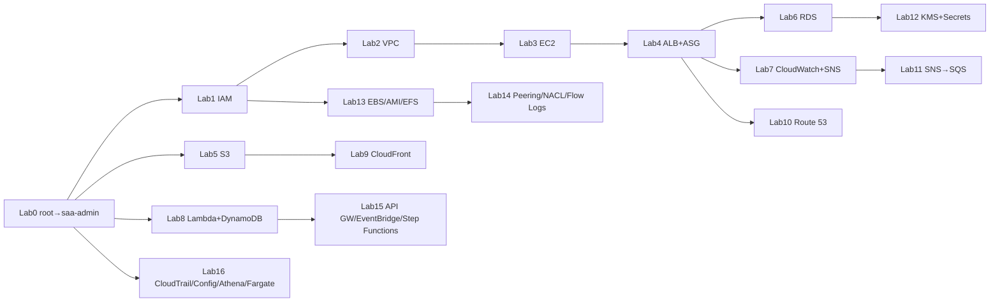

---

## 1. 環境準備與費用控管

### 1.1 需要的東西

1. 一個 AWS 帳號，root 使用者**已啟用 MFA**
2. 用 root 做完 [Lab 0](#lab-0以-root-建立管理員-saa-admin) 之後，**登出 root**，之後全部以 IAM 使用者 `saa-admin` 登入
3. 主控台右上角 Region 切到 **美國東部（維吉尼亞北部）us-east-1**（IAM、Route 53、CloudFront 是全域服務，右上角會顯示「全球」）
4. **AWS CloudShell**（主控台下方工具列或上方 `>_` 圖示）：已內建 AWS CLI、jq、Python，以「目前登入的身分」呼叫 API，不需要建立存取金鑰
5. 把本 repo 複製到 CloudShell：

```bash
git clone https://github.com/ChunPingWang/aws-saa-preparation.git
cd aws-saa-preparation
chmod +x scripts/*.sh
```

### 1.2 兩種做法

| 做法 | 適合 | 說明 |
|---|---|---|
| **主控台逐步操作**（本文主軸） | 第一次學、想看懂每個選項 | 照著每個 Step 的截圖點選 |
| **CLI 腳本** | 複習、想快速重建環境 | `scripts/00-admin-user.sh`（root 執行一次）→ `scripts/01-iam.sh` … `scripts/16-governance-data.sh` 依序執行（Lab 13–16 使用預設 VPC，可獨立於 Lab 2–12 執行；Lab 13 需要 `saa-ec2-ssm-role`） |

> 兩種做法擇一即可，不要混用同名資源（例如主控台已建了 `saa-lab-vpc`，就不要再跑 `02-vpc.sh`）。
> 腳本會把資源 ID 存到 `~/.saa-lab-state`，後面的 Lab 會自動讀取；`99-cleanup.sh` 讀不到狀態檔時會改用資源名稱查找，所以主控台建立的資源也能清。

### 1.3 費用提醒（us-east-1，數字為截圖當下主控台顯示或概略值，請以 AWS 定價頁為準）

| 資源 | 計費方式 | 本教學的數字 / 注意 |
|---|---|---|
| NAT 閘道 | 每小時 + 每 GB 處理量 | **最容易忘記刪的費用來源**；彈性 IP 也另計公有 IPv4 費 |
| Application Load Balancer | 每小時 + LCU | — |
| RDS Multi-AZ db.t3.micro + gp3 20 GiB | 每小時（Multi-AZ 約單 AZ 的 2 倍） | 主控台估算 **29.42 USD/月**（執行個體 24.82 + 儲存 4.60），做幾小時約 0.04 USD/小時 |
| EC2 t3.micro | 每小時 | 主控台顯示 0.0104 USD/小時；免費方案可能涵蓋 |
| 公有 IPv4 位址 | 每小時 | EC2 公有 IP、NAT 的彈性 IP 都算 |
| Secrets Manager | 每個機密每月 | RDS 託管密碼約 0.40 USD/月，隨 RDS 刪除 |
| KMS 客戶受管金鑰 | 每月每把（按時間比例） | 刪除只能「排程」（7–30 天）；等待期間的計費方式請以 KMS 定價頁為準 |
| Route 53 託管區域 | 每月每個 | 建立後 12 小時內刪除不收費 |
| EBS gp3 / 快照 / EFS（Lab 13） | 每 GB-月 | 1 GiB 磁碟區與快照、EFS 幾 KB，做完當天刪除幾乎為 0；**AMI 的快照要另外刪** |
| AWS Config（Lab 16） | 每個記錄的組態項目 + 每次規則評估 | 本教學只記錄 SG；「1-click 設定」記錄所有資源類型，帳號資源多時費用明顯 |
| Athena（Lab 16） | 每 TB 掃描量（有最低計費量） | 本教學 0.27 KB |
| ECS Fargate（Lab 16） | 每 vCPU-小時 + 每 GB-小時 | 0.25 vCPU / 0.5 GB，十幾分鐘不到 0.01 美元 |
| CloudFront WAF（若啟用） | 每月 | 精靈預設啟用，畫面估計約 14 USD/月 → 本教學改為不啟用 |

**建議**：先到 **Billing → Budgets** 建一個 5 美元的預算警示；做完當天就執行 [Lab 99](#lab-99清除資源)。

---

## 2. 最終架構與資源命名

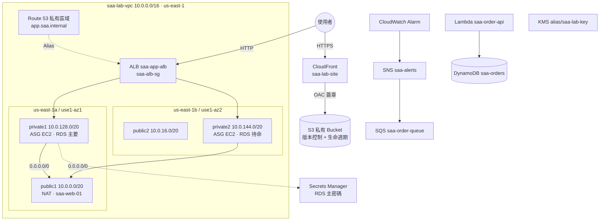

### 資源命名一覽

| 類別 | 名稱 |
|---|---|
| IAM（Lab 0，保留） | 群組 `saa-admins`（AdministratorAccess）、使用者 `saa-admin` |
| IAM（Lab 1、8） | 群組 `saa-developers`、使用者 `saa-dev-user`、角色 `saa-ec2-ssm-role`（含同名執行個體設定檔）、Lambda 角色 `saa-order-api-role-<亂碼>` |
| 網路 | `saa-lab-vpc`、`saa-lab-subnet-public1-us-east-1a`、`saa-lab-subnet-public2-us-east-1b`、`saa-lab-subnet-private1-us-east-1a`、`saa-lab-subnet-private2-us-east-1b`、`saa-lab-igw`、`saa-lab-nat-public1-us-east-1a`、`saa-lab-rtb-public`、`saa-lab-rtb-private1-us-east-1a`、`saa-lab-rtb-private2-us-east-1b`、`saa-lab-vpce-s3` |
| Security Group | `saa-web-sg`、`saa-alb-sg`、`saa-app-sg`、`saa-db-sg` |
| 運算 | `saa-web-01`、`saa-app-lt`、`saa-app-asg`、`saa-app-alb`、`saa-app-tg` |
| 資料 | `saa-lab-site-<日期>-<代號>`（S3）、`saa-lab-mysql`（RDS）、`saa-db-subnets`（DB 子網路群組）、`saa-orders`（DynamoDB） |
| Lab 13 | `saa-storage-sg`、`saa-storage-a` / `saa-storage-b`、`saa-data-vol` / `saa-data-vol-b`、`saa-data-snap`、`saa-storage-ami`、`saa-efs`（皆在預設 VPC） |
| Lab 14 | `saa-peer-vpc`（10.20.0.0/16）、`saa-peer-subnet-public1-us-east-1a`、`saa-peer-rtb-public`、`saa-peer-sg`、`saa-peer-b`、`saa-default-to-peer`（Peering）、`saa-peer-nacl`、`saa-peer-flowlog` → `/saa/vpc-flow-logs`、`saa-flowlogs-role` |
| Lab 15 | `saa-hello`（Lambda）、`saa-hello-api`（REST API，階段 `dev`）、`saa-order-flow`（Step Functions）、`saa-order-created-rule`（EventBridge） |
| Lab 16 | `config-bucket-<帳號>`、規則 `restricted-ssh`、`saa-bad-ssh-sg`（示範用）、`saa-lab-athena-<帳號>`、Glue 資料庫 `saa_lab.orders`、`saa-ecs-cluster`、任務定義 `saa-nginx`、`saa-ecs-sg` |
| 其他 | `saa-order-api`（Lambda）、`saa-alerts`（SNS）、`saa-asg-high-cpu`（警示）、`saa-order-queue`（SQS）、`saa.internal`（Route 53）、`alias/saa-lab-key`（KMS） |

### 本次實作的實際 ID（對照截圖用；你的帳號會不同）

| 資源 | ID / 值 |
|---|---|
| VPC | `vpc-079b71ddf0b994251`（10.0.0.0/16） |
| 子網路 | public1 `subnet-043a4f8749b117434`、public2 `subnet-03667ba5e12944c1b`、private1 `subnet-0e2e893a3d355644a`、private2 `subnet-0a74dfe485ddc303c` |
| IGW / NAT / EIP | `igw-0a49dfd8d637de8c1` / `nat-0f60feebd80feedbe`（公有 IP 44.193.180.167、私有 IP 10.0.11.68） / `eipalloc-0939294cbde9f55b5` |
| 路由表 | public `rtb-0e986dce7ced8975f`、private1 `rtb-085374ace2e08952d`、private2 `rtb-0ed448de539d2fea4`、主路由表 `rtb-0671478ac39f535a7` |
| S3 閘道端點 / 前綴清單 | `vpce-0221db099d26928a5` / `pl-63a5400a` |
| EC2 saa-web-01 | `i-0ee8bea4ef6733d6d`（44.211.180.163 / 10.0.8.168） |
| SG | web `sg-03a644f1f66da19d3`、alb `sg-0a136f7c1b666fe8d`、app `sg-024f7810f6c18d78b`、db `sg-00650642f1ae46a57` |
| ALB | `saa-app-alb-247025738.us-east-1.elb.amazonaws.com`（託管區域 `Z35SXDOTRQ7X7K`） |
| 啟動範本 / ASG 執行個體 | `lt-03adf5882137b94b2` / `i-02ef56df75a10660f`（1a）、`i-0390f5e1e23338334`（1b） |
| S3 Bucket | `saa-lab-site-20261101-rexw` |
| RDS 端點 | `saa-lab-mysql.ce3m4mie20qx.us-east-1.rds.amazonaws.com` |
| CloudFront | `EUKAZSJVDSUTH` / `d3flqtcyxpfjgo.cloudfront.net` |
| Route 53 私有區域 | `Z1009820L3HZVDFZ8PMZ` |
| KMS 金鑰 | `a7efc158-55aa-409d-9380-7e48419f9268` |
| RDS 託管機密 | `rds!db-1402a6e3-ca0f-4ba8-bc24-e3a3393d8c67` |
| Lab 13 | 預設 VPC `vpc-06c8ce0a3b085ebae`、`saa-storage-a` `i-028de14b85d34f75e`（1a）、`saa-storage-b` `i-02e8524c751113638`（1b）、磁碟區 `vol-0469157e086aa9cf5` / `vol-00cc75a69328cb7a4`、快照 `snap-00a185fccbbe4b541`、AMI `ami-00cc424353c263e5d`、EFS `fs-0859ca7535456cd12` |
| Lab 14 | `saa-peer-vpc` `vpc-02d6349747a45724f`、Peering `pcx-00880416443e4a1a0`、`saa-peer-b` `i-090e32040e4b1abb6`（10.20.6.241）、NACL `acl-05f6d768e3f6adefe`、Flow Log `fl-0e6eb668c4c20b07d` |
| Lab 15 | REST API `db8opqi0ql`、部署 `u7178z` |
| Lab 16 | Fargate 任務 `a8d1033c143947f1ab11986a356ae0ae`（172.31.71.61 / 44.221.43.184）、`saa-bad-ssh-sg` `sg-030848afb4bdd0220` |

---

## 3. 身分與帳號規劃

在 AWS 上「誰在操作」決定了能做什麼、出事時能不能追查。本教學用到四種身分概念：

| 身分 | 是什麼 | 憑證 | 本教學怎麼用 |
|---|---|---|---|
| **root 使用者** | 建立 AWS 帳號時的電子郵件身分，擁有帳號的**全部權限**，IAM 政策無法限制它（只有 Organizations 的 SCP 能限制成員帳號的 root） | 電子郵件 + 密碼 + MFA | **只在 Lab 0 使用**：建立第一個管理員後就登出 |
| **IAM 使用者** | 在帳號內建立的長期身分，代表一個人或（少數舊系統的）程式 | 主控台密碼、存取金鑰（都是長期憑證）、MFA | Lab 0 建立 `saa-admin`（管理員，Lab 1–12 都用它）；Lab 1 建立 `saa-dev-user`（示範一般開發者） |
| **IAM 角色** | 沒有長期密碼或金鑰的身分，由被信任的對象「擔任（AssumeRole）」後取得 STS **臨時憑證** | 臨時憑證（自動到期） | Lab 1 的 `saa-ec2-ssm-role` 給 EC2；Lab 8 的 Lambda 執行角色 |
| **IAM Identity Center**（原 AWS SSO） | 集中管理「人」的登入：一組帳號密碼（或企業 IdP）＋ MFA，透過**權限集**登入多個 AWS 帳號，背後其實是角色與臨時憑證 | 入口網站登入 → 臨時憑證 | 本教學不啟用（需規劃 Organizations）；列在 Lab 1 延伸練習 |

**為什麼只用 root 做 Lab 0？**

1. root 不能被 IAM 政策限制，一旦密碼外洩就是整個帳號失守；日常操作應該用「可被限制、可被稽核、可被停用」的身分。
2. 真正**必須**用 root 的工作很少，例如：變更帳號根電子郵件與 root 密碼、關閉帳號、在 IAM 管理員都被鎖住時恢復權限、某些帳單與支援方案設定、S3 **MFA Delete** 的啟用。這些都不在本教學範圍內。
3. 新帳號一開始只有 root，所以「用 root 建立第一個管理員」是唯一需要 root 的步驟。建完之後 root 就應該：已啟用 MFA、**沒有存取金鑰**、密碼與 MFA 裝置妥善保管、登出。
4. CloudTrail 記錄的是「哪個身分」呼叫 API。所有 Lab 都用 `saa-admin`，Session Manager 的工作階段 ID 也會以 `saa-admin-` 開頭（見 lab03-08），稽核時一目了然。

> **實務上的進一步做法**：多帳號環境用 **Organizations + IAM Identity Center**，人員一律走 SSO 取得臨時憑證，IAM 使用者只留給無法使用聯合身分的少數情境（甚至完全不建）。本教學因為是單一個人帳號、要讓你看到 IAM 使用者與密碼的完整生命週期，所以選擇 IAM 使用者 `saa-admin`。四種憑證的完整比較見 [Lab 1 的比較表](#四種登入存取方式比較)。

---

## Lab 0：以 root 建立管理員 saa-admin

> **本 Lab 操作身分與環境**
>
> | 項目 | 內容 |
> |---|---|
> | 操作身分 | **root 使用者**（帳號擁有者電子郵件）。這是整份教學**唯一**用 root 的 Lab |
> | 登入方式 | https://console.aws.amazon.com/ → 登入頁選「Sign in using root user email」→ 電子郵件 → 密碼 → MFA |
> | 區域 | IAM 是全域服務（右上角顯示「全球」）；之後的 Lab 一律切到 us-east-1 |
> | 前置條件 | 已有 AWS 帳號，root 已啟用 MFA |
> | 預估時間 / 費用 | 約 10 分鐘 / 0 USD（IAM 不計費） |

**目標**：用 root 建立管理員群組 `saa-admins`（AdministratorAccess）與 IAM 使用者 `saa-admin`（主控台密碼、首次登入須改密碼），然後登出 root、改用 `saa-admin` 登入。

### Step 0-1　確認目前是 root 登入，並檢查 IAM 安全建議

**進入路徑**：主控台 → 服務 → IAM → 儀表板 → 點右上角帳號名稱

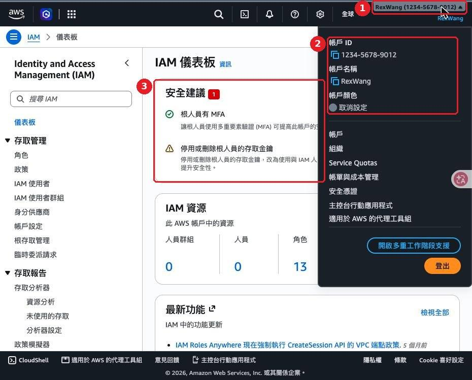

1. 點右上角帳號名稱展開帳號選單。
2. 選單顯示「帳戶 ID」（12 位數字，圖中已遮蔽為 1234-5678-9012）、「帳戶名稱」與「帳戶顏色」，**沒有「IAM 使用者」欄位**——這就是 root 登入的特徵。對照 [lab01-01](#step-1-1確認目前以-saa-admin-登入)：用 IAM 使用者登入時，選單會多出「IAM 使用者：saa-admin」。
3. IAM 儀表板的「安全建議」：「根人員有 MFA」已打勾（完成）；「停用或刪除根人員的存取金鑰」提醒 root 不應該有存取金鑰，改用 IAM 身分。下方「IAM 資源」顯示人員群組 0、人員 0：帳號裡還沒有任何 IAM 使用者，所以這一步只能用 root 做。

> **為什麼**：root 有 MFA、沒有存取金鑰，是 AWS 對 root 最基本的兩項要求。存取金鑰若外洩，攻擊者可以不經 MFA 直接呼叫所有 API。

### Step 0-2　建立管理員群組 saa-admins

**進入路徑**：IAM → 左側「IAM 使用者群組」→「建立群組」

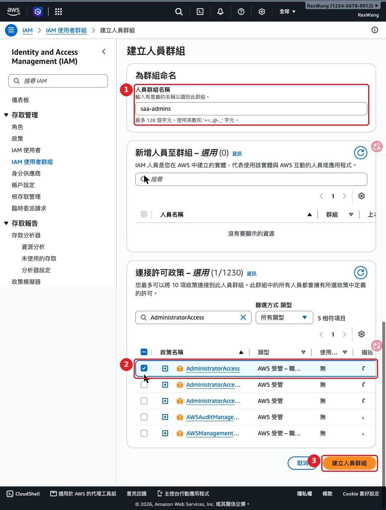

1. 「人員群組名稱」輸入 `saa-admins`（最多 128 字元，英數與 `+=,.@-_`）。
2. 「連接許可政策」搜尋 `AdministratorAccess`，勾選第一列（類型「AWS 受管 – 職務」）。注意搜尋結果還有名稱相近的 `AdministratorAccess-Amplify`、`AdministratorAccess-AWSElasticBeanstalk` 等，不要勾錯；標題計數變成「(1/1230)」。
3. 按「建立人員群組」。「新增人員至群組」先留空（使用者還沒建立）。

> **為什麼權限掛在群組**：日後多一位管理員只要加入群組，離職時移出群組即可，不必逐一修改使用者的政策。

### Step 0-3　建立使用者 saa-admin：主控台存取與密碼

**進入路徑**：IAM → 左側「IAM 使用者」→「建立人員」→ 步驟 1 指定人員詳細資訊

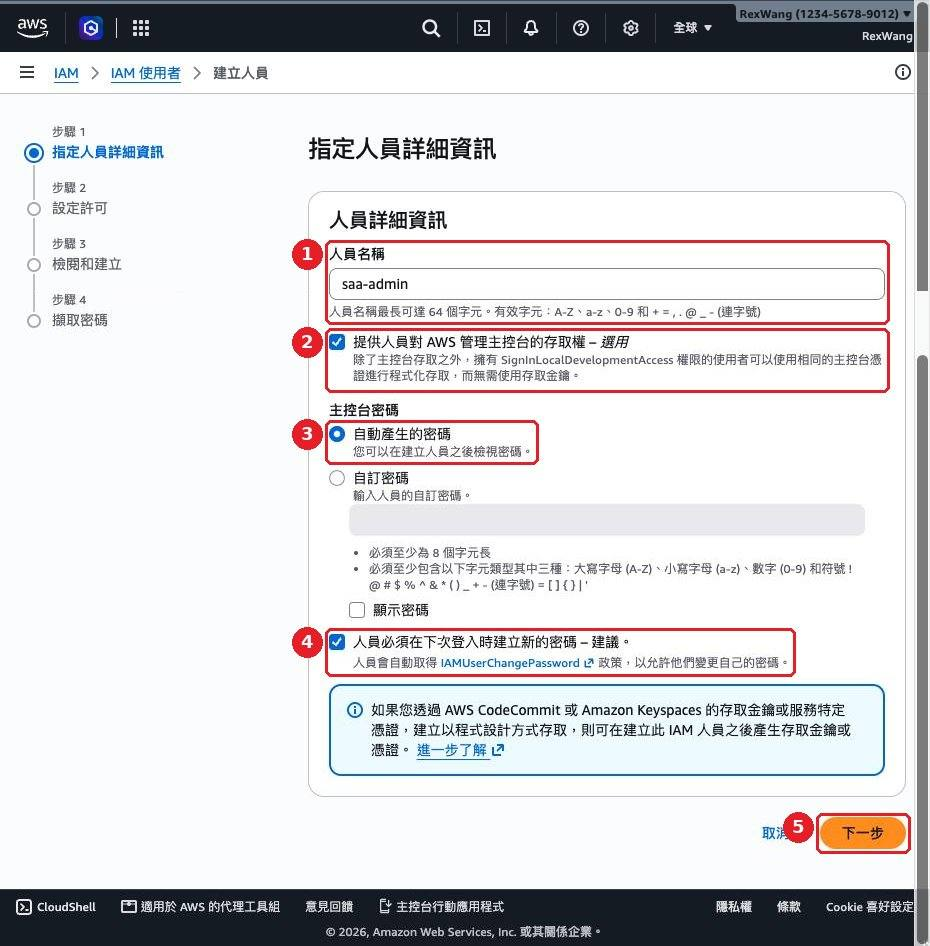

1. 「人員名稱」輸入 `saa-admin`（最長 64 字元）。
2. 勾選「提供人員對 AWS 管理主控台的存取權 – 選用」。不勾的話使用者沒有主控台密碼，只能用程式化方式存取。
3. 「主控台密碼」選 **自動產生的密碼**（預設）：AWS 產生一組隨機強密碼，在最後一步顯示一次。另一個選項「自訂密碼」需自行輸入，畫面列出規則：**至少 8 個字元**，且大寫、小寫、數字、符號 `! @ # $ % ^ & * ( ) _ + - = [ ] { } | '` 四類中**至少三類**（這是帳號的預設密碼政策，見 [lab01-08](#step-1-8密碼政策只看不改)）。兩者比較見 [Lab 1 的密碼說明](#iam-使用者的帳號與密碼完整說明)。
4. 勾選「**人員必須在下次登入時建立新的密碼 – 建議**」（預設已勾）。勾選後使用者會自動取得 AWS 受管政策 `IAMUserChangePassword`，才有權限改自己的密碼；管理員也就不會知道使用者最終的密碼。
5. 按「下一步」。

> 藍色提示框說明：存取金鑰、CodeCommit / Keyspaces 的服務特定憑證，要在使用者建立之後另外產生。本教學**不建立存取金鑰**。

### Step 0-4　設定許可：加入 saa-admins 群組

**進入路徑**：建立人員精靈 → 步驟 2 設定許可

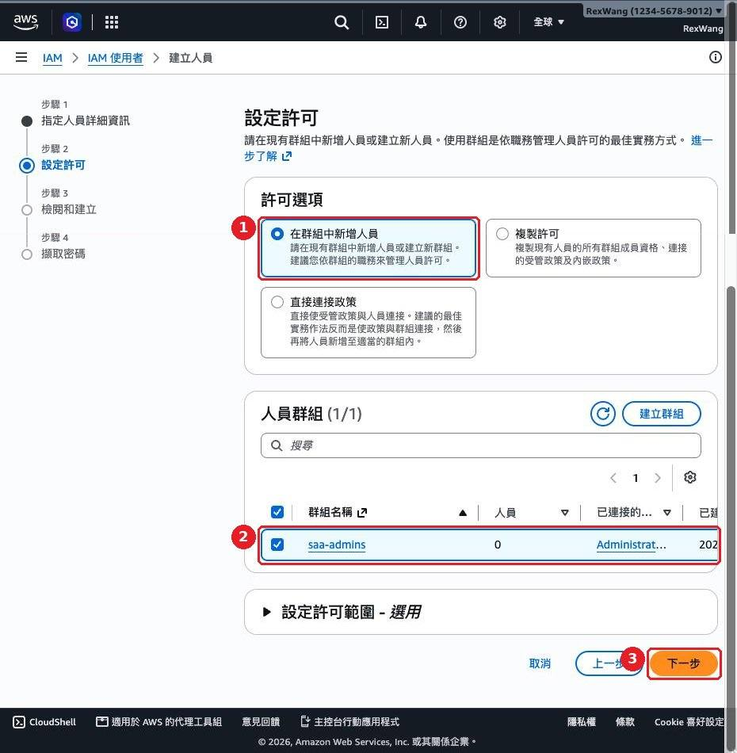

1. 「許可選項」選 **在群組中新增人員**（預設，也是 AWS 建議的做法）。另兩個選項：「複製許可」——從現有使用者複製群組成員資格與政策；「直接連接政策」——把政策直接掛在使用者身上（不建議，難以維護）。
2. 在「人員群組 (1/1)」勾選 `saa-admins`（已連接的政策欄顯示 AdministratorAccess）。
3. 按「下一步」。「設定許可範圍 – 選用」（Permissions boundary）不設定。

### Step 0-5　檢閱和建立

**進入路徑**：建立人員精靈 → 步驟 3 檢閱和建立

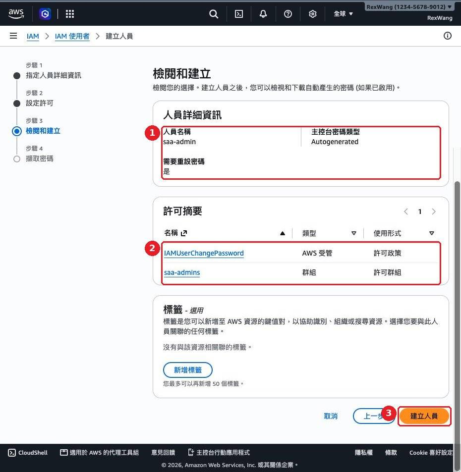

1. 「人員詳細資訊」：人員名稱 `saa-admin`、主控台密碼類型 **Autogenerated**、需要重設密碼 **是**。
2. 「許可摘要」有兩列：`IAMUserChangePassword`（AWS 受管、許可政策——因為勾了「下次登入時建立新密碼」而自動加上）與 `saa-admins`（群組、許可群組）。
3. 按「建立人員」。標籤不加。

### Step 0-6　擷取密碼（唯一一次機會）

**進入路徑**：建立人員精靈 → 步驟 4 擷取密碼（按「建立人員」後自動進入）

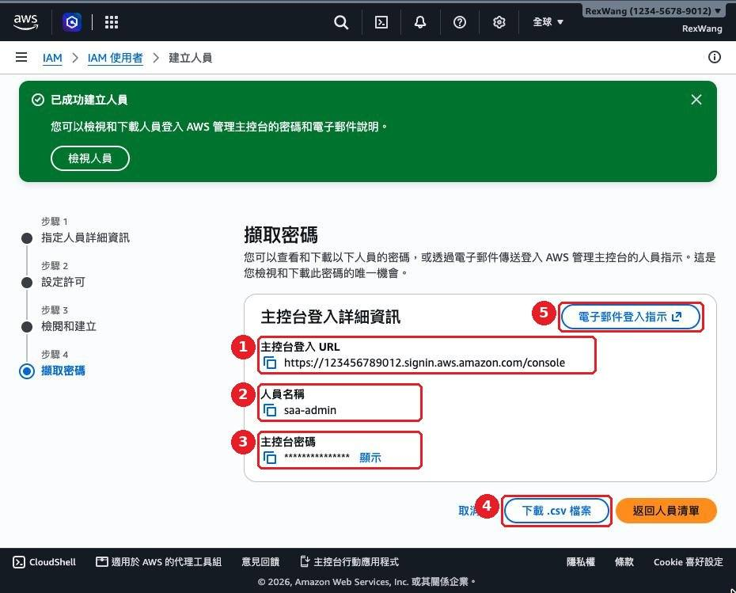

1. 「主控台登入 URL」：`https://123456789012.signin.aws.amazon.com/console`（真實帳號 ID 已遮蔽）。這是 IAM 使用者專用的登入網址，網址裡已經帶入帳號 ID。
2. 「人員名稱」：`saa-admin`。
3. 「主控台密碼」：以 `***************` 遮蔽，按「顯示」才看得到。
4. 「下載 .csv 檔案」：下載包含使用者名稱、密碼、登入 URL 的 CSV。
5. 「電子郵件登入指示」：開啟郵件軟體產生一封登入說明信（**信中不含密碼**，密碼要用另一個安全管道交付）。

> **注意**：頁面寫著「這是您檢視和下載此密碼的唯一機會」。離開此頁後就再也看不到這組自動產生的密碼；遺失時只能由管理員（此時就是 root）**重設**。請先按「顯示」把密碼存到密碼管理器，或下載 CSV 後妥善保管並在改密碼後刪除。截圖時刻意沒有按「顯示」。

### Step 0-7　登出 root，改用 IAM 使用者登入

**進入路徑**：右上角帳號選單 →「登出」→ 開啟上一步的主控台登入 URL

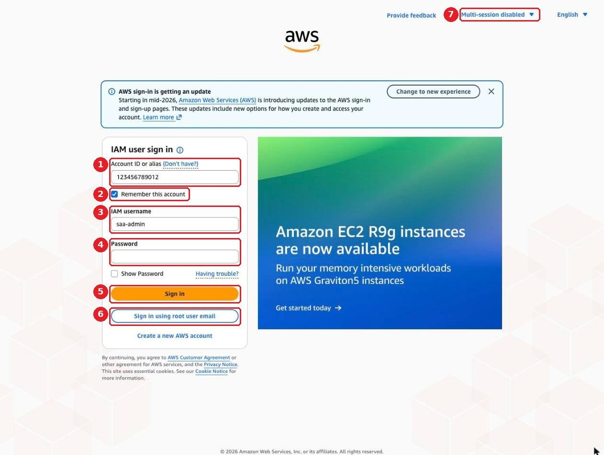

1. **Account ID or alias**：帳號 ID（12 位數字）或帳號別名。用上一步的登入 URL 開啟時會自動帶入；從一般登入頁進來則要自己輸入。旁邊「(Don't have?)」說明去哪裡查。
2. **Remember this account**：記住帳號 ID，下次不用再輸入（公用電腦不要勾）。
3. **IAM username**：輸入 `saa-admin`（區分大小寫的使用者名稱，不是電子郵件）。
4. **Password**：輸入上一步取得的初始密碼。可勾「Show Password」確認輸入；「Having trouble?」是登入問題說明（IAM 使用者忘記密碼**不能自助重設**，只能找管理員）。
5. **Sign in**：登入。
6. **Sign in using root user email**：root 使用者走這個按鈕（輸入電子郵件 → 密碼 → MFA）。IAM 使用者不要按這裡。
7. **Multi-session**（右上角開關）：開啟後同一個瀏覽器可以同時登入多個身分（例如 root 與 saa-admin、或不同帳號），各自在不同分頁使用；本教學保持 disabled，避免搞混操作身分。

**首次登入改密碼**（此畫面未截圖）：按下 Sign in 後會出現「變更密碼」頁面，要輸入 **舊密碼**（上一步的初始密碼）一次、**新密碼**兩次。新密碼必須符合帳號密碼政策；改完才會進入主控台。這一步能成功，靠的就是 Step 0-5 自動附加的 `IAMUserChangePassword`。

**登入後立刻做**：IAM → IAM 使用者 → `saa-admin` →「安全憑證」分頁 →「指派 MFA 裝置」（通行金鑰/安全金鑰、驗證器應用程式或硬體 TOTP 擇一）。管理員帳號沒有 MFA，在 lab01-01 的儀表板上會被提醒「為您自己新增 MFA」。

### CLI 等效

```bash
# 以 root（或既有管理員）在 CloudShell 執行；密碼只印出一次
./scripts/00-admin-user.sh
```

腳本會：建立 `saa-admins` + AdministratorAccess → 建立 `saa-admin` 並加入群組 → 附加 `IAMUserChangePassword` → 用 `openssl rand` 產生 21 字元隨機密碼（大寫、小寫、數字、符號四類都有）並以 `--password-reset-required` 建立主控台密碼 → 印出登入 URL（有帳號別名時也列出別名網址）。腳本不建立任何存取金鑰。

### 實務情境

- **銀行**：root 的電子郵件用部門共用信箱、MFA 硬體金鑰放保險箱，由兩人分持（帳號密碼與 MFA 分開保管），每次使用 root 都要開單並在 CloudTrail 事後覆核；日常管理員走 SSO。
- **製造**：工廠 IT 常只有一兩位管理員。至少建兩個管理員身分（避免唯一管理員離職或遺失 MFA 時只能動用 root），並在 IAM 儀表板設帳號別名，讓登入網址好記。
- **零售**：外包廠商需要進主控台時，建立獨立的 IAM 使用者或角色、限定期限，不要給 root 或共用管理員帳號。

### 延伸練習

1. 用 root 確認 **安全憑證** 頁沒有任何根存取金鑰；若有，停用後刪除。
2. 為 `saa-admin` 指派第二個 MFA 裝置（每位使用者最多 8 個），模擬主要裝置遺失時的備援。
3. 在 IAM 儀表板建立 **帳號別名**，比較 `https://<別名>.signin.aws.amazon.com/console` 與帳號 ID 網址（別名全球唯一）。
4. 在 **Billing → Budgets** 建立 5 美元預算並寄送通知到 root 信箱。

### 考試重點

- root：啟用 MFA、**不建立存取金鑰**、只做必須用 root 的帳號層級工作
- 第一個管理員應是 IAM 使用者（或 Identity Center 使用者），權限透過**群組**授予
- 需要用 root 的工作舉例：變更帳號設定/根電子郵件、關閉帳號、S3 MFA Delete、恢復被鎖住的 IAM 權限
- 多帳號環境用 **SCP** 可以限制成員帳號的 root；單一帳號內 IAM 政策無法限制 root

---

## Lab 1：IAM 群組、使用者密碼與 EC2 角色

> **本 Lab 操作身分與環境**
>
> | 項目 | 內容 |
> |---|---|
> | 操作身分 | IAM 使用者 **`saa-admin`**（群組 `saa-admins`，AdministratorAccess） |
> | 登入方式 | `https://123456789012.signin.aws.amazon.com/console` → IAM username `saa-admin` → 密碼 →（若已設定）MFA |
> | 區域 | IAM 為全域服務；主控台右上角保持 us-east-1 即可 |
> | 前置條件 | Lab 0（`saa-admin` 已可登入） |
> | 預估時間 / 費用 | 約 20 分鐘 / 0 USD |

**目標**：用「群組授權、角色給服務」的方式落實最小權限：建立開發者群組 `saa-developers`、有主控台密碼的使用者 `saa-dev-user`，以及後續 EC2 會用到的角色 `saa-ec2-ssm-role`；並完整理解 IAM 使用者的帳號密碼機制。

### 觀念

| 身分 | 用途 | 憑證 |
|---|---|---|
| IAM User | 代表「人」或少數舊系統 | 長期：主控台密碼、存取金鑰 |
| IAM Group | 一群使用者共用權限，**不能被當作 Principal**（政策裡不能寫「允許某群組」） | 無 |
| IAM Role | 給 AWS 服務、跨帳號或聯合身分「暫時扮演」 | 短期：STS 臨時憑證 |
| Instance Profile | 把 Role 裝進 EC2 的容器（主控台建立 EC2 角色時會自動建立同名設定檔） | — |

### Step 1-1　確認目前以 saa-admin 登入

**進入路徑**：主控台 → IAM → 儀表板 → 右上角帳號選單

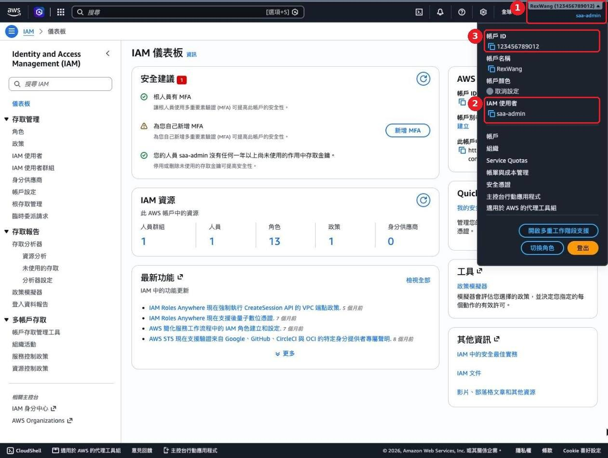

1. 右上角帳號名稱下方的小字顯示目前登入的身分 `saa-admin`。
2. 展開的選單多了「**IAM 使用者：saa-admin**」——代表這次是用 IAM 使用者登入，而不是 root（對照 [lab00-01](#step-0-1確認目前是-root-登入並檢查-iam-安全建議) 的 root 選單沒有這一欄）。
3. 「帳戶 ID」是 12 位數字（已遮蔽為 123456789012），IAM 使用者登入 URL 會用到它。

> 畫面上的「安全建議」：「根人員有 MFA」已完成，另提醒「為您自己新增 MFA」——`saa-admin` 還沒有綁 MFA，正式環境務必補上。「IAM 資源」：人員群組 1、人員 1、角色 13（多為 AWS 服務連結角色）。

### Step 1-2　建立群組 saa-developers 並附加兩個唯讀政策

**進入路徑**：IAM → 左側「IAM 使用者群組」→「建立群組」

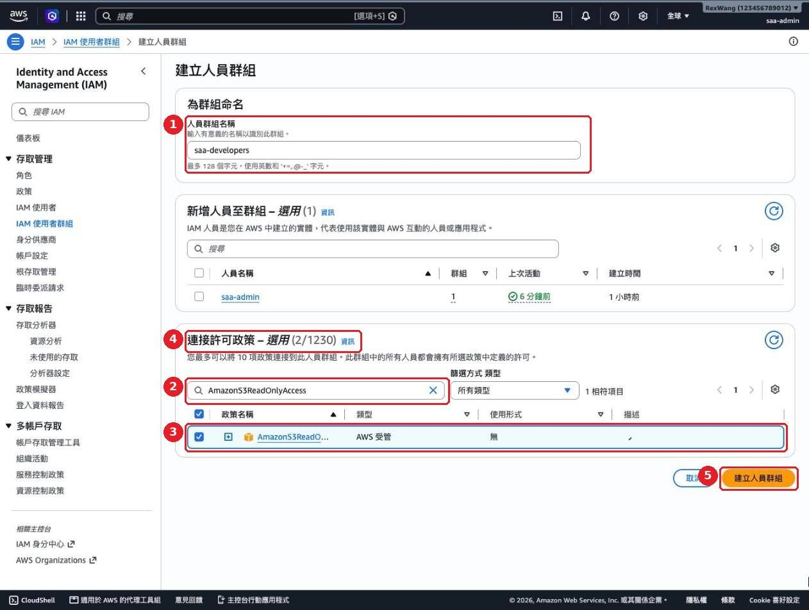

1. 「人員群組名稱」輸入 `saa-developers`。
2. 在「連接許可政策」搜尋框輸入政策名稱並按 Enter。政策共有 1230 個，一定要用搜尋：先搜尋 `AmazonEC2ReadOnlyAccess` 勾選，再按 X 清除、改搜尋 `AmazonS3ReadOnlyAccess` 勾選（前一次的勾選會保留）。
3. 畫面顯示第二次搜尋結果 `AmazonS3ReadOnlyAccess`（AWS 受管）已勾選。
4. 標題計數變成「**(2/1230)**」，確認兩個政策都已勾選。
5. 按「建立人員群組」。

> 一個群組最多可連接 10 個受管政策。「新增人員至群組」先不加。

### Step 1-3　建立使用者 saa-dev-user：主控台存取與密碼

**進入路徑**：IAM → 「IAM 使用者」→「建立人員」→ 步驟 1

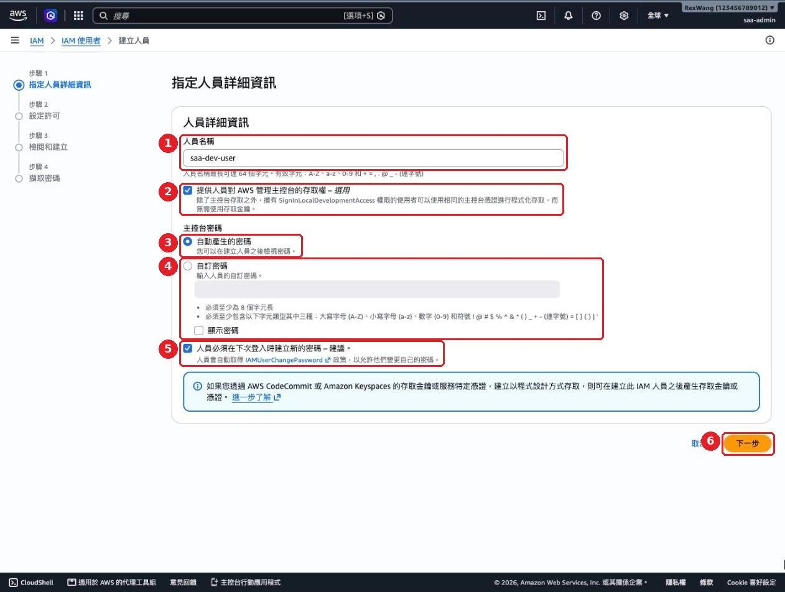

1. 「人員名稱」輸入 `saa-dev-user`。
2. 勾選「提供人員對 AWS 管理主控台的存取權 – 選用」，下方才會出現主控台密碼設定。
3. 「主控台密碼」選 **自動產生的密碼**（預設）。
4. 另一個選項「**自訂密碼**」：自行輸入，畫面列出的規則就是帳號密碼政策（至少 8 字元、四類字元中至少三類），可勾「顯示密碼」。本 Lab 不使用。
5. 勾選「人員必須在下次登入時建立新的密碼 – 建議」（預設）→ 自動附加 `IAMUserChangePassword`。
6. 按「下一步」。

> 精靈共 4 步（指定人員詳細資訊 → 設定許可 → 檢閱和建立 → 擷取密碼）；第 4 步只在勾選主控台存取時出現。

### Step 1-4　設定許可：加入 saa-developers

**進入路徑**：建立人員精靈 → 步驟 2 設定許可

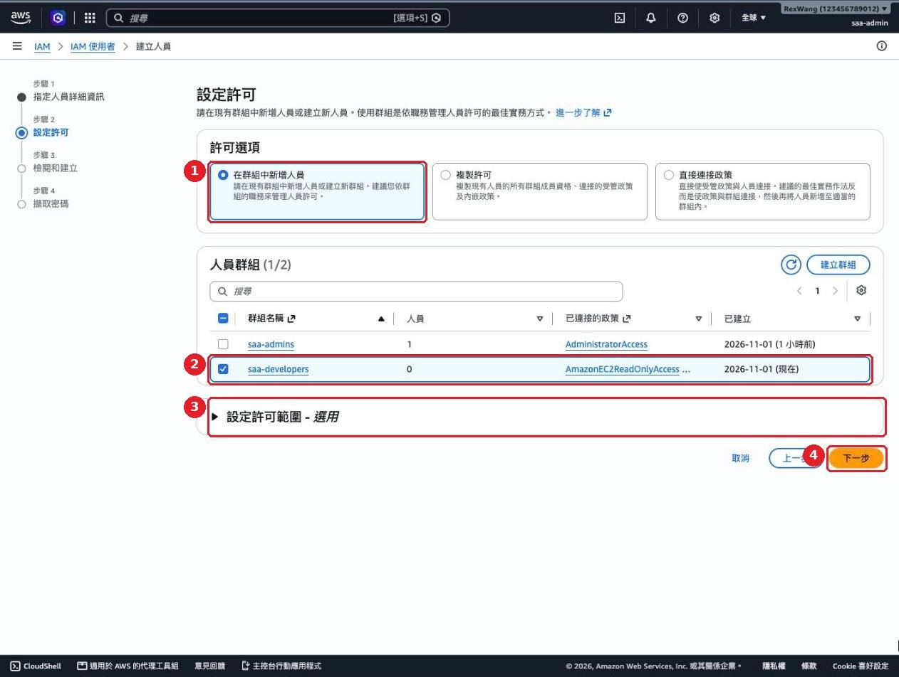

1. 「許可選項」選 **在群組中新增人員**（預設）。
2. 在「人員群組 (1/2)」**只勾** `saa-developers`（已連接政策 AmazonEC2ReadOnlyAccess …）。不要勾 `saa-admins`——那是管理員群組。
3. 「設定許可範圍 – 選用」（Permissions boundary，權限上限）不展開；它常用於「讓團隊自己建角色，但權限不能超過上限」的委派情境，見延伸練習。
4. 按「下一步」。

### Step 1-5　檢閱和建立

**進入路徑**：建立人員精靈 → 步驟 3

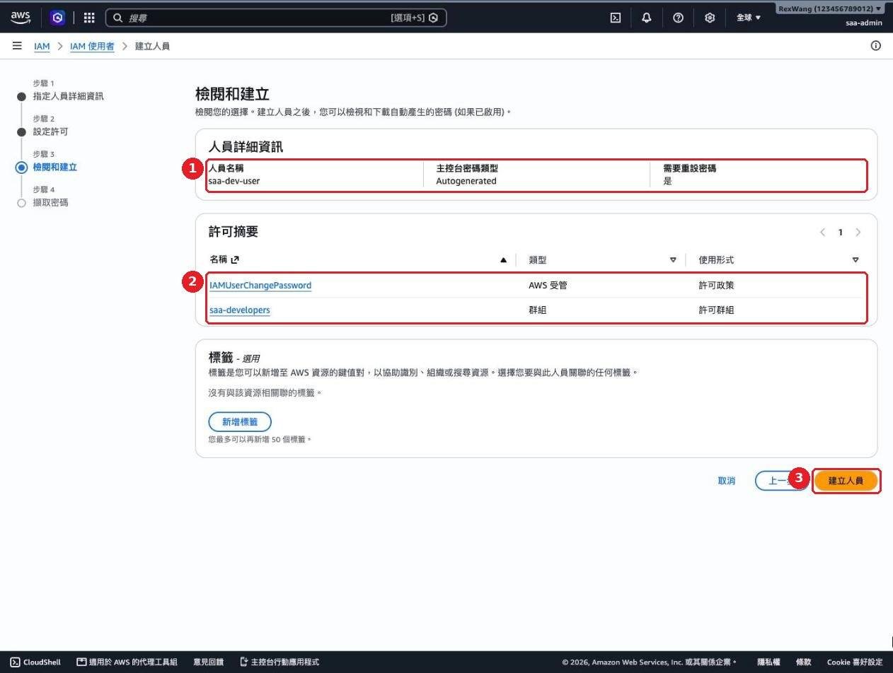

1. 「人員詳細資訊」：saa-dev-user、主控台密碼類型 **Autogenerated**、需要重設密碼 **是**。
2. 「許可摘要」：`IAMUserChangePassword`（AWS 受管、許可政策）與 `saa-developers`（群組）。
3. 按「建立人員」。

### Step 1-6　擷取密碼（只看不顯示、不下載）

**進入路徑**：建立人員精靈 → 步驟 4

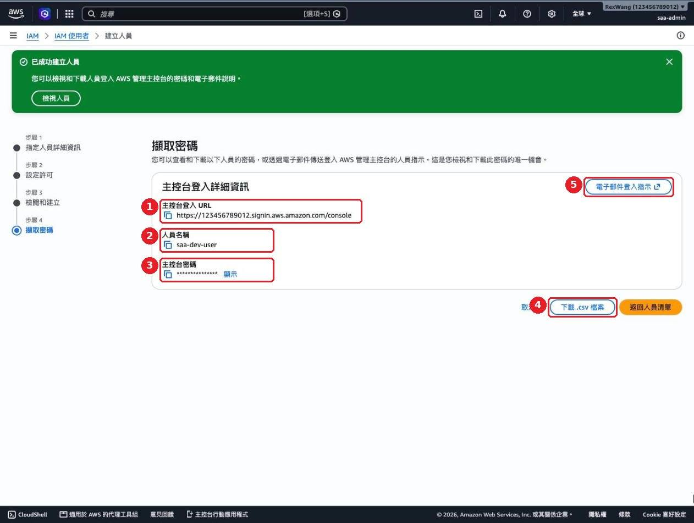

1. 「主控台登入 URL」：`https://<帳戶ID>.signin.aws.amazon.com/console`。
2. 「人員名稱」：saa-dev-user。
3. 「主控台密碼」：遮蔽，旁邊有「顯示」。本教學截圖時**不點顯示**。
4. 「下載 .csv 檔案」：使用者名稱、密碼、登入 URL。
5. 「電子郵件登入指示」：產生登入說明信（不含密碼）。

> **陷阱**：直接按「返回人員清單」會跳出「繼續執行而不檢視或下載主控台密碼？」的確認框——按「繼續」之後這組密碼就永遠拿不到了，只能重設。本 Lab 為了不暴露密碼而按「繼續」，實務上請先交付密碼。回到清單後 saa-dev-user 的「密碼期限」欄顯示「現在」（下次登入必須變更）。

### Step 1-7　使用者的「安全憑證」分頁

**進入路徑**：IAM → IAM 使用者 → `saa-dev-user` →「安全憑證」分頁

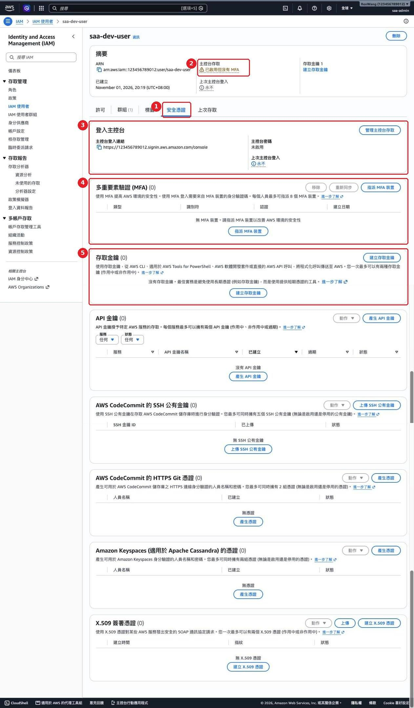

1. 點「安全憑證」分頁（其他分頁：許可、群組 (1)、標籤、上次存取）。
2. 摘要的「主控台存取」顯示「**已啟用但沒有 MFA**」：主控台登入已開啟、尚未綁 MFA；「上次主控台登入」：永不。
3. 「登入主控台」區塊：主控台登入連結與上次登入時間；右上「**管理主控台存取**」可以停用主控台存取或**重設密碼**（忘記密碼就是在這裡處理）。
4. 「多重要素驗證 (MFA) (0)」：無 MFA 裝置，可按「指派 MFA 裝置」（每位使用者最多 8 個）。
5. 「存取金鑰 (0)」：沒有存取金鑰；畫面提醒最佳實務是避免長期憑證，改用提供短期憑證的方式。

> **畫面不一致（照實說明）**：截圖當下「登入主控台」區塊裡的「主控台密碼」欄位顯示「**未啟用**」，但同一頁摘要的「主控台存取」是「**已啟用但沒有 MFA**」，Step 1-5 的檢閱頁也顯示 Autogenerated。這是建立後立即查看、區塊尚未刷新的現象；判斷能否登入請以摘要的「主控台存取」為準，或重新整理頁面再看，也可以用 CLI `aws iam get-login-profile --user-name saa-dev-user` 確認（有回傳 LoginProfile 就代表有主控台密碼）。另外，摘要右側的「存取金鑰 1 / 建立存取金鑰」是欄位標題與建立連結，**不代表已有 1 把金鑰**。往下還有 API 金鑰、CodeCommit SSH/HTTPS 憑證、Keyspaces 憑證、X.509 簽署憑證，全部為 0。

### Step 1-8　密碼政策（只看不改）

**進入路徑**：IAM → 左側「帳戶設定」

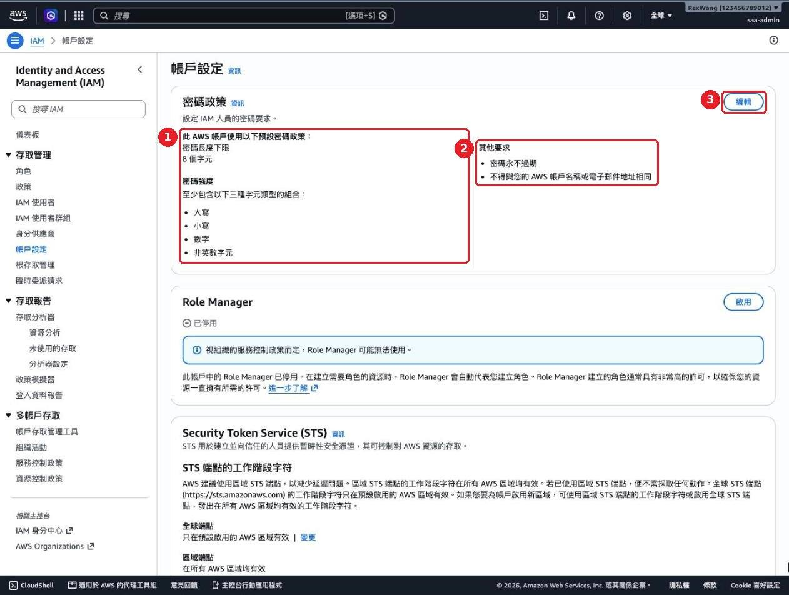

1. 「此 AWS 帳戶使用以下預設密碼政策」：密碼長度下限 **8 個字元**；強度要求**大寫、小寫、數字、非英數字元四類中至少三類**——這正是 Step 1-3「自訂密碼」下方列出的規則來源。
2. 「其他要求」：**密碼永不過期**；不得與 AWS 帳戶名稱或電子郵件地址相同。
3. 「編輯」可改成自訂密碼政策（例如最少 14 字元、四類都要、90 天到期、禁止重複使用前 N 組、到期後需管理員重設、是否允許使用者自行變更密碼）。本教學**不修改**帳戶設定；銀行等受稽核環境通常會改成自訂政策。

> 同頁下方還有「Security Token Service (STS)」區塊：全球端點只在預設啟用的區域有效、區域端點在所有區域有效，AWS 建議使用區域 STS 端點。

### IAM 使用者的帳號與密碼完整說明

#### 主控台密碼：自動產生 vs 自訂

| 項目 | 自動產生的密碼（Autogenerated） | 自訂密碼（Custom） |
|---|---|---|
| 強度 | AWS 產生的隨機強密碼，一定符合政策 | 取決於管理員；只要符合政策下限（預設 8 字元、三類）就能通過，容易出現「Company2026!」這類弱密碼 |
| 管理員是否知道 | 只在「擷取密碼」頁出現一次；若勾「下次登入須變更」，管理員不會知道最終密碼 | 管理員一定知道（自己輸入的）；必須搭配「下次登入須變更」 |
| 交付方式 | 顯示 / 下載 CSV，要另外用安全管道交付 | 可事先約定，但同樣不該用明文 Email 或聊天軟體 |
| 遺失 | 離開頁面就看不到，只能重設 | 管理員記得就能再告訴使用者（但這本身就是風險） |
| 優點 | 強度有保障、不會重複、適合一次建立多人 | 可以配合既有流程（例如密碼信封、臨時密碼規則）；可批次用腳本產生後匯入 |
| 缺點 | 只有一次擷取機會，忘了存就要重設 | 人為產生容易弱、容易重複使用 |
| 適用時機 | **預設首選**；個人或小團隊建立帳號 | 自動化建帳號（如本 repo 的 `scripts/00-admin-user.sh` 用 `openssl rand` 產生後以自訂密碼建立）、需配合公司既有臨時密碼流程 |

兩種方式都應勾選「**人員必須在下次登入時建立新的密碼**」：主控台會自動附加 `IAMUserChangePassword`，讓使用者有 `iam:ChangePassword` 權限；用 CLI 建立時要自己附加（`aws iam attach-user-policy ... IAMUserChangePassword`），或在密碼政策開啟「允許使用者變更自己的密碼」。

#### 首次登入改密碼流程

1. 使用者開啟登入 URL（或一般登入頁 → 輸入帳號 ID / 別名）。
2. 輸入 IAM username 與初始密碼 → Sign in。
3. 出現「變更密碼」畫面：輸入**舊密碼**一次、**新密碼**兩次；新密碼要符合密碼政策（若政策設定「禁止重複使用」，不能與舊密碼相同）。
4. 變更成功後進入主控台 → 立刻到「安全憑證」指派 MFA。

#### MFA

- 每位 IAM 使用者最多 8 個 MFA 裝置；類型有通行金鑰/安全金鑰（FIDO2）、驗證器應用程式（TOTP）、硬體 TOTP 權杖。
- MFA 只保護「主控台登入」；存取金鑰呼叫 API 預設不需要 MFA。要強制，可在政策加 `aws:MultiFactorAuthPresent` 條件，或讓 CLI 使用者先 `sts get-session-token` 帶 MFA 取得臨時憑證。

#### 密碼遺失怎麼辦

| 身分 | 做法 |
|---|---|
| IAM 使用者 | **不能自助重設**。由管理員到 IAM → 使用者 →「安全憑證」→「管理主控台存取」→ 重設密碼（可選自動產生或自訂，並勾選下次登入須變更）。CLI：`aws iam update-login-profile --user-name saa-dev-user --password '<新密碼>' --password-reset-required` |
| 唯一的管理員（如 saa-admin）忘記密碼 | 用 root 登入重設，或由另一位管理員重設——這也是建議至少有兩個管理員的原因 |
| root | 在登入頁走「Sign in using root user email」→「忘記密碼」，由 AWS 寄重設信到根電子郵件 |
| MFA 裝置遺失 | 由管理員在「安全憑證」停用該 MFA 裝置後重新指派；root 的 MFA 遺失則走 AWS 的替代驗證流程 |

#### 登入 URL 與帳號別名

- IAM 使用者登入 URL：`https://<12 位帳號 ID>.signin.aws.amazon.com/console`。
- 在 IAM 儀表板建立**帳號別名**後，也可用 `https://<別名>.signin.aws.amazon.com/console`；別名必須**全球唯一**，只是方便記憶，不是安全機制（帳號 ID 不算機密，但也不要公開張貼）。本教學不修改帳戶設定，所以沒有建立別名。
- 登入頁每個欄位的用法見 [Step 0-7](#step-0-7登出-root改用-iam-使用者登入)。

#### 四種登入／存取方式比較

| 項目 | 主控台密碼（IAM 使用者） | 存取金鑰（長期） | IAM 角色（臨時憑證） | IAM Identity Center（SSO） |
|---|---|---|---|---|
| 用途 | 人登入 AWS 主控台 | 程式或 CLI/SDK 呼叫 API | AWS 服務（EC2、Lambda）、跨帳號存取、聯合身分 | 人員集中登入多個 AWS 帳號（主控台與 CLI） |
| 憑證類型 | 使用者名稱 + 密碼（+ MFA） | Access Key ID + Secret Access Key | STS 臨時憑證（AccessKey + Secret + Session Token） | 入口網站登入（內建目錄或企業 IdP）→ 依權限集取得臨時憑證 |
| 壽命 | 不會自動失效，除非密碼政策設定到期 | **不會自動失效**，直到停用或刪除（每位使用者最多 2 把） | 自動到期：工作階段上限 1–12 小時（角色預設 1 小時）；EC2 執行個體設定檔的憑證由 IMDS 自動輪換 | 權限集工作階段 1–12 小時，到期需重新登入 |
| 安全性 | 中：可加 MFA；外洩風險在於釣魚與重複使用 | **低**：外洩後可在任何地方使用直到被發現；常見於程式碼或 Git 外洩 | **高**：沒有長期秘密；外洩影響有時間限制 | **高**：集中 MFA、集中停用帳號、全為臨時憑證 |
| 管理成本 | 每個帳號、每個人各自管理；人員異動要逐帳號處理 | 需要輪換、盤點、偵測外洩 | 低：信任政策 + 許可政策設定一次 | 初期需規劃 Organizations、權限集與 IdP；之後最低 |
| 優點 | 簡單、單一帳號立即可用 | 任何環境都能用，不依賴 AWS 執行環境 | 不用保管秘密；最小權限易落實；可跨帳號 | 一組身分走遍多帳號；可對接 AD / Entra ID / Okta；稽核清楚 |
| 缺點 | 多帳號時難以管理；不適合大量人員 | 外洩風險最高；常被寫死在程式碼 | 需要能「擔任」的對象（服務、IdP、另一個身分） | 需要 Organizations 與初始設定；單一練習帳號有點殺雞用牛刀 |
| 建議情境 | 小型 / 單一帳號、練習環境（本教學的 saa-admin） | 盡量不用；只留給無法使用角色的第三方工具或地端舊系統，並設定輪換 | **所有 AWS 上的工作負載**；GitHub Actions 等 CI/CD 用 OIDC 聯合擔任角色 | **企業人員登入的預設選擇** |

### Step 1-9　建立角色：選取信任的實體

**進入路徑**：IAM → 左側「角色」→「建立角色」→ 步驟 1

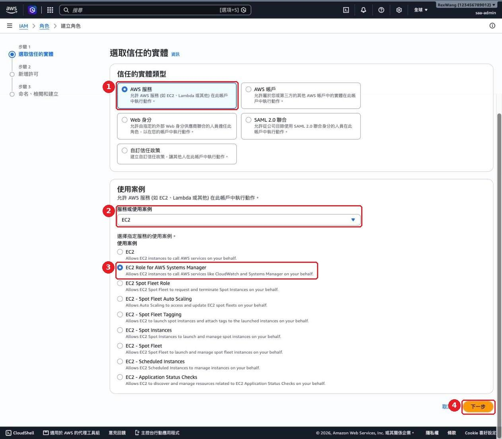

1. 「信任的實體類型」選 **AWS 服務**：讓 AWS 服務（EC2、Lambda…）擔任這個角色。其他選項：AWS 帳戶（跨帳號）、Web 身分（OIDC，例如 GitHub Actions）、SAML 2.0 聯合（企業 AD / IdP）、自訂信任政策。
2. 「服務或使用案例」輸入 `EC2`，選「常用服務」下的 EC2。
3. 「使用案例」選 **EC2 Role for AWS Systems Manager**：下一步會自動帶入 Session Manager 需要的 `AmazonSSMManagedInstanceCore`。若選第一個「EC2」則要自己搜尋政策。
4. 按「下一步」。

### Step 1-10　新增許可：AmazonSSMManagedInstanceCore

**進入路徑**：建立角色精靈 → 步驟 2

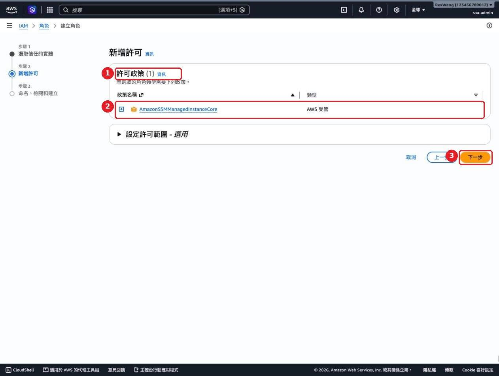

1. 「許可政策 (1)」說明「您選取的角色類型需要下列政策」——因為上一步選了 SSM 使用案例，這裡直接列出必要政策。
2. `AmazonSSMManagedInstanceCore`（AWS 受管）：讓 EC2 上的 SSM Agent 註冊為受管執行個體並建立 Session Manager 連線；Lab 3 靠它做到不開 22 埠就能登入主機。
3. 按「下一步」（許可範圍不設定）。

### Step 1-11　命名、檢閱和建立角色

**進入路徑**：建立角色精靈 → 步驟 3

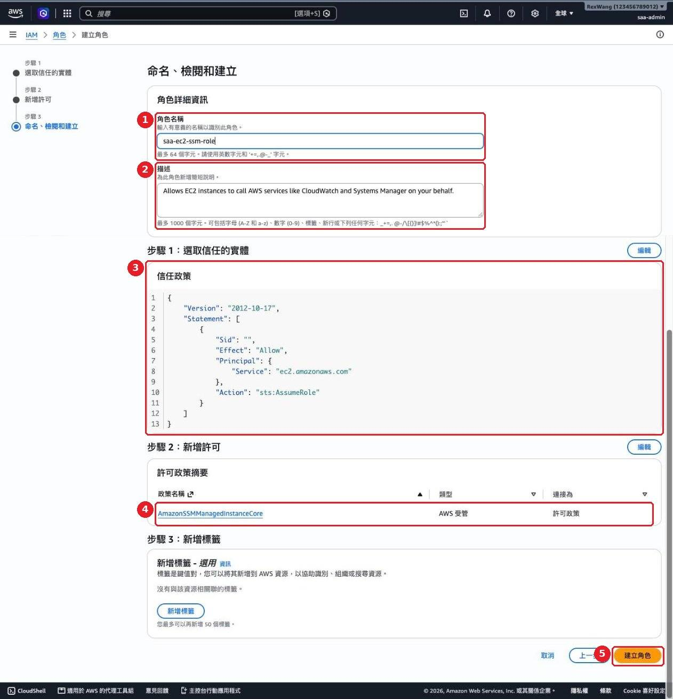

1. 「角色名稱」輸入 `saa-ec2-ssm-role`。
2. 「描述」保留自動帶入的 `Allows EC2 instances to call AWS services like CloudWatch and Systems Manager on your behalf.`
3. 自動產生的**信任政策**：`Effect: Allow`、`Principal: {"Service": "ec2.amazonaws.com"}`、`Action: sts:AssumeRole`——只有 EC2 服務能擔任這個角色。
4. 「步驟 2：新增許可」摘要：AmazonSSMManagedInstanceCore。
5. 按「建立角色」。

> **信任政策（Trust Policy）決定「誰可以擔任」，許可政策（Permission Policy）決定「擔任後能做什麼」**，兩者缺一不可。

### Step 1-12　角色詳細資訊：信任關係與執行個體設定檔

**進入路徑**：IAM → 角色 → `saa-ec2-ssm-role` →「信任關係」分頁

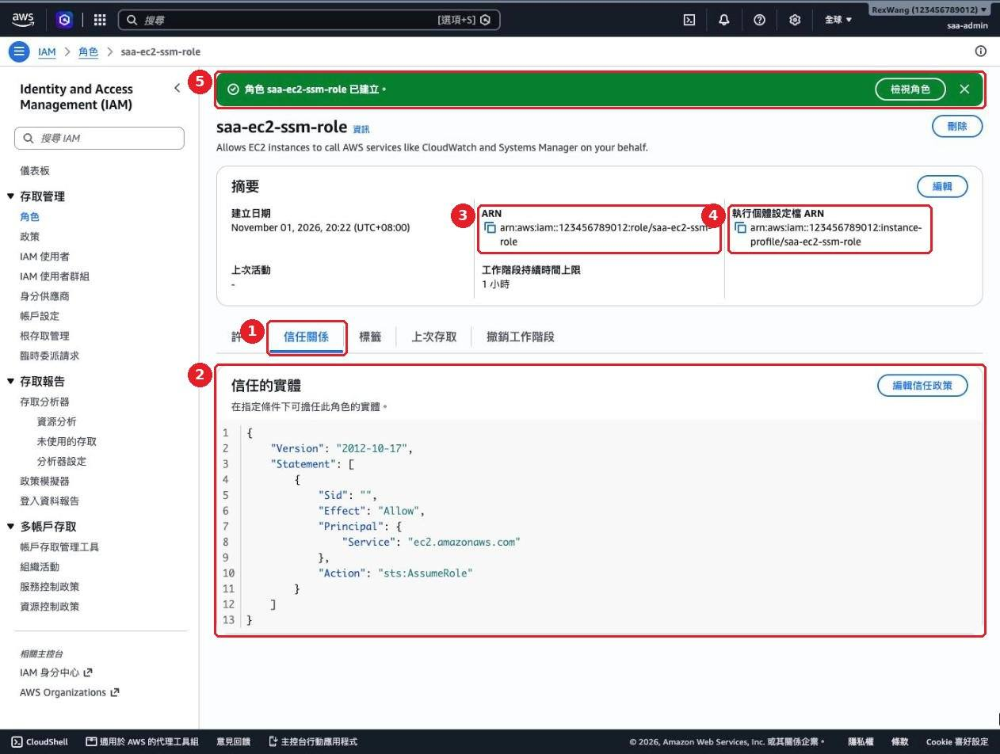

1. 「信任關係」分頁（其他：許可、標籤、上次存取、撤銷工作階段）。
2. 「信任的實體」顯示同樣的 JSON（Principal = ec2.amazonaws.com）；「編輯信任政策」可修改擔任者。
3. 角色 ARN：`arn:aws:iam::123456789012:role/saa-ec2-ssm-role`。
4. 「執行個體設定檔 ARN」：`arn:aws:iam::123456789012:instance-profile/saa-ec2-ssm-role`。主控台建立 EC2 服務角色時會**自動建立同名的執行個體設定檔**；Lab 3 啟動 EC2 時「IAM 執行個體設定檔」欄位選的其實是它。用 CLI / CloudFormation 建角色則要自己建設定檔（`scripts/01-iam.sh` 有示範）。
5. 頂端綠色橫幅「角色 saa-ec2-ssm-role 已建立」。

> 摘要中「工作階段持續時間上限」1 小時；EC2 角色的臨時憑證由執行個體中繼資料服務（IMDS）自動輪換，應用程式不用處理到期。

### CLI 等效

```bash
./scripts/01-iam.sh   # 建 saa-developers、saa-dev-user（隨機密碼、首次登入須重設）、saa-ec2-ssm-role + 執行個體設定檔
```

### 實務情境

- **銀行**：開發、維運、稽核分成不同群組；稽核群組只給 `ReadOnlyAccess` + `SecurityAudit`。正式環境通常完全不建 IAM 使用者，由 Identity Center 對接 AD，人員異動在 AD 端處理。
- **製造**：MES 主機（EC2）要把生產資料上傳 S3：用角色 + 執行個體設定檔，**禁止**把存取金鑰寫在設定檔；地端舊設備無法用角色時，改用 **IAM Roles Anywhere**（以 X.509 憑證換臨時憑證）。
- **零售**：促銷季臨時人員：建立群組並設定 Permissions Boundary，讓區域主管能自行建使用者但權限不超過上限；活動結束整批移出群組。

### 延伸練習

1. **IAM Identity Center**：在測試帳號啟用 Identity Center，建立一位使用者與 `ReadOnlyAccess` 權限集，體驗 SSO 入口登入與 `aws configure sso`。
2. **Permissions Boundary**：建立一個只允許 `s3:*` 與 `cloudwatch:*` 的受管政策，設為 `saa-dev-user` 的許可範圍，再直接附加 `AdministratorAccess`，驗證實際權限仍被限制在上限內。
3. **IAM Access Analyzer**：建立帳號層級分析器，檢查是否有對外公開的資源；再用「未使用的存取」分析找出很久沒用的權限。
4. 用「**政策模擬器**」測試 `saa-dev-user` 能否 `ec2:TerminateInstances`（應為隱含拒絕）。

### 考試重點

- 優先使用 **IAM Role + 臨時憑證**，不要把 Access Key 放在 EC2 或程式碼裡
- 政策評估：**明確 Deny > Allow > 預設（隱含）Deny**；多個政策取聯集
- **Permissions Boundary** 限制「單一身分的最大可授權範圍」；**SCP**（Organizations）限制整個帳號
- 群組不能當 Principal；群組不能巢狀
- 跨帳號存取：在目標帳號建立角色，信任政策寫來源帳號，來源身分 `sts:AssumeRole`
- 人員登入多帳號的最佳答案：**IAM Identity Center**

---

## Lab 2：自建 VPC（CIDR、Regional 與 Zonal、路由）

> **本 Lab 操作身分與環境**
>
> | 項目 | 內容 |
> |---|---|
> | 操作身分 | IAM 使用者 **`saa-admin`**（群組 `saa-admins`，AdministratorAccess） |
> | 登入方式 | IAM 使用者登入 URL → `saa-admin` → 密碼 → MFA |
> | 區域 | **us-east-1**（VPC 是區域性資源，切錯區域就看不到） |
> | 前置條件 | Lab 0 |
> | 預估時間 / 費用 | 約 20 分鐘（閱讀觀念另計）/ NAT 閘道與彈性 IP 從建立起按小時計費，做完 Lab 4、6、10 後請盡快清除 |

**目標**：用「VPC 和更多」一次建立跨 2 個 AZ 的公有 / 私有子網路、IGW、NAT 閘道與 S3 閘道端點，並徹底看懂 CIDR 計算、Region / AZ / Zonal 的差別，以及每一張路由表。

### 2.A　先懂 CIDR：10.0.0.0/16 是怎麼算的

**IPv4 位址是 32 個位元**，寫成 4 個八位元組（octet），例如 `10.0.0.0` = `00001010.00000000.00000000.00000000`。

**CIDR 記法 `位址/n`**：前 `n` 個位元是**網路位元**（固定不變，代表「哪一個網段」），剩下 `32 − n` 個是**主機位元**（可以變化，代表網段內的位址）。所以一個網段的位址數 = **2^(32−n)**。

| 前綴 | 主機位元 | 位址總數 2^(32−n) | AWS 子網路可用（−5） | 常見用途 |
|---|---|---|---|---|
| /16 | 16 | 65,536 | （VPC 本身不扣） | 一個 VPC 的最大尺寸，本 Lab 的 VPC |
| /20 | 12 | 4,096 | **4,091** | 本 Lab 每個子網路；VPC 精靈的預設 |
| /24 | 8 | 256 | 251 | 最常見的小型子網路，第三個 octet 剛好代表一個子網路 |
| /28 | 4 | 16 | 11 | VPC 與子網路允許的**最小**尺寸 |

`10.0.0.0/16`：前 16 位元（`10.0`）固定，後 16 位元可變 → 範圍 `10.0.0.0`～`10.0.255.255`，共 2^16 = **65,536** 個位址。

#### 為什麼四個子網路是 10.0.0.0/20、10.0.16.0/20、10.0.128.0/20、10.0.144.0/20？

/20 = 前 20 位元固定。前 16 位元已經是 `10.0`，所以**第三個 octet 的前 4 位元**屬於網路位元，後 4 位元 + 第四個 octet 的 8 位元 = 12 個主機位元（2^12 = 4,096）。第三個 octet 只看前 4 位元，因此子網路的起點每次**跳 2^4 = 16**：

| 子網路 | 第三個 octet（十進位） | 第三個 octet（二進位，前 4 位為網路位元） | 範圍 |
|---|---|---|---|
| public1（us-east-1a） | 0 | **0000** 0000 | 10.0.0.0 – 10.0.15.255 |
| public2（us-east-1b） | 16 | **0001** 0000 | 10.0.16.0 – 10.0.31.255 |
| private1（us-east-1a） | 128 | **1000** 0000 | 10.0.128.0 – 10.0.143.255 |
| private2（us-east-1b） | 144 | **1001** 0000 | 10.0.144.0 – 10.0.159.255 |

精靈把公有子網路放在 `10.0.0.0/17`（第三個 octet 最高位元 = 0，即 0–127）、私有子網路放在 `10.0.128.0/17`（最高位元 = 1，即 128–255）。好處：看到 `10.0.1xx.x` 就知道是私有；防火牆或 NACL 規則可以用一條 `/17` 涵蓋所有私有子網路；兩半各還有 6 個 /20 的空位可擴充。

#### AWS 在每個子網路保留的 5 個 IP（以 public1 10.0.0.0/20 為例）

| 位址 | 用途 |
|---|---|
| 10.0.0.0 | 網路位址 |
| 10.0.0.1 | VPC 路由器 |
| 10.0.0.2 | DNS（Route 53 Resolver；VPC 的 DNS 是「VPC 基底位址 + 2」，每個子網路的 +2 也保留） |
| 10.0.0.3 | 保留供未來使用 |
| 10.0.15.255 | 網路廣播位址（VPC 不支援廣播，但仍保留） |

所以 4,096 − 5 = **4,091**。對照 [lab02-06](#step-2-6子網路清單cidr-與可用-ip) 的實際畫面：private1、private2、public2 都是 **4091**，public1 是 **4090**——少的那 1 個被 NAT 閘道的網路介面（私有 IP `10.0.11.68`）用掉了。之後在 public1 啟動 EC2、ALB 節點進駐，可用數還會繼續減少。

#### 私有位址範圍與 VPC 尺寸規則

- **RFC 1918 私有位址**：`10.0.0.0/8`、`172.16.0.0/12`、`192.168.0.0/16`。VPC 建議使用這些範圍（預設 VPC 是 `172.31.0.0/16`）。
- VPC 的 IPv4 CIDR 大小必須介於 **/16（65,536）到 /28（16）**；子網路的 CIDR 必須落在 VPC CIDR 之內且彼此不重疊。VPC 建立後主要 CIDR 不能改，但可以**新增次要 CIDR**。

#### 規劃 CIDR 的實務原則

1. **不可重疊**：VPC Peering、Transit Gateway、Site-to-Site VPN、Direct Connect 都無法路由重疊的網段。一開始就要和地端、其他 VPC、其他區域、未來的併購對象一起規劃。
2. **不要每個 VPC 都用 10.0.0.0/16**：練習用沒關係，正式環境請依「環境 × 區域 × 帳號」分配，例如 prod-us-east-1 用 `10.10.0.0/16`、dev 用 `10.20.0.0/16`，並用 **VPC IPAM** 或試算表集中管理。
3. **預留成長空間**：子網路切大一點（/20 比 /24 寬裕），EKS、Lambda in VPC、ALB 都會消耗 IP。
4. **避開常見衝突網段**：例如 Docker 預設橋接網段 `172.17.0.0/16`、家用路由器常見的 `192.168.0.0/24`、`192.168.1.0/24`。

### 2.B　Region、AZ、Regional 與 Zonal

| 層級 | 說明 | 本教學的例子 |
|---|---|---|
| **Region（區域）** | 一個地理區，彼此獨立；資料預設不會跨區域 | `us-east-1` |
| **Availability Zone（AZ，可用區域）** | 區域內一個或多個實體隔離的資料中心，彼此以低延遲網路相連；設計高可用至少用 2 個 AZ | `us-east-1a`、`us-east-1b` |
| **AZ 名稱 vs AZ ID** | `us-east-1a` 是**AZ 名稱**，在每個帳號可能對應到不同的實體 AZ；`use1-az1` 是 **AZ ID**，跨帳號一致。跨帳號共用子網路或對齊延遲時要用 AZ ID | lab02-06：`use1-az1 (us-east-1a)`、`use1-az2 (us-east-1b)` |

資源的「範圍」決定了故障影響與能不能跨 AZ 使用：

| 範圍 | 意義 | 資源舉例 |
|---|---|---|
| **全域（Global）** | 不屬於任何區域，主控台右上角顯示「全球」 | IAM、Route 53、CloudFront（以及搭配 CloudFront 的 WAF） |
| **區域性（Regional）** | 屬於一個區域、跨該區域所有 AZ | VPC、路由表、安全群組、NACL、IGW、S3 Bucket（名稱全球唯一，但資料在一個區域）、區域性 NAT 閘道、ALB（跨多個 AZ 的子網路）、Lambda、DynamoDB、SQS/SNS、KMS 金鑰 |
| **Zonal（單一 AZ）** | 只存在於一個 AZ，該 AZ 故障就受影響 | **子網路**、**EC2 執行個體**、**EBS 磁碟區**、**Zonal NAT 閘道**、網路介面（ENI）、RDS 單一執行個體 |

> 記憶法：**VPC 跨 AZ、子網路不跨 AZ**。「把應用程式放在兩個 AZ」實際上就是「放在兩個不同 AZ 的子網路」。

#### Zonal NAT 與新的「區域性 NAT 閘道」

建立 VPC 精靈的「NAT 閘道 ($) – 已更新」區塊現在有三個選項：**無 | 區域性 – 全新 | Zonal**。依畫面上的說明文字：

| 項目 | Zonal NAT（本教學選用） | 區域性（Regional）NAT – 全新 |
|---|---|---|
| 畫面說明 | 選 Zonal 後還要選「在 1 個可用區域中」或「每個可用區域 1 個」，並提示「每個 NAT 閘道都需收費」 | 「為整個區域提供單一受管網際網路退出點」；藍色提示「AWS 現在提供多可用區域 NAT 閘道，消除了在不同可用區域建立獨立 NAT 閘道的需求」 |
| 範圍 | 綁在**一個子網路、一個 AZ**（lab02-10 的「子網路」欄位就是 public1 / us-east-1a） | 區域層級，選它時精靈**不再詢問 AZ 數量** |
| 高可用做法 | 自己在每個 AZ 各建一個，各 AZ 的私有路由表指向自己 AZ 的 NAT | 由服務本身涵蓋多個 AZ |
| 考試 | SAA-C03 考題與大量文件以 Zonal NAT 的觀念為主 | 新功能；計費方式、路由設定與限制本教學**未實測**，請以官方文件為準 |

**只建 1 個 Zonal NAT 的代價**：本 Lab 為了省錢只在 us-east-1a 建一個 NAT，兩張私有路由表都指向它。

- 若 **us-east-1a 故障**：NAT 跟著失效，**us-east-1b 的私有子網路也失去對外連線**（例如無法 `dnf install`、無法呼叫外部 API），即使 1b 本身完全正常——這就是跨 AZ 的單點故障。
- 平時 us-east-1b 的私有子網路流量要先跨 AZ 到 1a 的 NAT，會產生**跨 AZ 資料傳輸費**。
- **高可用做法**：精靈選「每個可用區域 1 個」（或腳本 `NAT_PER_AZ=1 ./scripts/02-vpc.sh`），public1 與 public2 各一個 NAT，`saa-lab-rtb-private1-us-east-1a` 的 0.0.0.0/0 → 1a 的 NAT、`saa-lab-rtb-private2-us-east-1b` → 1b 的 NAT。這也是精靈**一個 AZ 建一張私有路由表**的原因（見 2.C）。

### Step 2-1　建立 VPC：VPC 和更多

**進入路徑**：主控台 → VPC →「您的 VPC」→「建立 VPC」

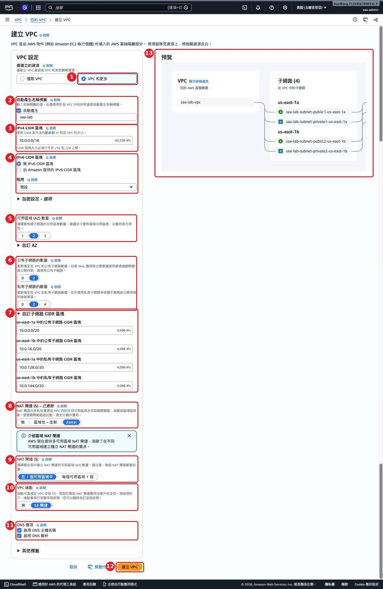

1. 「要建立的資源」選 **VPC 和更多**：一次建立 VPC、子網路、路由表、IGW、NAT 閘道、VPC 端點；「僅限 VPC」只建一個空 VPC。
2. 「自動產生名稱標籤」保持勾選，把預設值（中文介面預設「專案」）改成 `saa-lab`，所有資源都以 `saa-lab-` 開頭。**陷阱**：直接在欄位後面打字會變成「saa-lab專案」，要先把原本的字刪乾淨。
3. 「IPv4 CIDR 區塊」：`10.0.0.0/16`（右側提示 65,536 IPs；計算方式見 2.A）。
4. 「IPv6 CIDR 區塊」選「無」；「租用」保持「預設」（「專用」會大幅增加費用）。「加密設定 – 選用」不展開。
5. 「可用區域 (AZ) 數量」：**2**（預設）。不展開「自訂 AZ」時會使用 us-east-1a 與 us-east-1b。
6. 「公有子網路的數量」**2**、「私有子網路的數量」**2**：每個 AZ 各一個公有、一個私有。
7. 展開「自訂子網路 CIDR 區塊」可看到（也可修改）四個 /20：1a 公有 `10.0.0.0/20`、1b 公有 `10.0.16.0/20`、1a 私有 `10.0.128.0/20`、1b 私有 `10.0.144.0/20`（為什麼是這四個見 2.A）。
8. 「NAT 閘道 ($) – 已更新」選 **Zonal**（選項：無 / 區域性 – 全新 / Zonal，比較見 2.B）。
9. 「NAT 閘道 ($)」選 **在 1 個可用區域中**：為了省錢只建 1 個，放在 public1。正式環境選「每個可用區域 1 個」。
10. 「VPC 端點」選 **S3 閘道**（預設）：私有子網路存取 S3 走 AWS 內部網路、不經過 NAT；閘道端點免費，還省下 NAT 資料處理費。
11. 「DNS 選項」：「啟用 DNS 主機名稱」與「啟用 DNS 解析」都勾選（預設）。Route 53 私有託管區域（Lab 10）、Session Manager、介面端點都需要。
12. 確認後按 **建立 VPC**（旁邊「預覽代碼」可看到等效的 CLI / CloudFormation）。
13. 右側「預覽」即時列出要建立的資源：VPC `saa-lab-vpc`、4 個子網路（us-east-1a：public1、private1；us-east-1b：public2、private2）。

> 長截圖中，預覽區塊在畫面上會跟著捲動；為避免重複，只保留在頁首。

### Step 2-2　預覽右半部：路由表與網路連線

**進入路徑**：同一頁，在「預覽」區塊內向右捲動

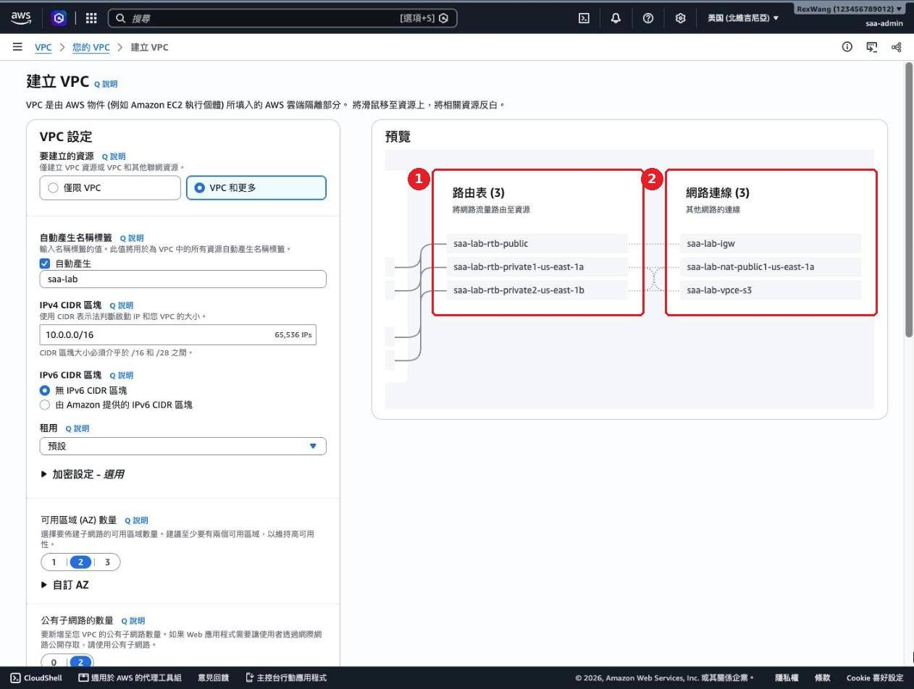

1. 「路由表 (3)」：`saa-lab-rtb-public`（兩個公有子網路共用）、`saa-lab-rtb-private1-us-east-1a`、`saa-lab-rtb-private2-us-east-1b`（私有子網路各一張）。左側線條表示子網路與路由表的關聯。
2. 「網路連線 (3)」：`saa-lab-igw`、`saa-lab-nat-public1-us-east-1a`（NAT 位於 public1）、`saa-lab-vpce-s3`。虛線表示路由：公有路由表 → IGW；兩張私有路由表 → NAT 與 S3 端點。

### Step 2-3　建立工作流程：全部成功

**進入路徑**：按「建立 VPC」後自動進入「建立 VPC 工作流程」

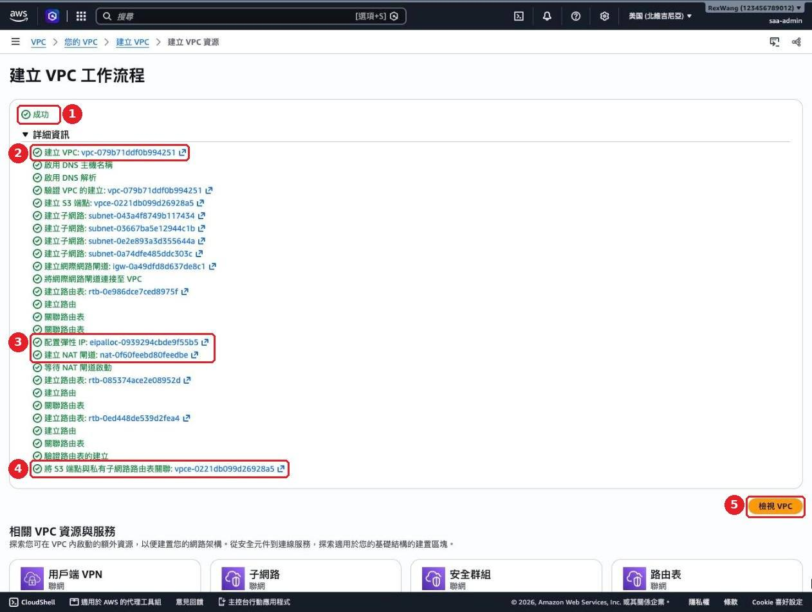

1. 頂端顯示「成功」。過程中會看到「建立 NAT 閘道」「等待 NAT 閘道啟動」等進度；NAT 約 1–2 分鐘，其他資源幾秒完成。
2. 第一個資源「建立 VPC: `vpc-079b71ddf0b994251`」，接著啟用 DNS 主機名稱與解析、建立 S3 端點、4 個子網路、IGW 並連接、公有路由表與路由及關聯。
3. 「配置彈性 IP: `eipalloc-0939294cbde9f55b5`」→「建立 NAT 閘道: `nat-0f60feebd80feedbe`」：NAT 需要一個彈性 IP；等待 NAT 啟動後才建立兩張私有路由表並加上 0.0.0.0/0 → NAT。
4. 最後「將 S3 端點與私有子網路路由表關聯」：在兩張私有路由表加入 S3 前綴清單路由。
5. 按「檢視 VPC」。

### Step 2-4　資源對應：公有路由表 → 網際網路閘道

**進入路徑**：VPC →「您的 VPC」→ `saa-lab-vpc` →「資源對應」分頁

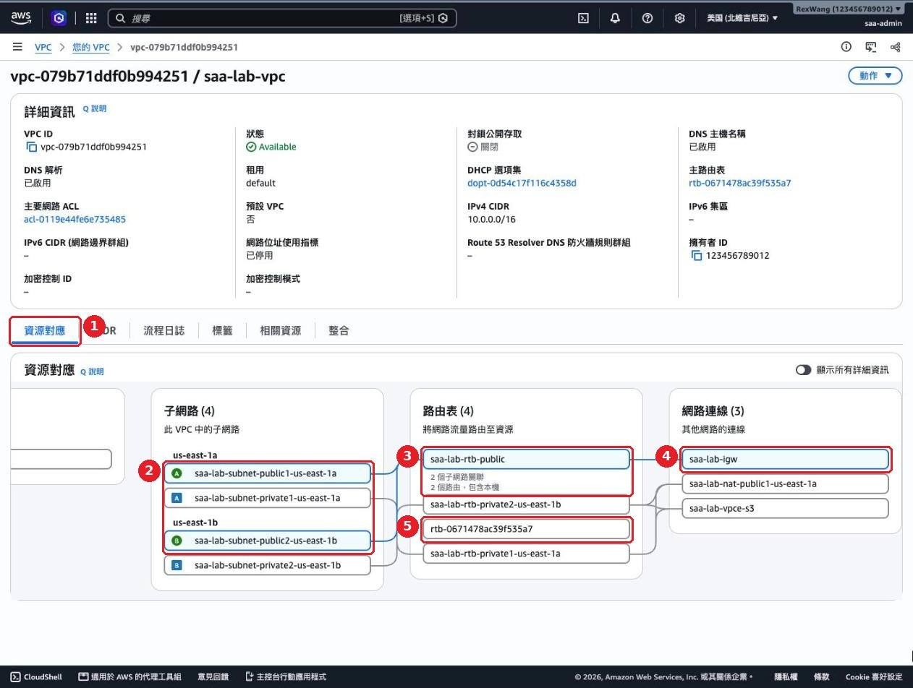

1. 「資源對應」以四欄呈現：VPC → 子網路 (4) → 路由表 (4) → 網路連線 (3)。（截圖時收合了左側選單並向右捲動，讓三欄同時入鏡。）
2. 點選路由表 `saa-lab-rtb-public`，相關的 `saa-lab-subnet-public1-us-east-1a` 與 `saa-lab-subnet-public2-us-east-1b` 以藍框反白——兩個 AZ 的公有子網路共用同一張路由表。
3. `saa-lab-rtb-public` 下方：「2 個子網路關聯、2 個路由，包含本機」（local + 0.0.0.0/0）。
4. 網路連線反白 `saa-lab-igw`：預設路由指向 IGW，這就是「公有子網路」的定義。
5. 第四張路由表 `rtb-0671478ac39f535a7` 沒有名稱，是 VPC 的**主路由表**，只有 `10.0.0.0/16 → local`，沒有明確關聯任何子網路。

> 上方「詳細資訊」：狀態 Available、DNS 主機名稱/解析「已啟用」、IPv4 CIDR 10.0.0.0/16、主要網路 ACL `acl-0119e44fe6e735485`、預設 VPC「否」。

### Step 2-5　資源對應：私有路由表 → NAT 與 S3 端點

**進入路徑**：同上，在資源對應中點選 `saa-lab-rtb-private1-us-east-1a`

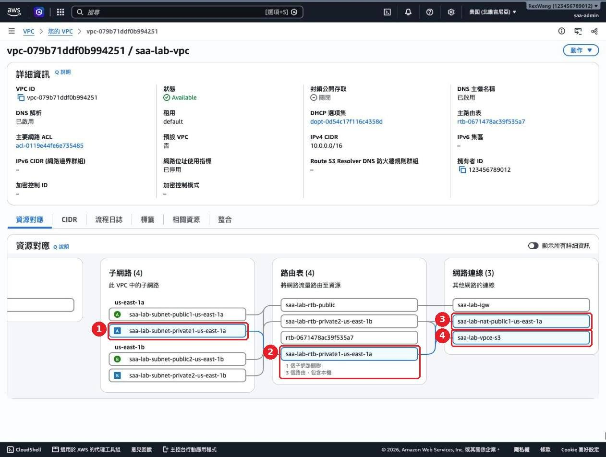

1. 反白的子網路只有 `saa-lab-subnet-private1-us-east-1a`：每張私有路由表只關聯同一個 AZ 的私有子網路。
2. 路由表下方：「1 個子網路關聯、3 個路由，包含本機」（local、0.0.0.0/0 → NAT、S3 前綴清單 → 端點）。
3. 網路連線反白 `saa-lab-nat-public1-us-east-1a`：私有子網路對外（例如安裝套件）經由公有子網路的 NAT 出去，外部無法主動連進來。
4. 同時反白 `saa-lab-vpce-s3`：到 S3 的流量走閘道端點，不經 NAT。

> 點 `saa-lab-rtb-private2-us-east-1b` 會看到它也指向**同一個位於 us-east-1a 的 NAT**——這就是 2.B 所說「只建 1 個 NAT」的單點故障。

### Step 2-6　子網路清單：CIDR 與可用 IP

**進入路徑**：VPC → 左側「子網路」→ 篩選 `VPC : vpc-079b71ddf0b994251`

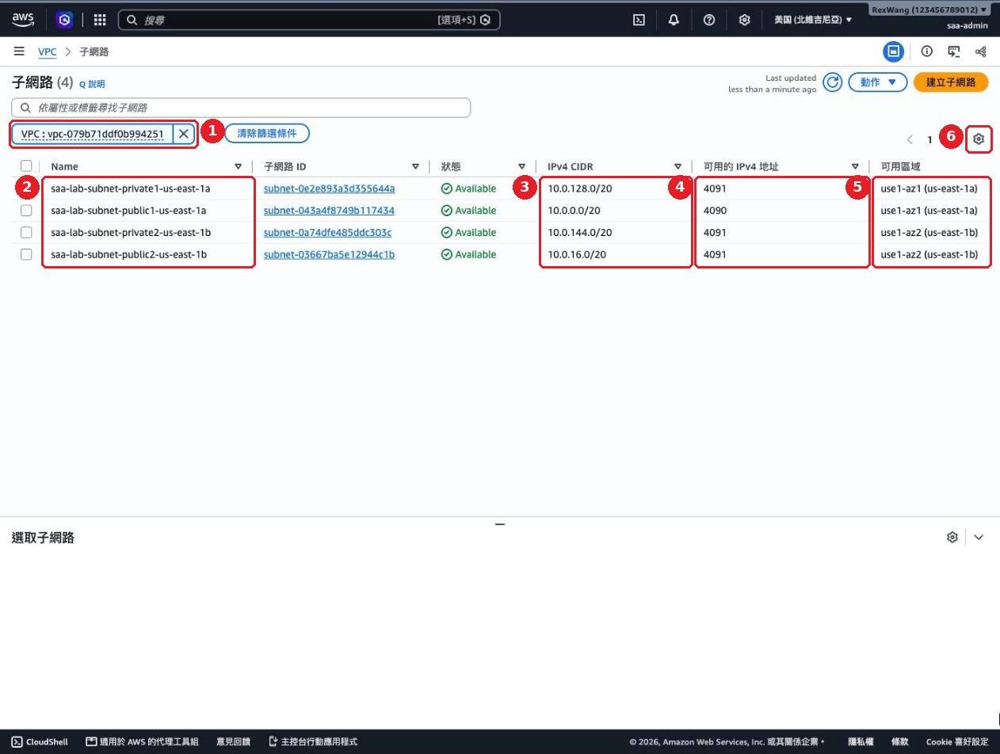

1. 篩選條件 `VPC : vpc-079b71ddf0b994251`，只顯示本 Lab 的 4 個子網路。
2. Name：private1、public1、private2、public2，狀態皆 Available。
3. IPv4 CIDR：private1 `10.0.128.0/20`、public1 `10.0.0.0/20`、private2 `10.0.144.0/20`、public2 `10.0.16.0/20`。
4. 「可用的 IPv4 地址」：private1 **4091**、public1 **4090**、private2 **4091**、public2 **4091**。4,096 − 5 = 4,091；public1 少 1 個是 NAT 用掉的 `10.0.11.68`（見 2.A）。
5. 可用區域：`use1-az1 (us-east-1a)`、`use1-az2 (us-east-1b)`——括號外是 AZ ID，括號內是 AZ 名稱（見 2.B）。
6. 右上齒輪（偏好設定）可調整欄位；本圖關閉了多個較少用的欄位以便閱讀。

> **陷阱**：畫面右側被截掉的「自動指派公有 IPv4 地址」欄位，**四個子網路都是「否」，連公有子網路也是**。所以 Lab 3 在公有子網路啟動 EC2 時，必須手動把「自動指派公有 IP」改成「啟用」。（被截掉的「路由表」欄位：public1/2 → `rtb-0e986dce7ced8975f | saa-lab-rtb-public`、private1 → `rtb-085374ace2e08952d`、private2 → `rtb-0ed448de539d2fea4`。）

### Step 2-7　公有路由表 saa-lab-rtb-public 的路由

**進入路徑**：VPC → 左側「路由表」→ `saa-lab-rtb-public`（`rtb-0e986dce7ced8975f`）→「路由」分頁

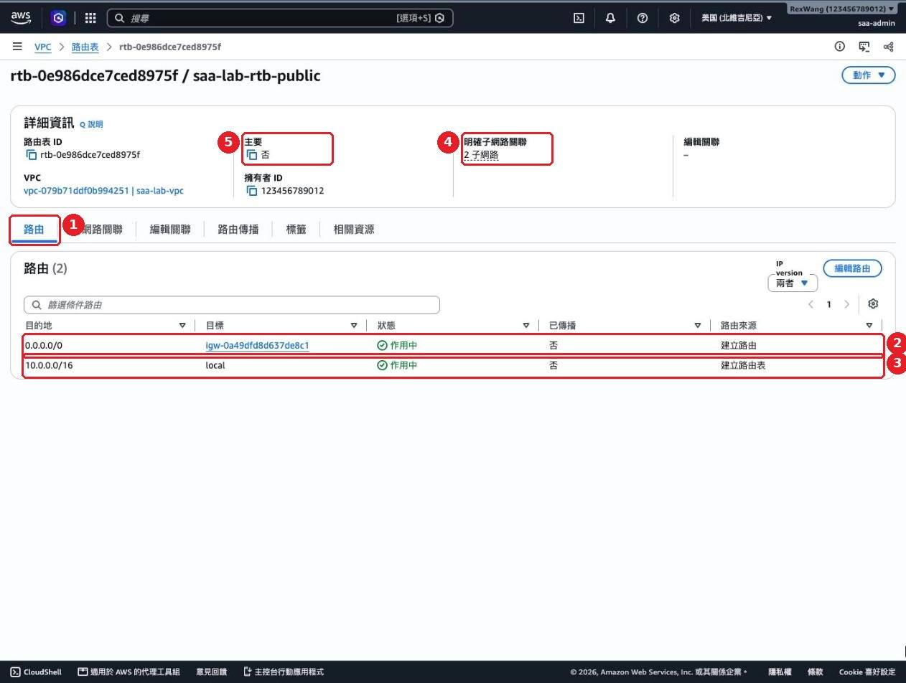

1. 「路由」分頁（其他：子網路關聯、邊緣關聯、路由傳播、標籤）。
2. `0.0.0.0/0` → `igw-0a49dfd8d637de8c1`，狀態「作用中」：所有非 VPC 內的流量送往 IGW。
3. `10.0.0.0/16` → `local`：VPC 內部互通的本機路由，每張路由表自動存在、不能刪除。
4. 「明確子網路關聯」：2 子網路。
5. 「主要」：否（不是主路由表）。

### Step 2-8　私有路由表 saa-lab-rtb-private1-us-east-1a 的路由

**進入路徑**：VPC → 路由表 → `saa-lab-rtb-private1-us-east-1a`（`rtb-085374ace2e08952d`）→「路由」分頁

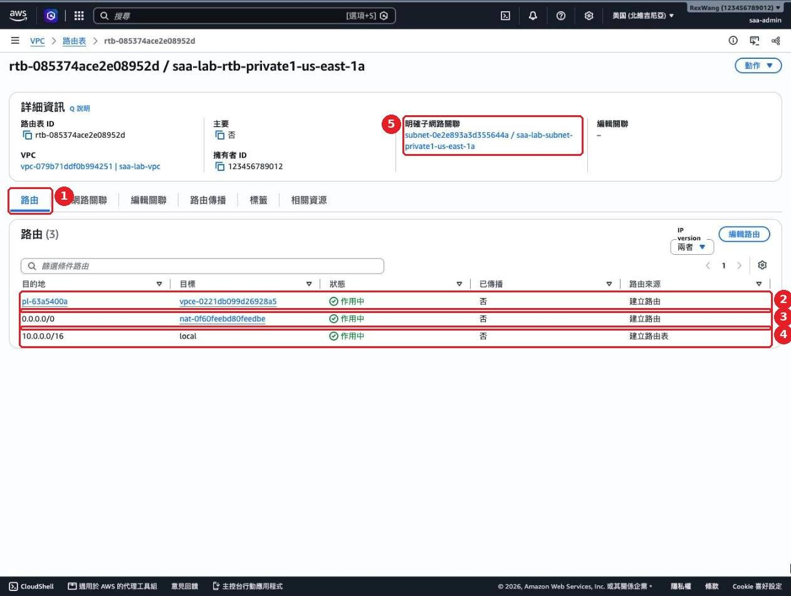

1. 「路由」分頁。
2. `pl-63a5400a` → `vpce-0221db099d26928a5`（作用中）：`pl-` 開頭是 AWS 管理的**前綴清單**，代表 us-east-1 S3 的所有 IP 範圍；目標是 S3 閘道端點。
3. `0.0.0.0/0` → `nat-0f60feebd80feedbe`：其他對外流量經 NAT。
4. `10.0.0.0/16` → `local`。
5. 「明確子網路關聯」：`subnet-0e2e893a3d355644a / saa-lab-subnet-private1-us-east-1a`。

### Step 2-9　公有路由表的子網路關聯

**進入路徑**：VPC → 路由表 → `saa-lab-rtb-public` →「子網路關聯」分頁

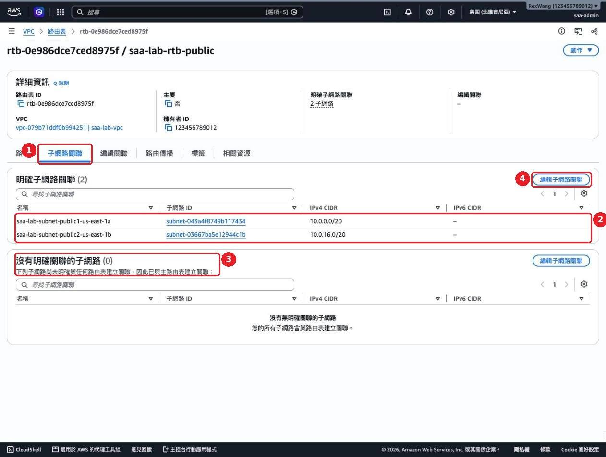

1. 「子網路關聯」分頁。
2. 「明確子網路關聯 (2)」：public1（`subnet-043a4f8749b117434`，10.0.0.0/20）、public2（`subnet-03667ba5e12944c1b`，10.0.16.0/20）。
3. 「沒有明確關聯的子網路 (0)」：沒有明確關聯的子網路會自動使用主路由表；精靈已替每個子網路做好明確關聯，所以這裡是空的。
4. 「編輯子網路關聯」可變更（本 Lab 不修改）。

> 一個子網路同時只能關聯**一張**路由表；一張路由表可以關聯**多個**子網路。

### Step 2-10　NAT 閘道詳細資訊

**進入路徑**：VPC → 左側「NAT 閘道」→ `saa-lab-nat-public1-us-east-1a`（`nat-0f60feebd80feedbe`）

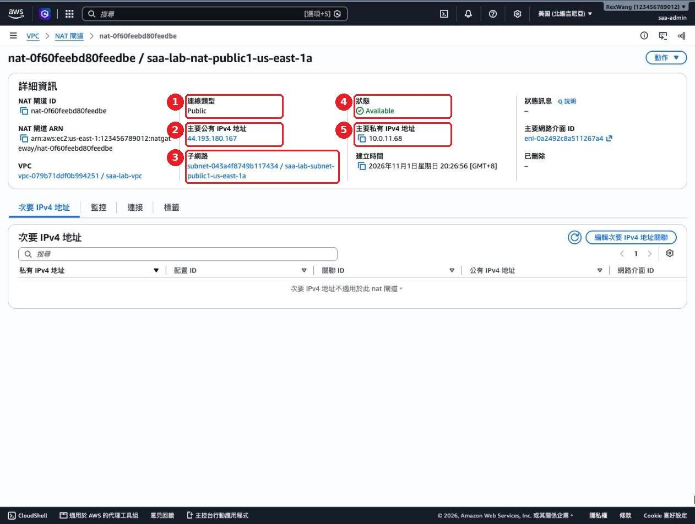

1. 「連線類型」：**Public**——讓私有子網路連上網際網路，需要彈性 IP；Private 類型只用於連到其他 VPC / 地端，不需要彈性 IP。
2. 「主要公有 IPv4 地址」：`44.193.180.167`（彈性 IP `eipalloc-0939294cbde9f55b5`）。私有子網路的 EC2 對外連線時，對方看到的來源 IP 就是它——要請外部廠商把你加入白名單時給的就是這個 IP。
3. 「子網路」：`subnet-043a4f8749b117434 / saa-lab-subnet-public1-us-east-1a`。NAT 必須放在**公有**子網路（它自己靠 IGW 上網）；由此欄也可看出它是綁在 us-east-1a 的 Zonal NAT。
4. 「狀態」：Available。
5. 「主要私有 IPv4 地址」：`10.0.11.68`（屬於 public1，所以該子網路可用 IP 少 1）。

> **成本**：NAT 按小時 + 每 GB 資料處理計費，彈性 IP 也計公有 IPv4 費。Lab 結束務必刪除 NAT 並釋放彈性 IP。

### Step 2-11　S3 閘道端點

**進入路徑**：VPC → 左側「PrivateLink 和 Lattice」→「端點」→ `saa-lab-vpce-s3`（`vpce-0221db099d26928a5`）

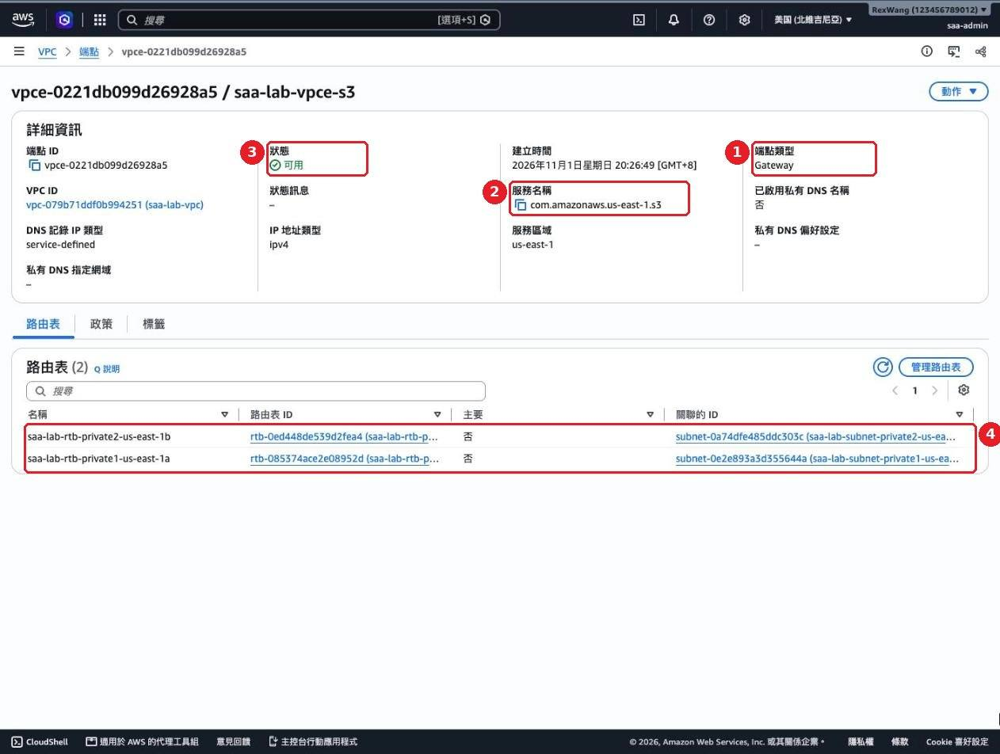

1. 「端點類型」：**Gateway**。閘道端點只支援 **S3 與 DynamoDB**，透過路由表運作、**免費**；Interface 端點（PrivateLink）是在子網路建立 ENI，按小時與流量計費。
2. 「服務名稱」：`com.amazonaws.us-east-1.s3`——閘道端點只能存取**同區域**的 S3。
3. 「狀態」：可用。
4. 「路由表 (2)」：`saa-lab-rtb-private2-us-east-1b`（`rtb-0ed448de539d2fea4`）與 `saa-lab-rtb-private1-us-east-1a`（`rtb-085374ace2e08952d`）。精靈只把端點加到私有路由表；公有子網路的 S3 流量仍走 IGW。

> 「政策」分頁可設定端點政策（預設完整存取），例如只允許存取公司自己的 Bucket，防止資料被帶到外部帳號的 Bucket。

### 2.C　進階：資源對應與路由表逐條解讀

把 lab02-04、lab02-05、lab02-07、lab02-08 整理成一張表（實際 ID 以本次實作為例）：

| 路由表 | 關聯子網路 | 路由（目的地 → 目標） | 解讀 |
|---|---|---|---|
| `saa-lab-rtb-public`<br/>`rtb-0e986dce7ced8975f` | public1 `subnet-043a4f8749b117434`（1a）<br/>public2 `subnet-03667ba5e12944c1b`（1b） | `10.0.0.0/16 → local`<br/>`0.0.0.0/0 → igw-0a49dfd8d637de8c1` | 兩個 AZ 共用；IGW 是區域性資源、本身高可用，所以公有路由表一張就夠 |
| `saa-lab-rtb-private1-us-east-1a`<br/>`rtb-085374ace2e08952d` | private1 `subnet-0e2e893a3d355644a`（1a） | `10.0.0.0/16 → local`<br/>`0.0.0.0/0 → nat-0f60feebd80feedbe`<br/>`pl-63a5400a → vpce-0221db099d26928a5` | 上網走 NAT；S3 走閘道端點 |
| `saa-lab-rtb-private2-us-east-1b`<br/>`rtb-0ed448de539d2fea4` | private2 `subnet-0a74dfe485ddc303c`（1b） | 同上（本 Lab 的 NAT 也是 `nat-0f60feebd80feedbe`，位於 1a） | 若改成每 AZ 一個 NAT，只要把這張的 0.0.0.0/0 改指向 1b 的 NAT |
| 主路由表<br/>`rtb-0671478ac39f535a7` | （無明確關聯） | `10.0.0.0/16 → local` | 新建子網路若忘了關聯，會落到這裡：只能 VPC 內互通，不會意外變成公有——**保持主路由表只有 local 是安全的預設** |

**為什麼私有路由表要「一個 AZ 一張」？** 路由表是區域性資源，可以給多個 AZ 的子網路共用；但 Zonal NAT 屬於單一 AZ。為了讓每個 AZ 的私有子網路走**自己 AZ 的 NAT**（避免跨 AZ 單點故障與跨 AZ 傳輸費），每個 AZ 必須有自己的私有路由表。精靈即使在「只建 1 個 NAT」時也先切成兩張，日後升級成每 AZ 一個 NAT 時只要改一條路由，不必重新關聯子網路。（v1 版的 `02-vpc.sh` 讓兩個私有子網路共用一張路由表，v2 已改成與精靈一致。）

**最長前綴比對（Longest Prefix Match）**：一個封包可能同時符合多條路由，VPC 路由器會選**前綴最長（最精確）**的那一條。

| 目的地 | 符合的路由 | 選中 | 結果 |
|---|---|---|---|
| `10.0.144.25`（private2 的 RDS 待命） | `10.0.0.0/16`、`0.0.0.0/0` | `/16` 比 `/0` 長 → **local** | VPC 內直接互通 |
| S3 的某個 IP | `0.0.0.0/0`、`pl-63a5400a` 內的某個 S3 網段 | 前綴清單內的網段一定比 `/0` 長 → **vpce** | S3 流量走閘道端點，不經 NAT（免 NAT 處理費） |
| 網際網路上的第三方 API 或套件伺服器 | 只有 `0.0.0.0/0` | **NAT** | 經 NAT → IGW 出去 |

> 前綴清單 `pl-63a5400a` 的實際內容可在 **VPC → 受管前綴清單** 查看；它是 AWS 維護的 S3 網段集合，會隨 AWS 擴充自動更新。

### CLI 等效

```bash
./scripts/02-vpc.sh                 # 與精靈結果一致：1 個 Zonal NAT、每 AZ 一張私有路由表
NAT_PER_AZ=1 ./scripts/02-vpc.sh    # 高可用版：每個 AZ 各一個 NAT（NAT 費用加倍）
```

### 實務情境

- **銀行**：核心系統 VPC 不允許直接上網；私有子網路對外只走集中式的 egress VPC（Transit Gateway + 防火牆），S3 與 DynamoDB 一律走閘道端點並以端點政策限制只能存取行內 Bucket，防止資料外洩。CIDR 由網路組統一配發，避免與地端機房重疊。
- **製造**：多廠區各自一個 VPC（例如 8 個廠 × `/20`），透過 Transit Gateway 與 Direct Connect 回到總部；事先規劃不重疊的 CIDR 是成敗關鍵。設備資料上傳 S3 走閘道端點，省下大量 NAT 處理費。
- **零售**：電商網站尖峰時 NAT 流量很大，每 AZ 一個 NAT 避免單 AZ 故障讓整個下單流程中斷；同時監控 NAT 的 `BytesOutToDestination` 控制成本。

### 延伸練習

1. **VPC Flow Logs**：對 `saa-lab-vpc` 開啟 Flow Logs 送到 CloudWatch Logs，Lab 3 連網站後查看 ACCEPT / REJECT 紀錄。
2. **NACL**：在 public1 的網路 ACL 新增一條規則編號 50 的 **Deny** 你家 IP 的 TCP 80，觀察網站連不上（體會 NACL 無狀態、依編號順序、可 Deny；SG 只能 Allow）。測完記得刪除。
3. **每 AZ 一個 NAT**：在 public2 再建一個 NAT，把 `saa-lab-rtb-private2-us-east-1b` 的 0.0.0.0/0 改指向它，再用 Lab 4 的 ASG 執行個體驗證兩個 AZ 都能上網。
4. 用 **Reachability Analyzer** 分析「私有子網路 EC2 → IGW」的路徑，看它如何經過 NAT。

### 考試重點

| 情境 | 答案 |
|---|---|
| 私有子網路的 EC2 要下載套件 | NAT 閘道（放在**公有**子網路） |
| 私有子網路存取 S3 / DynamoDB 且省錢 | **Gateway Endpoint**（免費，靠路由表） |
| 私有存取其他 AWS 服務（SQS、KMS…） | **Interface Endpoint**（PrivateLink，計費） |
| NAT 高可用 | 每個 AZ 各一個 NAT，各 AZ 私有路由表指向自己 AZ 的 NAT |
| 子網路可用 IP 數 | 2^(32−n) − 5（例：/24 → 251、/20 → 4,091） |
| VPC CIDR 範圍 | /16 – /28；可新增次要 CIDR；不可與要互連的網段重疊 |
| 兩個 VPC 互通（少量） | VPC Peering（不可遞移、CIDR 不可重疊） |
| 多個 VPC + 地端集中互通 | Transit Gateway |
| 子網路層級擋特定 IP | **NACL**（無狀態、可 Deny、規則有編號順序） |
| 記錄網路流量做疑難排解 / 稽核 | VPC Flow Logs |

---

## Lab 3：Security Group、EC2 與 Session Manager

> **本 Lab 操作身分與環境**
>
> | 項目 | 內容 |
> |---|---|
> | 操作身分 | IAM 使用者 **`saa-admin`**（群組 `saa-admins`，AdministratorAccess） |
> | 登入方式 | IAM 使用者登入 URL → `saa-admin` → 密碼 → MFA |
> | 區域 | **us-east-1** |
> | 前置條件 | Lab 1（角色 `saa-ec2-ssm-role`）、Lab 2（`saa-lab-vpc` 與公有子網路） |
> | 預估時間 / 費用 | 約 20 分鐘 / t3.micro 約 0.0104 USD/小時 + 公有 IPv4 費（免費方案可能涵蓋） |

**目標**：在公有子網路啟動一台 Web 伺服器 `saa-web-01`，安全群組只開 80；用 IAM 角色 + Session Manager 管理主機，完全不開 22。

### Step 3-1　建立安全群組 saa-web-sg

**進入路徑**：主控台 → EC2 → 左側「網路和安全」→「安全群組」→「建立安全群組」

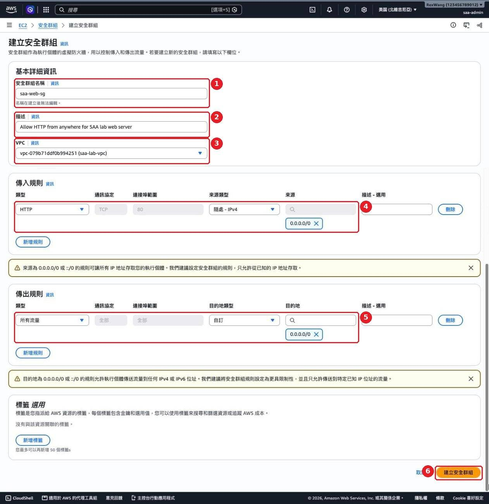

1. 「安全群組名稱」：`saa-web-sg`（建立後不能改名）。
2. 「描述」：`Allow HTTP from anywhere for SAA lab web server`（必填、建立後不能改；只能用英數與部分符號，不能用中文）。
3. 「VPC」：改選 `vpc-079b71ddf0b994251 (saa-lab-vpc)`。**陷阱**：預設帶入的是預設 VPC（172.31.0.0/16）；安全群組屬於單一 VPC，選錯之後在 saa-lab-vpc 啟動 EC2 時就選不到它。
4. 「傳入規則」→「新增規則」：類型 **HTTP**（自動帶入 TCP 80），來源類型「**隨處 - IPv4**」（`0.0.0.0/0`）。黃色警告提醒 0.0.0.0/0 會讓所有 IP 存取——對公開網站的 80 埠是預期的，但 SSH 22、RDP 3389、資料庫埠絕不要這樣開。
5. 「傳出規則」保留預設（所有流量 → 0.0.0.0/0）。安全群組是**有狀態**的：允許進來的連線，回應會自動放行。
6. 按「建立安全群組」→ `sg-03a644f1f66da19d3`（傳入規則 `sgr-01d0c9493d5621e4d`）。

### Step 3-2　啟動執行個體（1）：名稱、AMI、類型、金鑰對

**進入路徑**：EC2 →「執行個體」→「啟動執行個體」

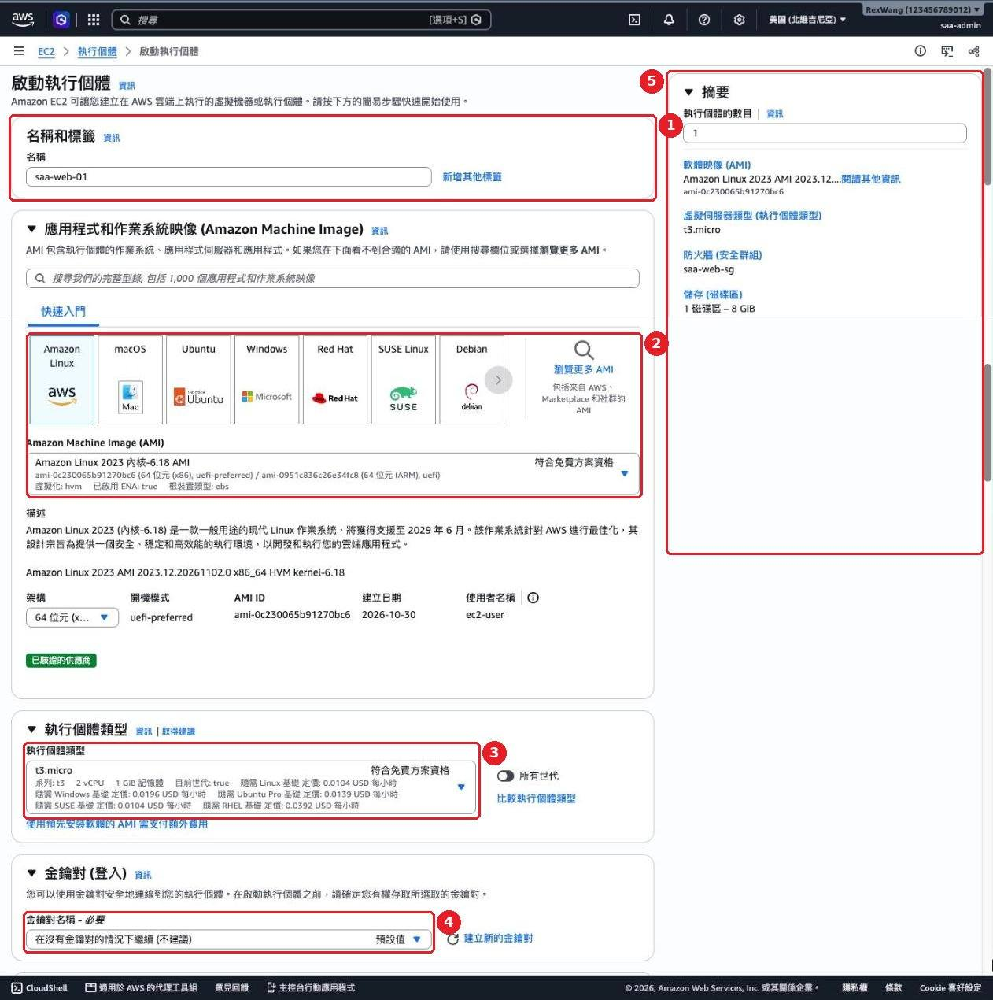

1. 「名稱和標籤」→ 名稱 `saa-web-01`（其實是建立 `Name` 標籤）。
2. AMI：快速入門 → Amazon Linux，保持預設 **Amazon Linux 2023 內核-6.18 AMI**（`ami-0c230065b91270bc6`，64 位元 x86，符合免費方案資格）。AL2023 預設已安裝 SSM Agent。
3. 執行個體類型：`t3.micro`（2 vCPU、1 GiB；畫面顯示 Linux 隨需 0.0104 USD/小時）。
4. 「金鑰對 (登入)」：選「**在沒有金鑰對的情況下繼續 (不建議)**」。我們用 Session Manager 登入，不需要 SSH 金鑰，也就不必開 22。
5. 右側「摘要」：1 台、AL2023、t3.micro、防火牆 saa-web-sg（下一步選定後）、儲存 1 磁碟區 8 GiB。

### Step 3-3　啟動執行個體（2）：網路設定與儲存

**進入路徑**：啟動精靈 →「網路設定」區塊右上「編輯」

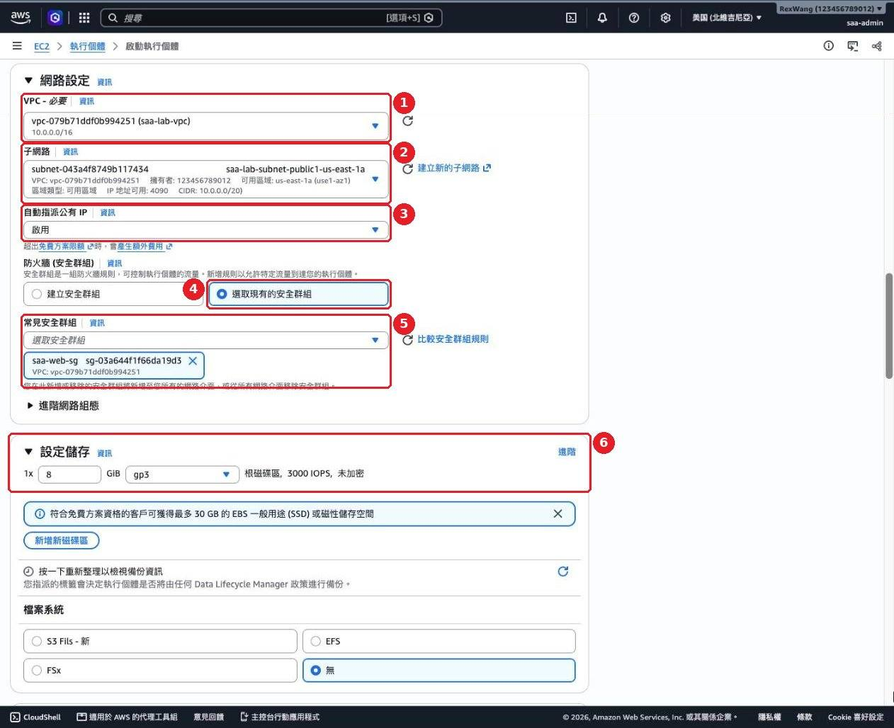

1. 「VPC - 必要」：改選 `saa-lab-vpc`（預設是預設 VPC）。
2. 「子網路」：`saa-lab-subnet-public1-us-east-1a`（下拉會顯示 AZ 與可用 IP 數：4090）。
3. 「自動指派公有 IP」：**手動改成「啟用」**。**陷阱**：選完子網路後這裡預設「停用」，因為精靈建立的公有子網路沒有開「自動指派公有 IPv4」（lab02-06）。沒有公有 IP 就無法從瀏覽器連到網站。
4. 「防火牆 (安全群組)」選「**選取現有的安全群組**」。**陷阱**：預設是「建立安全群組」，會產生 `launch-wizard-N` 並開放 **SSH 22 給 0.0.0.0/0**。
5. 「常見安全群組」選 `saa-web-sg (sg-03a644f1f66da19d3)`。
6. 「設定儲存」保持預設：1 × 8 GiB gp3 根磁碟區（3000 IOPS，未加密）。

> 儲存區下方的「檔案系統」選項（S3 Files – 新、EFS、FSx）保持「無」。

### Step 3-4　啟動執行個體（3）：進階詳細資訊與使用者資料

**進入路徑**：啟動精靈 → 展開「進階詳細資訊」

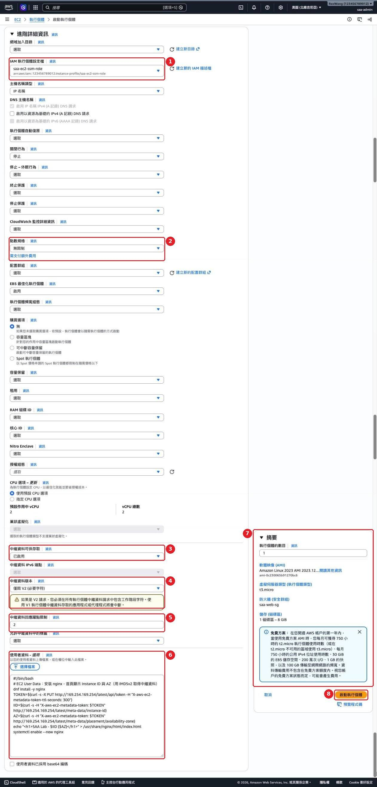

1. 「IAM 執行個體設定檔」：`saa-ec2-ssm-role`（Lab 1 建立）。SSM Agent 靠它向 Systems Manager 註冊。
2. 「點數規格」：預設「無限制」（Unlimited，畫面註明「需支付額外費用」）。t3 是可爆發執行個體，長時間高 CPU 會產生額外點數費用；要嚴格控費可改「標準」。
3. 「中繼資料可供存取」：已啟用。
4. 「中繼資料版本」：預設已是「**僅限 V2 (必要字符)**」（IMDSv2 only）。使用 V1 的程式會中斷；我們的 User Data 已用 token 方式。
5. 「中繼資料回應躍點限制」：2（預設）。
6. 「使用者資料 – 選用」：貼上 [`userdata/web-userdata.sh`](userdata/web-userdata.sh)：安裝 nginx、用 IMDSv2 取得 instance-id 與 AZ、寫入首頁、啟動 nginx。User Data 只在**第一次開機**以 root 執行。
7. 右側摘要再確認一次。
8. 按「**啟動執行個體**」→「已成功啟動執行個體 (`i-0ee8bea4ef6733d6d`)」。

### Step 3-5　執行個體詳細資訊

**進入路徑**：EC2 →「執行個體」→ 勾選 `saa-web-01`（下方「詳細資訊」分頁）

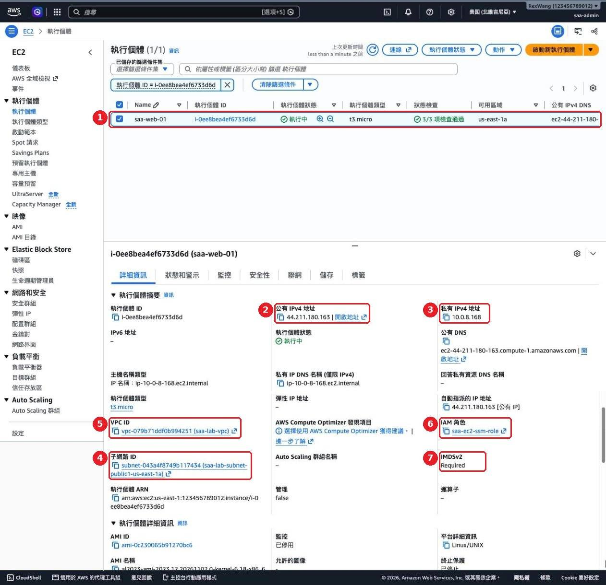

1. 執行個體狀態「執行中」、狀態檢查「3/3 項檢查通過」（系統、執行個體、已連接的 EBS），約 2 分鐘內完成。
2. 「公有 IPv4 地址」：`44.211.180.163`。旁邊「開啟地址」會用 https 開——本 Lab 只開 80，要手動改 `http://`。這個公有 IP 在停止再啟動後會改變；要固定請用彈性 IP。
3. 「私有 IPv4 地址」：`10.0.8.168`（落在 public1 的 10.0.0.0/20 內）。
4. 「子網路 ID」：`subnet-043a4f8749b117434 (saa-lab-subnet-public1-us-east-1a)`。
5. 「VPC ID」：`vpc-079b71ddf0b994251 (saa-lab-vpc)`。
6. 「IAM 角色」：`saa-ec2-ssm-role`。
7. 「IMDSv2」：Required。

### Step 3-6　瀏覽器開啟 http://公有 IP/

**進入路徑**：瀏覽器網址列輸入 `http://44.211.180.163/`

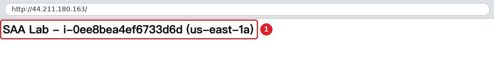

*圖上方的網址列是後製加上的示意（截圖工具只擷取網頁內容區）。*

1. 頁面顯示 `SAA Lab - i-0ee8bea4ef6733d6d (us-east-1a)`：證明 User Data 已執行，且 SG 的 80 規則、公有子網路路由（0.0.0.0/0 → IGW）、公有 IP 三者都正確。

> **打不開時依序檢查**：①是 http 不是 https ②有沒有公有 IP ③SG 有沒有 80 ④子網路路由表有沒有指向 IGW ⑤NACL 是否擋住 ⑥User Data 是否成功（Session Manager 查 `/var/log/cloud-init-output.log`）。

### Step 3-7　連線至執行個體：SSM Session Manager

**進入路徑**：EC2 → 執行個體 → 勾選 `saa-web-01` → 右上「連線」

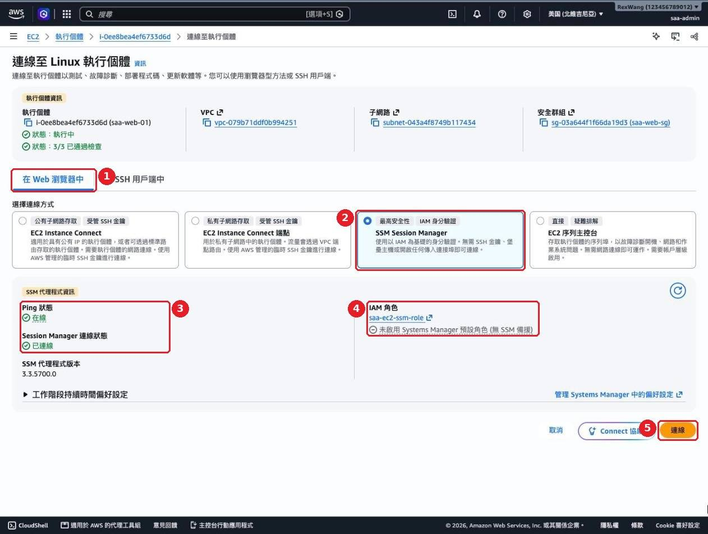

1. 「在 Web 瀏覽器中」分頁（另一個「在 SSH 用戶端中」說明 SSH 連線方式）。新版介面把連線方式做成四張卡片。
2. 選「**SSM Session Manager**」（標籤：最高安全性、IAM 身分驗證）：不需要 SSH 金鑰、堡壘主機或任何傳入連接埠。其他三種：EC2 Instance Connect（需 22 埠與公有存取）、EC2 Instance Connect 端點（私有子網路）、EC2 序列主控台（疑難排解）。
3. 「SSM 代理程式資訊」：Ping 狀態「在線」、連線狀態「已連線」、代理程式版本 3.3.5700.0。若顯示離線，通常是沒掛角色，或執行個體無法連到 SSM 端點（沒有公有 IP / NAT / 介面端點）。
4. 「IAM 角色」：saa-ec2-ssm-role；提示「未啟用 Systems Manager 預設角色 (無 SSM 備援)」——帳號層級的 Default Host Management Configuration 沒開，所以一定要靠執行個體自己的角色。
5. 按「連線」。

### Step 3-8　Session Manager 終端機驗證

**進入路徑**：上一步按「連線」後，同一分頁開啟瀏覽器終端機

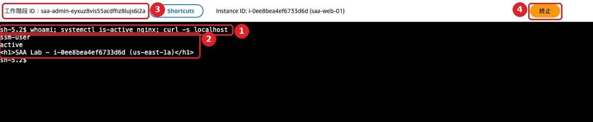

1. 輸入 `whoami; systemctl is-active nginx; curl -s localhost`。
2. 輸出三行：`ssm-user`（Session Manager 預設使用者，可 sudo）、`active`（nginx 執行中）、`<h1>SAA Lab - i-0ee8bea4ef6733d6d (us-east-1a)</h1>`。
3. 頂端「工作階段 ID」以 **`saa-admin-`** 開頭：工作階段以發起連線的 IAM 身分命名，並記錄在 Systems Manager 工作階段歷史（可再設定送到 S3 / CloudWatch Logs 稽核）。
4. 結束時按右上「**終止**」→ 確認「終止」→「關閉」。不要只關分頁。

### CLI 等效

```bash
./scripts/03-ec2.sh
# 互動式連線（CloudShell 已內建 Session Manager plugin）
aws ssm start-session --target <InstanceId>
```

### 實務情境

- **銀行**：法規要求所有主機登入都要留紀錄、禁止共用 SSH 金鑰。Session Manager 以 IAM 身分登入，工作階段內容可完整記錄到 S3（搭配 KMS 加密），取代堡壘主機，也不必開 22。
- **製造**：工廠的 Windows / Linux 邊緣伺服器透過 Systems Manager（混合啟用）納管，統一由 Patch Manager 安排在停線時段更新。
- **零售**：促銷前用 **Run Command** 一次在上百台主機更新設定檔；搭配標籤（如 `Env=prod`）選取目標。

### 延伸練習

1. **SSM Patch Manager**：為 `saa-web-01` 建立修補程式基準與維護時段（或直接執行「立即修補」），在合規性報告查看結果。
2. **CloudWatch Agent**：用 SSM 文件 `AWS-ConfigureAWSPackage` 安裝 CloudWatch Agent，收集**記憶體與磁碟使用率**（EC2 預設指標沒有這兩項）。
3. 把 Session Manager 的工作階段紀錄設定送到 CloudWatch Logs，再連一次並查看內容。
4. 試著把「中繼資料版本」改回「V1 和 V2」，再改回「僅限 V2」，理解 IMDSv2 如何防 SSRF。

### 考試重點

- Security Group：**有狀態、只有 Allow、可以參照其他 SG**；NACL：無狀態、可 Deny、規則有編號
- 管理 EC2 的最佳答案通常是 **Systems Manager Session Manager**（免堡壘主機、免開 22、可稽核）
- **IMDSv2** 以 session token 防止 SSRF 竊取中繼資料中的角色憑證
- EC2 預設指標**沒有記憶體與磁碟使用率** → CloudWatch Agent
- EC2 購買選項：On-Demand、Savings Plans / Reserved（穩定長期）、**Spot**（可中斷、最便宜）、Dedicated Host（授權綁定實體核心）

---

## Lab 4：ALB、啟動範本與 Auto Scaling

> **本 Lab 操作身分與環境**
>
> | 項目 | 內容 |
> |---|---|
> | 操作身分 | IAM 使用者 **`saa-admin`**（群組 `saa-admins`，AdministratorAccess） |
> | 登入方式 | IAM 使用者登入 URL → `saa-admin` → 密碼 → MFA |
> | 區域 | **us-east-1** |
> | 前置條件 | Lab 1（`saa-ec2-ssm-role`）、Lab 2（公有 / 私有子網路與 NAT——私有子網路的 EC2 要經 NAT 安裝 nginx） |
> | 預估時間 / 費用 | 約 40 分鐘 / ALB 每小時 + LCU、2 台 t3.micro |

**架構**：網際網路 → ALB `saa-app-alb`（兩個**公有**子網路，SG `saa-alb-sg`）→ 目標群組 `saa-app-tg` → ASG `saa-app-asg` 的 EC2（兩個**私有**子網路，SG `saa-app-sg` 只允許來自 `saa-alb-sg` 的 80）。

**順序**：兩個 SG → 目標群組 → **獨立建立 ALB** → 啟動範本 → ASG「連接到現有的負載平衡器（目標群組）」。（v1 用 ASG 精靈「順便建 ALB」會讓 ALB 沿用 `saa-app-sg` 而連不進來，v2 改用這個較正式的順序。）

### Step 4-1　建立 ALB 安全群組 saa-alb-sg

**進入路徑**：EC2 →「安全群組」→「建立安全群組」

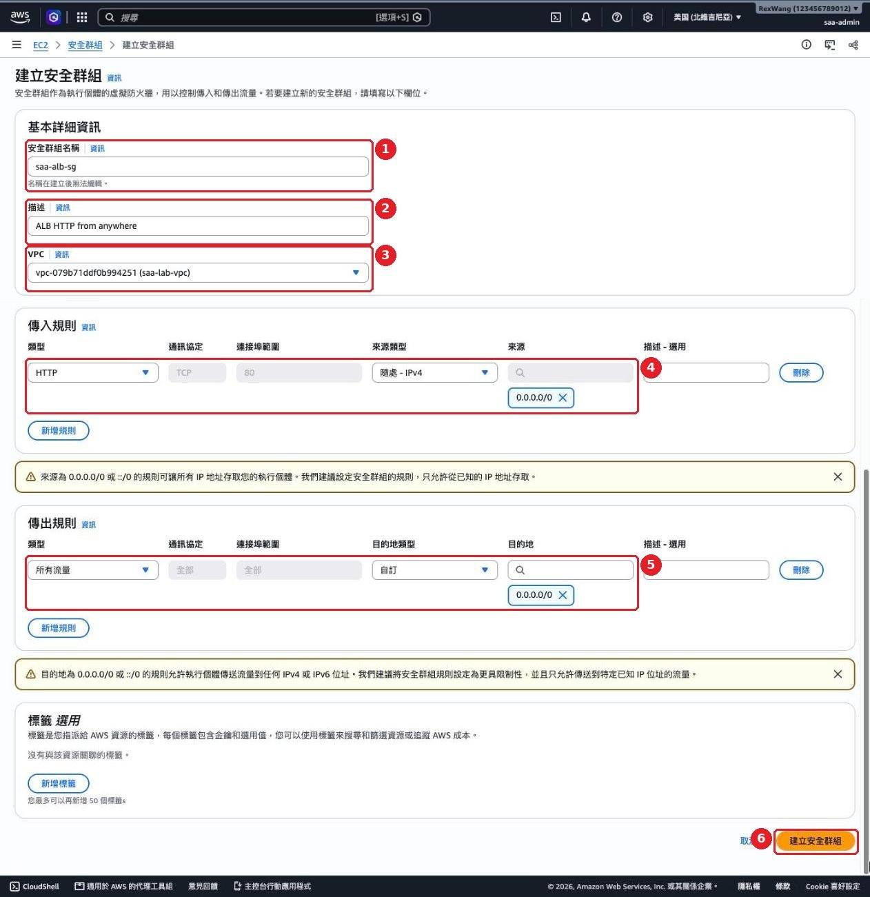

1. 名稱 `saa-alb-sg`。
2. 描述 `ALB HTTP from anywhere`。
3. VPC 改選 `saa-lab-vpc`。
4. 傳入規則：HTTP（TCP 80），來源「隨處 - IPv4」`0.0.0.0/0`——ALB 是對外入口。
5. 傳出規則保留預設。
6. 按「建立安全群組」→ `sg-0a136f7c1b666fe8d`。

### Step 4-2　建立應用程式安全群組 saa-app-sg（只允許來自 ALB）

**進入路徑**：同上

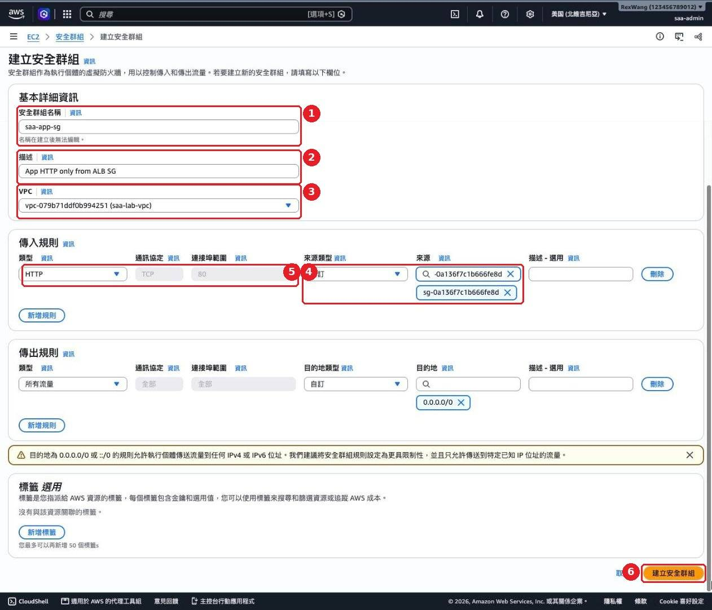

1. 名稱 `saa-app-sg`。
2. 描述 `App HTTP only from ALB SG`。
3. VPC `saa-lab-vpc`。
4. 傳入規則類型 HTTP（TCP 80）。
5. 來源類型「自訂」，在來源框輸入 `sg-0a136f7c1b666fe8d`，從下拉「安全群組」區塊點選 `saa-alb-sg`。**來源是另一個 SG 而不是 IP**：只有掛 `saa-alb-sg` 的資源（ALB 的網路介面）能連進 80，ALB 節點 IP 變了也不用改規則。
6. 按「建立安全群組」→ `sg-024f7810f6c18d78b`。

> 這個 SG 沒有任何 0.0.0.0/0 傳入規則；EC2 又在私有子網路沒有公有 IP，只能經由 ALB 存取。

### Step 4-3　建立目標群組 saa-app-tg（步驟 1）

**進入路徑**：EC2 → 左側「負載平衡」→「目標群組」→「建立目標群組」

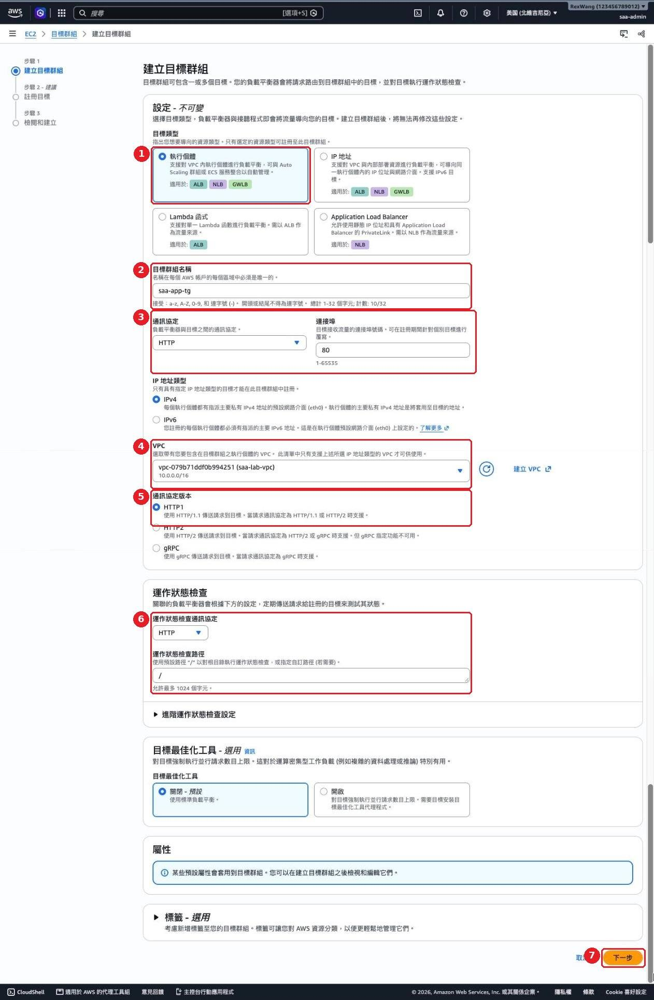

1. 目標類型「**執行個體**」（預設）：可與 Auto Scaling 整合自動註冊。其他：IP 地址、Lambda 函式、Application Load Balancer（給 NLB 串 ALB）。這些設定建立後不能改。
2. 目標群組名稱 `saa-app-tg`。
3. 通訊協定 HTTP、連接埠 80：ALB 轉送到 EC2 的協定與埠。
4. VPC 改選 `saa-lab-vpc`。**陷阱**：預設是預設 VPC，選錯的話 ASG 選不到這個目標群組。
5. 通訊協定版本 HTTP1（預設）。
6. 運作狀態檢查：HTTP、路徑 `/`。nginx 首頁回 200 即健康。
7. 按「下一步」。

> 進階健康檢查預設：良好閾值 5、不良閾值 2、逾時 5 秒、間隔 30 秒、成功代碼 200。

### Step 4-4　目標群組步驟 2：註冊目標（不註冊）

**進入路徑**：建立目標群組精靈 → 步驟 2

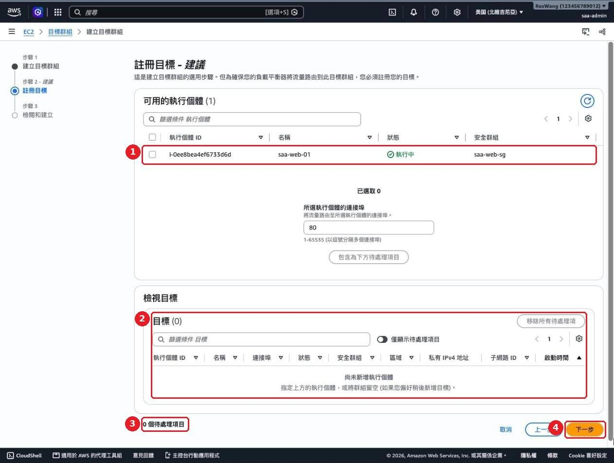

1. 「可用的執行個體 (1)」列出 Lab 3 的 `saa-web-01`——**不要勾**。
2. 「檢視目標」目標 (0)：尚未新增。目標會由稍後的 ASG 自動註冊 / 取消註冊。
3. 底部「0 個待處理項目」。
4. 按「下一步」→ 檢閱 →「建立目標群組」。

### Step 4-5　建立 Application Load Balancer saa-app-alb

**進入路徑**：EC2 →「負載平衡器」→「建立負載平衡器」→ Application Load Balancer「建立」

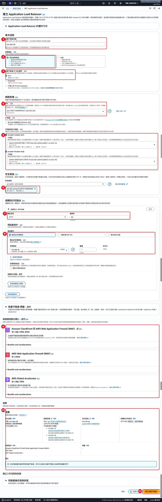

1. 名稱 `saa-app-alb`（建立後無法變更）。
2. 結構描述「**面對網際網路**」（Internet-facing）：有公有 IP、**需要公有子網路**。另一個「內部」只有私有 IP。
3. IP 位址類型 IPv4。
4. 網路對應 VPC：改選 `saa-lab-vpc`。
5. 可用區域和子網路：勾 us-east-1a (use1-az1) 與 us-east-1b (use1-az2)，自動帶入 **public1 / public2**；每個子網路下方顯示「路由表：IGW (✓)」，代表是可對外的公有子網路。ALB 至少需要兩個 AZ，每個子網路至少 8 個可用 IP。
6. 安全群組：按 X 移除預設的 `default`，改選 `saa-alb-sg`，只留一個。
7. 接聽程式 HTTP:80。
8. 預設動作「轉送至目標群組」→ `saa-app-tg`（權重 1，100%）。
9. 「透過服務整合優化 – 選用」：CloudFront + WAF、AWS WAF、Global Accelerator **都不勾**（皆另計費）。
10. 「摘要」再確認：面對網際網路、兩個公有子網路、saa-alb-sg、HTTP:80 → saa-app-tg。
11. 按「建立負載平衡器」。

> 建立後約 2–3 分鐘從「佈建中」轉為 Active。DNS 名稱 `saa-app-alb-247025738.us-east-1.elb.amazonaws.com`，託管區域 `Z35SXDOTRQ7X7K`（Lab 10 的 Alias 會看到）。

### Step 4-6　建立啟動範本 saa-app-lt（上半）

**進入路徑**：EC2 →「執行個體」→「啟動範本」→「建立啟動範本」

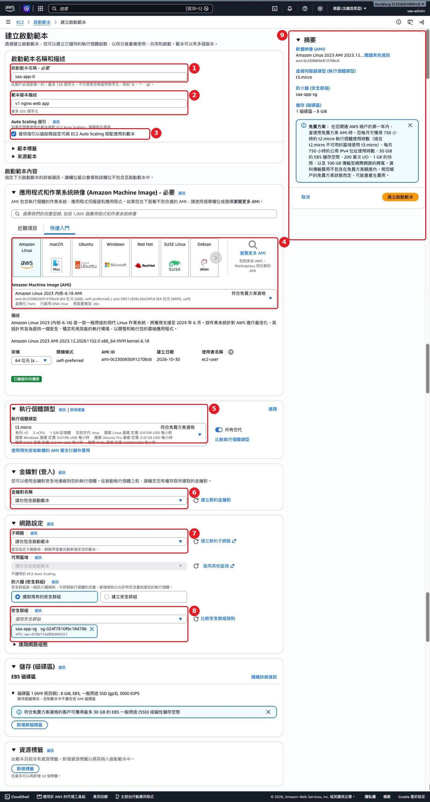

1. 名稱 `saa-app-lt`。
2. 版本描述 `v1 nginx web app`。啟動範本有版本控管，修改會產生 v2、v3…，ASG 可指定 Default / Latest 或特定版本。
3. 勾選「**Auto Scaling 指引**」：不適用於 ASG 的欄位會被標示或停用。
4. AMI：快速入門 → Amazon Linux 2023（`ami-0c230065b91270bc6`）。
5. 執行個體類型 `t3.micro`。
6. 金鑰對：「請勿包含啟動範本」。
7. 網路設定 → 子網路：「**請勿包含啟動範本**」。子網路交給 ASG 決定；範本裡寫死子網路會讓 ASG 只能在該 AZ 啟動。
8. 防火牆：「選取現有的安全群組」→ `saa-app-sg`。
9. 右側摘要確認。

> 「進階網路組態」不要展開設定網路介面，否則安全群組要改設在網路介面上。

### Step 4-7　建立啟動範本（下半：進階詳細資訊）

**進入路徑**：同上頁，展開「進階詳細資訊」

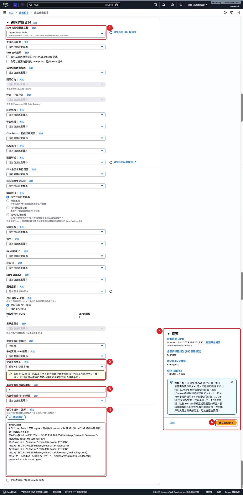

1. IAM 執行個體設定檔：`saa-ec2-ssm-role`（ASG 的 EC2 也能用 Session Manager 除錯）。
2. 中繼資料版本：預設「僅限 V2」。
3. 中繼資料回應躍點限制 2。
4. 使用者資料：貼上與 Lab 3 相同的 `web-userdata.sh`。私有子網路的 EC2 經 NAT 執行 `dnf install -y nginx`——**沒有 NAT 就會裝不起來、健康檢查失敗**。
5. 右側摘要再確認。
6. 按「建立啟動範本」→「已成功建立 saa-app-lt (`lt-03adf5882137b94b2`)」。

### Step 4-8　建立 ASG 步驟 1：選擇啟動範本

**進入路徑**：EC2 → 左側「Auto Scaling 群組」→「建立 Auto Scaling 群組」

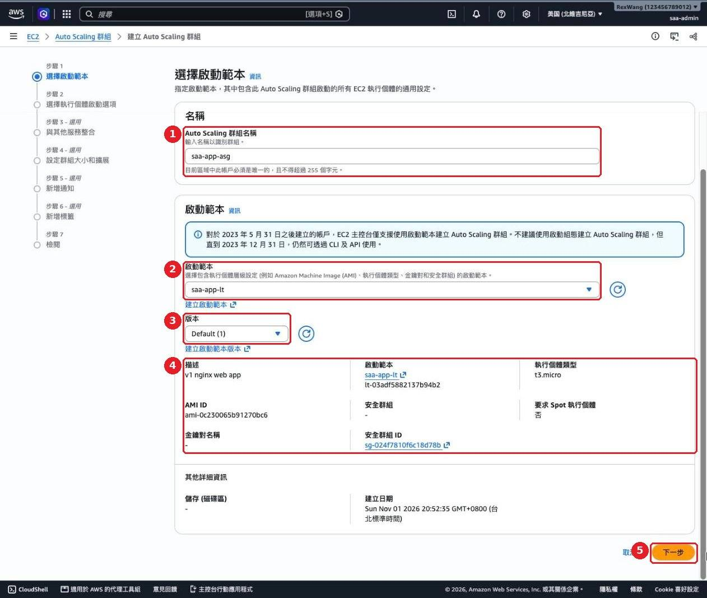

1. 名稱 `saa-app-asg`。
2. 啟動範本 `saa-app-lt`。提示：2023/5/31 之後建立的帳號，主控台只支援啟動範本（不再支援 Launch Configuration）。
3. 版本 `Default (1)`。
4. 範本摘要：t3.micro、AMI、SG `sg-024f7810f6c18d78b`、金鑰對「-」、要求 Spot「否」。
5. 按「下一步」。

### Step 4-9　步驟 2：選擇執行個體啟動選項（網路）

**進入路徑**：建立 ASG 精靈 → 步驟 2

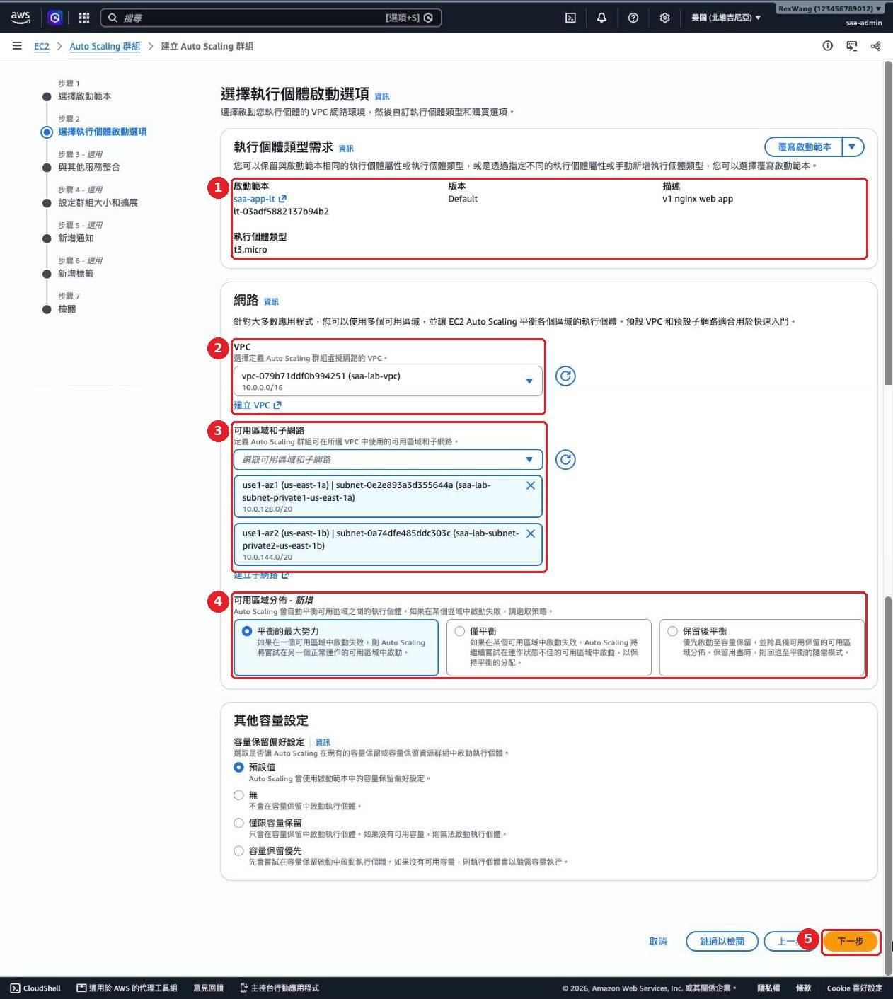

1. 執行個體類型需求：沿用啟動範本（可「覆寫」成多種類型，本 Lab 不用）。
2. VPC `saa-lab-vpc`。
3. 可用區域和子網路：**private1**（10.0.128.0/20）與 **private2**（10.0.144.0/20）。應用程式伺服器放私有子網路；ALB 才放公有子網路。
4. 可用區域分布（新）：「**平衡的最大努力**」（預設）——某 AZ 啟動失敗時改在其他健康 AZ 啟動；另有「僅平衡」「保留後平衡」。
5. 按「下一步」。

### Step 4-10　步驟 3：連接現有 ALB 與 ELB 健康檢查

**進入路徑**：建立 ASG 精靈 → 步驟 3

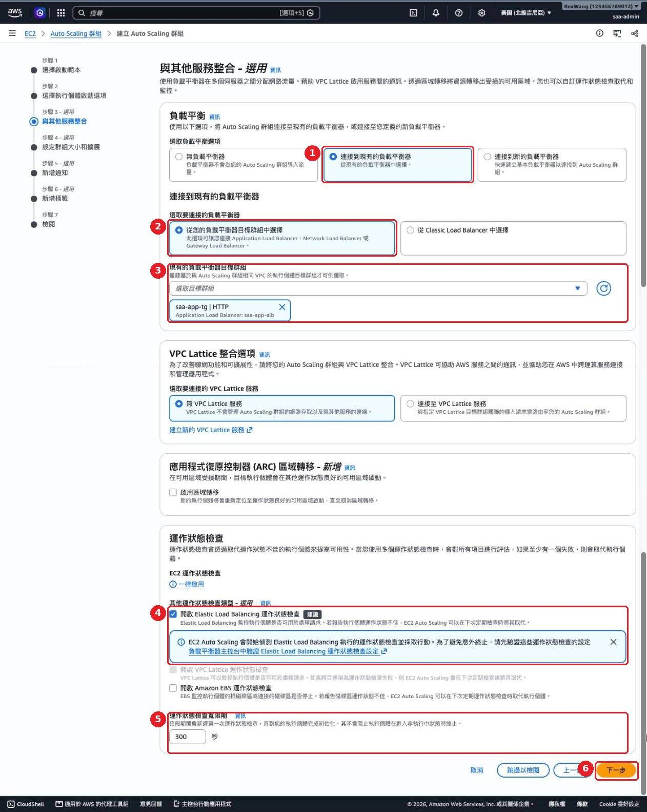

1. 負載平衡選「**連接到現有的負載平衡器**」。
2. 「從您的負載平衡器目標群組中選擇」。
3. 目標群組選 `saa-app-tg | HTTP`（下方註明 Application Load Balancer: saa-app-alb）。只有同 VPC 的執行個體類型目標群組才會出現。
4. 運作狀態檢查：EC2 檢查一律啟用；勾選「**開啟 Elastic Load Balancing 運作狀態檢查**」（建議）。只用 EC2 檢查時，nginx 掛掉但機器還活著 ASG 不會替換；加上 ELB 檢查才會。
5. 寬限期 `300` 秒：新執行個體開機、跑 User Data 的期間不做健康判定。
6. 按「下一步」。

### Step 4-11　步驟 4：群組大小與擴展

**進入路徑**：建立 ASG 精靈 → 步驟 4


1. 所需容量 `2`。
2. 下限 `2`、上限 `4`。**陷阱**：先改上限再改下限與所需容量，避免驗證錯誤。
3. 自動擴展選「**目標追蹤擴展政策**」（預設是「沒有擴展政策」）。
4. 政策名稱 `Target Tracking Policy`、指標「平均 CPU 使用率」。
5. 目標數值 `50`；執行個體暖機 300 秒。目標追蹤會自動建立兩個 CloudWatch 警示（Lab 7 會看到 `TargetTracking-saa-app-asg-AlarmHigh/AlarmLow`）。
6. 執行個體維護政策：「沒有政策」。
7. 之後按「**跳過以檢閱**」（通知、標籤不設定）。

### Step 4-12　步驟 7：檢閱並建立

**進入路徑**：建立 ASG 精靈 → 步驟 7


1. 步驟 1：saa-app-asg、saa-app-lt、Default。
2. 步驟 2：us-east-1a `subnet-0e2e893a3d355644a`、us-east-1b `subnet-0a74dfe485ddc303c`；平衡的最大努力。
3. 步驟 3：負載平衡器 saa-app-alb、目標群組 saa-app-tg。
4. 運作狀態檢查類型 **EC2, ELB**、寬限期 300 秒。
5. 步驟 4：2 / 2 / 4；目標追蹤 CPU 50。
6. 按「建立 Auto Scaling 群組」。

### Step 4-13　目標群組：兩台 Healthy、分屬兩個 AZ

**進入路徑**：EC2 →「目標群組」→ `saa-app-tg` →「目標」分頁（建立 ASG 後約 3–5 分鐘）


1. 「目標」分頁。
2. 摘要：目標總數 2、運作狀態良好 2。
3. 「註冊的目標 (2)」：`i-02ef56df75a10660f`（us-east-1a）與 `i-0390f5e1e23338334`（us-east-1b），Healthy——由 ASG 自動啟動並註冊。
4. 「區域」欄：一台 1a、一台 1b，ASG 自動平均分散。
5. 「負載平衡器」：saa-app-alb。

> **陷阱**：ASG 剛建立就看目標群組，可能仍顯示 0 個目標（主控台快取）；按「註冊的目標」右上的**重新整理**即可。

### Step 4-14　瀏覽器開啟 ALB DNS 名稱（第一次）

**進入路徑**：瀏覽器網址列輸入 `http://saa-app-alb-247025738.us-east-1.elb.amazonaws.com/`


*圖上方的網址列為後製示意。*

1. 顯示 `SAA Lab - i-0390f5e1e23338334 (us-east-1b)`：請求經 ALB 轉到 private2 的執行個體。EC2 本身沒有公有 IP，只能透過 ALB 存取。

### Step 4-15　再請求一次：換成另一個 AZ 的執行個體

**進入路徑**：同上，網址加上 `?refresh=2`


*圖上方的網址列為後製示意。*

1. 顯示 `SAA Lab - i-02ef56df75a10660f (us-east-1a)`：換成 us-east-1a 的另一台，證明 ALB 在兩個 AZ 的目標之間輪流分配（預設 Round robin）。

> 直接按 F5 有時一直看到同一台：瀏覽器重用 keep-alive 連線，加上 favicon 請求也會被分配。用 `curl` 連續請求或加不同查詢字串即可看到輪流（實測 8 次為 1b、1a 交替）。

### CLI 等效

```bash
./scripts/04-alb-asg.sh   # 與主控台同順序：SG → 目標群組 → 獨立 ALB → 啟動範本 → ASG（現有目標群組）
```

### 實務情境

- **銀行**：網銀前端放 ALB + WAF，ALB 只接受 CloudFront 或 WAF 過濾後的流量；應用程式層在私有子網路，跨 AZ 部署以符合營運持續要求；部署新版本用 Instance Refresh 或藍綠切換目標群組。
- **製造**：MES 的 Web 層用 ASG 固定 2 台（不擴展也要用 ASG 達到「壞了自動補」）；排程擴展在換班時段增加容量。
- **零售**：雙 11、週年慶前用**排程擴展**提前加機器，活動期間用目標追蹤；路徑路由把 `/api/*` 與 `/static/*` 分到不同目標群組。

### 延伸練習

1. **ALB HTTPS + ACM**：在 ACM 申請自己網域的公開憑證（DNS 驗證），新增 HTTPS:443 接聽程式，並把 HTTP:80 改成重新導向到 HTTPS（需要擁有網域）。
2. **啟動範本新版本 + Instance Refresh**：建立 `saa-app-lt` v2（例如首頁加上「v2」字樣），把 ASG 改用 Latest，執行「開始執行個體重新整理」，觀察滾動替換且服務不中斷。
3. 用 Session Manager 進入其中一台 `sudo systemctl stop nginx`，觀察 ELB 健康檢查失敗 → ASG 自動替換。
4. 新增**排程動作**：每天某時段把所需容量改成 3。

### 考試重點

| 情境 | 答案 |
|---|---|
| HTTP/HTTPS、路徑/主機名路由、WebSocket | **ALB**（第 7 層） |
| TCP/UDP、極低延遲、固定 IP | **NLB**（第 4 層，可配 Elastic IP） |
| 串接第三方防火牆設備 | **GWLB** |
| 依指標維持在目標值 | Target Tracking（最常見答案） |
| 已知時段尖峰（每天 9 點） | Scheduled Scaling |
| 依歷史模式預先擴展 | Predictive Scaling |
| 應用程式掛了但 EC2 還活著也要替換 | ASG 健康檢查類型加上 **ELB** |
| 縮減時避免中斷連線 | ALB Deregistration Delay（Connection Draining） |
| 讓應用程式無狀態 | Session 放到 ElastiCache / DynamoDB，而非 Sticky Session |
| 只允許 ALB 連到後端 | 後端 SG 的來源設為 **ALB 的 SG**（SG 參照） |

---

## Lab 5：S3 版本控制、加密與生命週期

> **本 Lab 操作身分與環境**
>
> | 項目 | 內容 |
> |---|---|
> | 操作身分 | IAM 使用者 **`saa-admin`**（群組 `saa-admins`，AdministratorAccess） |
> | 登入方式 | IAM 使用者登入 URL → `saa-admin` → 密碼 → MFA |
> | 區域 | **us-east-1**（Bucket 名稱全球唯一，但資料存在你選的區域） |
> | 前置條件 | Lab 0；本機準備 [`test-data/site/`](test-data/site/) 的 `index.html`、`error.html`、`orders.csv`、`index-v2.html` |
> | 預估時間 / 費用 | 約 15 分鐘 / 幾 KB 的儲存與請求，幾乎為 0 |

**目標**：建立私有 Bucket（Lab 9 當 CloudFront 來源），開啟版本控制與 SSE-S3，上傳網站檔案、覆蓋同名檔觀察版本，再用生命週期規則自動分層與清除舊版本。

### Step 5-1　建立儲存貯體

**進入路徑**：主控台 → S3 → 左側「一般用途儲存貯體」→「建立儲存貯體」


1. 儲存貯體類型「**一般用途**」（預設）。「目錄」是 S3 Express One Zone 用的（單一 AZ、低延遲，不是多 AZ 耐久）。
2. 命名空間「**全域命名空間**」（預設）。新版多了「帳戶區域命名空間（建議）」；本教學沿用傳統全域命名空間，所以名稱必須在**全世界所有帳號**中唯一。
3. 名稱 `saa-lab-site-20261101-rexw`（請換成你自己的日期與代號；3–63 字元，小寫、數字、`.`、`-`）。
4. 物件擁有權「ACL 已停用（建議）」：存取一律用政策控制。
5. 「封鎖所有公開存取權」保持勾選（四個子項目一起）。之後由 CloudFront OAC 對外，Bucket 不需要公開。
6. 儲存貯體版本控制：**改選「啟用」**。**陷阱**：預設是「停用」。版本控制一旦啟用只能「暫停」，無法回到從未啟用。
7. 預設加密：**SSE-S3**（預設）、儲存貯體金鑰「啟用」（只對 SSE-KMS 有降低 KMS 請求費的效果）。
8. 按「建立儲存貯體」。

> 新 Bucket 預設就是 SSE-S3、ACL 停用、封鎖公開存取；本頁**需要手動改的只有名稱與版本控制**。

| 加密方式 | 金鑰管理 | 適用情境 |
|---|---|---|
| SSE-S3 | AWS 全權管理 | 預設、最省事 |
| SSE-KMS | KMS 金鑰，可稽核、可控權限 | 合規要求、需要 CloudTrail 記錄金鑰使用 |
| DSSE-KMS | 雙層 KMS 加密 | 特定合規要求 |
| SSE-C | 客戶自帶金鑰，每次請求附上 | 金鑰必須留在企業手中（新 Bucket 預設封鎖 SSE-C，見 Step 5-5） |

### Step 5-2　上傳三個網站檔案

**進入路徑**：S3 → `saa-lab-site-20261101-rexw` →「物件」→「上傳」


1. 「新增檔案」選取 `index.html`（278 B）、`error.html`（134 B）、`orders.csv`（272 B），共 684.0 B。
2. 目的地 `s3://saa-lab-site-20261101-rexw`（根目錄）。「目的地詳細資訊」可看到版本控制與預設加密會套用到新物件。
3. 「許可」「屬性」保持預設：儲存類別「標準」、加密沿用 Bucket 預設。
4. 按「上傳」。

### Step 5-3　上傳成功

**進入路徑**：按「上傳」後自動顯示「上傳：狀態」


1. 綠色橫幅「上傳成功」。
2. 摘要：已成功 3 個檔案（684.0 B），失敗 0。
3. 三個檔案狀態皆「已成功」。

> 此頁離開後就看不到了；按右上「關閉」回到 Bucket。

### Step 5-4　覆蓋 index.html 後顯示版本

**進入路徑**：先在本機把 `test-data/site/index-v2.html` 複製一份並命名為 `index.html`（259 B），再到 Bucket「上傳」覆蓋同名物件 → 回「物件」分頁 → 打開「顯示版本」


1. 打開「顯示版本」開關，清單多出「版本 ID」欄。
2. `index.html` 出現兩列：最新（目前）版本 `ZoqF_iUNgPnPUMQ23uB0UlJ4kiMZbdzb`（259 B，v2），縮排的非目前版本 `o1L4GAyNwepPwiKgO6KohPlK_SVwUUed`（278 B，v1）。
3. 其他物件也都有版本 ID（`error.html`、`orders.csv`）。未啟用版本控制時版本 ID 為 `null`。

> 誤刪物件時只會產生「刪除標記」，舊版本仍可還原。但舊版本也會計費——下一步用生命週期清除。

### Step 5-5　儲存貯體「屬性」分頁

**進入路徑**：S3 → Bucket →「屬性」分頁


1. 儲存貯體版本控制：**已啟用**。
2. MFA 刪除：已停用。**MFA Delete 只能由 root 使用者用 CLI / API 開啟**，主控台無法設定（常考）。
3. 預設加密：SSE-S3。
4. 儲存貯體金鑰：已啟用；下方「封鎖的加密類型：SSE-C」——新 Bucket 預設禁止 SSE-C 上傳。
5. 物件鎖定：已停用（WORM，本 Lab 不用）。
6. S3 靜態網站託管：已停用。本教學改用 CloudFront + OAC，Bucket 保持私有。

> 概觀區 ARN：`arn:aws:s3:::saa-lab-site-20261101-rexw`——S3 Bucket ARN 不含區域與帳號 ID。

### Step 5-6　建立生命週期規則

**進入路徑**：S3 → Bucket →「管理」→「生命週期規則」→「建立生命週期規則」


1. 規則名稱 `saa-tiering-and-cleanup`。
2. 範圍「套用至儲存貯體中的所有物件」。
3. 勾選「我確認此規則會套用於儲存貯體中的所有物件」。
4. 規則動作勾兩項：「在儲存體類別之間轉移目前版本的物件」與「永久刪除非目前版本的物件」。
5. 勾選「我確認此生命週期規則將針對每個請求產生轉移費用」。藍色提示：**預設小於 128 KB 的物件不會轉移**（本 Lab 的小檔案實際上不會轉移，規則仍可建立）。
6. 轉移目前版本：**標準 – IA** 於 **30** 天；「新增轉移」第二列預設帶出「智慧型階層處理」，要**改選 Glacier Flexible Retrieval**，**90** 天。（下拉也提示最短儲存期間：IA 30 天、Glacier 90 天、Deep Archive 180 天。）
7. 永久刪除非目前版本：成為非目前版本後 **30** 天。
8. 頁尾時間軸：目前版本 第 0 天 → 30 天 IA → 90 天 Glacier；非目前版本 第 0 天 → 30 天刪除。
9. 按「建立規則」。

> 生命週期每天非同步執行，不會立即生效。

### CLI 等效

```bash
./scripts/05-s3.sh   # Bucket 名稱預設為 saa-lab-site-<帳號ID>-<日期>，可用 BUCKET=... 覆寫
```

### 實務情境

- **銀行**：交易對帳檔、報表放 S3，用 **SSE-KMS 指定客戶受管金鑰**、版本控制、**Object Lock（合規模式）** 滿足保存年限與不可竄改要求；跨區複寫到另一區域做災備。
- **製造**：機台 log、影像檢測圖片量大且越舊越少用：生命週期 30 天轉 IA、180 天轉 Deep Archive；用前綴（例如 `plant=TW01/`）區分廠區套不同規則。
- **零售**：商品圖片與靜態網站放 S3 + CloudFront；促銷素材用 Presigned URL 讓外部設計公司限時上傳。

### 延伸練習

1. **跨區複寫（CRR）**：在 us-west-2 建立另一個啟用版本控制的 Bucket，設定複寫規則，上傳新檔觀察複寫狀態。
2. **Object Lock**：建立一個啟用物件鎖定的新 Bucket，以「治理模式」保留 1 天，嘗試刪除物件版本觀察被拒。
3. **Presigned URL**：在 CloudShell 執行 `aws s3 presign s3://<bucket>/orders.csv --expires-in 300`，用瀏覽器在 5 分鐘內下載、過期後再試。
4. 刪除 `index.html` 的目前版本，觀察 v1 自動成為目前版本；或在一般檢視刪除後再刪「刪除標記」還原。

### 考試重點

| 儲存類別 | 特性 |
|---|---|
| Standard | 頻繁存取 |
| Intelligent-Tiering | 存取模式不確定，自動分層（有少量監控費） |
| Standard-IA / One Zone-IA | 不常存取但要即時取回；One Zone 只在單一 AZ |
| Glacier Instant Retrieval | 季度存取一次、毫秒取回 |
| Glacier Flexible Retrieval | 分鐘到小時取回 |
| Glacier Deep Archive | 最便宜，12–48 小時取回，合規長期保存 |

- 防誤刪：**版本控制 + MFA Delete**（root 用 CLI 開）；合規不可改：**Object Lock（WORM）**
- 跨區災備：**Cross-Region Replication**（兩端都要開版本控制）
- 大檔上傳：**Multipart Upload**；遠距加速：**Transfer Acceleration**
- 授權他人暫時上傳/下載：**Presigned URL**
- 小於 128 KB 的物件預設不轉移；IA 最短 30 天、Glacier Flexible 90 天、Deep Archive 180 天

---

## Lab 6：RDS MySQL Multi-AZ 與容錯移轉

> **本 Lab 操作身分與環境**
>
> | 項目 | 內容 |
> |---|---|
> | 操作身分 | IAM 使用者 **`saa-admin`**（群組 `saa-admins`，AdministratorAccess） |
> | 登入方式 | IAM 使用者登入 URL → `saa-admin` → 密碼 → MFA |
> | 區域 | **us-east-1** |
> | 前置條件 | Lab 2（兩個私有子網路）、Lab 4（`saa-app-sg`，DB SG 的來源） |
> | 預估時間 / 費用 | 約 40 分鐘（含建立等待 10–12 分鐘）/ 主控台估算 29.42 USD/月，約 0.04 USD/小時 |

**目標**：在私有子網路建立 Multi-AZ 資料庫 `saa-lab-mysql`，SG 只允許 `saa-app-sg`，密碼交給 Secrets Manager 管理，並實際觸發一次容錯移轉觀察主要 AZ 切換。

### Step 6-1　建立資料庫安全群組 saa-db-sg

**進入路徑**：EC2 →「安全群組」→「建立安全群組」


1. 名稱 `saa-db-sg`。
2. 描述 `MySQL only from app SG`。
3. VPC 改選 `saa-lab-vpc`。
4. 傳入規則類型 `MYSQL/Aurora`（TCP 3306）。
5. 來源類型「自訂」，輸入 `sg-024f7810f6c18d78b` 並從下拉點選 `saa-app-sg`——只有應用程式層的 EC2 能連資料庫。
6. 傳出規則保留預設，按「建立安全群組」→ `sg-00650642f1ae46a57`。

> 分層 SG 參照：**ALB SG → App SG → DB SG**，是 SAA 典型的三層架構。

### Step 6-2　建立 DB 子網路群組 saa-db-subnets

**進入路徑**：主控台 → Aurora and RDS → 左側「子網路群組」→「建立資料庫子網路群組」


1. 名稱 `saa-db-subnets`。
2. 描述 `SAA lab private subnets`。
3. VPC `saa-lab-vpc`。
4. 可用區域勾 `us-east-1a`、`us-east-1b`。
5. 子網路**只選兩個私有子網路**：private1（`subnet-0e2e893a3d355644a`，10.0.128.0/20）與 private2（`subnet-0a74dfe485ddc303c`，10.0.144.0/20）。
6. 「已選取的子網路 (2)」再確認 AZ、ID、CIDR。
7. 按「建立」。

> 藍色提示「多可用區域資料庫**叢集**需要 3 個 AZ 的 3 個子網路」——那是 Multi-AZ DB Cluster；本 Lab 用 Multi-AZ DB **執行個體**，兩個 AZ 就夠。

### Step 6-3　建立資料庫（1/4）：引擎、建立方法、範本、部署選項

**進入路徑**：Aurora and RDS →「資料庫」→「建立資料庫」


1. 引擎類型：**MySQL**。**陷阱**：新版頁面把引擎選項放最上面，預設是 **Aurora (PostgreSQL Compatible)**。
2. 建立方法：「**完整組態**」（「輕鬆建立」看不到網路設定）。
3. 範本：**開發/測試**（「生產」預設較大規格與刪除保護；「免費方案」只能單一 AZ）。
4. 部署選項：**多可用區域資料庫執行個體部署（2 個執行個體）**——另一個 AZ 有不可讀的同步待命。左邊「多可用區域資料庫叢集（3 個執行個體）」待命可讀但更貴；右邊「單一可用區域」沒有備援。

### Step 6-4　建立資料庫（2/4）：設定、執行個體、儲存

**進入路徑**：同一頁往下捲


1. 引擎版本：預設 **MySQL 8.4.11**；「啟用 RDS Extended Support」**不勾**（過了標準支援期後的付費延長支援）。
2. 資料庫執行個體識別符 `saa-lab-mysql`（預設 `database-1`）。**陷阱**：欄位內 Ctrl+A 不一定全選，曾變成 `saa-lab-mysqldatabase-1`；用 End + 多次 Backspace 清空再輸入。
3. 主要使用者名稱 `admin`。
4. 憑證管理：「**以 AWS Secrets Manager 管理 – 最安全**」（預設）：RDS 自動產生並輪換密碼，你不需要也看不到明碼；Secrets Manager 每個機密約 0.40 USD/月。加密金鑰保留 `aws/secretsmanager`。
5. 執行個體組態：選「**爆量類別（包括 t 類別）**」→ **db.t3.micro**。**陷阱**：預設是標準類別的 **db.m7g.large**。
6. 儲存體：**gp3**、配置 **20 GiB**。**陷阱**：本次預設帶入 **gp3 200 GiB**（同樣用 End + Backspace 清空，否則會變成 20200 而出現「最多 6,144 GiB」錯誤）。gp3 400 GiB 以下為 3000 IOPS / 125 MiBps 基準。
7. 展開「額外的儲存組態」→ **取消勾選「啟用儲存自動擴展」**（預設勾選、最大 1000 GiB）。

### Step 6-5　建立資料庫（3/4）：連線

**進入路徑**：同一頁往下捲到「連線」


1. 運算資源「不要連接至 EC2 運算資源」（選「連接」會自動建 SG 規則；教學上用自己的 saa-db-sg 比較清楚）。
2. VPC：**改選** `saa-lab-vpc`（預設 Default VPC）。建立後無法變更 VPC。
3. 資料庫子網路群組：自動帶入 `saa-db-subnets`。
4. 公開存取：「**否**」（預設）。
5. VPC 安全群組「選擇現有」→ 移除 `default`、加入 `saa-db-sg`，只留一個。
6. 展開「其他組態」：連接埠 3306。

> 新版頁面在 Multi-AZ 時**沒有「可用區域」下拉**，主要 / 待命 AZ 由 RDS 決定。

### Step 6-6　建立資料庫（4/4）：監控、其他組態、預估成本

**進入路徑**：同一頁往下捲到「監控」


1. 監控：Database Insights – 標準（預設）。
2. 展開「其他監控設定」→ **取消勾選「啟用 Enhanced Monitoring」**。**陷阱**：預設勾選（60 秒粒度），會建立 `rds-monitoring-role` 並產生 CloudWatch Logs 費用。
3. 「其他組態」→ 初始資料庫名稱 `saalab`（不填則 RDS 不建立任何資料庫）。參數群組 `default.mysql8.4`；加密已啟用（`aws/rds`）。
4. 備份：保留期間改為 **1 天**（預設 7）。
5. 維護：「啟用刪除保護」**不勾**（開發/測試範本預設已關閉）。
6. 預估每月成本：執行個體 24.82 + 儲存 4.60 = **29.42 USD**。
7. 按「建立資料庫」。

> 狀態依序「建立中 → 正在備份 → 可用」，約 10–12 分鐘（事件顯示 RDS 先建單一 AZ，再「轉換為 Multi-AZ」）。**陷阱**：按下建立後頁面一片空白——SPA 跳轉後捲動位置停在很下面，捲回最上方即可。

### Step 6-7　資料庫詳細資訊：連線與安全性

**進入路徑**：Aurora and RDS → 資料庫 → `saa-lab-mysql` →「連線與安全性」


1. 摘要：狀態「可用」、db.t3.micro、可用區域 **us-east-1b**（容錯移轉前的主要 AZ）。
2. 「連線與安全性」分頁。
3. 新版先顯示「連線方式」：程式碼片段 / CloudShell / **端點**；選「端點」可看到資料庫名稱 saalab、使用者 admin、連接埠 3306、主憑證 ARN（`rds!db-1402a6e3-…`）。
4. 端點 `saa-lab-mysql.ce3m4mie20qx.us-east-1.rds.amazonaws.com`、連接埠 3306。**應用程式一律連這個 DNS 名稱**，容錯移轉後 DNS 自動指向新主要。
5. 聯網：us-east-1b、saa-lab-vpc、saa-db-subnets、兩個私有子網路。
6. 安全性：`saa-db-sg` 作用中、**可公開存取：否**。

> 頂端提示「儲存初始化進行中」：新磁碟區在背景初始化，期間可用但延遲可能較高。

### Step 6-8　資料庫詳細資訊：組態

**進入路徑**：同上 →「組態」分頁


1. 摘要可用區域 us-east-1b。
2. 引擎版本 8.4.11、資料庫名稱 saalab。
3. 可用性 → **多可用區域：是**。下方「次要區域：-」指的是**跨區域**複本，不是次要 AZ；新版「組態」頁沒有顯示次要 AZ，要用 CLI 查（Step 6-12）。
4. 儲存：**gp3**、**20 GiB**（3000 IOPS、125 MiBps）。
5. 儲存自動擴展：已停用。
6. 增強型監控：已停用。
7. 刪除保護：已停用。

### Step 6-9　重新開機並容錯移轉

**進入路徑**：資料庫 `saa-lab-mysql` → 右上「動作」→「重新啟動」


1. 確認對象 `saa-lab-mysql`。
2. 勾選「**重新啟動並容錯移轉？**」——只有 Multi-AZ 才有；不勾就只是原地重開。
3. 按「確認」。

> 清單狀態變「重新啟動」，約 1 分鐘後回到「可用」，可用區域由 us-east-1b 變為 **us-east-1a**。

### Step 6-10　日誌與事件：容錯移轉事件

**進入路徑**：資料庫 →「日誌與事件」→「最近事件」


1. 最近事件（預設最後 1 天）。
2. 由下往上：21:34 `Multi-AZ instance failover started.` → 21:35 `DB instance restarted` → 21:35 `Multi-AZ instance failover completed` → `The user requested a failover of the DB instance.`（UTC+8）。整個容錯移轉約 **1 分鐘**。
3. 建立過程：21:21 `Applying modification to convert to a Multi-AZ DB Instance` → 21:28 `Finished applying modification…`。

> 事件清單更下方有 00:09–00:13 的 failover / shutdown / deleted 事件：那是當天稍早**另一個同名執行個體**的測試紀錄（已刪除），不是本次操作，可忽略。

### Step 6-11　容錯移轉後：主要 AZ = us-east-1a

**進入路徑**：資料庫 `saa-lab-mysql`（日誌與事件分頁）


1. 摘要「區域與可用區域」：**us-east-1a**（原本 1b）。
2. 最近事件最上方四筆即容錯移轉事件。

> 端點 DNS 名稱不變，應用程式不用改設定，只會在切換的數十秒內斷線後重連。

### Step 6-12　CloudShell 確認主要 / 次要 AZ

**進入路徑**：主控台工具列 → CloudShell


1. 執行：

   ```bash
   aws rds describe-db-instances --db-instance-identifier saa-lab-mysql \
     --query 'DBInstances[0].[DBInstanceStatus,MultiAZ,AvailabilityZone,SecondaryAvailabilityZone,StorageType,AllocatedStorage,Endpoint.Address]' --output table
   ```

   輸出：`available`、`True`、`us-east-1a`（主要）、`us-east-1b`（待命）、`gp3`、`20`、端點。`SecondaryAvailabilityZone` 只有 Multi-AZ 執行個體才有值。

### CLI 等效

```bash
./scripts/06-rds.sh   # 建 saa-db-sg、saa-db-subnets、Multi-AZ 執行個體並強制容錯移轉
```

### 實務情境

- **銀行**：核心周邊系統（如通路、對帳）用 Multi-AZ 達到 AZ 層級高可用；報表查詢導向 **Read Replica**，避免影響交易；跨區域災備用 Aurora Global Database 或跨區快照複製。DB 密碼一律由 Secrets Manager 輪換。
- **製造**：MES 資料庫要求維護時段停機最短：Multi-AZ 讓次要版本升級、作業系統修補先在待命進行再切換。
- **零售**：促銷期間大量 Lambda 短連線打資料庫：前面放 **RDS Proxy** 共用連線池，避免連線數爆掉。

### 延伸練習

1. **Read Replica**：從 `saa-lab-mysql` 建立讀取複本（db.t3.micro），比較端點與「複寫延遲」指標；練習「升級為獨立執行個體」。
2. **RDS Proxy**：建立 Proxy 並以 Secrets Manager 機密驗證，讓 Lab 4 的 EC2 透過 Proxy 端點連線。
3. **應用程式從 Secrets Manager 取密碼**：在 ASG 的 EC2 上用 Session Manager 執行 `aws secretsmanager get-secret-value --secret-id 'rds!db-...' --query SecretString`（需在 `saa-ec2-ssm-role` 加最小權限），再用 `mysql` 用戶端連線。注意不要把輸出貼到任何地方。
4. 手動建立快照，練習「還原到時間點」產生新執行個體。

### 考試重點

| 需求 | 答案 |
|---|---|
| 高可用、自動容錯移轉 | **Multi-AZ**（同步複寫，待命預設不可讀） |
| 分擔讀取流量 | **Read Replica**（非同步，可跨區，可升級為獨立 DB） |
| 待命也要可讀、容錯移轉更快 | Multi-AZ DB **Cluster**（1 寫 + 2 可讀待命，需 3 個 AZ） |
| 跨區災難復原、RPO 秒級 | Aurora Global Database |
| 大量短連線（Lambda） | **RDS Proxy** |
| 不可預測的負載、自動擴展 | Aurora Serverless v2 |
| 密碼不寫在程式碼、自動輪替 | **Secrets Manager**（Parameter Store 沒有內建輪替） |
| 時間點還原 | 自動備份（保留 1–35 天） |
| 測試容錯移轉 | Reboot with failover |

---

## Lab 7：CloudWatch 警示 + SNS 通知

> **本 Lab 操作身分與環境**
>
> | 項目 | 內容 |
> |---|---|
> | 操作身分 | IAM 使用者 **`saa-admin`**（群組 `saa-admins`，AdministratorAccess） |
> | 登入方式 | IAM 使用者登入 URL → `saa-admin` → 密碼 → MFA |
> | 區域 | **us-east-1** |
> | 前置條件 | Lab 4（`saa-app-asg`，警示監看它的 CPU） |
> | 預估時間 / 費用 | 約 15 分鐘 / 警示與 SNS 在免費方案額度內通常為 0 |

**目標**：建立 SNS 主題 `saa-alerts`，再建立警示 `saa-asg-high-cpu`：ASG 平均 CPU > 70% 持續 5 分鐘就通知 SNS；最後用 CLI 手動切到 ALARM 驗證動作。

### Step 7-1　建立 SNS 主題 saa-alerts

**進入路徑**：主控台 → Simple Notification Service → 左側「主題」→「建立主題」


1. 類型：**改選「標準」**。**陷阱**：這個頁面目前**預設是「FIFO」**；FIFO 主題只能訂閱 SQS，名稱必須以 `.fifo` 結尾，不能送 Email / SMS / Lambda。類型建立後無法修改。
2. 名稱 `saa-alerts`。顯示名稱（SMS 用）留空；最大訊息大小保持 256 KiB（新功能可調到 1 MiB）。
3. 「加密 – 選用」不展開：預設只有傳輸中加密，要靜態加密需指定 KMS 金鑰。其他區塊保持預設。
4. 按「建立主題」。

| 類型 | 順序 | 交付 | 可訂閱的協定 |
|---|---|---|---|
| FIFO | 嚴格保序 | 恰好一次 | 只有 SQS |
| 標準 | 盡力 | 至少一次 | SQS、Lambda、HTTP/S、Email、SMS、Firehose… |

### Step 7-2　主題詳細資訊

**進入路徑**：建立後自動進入主題頁


1. 綠色橫幅「成功建立主題 saa-alerts」。
2. ARN：`arn:aws:sns:us-east-1:123456789012:saa-alerts`。警示動作與其他服務都用 ARN 指向主題。
3. 類型「標準」。
4. 「訂閱 (0)」：目前沒有訂閱者，警示觸發時訊息會發佈成功但沒有人收到。
5. 「建立訂閱」：本 Lab 不建立。要收信：通訊協定「電子郵件」→ 填信箱 → 到信箱點「Confirm subscription」，狀態從「待確認」變「已確認」後才會收到（未確認的訂閱 3 天後失效）。

### Step 7-3　建立警示：選擇指標

**進入路徑**：主控台 → CloudWatch → 左側「警示」→「建立警示」→「選擇指標」


1. 瀏覽：全部 → **EC2** → **By Auto Scaling Group**（ASG 層級彙總；另一個 Per-Instance Metrics 是單台）。
2. 搜尋 `CPUUtilization`。
3. 勾選 `saa-app-asg | CPUUtilization`，上方圖表顯示平均 CPU（約 0.2%；剛啟動安裝 nginx 時曾到 8%）。
4. 按「選擇指標」。

### Step 7-4　指定指標和條件

**進入路徑**：建立警示精靈 步驟 1


1. 指標：`AWS/EC2`、`CPUUtilization`、`AutoScalingGroupName = saa-app-asg`。
2. 統計資料「平均數」、期間「5 分鐘」（預設）。EC2 基本監控每 5 分鐘一個資料點；1 分鐘需開詳細監控（另計費）。
3. 閾值類型「靜態」（另一種「異常偵測」用 ML 頻帶）。
4. 條件「大於 >」。
5. 閾值 `70`，圖上出現紅色虛線。
6. 展開「其他組態」：要發出警示的資料點 `1` / `1`（1 個 5 分鐘期間超過就觸發）；缺少資料「視為缺少」。
7. 按「下一步」。

> 這個 ASG 已經有 Lab 4 目標追蹤自動建立的 `TargetTracking-saa-app-asg-AlarmHigh/AlarmLow` 兩個警示，那是擴展用的，不要修改或刪除；本 Lab 的警示是用來「通知人」。

### Step 7-5　設定動作：通知 SNS

**進入路徑**：建立警示精靈 步驟 2


1. 警示狀態觸發「**警示中**」（ALARM）。可再「新增通知」給「好（OK）」狀態，恢復時也收到訊息。
2. 「選取現有的 SNS 主題」。
3. 傳送通知至 `saa-alerts`；下方顯示「主題沒有端點」——提醒還沒有訂閱者。
4. Lambda、Auto Scaling、EC2、系統管理員、調查動作都不設定，按「下一步」。

> 「EC2 動作」（停止 / 終止 / 重開 / 復原）只適用單一執行個體指標，所以用 ASG 指標時是灰色。

### Step 7-6　新增警示詳細資訊

**進入路徑**：建立警示精靈 步驟 3


1. 警示名稱 `saa-asg-high-cpu`。
2. 警示描述 `ASG average CPU > 70% for 5 minutes`。
3. 標籤不加，按「下一步」。

### Step 7-7　預覽並建立

**進入路徑**：建立警示精靈 步驟 4


1. 指標：AWS/EC2、CPUUtilization、saa-app-asg、平均數、5 分鐘。
2. 條件：靜態、> 70。
3. 動作：「警示中」時通知 `saa-alerts`。
4. 名稱與描述。
5. 按「建立警示」。

> 建立後先是「資料不足」，約 30 秒後評估為「好」。

### Step 7-8　手動觸發後的歷程記錄

**進入路徑**：CloudWatch → 警示 → `saa-asg-high-cpu` →「歷程記錄」分頁（先完成 Step 7-9）


1. 「歷程記錄」分頁。
2. `2026-11-01 13:22:12` 類型「動作」：**成功執行動作** `arn:aws:sns:us-east-1:123456789012:saa-alerts`——警示已把訊息發佈到 SNS。
3. `13:22:12` 狀態更新：「好」→「警示中」（CLI 手動設定的那次）。
4. `13:22:06` 狀態更新：「資料不足」→「好」。
5. `13:21:37` 組態更新：警示建立。

> 清單下方 10/31 的三筆紀錄是**之前建立又刪除過同名警示**留下的歷史（依名稱保留 30 天），不是本次操作。時間欄為 UTC。手動設的 ALARM 是暫時的，下一次評估 CPU 仍低就回到「好」。

### Step 7-9　CloudShell 手動把警示設為 ALARM

**進入路徑**：主控台工具列 → CloudShell


1. 執行：

   ```bash
   aws cloudwatch set-alarm-state --alarm-name saa-asg-high-cpu --state-value ALARM --state-reason "SAA lab manual test"
   aws cloudwatch describe-alarms --alarm-names saa-asg-high-cpu --query 'MetricAlarms[0].[AlarmName,StateValue,StateReason]' --output table
   ```

2. 輸出 `saa-asg-high-cpu`、`ALARM`、`SAA lab manual test`。`set-alarm-state` 不用真的把 CPU 拉高就能測試通知流程（考試常見「如何測試警示動作」）。

### CLI 等效

```bash
./scripts/07-cloudwatch-sns.sh
```

### 實務情境

- **銀行**：關鍵交易系統的警示同時送 SNS → Email、→ 值班系統（PagerDuty / Opsgenie 的 HTTPS 端點）、→ SQS 留存；ALARM 與 OK 都通知，事後可計算 MTTR。
- **製造**：產線伺服器 CPU、磁碟（需 CloudWatch Agent）超標時通知廠務 IT；**複合警示**只在「CPU 高且健康主機數下降」時才叫人，減少誤報。
- **零售**：大促時以儀表板集中顯示 ALB 5xx、目標回應時間、ASG 容量、RDS 連線數；用異常偵測警示取代固定閾值。

### 延伸練習

1. **Email 訂閱**：替 `saa-alerts` 建立 Email 訂閱並確認，再執行一次 `set-alarm-state`，檢查收到的信件內容。
2. **複合警示**：再建一個「ALB `UnHealthyHostCount` > 0」的警示，然後建立複合警示 `ALARM(saa-asg-high-cpu) AND ALARM(<新警示>)`。
3. **儀表板**：建立 `saa-lab` 儀表板，加入 ASG CPU、ALB `RequestCount`、`TargetResponseTime`、RDS `DatabaseConnections`。
4. 為「好」狀態新增通知，觀察恢復時也會發送訊息。

### 考試重點

- EC2 預設指標不含**記憶體與磁碟使用率** → 需安裝 **CloudWatch Agent**
- 誰呼叫了什麼 API → **CloudTrail**；資源設定是否合規、變更歷史 → **AWS Config**
- 事件驅動自動化（排程、狀態變更）→ **EventBridge**
- 警示動作可以是：SNS、Auto Scaling、EC2 動作（停止 / 重開 / 復原）、Systems Manager
- 測試警示通知 → `set-alarm-state`
- SNS FIFO 只能搭配 SQS（FIFO）；要 Email / Lambda 就用標準主題

---

## Lab 8：Lambda + DynamoDB 訂單 API

> **本 Lab 操作身分與環境**
>
> | 項目 | 內容 |
> |---|---|
> | 操作身分 | IAM 使用者 **`saa-admin`**（群組 `saa-admins`，AdministratorAccess） |
> | 登入方式 | IAM 使用者登入 URL → `saa-admin` → 密碼 → MFA |
> | 區域 | **us-east-1** |
> | 前置條件 | Lab 0；本機準備 `fn.zip`（在 repo 根目錄執行 `cd lambda && zip ../fn.zip lambda_function.py`） |
> | 預估時間 / 費用 | 約 25 分鐘 / Lambda 與 DynamoDB 隨需在免費方案額度內通常為 0 |

**目標**：建立 DynamoDB 資料表 `saa-orders` 與 Python Lambda `saa-order-api`；用**環境變數**傳入表名、用**內嵌政策** `saa-orders-rw` 授予最小權限（只允許這張表的 PutItem / GetItem），再用主控台測試事件寫入與查詢訂單。

### Step 8-1　建立 DynamoDB 資料表 saa-orders

**進入路徑**：主控台 → DynamoDB → 左側「資料表」→「建立資料表」


1. 資料表名稱 `saa-orders`。
2. 分區索引鍵 `order_id`，類型「字串」。分區索引鍵經雜湊決定資料放在哪個分割區，要選高基數、存取平均的屬性。
3. 排序索引鍵：**留空**——主索引鍵只有分區索引鍵，每個 `order_id` 只能有一筆。
4. 資料表設定「預設設定」。
5. 預設值：資料表類別 DynamoDB 標準、**容量模式「隨需」**（依請求量計費）、LSI 無（建立後不能加）、加密「AWS 擁有的金鑰」、刪除保護「關閉」。
6. 按「建立資料表」→ 幾秒後「作用中」。

### Step 8-2　建立 Lambda 函式 saa-order-api

**進入路徑**：主控台 → Lambda →「建立函式」（新版主控台標題為「Create Event Function」）


1. 選「**從頭開始撰寫**」（另有「使用藍圖」「容器映像」）。
2. 函式名稱 `saa-order-api`。
3. 執行時期：預設 Node.js 24.x，**改選 Python 3.14**（最新支援；Python 3.15 標示 Preview 不選）。
4. 許可說明：Lambda 會建立具有寫入 CloudWatch Logs 權限的執行角色。
5. 展開「**其他設定**」→「ARM64 架構」開關保持**關閉**（= x86_64）。ARM64（Graviton）同效能通常較便宜，本 Lab 依教材用 x86_64。
6. 「自訂執行角色」開關保持**關閉**＝建立具備基本 Lambda 許可的新角色。
7. 其他選項（耐久性執行、函式 URL、VPC、程式碼簽署、KMS、標籤）都不動，按「**Create Event Function**」。

> **主控台改版**：架構與執行角色都收在「其他設定」裡的開關，和舊教材的單選按鈕不同。建立後會先產生角色 `saa-order-api-role-17q80x86`，並跳出「Getting started」對話框，按「Dismiss」。

### Step 8-3　上傳程式碼 .zip

**進入路徑**：函式頁 →「程式碼」分頁 →「程式碼來源」右上「**更新 ▼**」→「從 .zip 檔案更新」


1. 新版把「上傳來源」改名為「更新 ▼」，選單有「從 .zip 檔案更新」「從 Amazon S3 中的檔案更新」。
2. 「選擇檔案」選 `fn.zip`（0.77 KB，內含 `lambda_function.py`）。提示：上傳會覆寫現有程式碼；大於 10 MB 改用 S3。
3. 按「更新」。

> 上傳 .zip 後直接部署，不用再按 Deploy。處理常式保持 `lambda_function.lambda_handler`，所以 zip 內檔名與函式名必須對應。

### Step 8-4　程式碼來源

**進入路徑**：函式頁 →「程式碼」分頁


1. EXPLORER 只有 `lambda_function.py`（[原始碼](lambda/lambda_function.py)）。
2. `action == "create"`：組出 item（order_id、customer、amount、created_at）→ `put_item` → 回 201。
3. `action == "get"`：`get_item`，找到回 200、找不到回 404；`json.dumps(..., default=str)` 處理 DynamoDB 回傳的 Decimal。
4. 狀態列「Lambda Deployed」。

> `TABLE = boto3.resource("dynamodb").Table(os.environ.get("TABLE_NAME", "saa-orders"))` 寫在 handler 外：冷啟動時初始化一次，之後重用（Lambda 最佳實務）。新版編輯器是 VS Code 風格，首次會跳「What's new」「Amazon Q」通知，按 X 關閉。

### Step 8-5　設定環境變數 TABLE_NAME

**進入路徑**：函式頁 →「組態」→ 左側「環境變數」→「編輯」→「新增環境變數」


1. 金鑰 `TABLE_NAME`。
2. 數值 `saa-orders`。
3. 按「儲存」→「已成功更新函式 saa-order-api」。

> 環境變數讓同一份程式碼在 dev / prod 指向不同的表；含機密的值應改放 Secrets Manager / Parameter Store。

### Step 8-6　用 CloudShell 為執行角色加上內嵌政策 saa-orders-rw

**進入路徑**：主控台工具列 → CloudShell


1. 執行下列指令（截圖中用 heredoc 直接帶入 JSON；內容與 [`policies/lambda-dynamodb-policy.json`](policies/lambda-dynamodb-policy.json) 相同，在 repo 根目錄也可改用 `--policy-document file://policies/lambda-dynamodb-policy.json`）：

   ```bash
   ROLE=$(aws lambda get-function-configuration --function-name saa-order-api --query Role --output text | awk -F/ '{print $NF}'); echo $ROLE
   aws iam put-role-policy --role-name $ROLE --policy-name saa-orders-rw --policy-document file:///dev/stdin <<'EOF'
   {"Version": "2012-10-17", "Statement": [{"Sid": "OrdersReadWrite", "Effect": "Allow", "Action": ["dynamodb:PutItem", "dynamodb:GetItem"], "Resource": "arn:aws:dynamodb:us-east-1:*:table/saa-orders"}]}
   EOF
   aws iam list-role-policies --role-name $ROLE --output table
   aws iam list-attached-role-policies --role-name $ROLE --query 'AttachedPolicies[].PolicyName' --output table
   ```

2. `echo $ROLE` 印出 `saa-order-api-role-17q80x86`（角色 ARN 路徑是 `role/service-role/...`，awk 取最後一段）。
3. `list-role-policies` 顯示內嵌政策 `saa-orders-rw`。
4. `list-attached-role-policies` 顯示 `AWSLambdaBasicExecutionRole-6ed7656f-b0f2-42db-aee6-88bef41af30e`。

> 用 CLI 而不用 IAM 的 JSON 編輯器，是因為主控台編輯器會自動補括號、容易貼壞。注意 Lambda 自動建立的是**客戶受管**政策（名稱帶 UUID，只允許寫這個函式的日誌群組），不是 AWS 受管的 `AWSLambdaBasicExecutionRole`——**清除時要另外刪除**（`99-cleanup.sh` 已處理）。

### Step 8-7　IAM 角色的「許可」分頁

**進入路徑**：IAM → 角色 → `saa-order-api-role-17q80x86`（從 Lambda「組態 → 許可」的角色連結會開新分頁）


1. ARN：`arn:aws:iam::123456789012:role/service-role/saa-order-api-role-17q80x86`（Lambda 自動建立的角色放在 `/service-role/` 路徑）。
2. 「許可」分頁。
3. `AWSLambdaBasicExecutionRole-6ed7656f-…`：類型「**客戶受管**」——寫 CloudWatch Logs。
4. `saa-orders-rw`：類型「**客戶內嵌**」——讀寫 saa-orders。

> 內嵌政策與角色同生共死（刪角色就一起刪），適合「只給這個角色用」的最小權限。

### Step 8-8　展開內嵌政策 JSON

**進入路徑**：同上，點 `saa-orders-rw` 左側 ⊞


1. `saa-orders-rw` 展開後的 JSON（右上有「複製 JSON」「編輯」）。
2. `Effect: Allow`、`Action: dynamodb:PutItem, dynamodb:GetItem`——只給程式真正用到的兩個動作。
3. `Resource: arn:aws:dynamodb:us-east-1:*:table/saa-orders`——只限這張表（帳號位置用 `*`，方便在任何帳號重用）。

### Step 8-9　建立測試事件 create-order

**進入路徑**：函式頁 →「測試」分頁


1. 「建立新事件」。
2. 調用類型「**同步**」（等待結果；「非同步」會排入佇列立即回傳）。
3. 事件名稱 `create-order`；共享設定「私有」。
4. 事件 JSON：`{"action": "create", "order_id": "A1001", "customer": "rex", "amount": 120}`（同 [`lambda/events/create-order.json`](lambda/events/create-order.json)）。
5. 先按「儲存」。
6. 再按「測試」。

> **陷阱**：事件編輯器會自動補 `}` 與 `"`，直接打字容易變成重複括號；先全選刪除再整段貼上。

### Step 8-10　執行結果：建立訂單

**進入路徑**：「測試」分頁按「測試」後 → 展開「詳細資訊」


1. 「正在執行函數：成功」。
2. Response：`statusCode: 201`，body 為寫入的項目（含 `created_at`）。
3. 持續時間 582.67 ms、**已計費 1107 ms**（冷啟動的初始化時間 524.28 ms 也計入）、記憶體 128 MB、最多使用 93 MB。
4. 日誌輸出：START / END / REPORT；完整日誌在 CloudWatch Logs `/aws/lambda/saa-order-api`。

> 如果還沒加內嵌政策，這裡會是 `AccessDeniedException ... not authorized to perform: dynamodb:PutItem`——可以故意先測一次觀察錯誤。

### Step 8-11　執行結果：查詢訂單

**進入路徑**：「測試」分頁 → 事件 JSON 改為 `{"action": "get", "order_id": "A1001"}`（不儲存，直接按「測試」）


1. 「正在執行函數：成功」。
2. Response：`statusCode: 200`，`amount` 變成字串 `"120"`（Decimal 經 `default=str` 轉字串）。
3. **熱啟動**：持續時間 56.59 ms、計費 57 ms，沒有 Init Duration。
4. 日誌只有 START / END / REPORT。

### Step 8-12　DynamoDB 探索項目

**進入路徑**：DynamoDB → 左側「探索項目」→ `saa-orders`


1. 左側「探索項目」。
2. 「掃描」（Scan 讀整張表；Query 需指定分區索引鍵，較省 RCU）→「執行」。
3. 結果：傳回 1 · 掃描 1 · 取用 RCU 2。
4. 項目 `A1001`：amount 120、created_at、customer rex。

> DynamoDB 無結構描述：除了主索引鍵，其他屬性都是寫入時才出現。

### CLI 等效

```bash
./scripts/08-lambda-dynamodb.sh   # 角色名稱固定為 saa-order-api-role，附加 AWS 受管 AWSLambdaBasicExecutionRole + 內嵌 saa-orders-rw
```

### 實務情境

- **銀行**：開戶進件、OTP 驗證等突發流量用 Lambda + DynamoDB；**Provisioned Concurrency** 消除冷啟動對使用者體驗的影響；DynamoDB 開啟 PITR 與刪除保護。
- **製造**：設備事件經 IoT / Kinesis 進 Lambda 寫入 DynamoDB，以 `machine_id` 為分區索引鍵、時間戳記為排序索引鍵，並用 TTL 自動清除 90 天前的資料。
- **零售**：購物車、訂單狀態查詢用 DynamoDB；訂單建立後以 DynamoDB Streams 觸發 Lambda 寄送通知。

### 延伸練習

1. **Lambda Function URL 或 API Gateway**：為 `saa-order-api` 建立 Function URL（驗證類型 AWS_IAM），或建立 HTTP API 整合，讓外部能以 HTTP 呼叫。注意不要用 `NONE` 驗證對外公開。
2. **DLQ / 失敗目的地**：設定非同步呼叫的「失敗時目的地」為 SQS 佇列，用「非同步」調用一個會失敗的事件，觀察訊息進入佇列。
3. **X-Ray**：在「組態 → 監控和操作工具」開啟主動追蹤，再測試一次，查看 DynamoDB 呼叫的追蹤分段。
4. 把架構改為 ARM64，比較持續時間與計費。

### 考試重點

| 需求 | 答案 |
|---|---|
| 毫秒級鍵值查詢、無伺服器 | DynamoDB |
| 讀取延遲降到微秒 | **DAX** |
| 多區域主動-主動 | DynamoDB **Global Tables** |
| 資料變更觸發處理 | **DynamoDB Streams** + Lambda |
| 流量無法預測 | **隨需容量**；穩定可預測 → 佈建容量 + Auto Scaling |
| 自動過期資料 | **TTL** |
| Lambda 限制 | 最長 15 分鐘、記憶體 128 MB–10 GB；長時間任務改用 ECS/Fargate 或 Step Functions |
| 冷啟動敏感 | Provisioned Concurrency（或 SnapStart，視執行時期支援） |
| Lambda 的權限 | **執行角色**（最小權限）；把設定放環境變數、機密放 Secrets Manager |

---

## Lab 9：CloudFront + OAC 保護私有 S3

> **本 Lab 操作身分與環境**
>
> | 項目 | 內容 |
> |---|---|
> | 操作身分 | IAM 使用者 **`saa-admin`**（群組 `saa-admins`，AdministratorAccess） |
> | 登入方式 | IAM 使用者登入 URL → `saa-admin` → 密碼 → MFA |
> | 區域 | CloudFront 是**全域**服務（右上角顯示「全球」）；來源 Bucket 在 us-east-1 |
> | 前置條件 | Lab 5（私有 Bucket `saa-lab-site-…` 與 index.html v2） |
> | 預估時間 / 費用 | 約 25 分鐘（含部署等待）/ 按使用量付費，練習流量幾乎為 0；**不要啟用 WAF** |

**目標**：S3 維持「封鎖所有公開存取」，只允許**這一個** CloudFront 分發透過 **OAC** 讀取；使用者只能經 CloudFront 看網站，直接打 S3 網址會被拒絕。

### Step 9-1　選擇方案

**進入路徑**：主控台 → CloudFront → 左側「分佈」→「建立分佈」


1. 選「**按使用量付費**」（Pay-as-you-go）。新版第一步預設是「統一定價方案」（Free / Pro / Business / Premium 月費方案，含 WAF、DDoS、DNS 等）。
2. 下方比較表：按使用量付費 100 GB / 1M 請求約每月 15–25 USD；注意按使用量付費**沒有每月費用上限**。
3. 按「選擇按使用量付費」。

> 精靈共 6 步（方案 → 入門 → 指定原始伺服器 → 啟用安全性 → 取得 TLS 憑證 → 檢閱並建立）；沒有填自訂網域時「取得 TLS 憑證」會消失，變成 5 步。

### Step 9-2　入門：分發名稱與類型

**進入路徑**：建立分發精靈 → 步驟 2「入門」


1. 分發名稱 `saa-lab-site`（存成 Name 標籤，方便辨識）。
2. 分發類型「**單一網站組態**」（預設）。「多網站組態」是給 SaaS / 多品牌共用設定的進階用法。
3. 「Route 53 管理網域 – 選用」**留空**：直接用 `dxxxx.cloudfront.net` 與預設憑證，不需要 ACM。
4. 按「下一個」。

### Step 9-3　指定原始伺服器（S3 + OAC）

**進入路徑**：建立分發精靈 → 步驟 3


1. 來源類型「**Amazon S3**」（其他：ELB、API Gateway、MediaPackage、Lambda Web function、VPC 來源、Other）。
2. S3 origin：按「Browse S3」選 `saa-lab-site-20261101-rexw` → 自動填入 `saa-lab-site-20261101-rexw.s3.us-east-1.amazonaws.com`（S3 **REST 端點**，不是 `s3-website` 網站端點——OAC 只能搭配 REST 端點）。
3. 「**允許私有 S3 儲存貯體存取 CloudFront – 建議**」保持勾選：主控台自動建立 OAC，並在建立分發後**自動改寫 Bucket 政策**（Step 9-8）。
4. 來源設定「使用建議的原始伺服器設定」。
5. 快取設定「使用量身定製的建議快取設定」（CachingOptimized 等）。
6. 按「下一個」。

> 舊教材的「Origin access → Create new OAC」在新版精靈簡化成一個勾選框。OAI 是舊做法，考試答案以 OAC 為主。

### Step 9-4　啟用安全性：不啟用 WAF

**進入路徑**：建立分發精靈 → 步驟 4


1. **陷阱**：預設是「啟用安全保護」（AWS WAF，畫面估計每月 1000 萬請求約 14 美元），依成本護欄**改選「不要啟用安全保護」**。
2. 按「下一個」。

> 正式環境建議開 WAF。

### Step 9-5　檢閱並建立

**進入路徑**：建立分發精靈 → 步驟 5


1. 一般組態：saa-lab-site、帳單「Pay-as-you-go ($0/month)」。
2. 藍色提示：CloudFront 會**自動編寫並更新 S3 儲存貯體政策**。
3. 「授予 CloudFront 對原始伺服器的存取權：是」（= OAC）。
4. 安全：防護「無」。
5. 按「建立分發」。

### Step 9-6　分發詳細頁

**進入路徑**：建立後自動進入（CloudFront → 分佈 → `EUKAZSJVDSUTH`）


1. 綠色橫幅「成功建立新的分佈」。
2. 分佈網域名稱 `d3flqtcyxpfjgo.cloudfront.net`、ID `EUKAZSJVDSUTH`。
3. 帳單「按使用量付費」（可日後「切換至方案」）。
4. 上次修改「**正在部署**」：推送到全球節點約 5–10 分鐘。
5. 「一般 → 設定 → 預設根物件」：「**-**」（未設定）。
6. 按設定區塊右上「編輯」。

> **主控台改版**：新精靈**沒有詢問預設根物件**，要建立後補設。CloudFront ARN `arn:aws:cloudfront::123456789012:distribution/EUKAZSJVDSUTH` 沒有區域欄位。

### Step 9-7　設定預設根物件 index.html

**進入路徑**：分發詳細頁 →「一般」→ 設定「編輯」


1. 「預設根對象 – 選用」輸入 `index.html`。**為什麼**：使用者開 `https://d3flqtcyxpfjgo.cloudfront.net/`（沒有檔名）時，CloudFront 會向 S3 要空的 key；S3 REST 端點沒有「預設首頁」概念，加上 Bucket 私有，會回 AccessDenied（403）。設定後根路徑會改要 `index.html`。只對根路徑有效，子目錄（`/docs/`）需要 CloudFront Functions。
2. 價格分級：保持「使用全部節點」（預設）；省錢可選「僅北美和歐洲」（Price Class 100，腳本採用）。
3. 按「儲存變更」→ 分發再次「正在部署」。

### Step 9-8　S3 儲存貯體政策（主控台自動寫入）

**進入路徑**：S3 → `saa-lab-site-20261101-rexw` →「許可」→ 往下到「儲存貯體政策」


1. 「封鎖所有公開存取權：開啟」——仍然全封鎖，CloudFront 不需要 Bucket 公開。
2. 藍色提示「已封鎖公有存取權」：政策中若有 Principal `*` 的公開陳述式也不會生效；本政策只授權 CloudFront 服務，不算公開。
3. `"Principal": {"Service": "cloudfront.amazonaws.com"}`：授權對象是 CloudFront **服務主體**（OAC；舊 OAI 則是授權一個 OAI 使用者）。
4. `"Action": "s3:GetObject"`、`"Resource": "arn:aws:s3:::saa-lab-site-20261101-rexw/*"`：只能讀物件，不能列出、寫入、刪除。
5. `"Condition": {"ArnLike": {"AWS:SourceArn": "arn:aws:cloudfront::123456789012:distribution/EUKAZSJVDSUTH"}}`：只有**這一個分發**代表使用者發出的請求才允許——防止別人的分發也來讀你的 Bucket（confused deputy 防護）。

> 政策 `Id` 為 `PolicyForCloudFrontPrivateContent`，完全由主控台自動寫入；腳本版本見 [`policies/s3-oac-bucket-policy.template.json`](policies/s3-oac-bucket-policy.template.json)。若 Bucket 用 SSE-KMS，還要在 KMS 金鑰政策允許 CloudFront。

### Step 9-9　經由 CloudFront 看到網站 v2

**進入路徑**：分發「上次修改」不再是「正在部署」後，瀏覽器開 `https://d3flqtcyxpfjgo.cloudfront.net/`


*圖上方的網址列為後製示意。*

1. 標題「SAA Lab static site v2」——顯示的是 index.html 的**目前版本（v2）**，證明 CloudFront 經 OAC 讀到了私有 Bucket。
2. 內文「第二版：用來示範 S3 版本控制…」。

> 回應標頭：HTTP 200、`x-cache: Hit from cloudfront`——第二次以後由邊緣節點快取直接回應。更新 index.html 後要立刻生效需建立**無效判定**（例如 `/*`）或等 TTL 到期。

### Step 9-10　驗證：直接存取 S3 會被拒（自行驗證）

本步驟不附截圖，請自行在瀏覽器或 CloudShell 驗證：

```bash
curl -s https://<分發網域>/ | head -5                                        # 經 CloudFront：200，看到 v2
curl -s -o /dev/null -w '%{http_code}\n' \
  https://<bucket>.s3.us-east-1.amazonaws.com/index.html                      # 直接打 S3：403
curl -s https://<bucket>.s3.us-east-1.amazonaws.com/index.html                # 回應 XML
```

本次實作直接開 `https://saa-lab-site-20261101-rexw.s3.us-east-1.amazonaws.com/index.html` 的實際回應為 **HTTP 403**，XML 內容 `<Code>AccessDenied</Code>`、`<Message>Access Denied</Message>`（RequestId `05SFTX3MRQDFXZ9W`）。同一個物件「經 CloudFront 可讀、直接打 S3 被拒」，這就是 OAC + 封鎖公開存取的目的：所有流量都必須經過 CloudFront（可以在那裡做 HTTPS、快取、WAF、地理限制）。

### CLI 等效

```bash
./scripts/09-cloudfront.sh   # 建 OAC、分發（DefaultRootObject=index.html、強制 HTTPS、PriceClass_100）、Bucket 政策
```

### 實務情境

- **銀行**：網銀的靜態資源（JS、CSS、圖片）走 CloudFront + OAC，搭配 WAF 與 Shield 防護；對帳單 PDF 用 **Signed URL** 限時下載，Bucket 永不公開。
- **製造**：全球經銷商下載產品手冊、韌體檔：CloudFront 降低跨國下載延遲，並用 Geo Restriction 封鎖未授權國家。
- **零售**：電商首頁與商品圖片全部快取在邊緣；改版上線用版本化檔名（`app.v123.js`）避免大量無效判定。

### 延伸練習

1. **自訂網域 + ACM**：在 **us-east-1** 的 ACM 申請 `www.<你的網域>` 憑證，分發加上替代網域名稱並選該憑證，Route 53 建 Alias 指向分發（需要擁有網域）。
2. **快取失效**：修改 index.html 上傳新版本，先觀察 CloudFront 仍回舊內容，再建立無效判定 `/index.html`，比較前後。
3. **Signed URL**：建立金鑰群組，將某個行為設為「限制檢視器存取」，用 CLI `aws cloudfront sign` 產生有效期 5 分鐘的 URL 測試。
4. 開啟標準記錄（存到另一個 Bucket），分析 `x-edge-result-type`（Hit / Miss）。

### 考試重點

- 私有 S3 給 CloudFront → **OAC**（新方案，支援 SSE-KMS 與所有區域）；OAI 是舊方案
- 根路徑顯示首頁 → **Default Root Object**
- 限制特定國家 → **Geo Restriction**；付費 / 私人內容 → **Signed URL / Signed Cookie**
- 動態內容 + 全球加速、非 HTTP（TCP/UDP）、固定 Anycast IP → **Global Accelerator**
- 自訂網域 HTTPS 憑證 → ACM 憑證必須在 **us-east-1**
- 更新內容立即生效 → **Invalidation** 或使用版本化檔名

---

## Lab 10：Route 53 私有託管區域與 Alias

> **本 Lab 操作身分與環境**
>
> | 項目 | 內容 |
> |---|---|
> | 操作身分 | IAM 使用者 **`saa-admin`**（群組 `saa-admins`，AdministratorAccess） |
> | 登入方式 | IAM 使用者登入 URL → `saa-admin` → 密碼 → MFA |
> | 區域 | Route 53 是**全域**服務；關聯的 VPC 在 us-east-1 |
> | 前置條件 | Lab 2（VPC，DNS 主機名稱與解析已啟用）、Lab 4（ALB `saa-app-alb`）、Lab 3（`saa-web-01` 用來在 VPC 內驗證） |
> | 預估時間 / 費用 | 約 15 分鐘 / 託管區域約 0.50 USD/月（建立後 12 小時內刪除不收費） |

**目標**：建立只在 `saa-lab-vpc` 內有效的私有 DNS 區域 `saa.internal`，新增 Alias 記錄 `app.saa.internal` → ALB，並在 VPC 內驗證。

### Step 10-1　建立私有託管區域 saa.internal

**進入路徑**：主控台 → Route 53 → 左側「託管區域」→「建立託管區域」


1. 網域名稱 `saa.internal`（私有區域可以用任何名稱，不必向註冊商購買）。
2. 描述 `SAA lab private zone`。
3. 類型改選「**私有託管區域**」（預設是公有）。私有區域只回應「已關聯 VPC」內的 DNS 查詢。
4. 選私有後出現「要與託管區域關聯的 VPC」；提示每個 VPC 必須開啟 `enableDnsHostnames` 與 `enableDnsSupport`（Lab 2 已開）。
5. 區域「美國東部 (維吉尼亞北部)」、VPC ID `vpc-079b71ddf0b994251 (saa-lab-vpc)`——另一個是預設 VPC，不要選錯。
6. 按「建立託管區域」。

### Step 10-2　區域詳細頁（預設 NS / SOA）

**進入路徑**：建立後自動進入；展開「託管區域詳細資訊」


1. 綠色橫幅「saa.internal 已成功建立」。
2. 區域名稱前標示「私有」。
3. 託管區域 ID `Z1009820L3HZVDFZ8PMZ`。
4. 類型「私有託管區域」。
5. 關聯的 VPC：`vpc-079b71ddf0b994251 | us-east-1`。
6. 紀錄 (2)：自動建立的 **NS** 與 **SOA**，不要刪除。
7. 按「建立紀錄」。

> VPC 內的查詢實際由 VPC 的 Route 53 Resolver（VPC CIDR +2，即 `10.0.0.2`）回答——這就是 2.A 中每個子網路保留 +2 位址的原因。

### Step 10-3　建立 Alias 記錄 app → ALB

**進入路徑**：saa.internal →「建立紀錄」（快速建立模式）


1. 紀錄名稱 `app`（完整名稱 app.saa.internal）。
2. 紀錄類型「A」。
3. 打開「**別名**」開關：直接指向 AWS 資源，資源 IP 改變時自動跟著變；查詢 AWS 資源的別名記錄不收費；可用在區域頂點（zone apex）——CNAME 不行。
4. 將流量路由至「Application 和 Classic Load Balancer 的別名」→「美國東部 (維吉尼亞北部)」→ `dualstack.saa-app-alb-247025738.us-east-1.elb.amazonaws.com`。下方「別名託管區域 ID：Z35SXDOTRQ7X7K」是 us-east-1 ELB 服務的固定區域 ID，不是你的託管區域。
5. 路由政策「簡單路由」。
6. 評估目標運作狀態「是」（預設）：ALB 後面沒有健康目標時，這筆紀錄視為不健康（搭配容錯移轉路由才有實際作用）。
7. 按「建立紀錄」。

> 別名紀錄沒有 TTL 欄位，沿用目標資源的 TTL（ALB 為 60 秒）。

### Step 10-4　紀錄清單

**進入路徑**：建立後回到紀錄清單；勾選 `app` 開啟右側「紀錄詳細資訊」


1. 藍色橫幅：變更會在 60 秒內傳播（可「檢視狀態」看 PENDING → INSYNC）。
2. 紀錄 (3)：`app.saa.in…`、A、簡易、別名「是」、TTL「-」。
3. 右側面板完整名稱 `app.saa.internal`。
4. 值：`dualstack.saa-app-alb-247025738.us-east-1.elb.amazonaws.com.`
5. 別名：是。

### Step 10-5　從 VPC 內驗證 DNS 與 HTTP

**進入路徑**：EC2 → `saa-web-01` →「連線」→「SSM Session Manager」→「連線」


1. 執行 `getent hosts app.saa.internal; curl -s http://app.saa.internal/; echo; nslookup app.saa.internal 2>/dev/null | tail -4`。
2. `getent hosts` 解析出兩個 IP（3.227.105.153、184.193.151.228）——ALB 在 2 個 AZ 各有一個節點。
3. `curl` 回應 `SAA Lab - i-0390f5e1e23338334 (us-east-1b)`：`app.saa.internal` → ALB → 目標群組整條路通。
4. `nslookup` 由 VPC DNS 回答，同樣兩個位址。
5. 驗證完按「終止」結束工作階段（ID 以 `saa-admin-` 開頭）。

> 解析出的是**公有 IP**，因為 saa-app-alb 是面向網際網路的 ALB；若改成「內部」ALB，就會解析成 10.0.x.x 私有 IP（內部服務的典型做法）。在 VPC 外查 `app.saa.internal` 會查不到——這正是私有託管區域的效果。

### CLI 等效

```bash
./scripts/10-route53.sh   # 透過 SSM Run Command 在 saa-web-01 上驗證，不需互動登入
```

### 實務情境

- **銀行**：內部服務一律用私有區域名稱（如 `core-api.bank.internal`），換機器或換 ALB 只改 DNS；混合雲以 **Route 53 Resolver 端點**讓地端 DNS 與 VPC 互相解析。
- **製造**：多廠區 VPC 共用同一個私有區域（關聯多個 VPC），統一命名各廠的 MES 服務。
- **零售**：對外網站用公有區域 + **Failover 路由**，主站健康檢查失敗時自動切到 S3 / CloudFront 的維護頁。

### 延伸練習

1. **Route 53 Resolver**：建立 Inbound 端點，記下它在私有子網路的 IP，模擬地端 DNS 轉送 `saa.internal` 到該 IP（需要地端或另一個 VPC 才能完整測試）。
2. **Failover 路由**：在公有區域（需要自己的網域）建立主要記錄指向 ALB、次要記錄指向 S3 網站或 CloudFront，搭配健康檢查，停掉 ASG 觀察切換。
3. 把私有區域再關聯到預設 VPC，從預設 VPC 的 EC2 驗證同樣能解析。
4. 新增一筆 **Weighted** 記錄，練習 90/10 分流。

### 考試重點

| 路由政策 | 用途 |
|---|---|
| Simple | 單一資源 |
| Weighted | 依比例分流（藍綠 / 金絲雀） |
| Latency | 導向延遲最低的區域 |
| Failover | 主備切換（搭配 Health Check） |
| Geolocation | 依使用者所在地（合規、在地化內容） |
| Geoproximity | 依地理距離並可加權偏移 |
| Multivalue Answer | 回傳多個健康的 IP |
| IP-based | 依來源 CIDR |

- **Alias vs CNAME**：Alias 可用於區域頂點（`example.com`）、查詢 AWS 資源不收費；CNAME 不能用在區域頂點
- 私有託管區域需要 VPC 開啟 `enableDnsHostnames` 與 `enableDnsSupport`
- 地端 ↔ VPC 互相解析 → **Route 53 Resolver 傳入 / 傳出端點**

---

## Lab 11：SNS → SQS 扇出解耦

> **本 Lab 操作身分與環境**
>
> | 項目 | 內容 |
> |---|---|
> | 操作身分 | IAM 使用者 **`saa-admin`**（群組 `saa-admins`，AdministratorAccess） |
> | 登入方式 | IAM 使用者登入 URL → `saa-admin` → 密碼 → MFA |
> | 區域 | **us-east-1** |
> | 前置條件 | Lab 7（SNS 主題 `saa-alerts`，標準類型） |
> | 預估時間 / 費用 | 約 15 分鐘 / SQS、SNS 在免費方案額度內通常為 0 |

**目標**：建立標準佇列 `saa-order-queue` 並訂閱 `saa-alerts`。發佈一則訂單訊息到主題，SNS **推送（push）** 到所有訂閱者；佇列先存起來，消費者再**輪詢（pull）** 取出——生產者與消費者解耦。再加更多佇列訂閱同一主題，就是扇出（Fan-out）。

### Step 11-1　建立佇列 saa-order-queue

**進入路徑**：主控台 → Simple Queue Service →「建立佇列」


1. 類型「**標準**」（預設）：至少一次交付、盡力排序、吞吐量幾乎無上限。FIFO 先進先出、恰好一次，名稱需以 `.fifo` 結尾。**建立後無法變更類型**。
2. 名稱 `saa-order-queue`。
3. 組態保留預設：可見性逾時 **30 秒**（被某消費者收走後 30 秒內對其他消費者隱藏，沒刪除就重新出現）、訊息保留期 **4 天**（1 分鐘–14 天）、交付延遲 0、訊息大小上限 **1024 KiB**（新版上限 1 MiB，舊教材寫 256 KiB）、接收訊息等候時間 0（>0 即長輪詢，最多 20 秒）。
4. 加密：SSE「已啟用」、**SSE-SQS**（預設，免費）；也可選 SSE-KMS。
5. 存取政策：「基本」、傳送與接收「僅限佇列擁有者」。右側 JSON 只有 `__owner_statement`。下一步訂閱 SNS 時主控台會自動加入授權。
6. 再驅動允許政策、無效字母佇列（DLQ）都「已停用」。
7. 按「建立佇列」。

### Step 11-2　訂閱 Amazon SNS 主題

**進入路徑**：佇列詳細頁 →「SNS 訂閱」分頁 →「訂閱 Amazon SNS 主題」


1. 下拉「使用現有資源」選 `arn:aws:sns:us-east-1:123456789012:saa-alerts`。
2. 按「儲存」→「已成功訂閱主題」。

> **為什麼從 SQS 端訂閱**：主控台一次做兩件事——在 SNS 建立 protocol=SQS 的訂閱，並**自動修改佇列存取政策**允許該主題傳送（Step 11-3）。若從 SNS 端建立訂閱，要自己改 SQS 政策，否則訊息會被默默丟掉。SQS 訂閱不需要確認。
>
> **實作時的觀察（照實記錄）**：按「儲存」前，「SNS 訂閱」分頁已列出一筆 `…saa-alerts:0268a22e-…`（端點同為本佇列，推測是之前同名佇列遺留的舊訂閱）；儲存後新增 `…saa-alerts:e8cd7a5f-6a08-4d27-9f3e-5ff753cd0cba`。主題的「訂閱」分頁只列出 e8cd7a5f 一筆，驗證也只收到 1 則訊息，未見重複投遞。

### Step 11-3　佇列存取政策（自動加入 SNS 授權）

**進入路徑**：佇列詳細頁 →「佇列策略」分頁


1. 「佇列策略」分頁（新版名稱；舊版叫「存取政策」）。
2. `__owner_statement`：帳號 root 擁有 `SQS:*`（建立時的預設）。
3. 新增的陳述式 `Sid: "topic-subscription-arn:aws:sns:us-east-1:123456789012:saa-alerts"`。
4. `Principal: {"AWS": "*"}` + `Action: "SQS:SendMessage"`……
5. ……但有 `Condition: {"ArnLike": {"aws:SourceArn": "arn:aws:sns:us-east-1:123456789012:saa-alerts"}}`：Principal 看起來是 `*`，實際被條件限縮到單一主題。

> 更嚴謹的寫法是 `Principal: {"Service": "sns.amazonaws.com"}`（`scripts/11-sqs-sns-fanout.sh` 採用）。

### Step 11-4　從 SNS 發佈訊息

**進入路徑**：SNS →「主題」→ `saa-alerts` →「發佈訊息」


1. 主題 ARN 已帶入。
2. 主旨 `OrderCreated`（會出現在 SQS 收到的 JSON 的 `Subject`）。
3. 訊息結構「所有交付協定承載相同」（另一個可為 Email、SQS、Lambda 各自訂內容）。
4. 訊息內文 `{"order_id":"A1003","amount":95}`。
5. 按「發佈訊息」→ 訊息 ID `18f308a0-a969-5841-bab8-6bc1ef452e8d`。

### Step 11-5　在 SQS 輪詢訊息

**進入路徑**：SQS → `saa-order-queue` →「傳送和接收訊息」


1. 「接收訊息」按「**輪詢訊息**」（預設 30 秒、最多 10 則）。
2. 輪詢前「可用訊息」已顯示 **1**——SNS 已把訊息推進佇列。
3. 輪詢進度「成功」。
4. 訊息 (1)：ID `70969591-…`、大小 **973 位元組**（原始內文只有 33 位元組，多出來的是 SNS 的 JSON 信封）、接收計數 1。

> 主控台「輪詢」只讀取不刪除；可見性逾時過後會重新可見、接收計數增加。程式處理完要呼叫 **DeleteMessage**。

### Step 11-6　訊息內文：SNS Notification JSON

**進入路徑**：同上頁，點訊息 ID


1. 「內文」分頁（另有「屬性」「詳細資訊」）。
2. `"Type" : "Notification"`：SNS 投遞的通知。
3. `"TopicArn"`、`"Subject" : "OrderCreated"`、`"Message" : "{\"order_id\":\"A1003\",\"amount\":95}"`——原始訊息被當成**字串**放在 Message 欄位，消費者要再 `json.loads` 一次。
4. `"Timestamp"`，以及 `Signature`、`SigningCertURL`（可驗證訊息來自 SNS）。
5. `"UnsubscribeURL"` 結尾是訂閱 ID `e8cd7a5f-…`，確認是 Step 11-2 新建的訂閱送來的。
6. 按「完成」。

> 想讓 SQS 只收到原始內文，可在 SNS 訂閱開啟「**原始訊息交付**（Raw message delivery）」。

### CLI 等效

```bash
./scripts/11-sqs-sns-fanout.sh
```

### 實務情境

- **銀行**：交易完成事件扇出給「通知」「風控」「會計」三個佇列，各系統依自己的速度處理，任何一方掛掉都不影響交易本身；處理失敗的訊息進 DLQ 由人工覆核。
- **製造**：工單事件需要嚴格順序（同一工單的「開工 → 完工」不能顛倒）→ SQS FIFO，以工單號當 MessageGroupId。
- **零售**：訂單建立事件同時送出貨、點數、推薦系統；促銷尖峰時佇列吸收突發流量，後端 Worker 依佇列長度擴展。

### 延伸練習

1. **DLQ**：建立 `saa-order-dlq`，在 `saa-order-queue` 設定無效字母佇列、最大接收次數 3；輪詢同一則訊息 4 次不刪除，觀察它被移到 DLQ。
2. **FIFO**：建立 `saa-order-queue.fifo` 與 FIFO 主題 `saa-orders.fifo`，發佈同一 MessageGroupId 的三則訊息觀察順序；體驗 FIFO 主題只能訂閱 SQS。
3. **Lambda 消費者**：建立 Lambda，以 `saa-order-queue` 為事件來源（觸發條件），在程式中解析 `Message` 字串並寫 CloudWatch Logs；成功處理後 Lambda 會自動刪除訊息。
4. 為 SNS 訂閱設定「訂閱篩選政策」，只讓 `amount > 100` 的訊息進入某個佇列。

### 考試重點

| 需求 | 答案 |
|---|---|
| 一對多廣播 | SNS（扇出到多個 SQS） |
| 削峰填谷、生產者與消費者解耦 | SQS |
| 嚴格順序、不重複 | SQS **FIFO**（MessageGroupId、去重） |
| 處理失敗的訊息 | **Dead-Letter Queue** |
| 減少空輪詢成本 | **Long Polling**（WaitTimeSeconds 最多 20 秒） |
| 處理時間比可見性逾時長 | 延長 **Visibility Timeout** |
| 依佇列長度擴展 Worker | ASG 依 `ApproximateNumberOfMessagesVisible`（或每台 backlog）擴展 |
| 即時串流、多消費者重播 | Kinesis Data Streams |
| 依事件內容路由到多個 SaaS / 服務 | EventBridge |

---

## Lab 12：KMS 加解密與 Secrets Manager

> **本 Lab 操作身分與環境**
>
> | 項目 | 內容 |
> |---|---|
> | 操作身分 | IAM 使用者 **`saa-admin`**（群組 `saa-admins`，AdministratorAccess）；本 Lab 同時把 `saa-admin` 設為金鑰管理員與使用者 |
> | 登入方式 | IAM 使用者登入 URL → `saa-admin` → 密碼 → MFA |
> | 區域 | **us-east-1**（KMS 金鑰是區域性資源） |
> | 前置條件 | Lab 0；第二部分需要 Lab 6（RDS 託管的 Secrets Manager 機密） |
> | 預估時間 / 費用 | 約 20 分鐘 / 客戶受管金鑰按月計費（按時間比例），API 呼叫極少 |

**目標**：建立對稱客戶受管金鑰 `saa-lab-key` 並啟用自動輪換，用 CloudShell 實際加密 / 解密；再到 Secrets Manager 觀察 Lab 6 由 RDS 自動建立與輪換的密碼機密（只看設定，不擷取機密值）。

### Step 12-1　建立金鑰：設定金鑰

**進入路徑**：主控台 → Key Management Service → 左側「客戶受管金鑰」→「建立金鑰」


1. 金鑰類型「**對稱**」（預設）：同一把金鑰加解密，金鑰材料永不離開 KMS；S3、EBS、RDS 整合都用對稱金鑰。「非對稱」是公私鑰對（簽章或讓外部用公鑰加密）。
2. 金鑰使用「**加密和解密**」（另一個是 HMAC）。
3. 展開「進階選項」。
4. 金鑰資料來源「**KMS – 建議**」。其他：外部（匯入金鑰材料 BYOK）、CloudHSM 金鑰存放區、外部金鑰存放區（XKS）。
5. 區域性「**單一區域金鑰**」。多區域金鑰適合跨區域災難復原。
6. 按「下一步」。

> 精靈共 6 步：設定金鑰 → 新增標籤 → 金鑰管理許可 → 金鑰使用許可 → 編輯金鑰政策（選用，新版新增）→ 檢閱。

### Step 12-2　新增標籤：別名與描述

**進入路徑**：建立金鑰 → 第 2 步


1. 別名 `saa-lab-key`（自動加 `alias/` 前綴；程式用 `alias/saa-lab-key` 引用，換金鑰時只要改別名指向）。
2. 描述 `SAA lab customer managed key`。
3. 標籤不加。
4. 按「下一步」。

### Step 12-3　定義金鑰管理許可

**進入路徑**：建立金鑰 → 第 3 步


1. 金鑰管理員清單（17 個 IAM 使用者與角色），選取後標題變「(1/17)」。
2. 勾選 `saa-admin`。管理員可以管理金鑰（啟停用、改政策、排程刪除、輪換），但**不代表能用金鑰加解密**——管理與使用分開授權（職責分離）。
3. 「允許金鑰管理員來刪除此金鑰」保持勾選。
4. 按「下一步」。

> 清單中還有 `saa-dev-user` 與 AWSServiceRoleFor… 服務連結角色，不要選。

### Step 12-4　定義金鑰使用許可

**進入路徑**：建立金鑰 → 第 4 步


1. 金鑰使用者（1/17）。
2. 勾選 `saa-admin`：允許 Encrypt、Decrypt、GenerateDataKey… 後面 CloudShell 才能加解密。
3. 「其他 AWS 帳戶」不新增（跨帳號共用金鑰時才填）。
4. 按「下一步」→ 第 5 步「編輯金鑰政策 – 選用」只預覽 JSON，再按「下一步」。

### Step 12-5　檢閱與金鑰政策 JSON

**進入路徑**：建立金鑰 → 第 6 步「檢閱」


1. 金鑰組態：對稱、`SYMMETRIC_DEFAULT`、加密和解密、來源 AWS KMS、單一區域。提示「建立之後無法變更金鑰組態」。
2. 別名與描述。
3. 金鑰管理員：`saa-admin`（`arn:aws:iam::123456789012:user/saa-admin`）。
4. 金鑰使用者：`saa-admin`。
5. 第一個陳述式 **Enable IAM User Permissions**：Principal 是帳號 root、`kms:*`——「把授權交給本帳號的 IAM 政策」。**刪掉這段可能讓金鑰變成無人能管理**。
6. **Allow access for Key Administrators**：`kms:Create*`、`Describe*`、`Enable*`、`List*`、`Put*`、`Update*`、`Revoke*`、`Disable*`、`Get*`、`Delete*`、Tag / Untag…
7. ……`kms:ScheduleKeyDeletion`、`kms:CancelKeyDeletion`、`kms:RotateKeyOnDemand`。注意**沒有 Encrypt / Decrypt**。
8. **Allow use of the key**：`kms:Encrypt`、`Decrypt`、`ReEncrypt*`、`GenerateDataKey*`、`DescribeKey`。
9. **Allow attachment of persistent resources**：`kms:CreateGrant` / `ListGrants` / `RevokeGrant`，條件 `kms:GrantIsForAWSResource = true`——只允許替 AWS 服務（如 EBS、RDS）建立授予。
10. 按「完成」→「已以別名 saa-lab-key 和金鑰 ID `a7efc158-55aa-409d-9380-7e48419f9268` 建立」。

> 清單中另有一把無別名、狀態「刪除待定」的金鑰（`44b1da59-…`），不是本次建立的（先前測試留下並已排程刪除）。

### Step 12-6　金鑰詳細頁：啟用自動輪換

**進入路徑**：客戶受管金鑰 → `a7efc158-…` →「金鑰材料和輪換」分頁 → 自動金鑰轉換「編輯」→ 啟用、期間 365 天 →「儲存」


1. 綠色橫幅「成功啟用自動金鑰轉換」。
2. 別名 saa-lab-key。
3. 狀態「已啟用」。
4. 「金鑰材料和輪換」分頁（舊版叫「金鑰輪換」）。
5. 自動金鑰轉換：**已啟用**、期間 **365** 天（可設 90–2560）、下次 **2027 年 11 月 01 日**。
6. 「編輯」：剛才從這裡啟用。**客戶受管金鑰預設不輪換**；AWS 受管金鑰固定每年自動輪換。

> 輪換只換「金鑰材料」，金鑰 ID、ARN、別名、政策都不變；舊材料保留，以前加密的資料仍可解密，應用程式不用改。同頁還有「隨需金鑰轉換」。

### Step 12-7　CloudShell 加密 / 解密

**進入路徑**：主控台工具列 → CloudShell


1. `echo 'card-token: tok_demo_4242' > plain.txt`，再 `aws kms encrypt --key-id alias/saa-lab-key --plaintext fileb://plain.txt --query CiphertextBlob --output text > cipher.b64`：用別名指定金鑰，密文以 base64 存檔（`fileb://` 表示以二進位讀檔）。
2. `Ciphertext(head): AQICAHhZ…`：密文前段；密文中已內嵌「用哪把金鑰加密」的資訊。
3. `base64 -d cipher.b64 > cipher.bin`，再 `aws kms decrypt --ciphertext-blob fileb://cipher.bin --query Plaintext --output text | base64 -d` → `card-token: tok_demo_4242`。解密時**不用指定金鑰 ID**，KMS 從密文判斷。
4. `aws kms describe-key --key-id alias/saa-lab-key --output table`：`Enabled`、`SYMMETRIC_DEFAULT`、`CUSTOMER`（客戶受管）。

> `kms encrypt` 單次最多 **4 KB**；大檔案要用 `GenerateDataKey` 做**信封加密**。`tok_demo_4242` 是示範字串，不是真實卡號。

### Step 12-8　Secrets Manager 機密清單

**進入路徑**：主控台 → Secrets Manager →「機密」


1. 機密名稱 `rds!db-1402a6e3-ca0f-4ba8-bc24-e3a3393d8c67`：`rds!` 前綴表示由 **RDS 自動建立並管理**（Lab 6 選了「以 Secrets Manager 管理」）。
2. 描述指向 `arn:aws:rds:us-east-1:123456789012:db:saa-lab-mysql`。
3. 上次擷取時間「-」：還沒有人讀取過。
4. 建立時間 2026-11-01 13:17:08（UTC）。

### Step 12-9　機密詳細資訊：概觀與輪換

**進入路徑**：機密清單 → 點 `rds!db-…`（上半為「概觀」分頁，下半為「輪換」分頁，兩張拼接，中間灰線分隔）


1. 藍色提示：此機密由 RDS 建立並管理，**無法直接修改機密值**（改密碼請到 RDS）。
2. 加密金鑰 `aws/secretsmanager`；機密 ARN 結尾多了 6 碼隨機字尾。
3. 「概觀」分頁。
4. 「擷取機密值」——**本 Lab 刻意不點**，避免暴露資料庫密碼。應用程式應以 IAM 權限呼叫 `GetSecretValue`。
5. 「輪換」分頁。
6. 輪換狀態「已啟用」。
7. 輪換排程「**7 天**」（RDS 管理的機密預設）。
8. 上次輪換 2026-11-01 13:19:46 UTC（建立後約 2 分鐘就做了第一次）；下次 2026-11-08 23:59:59 UTC 之前。

### CLI 等效

```bash
./scripts/12-kms-secrets.sh   # CLI 版用預設金鑰政策（由 IAM 決定誰能用），並啟用自動輪換
```

### 實務情境

- **銀行**：卡號、身分證字號等欄位以**信封加密**在應用程式層加密，資料金鑰由 KMS 客戶受管金鑰保護；金鑰管理員（資安）與使用者（應用程式角色）分屬不同人，金鑰使用全部記錄在 CloudTrail。法規要求硬體獨佔時改用 CloudHSM 或 XKS。
- **製造**：跨國工廠共用加密資料時用**多區域金鑰**；供應商傳入的檔案在 S3 以 SSE-KMS 指定專用金鑰，金鑰政策只允許特定角色解密。
- **零售**：第三方支付、物流 API 金鑰放 Secrets Manager，並用輪換函式定期更換；應用程式透過 Lambda Extension 或 SDK 快取取得。

### 延伸練習

1. **Envelope Encryption**：`aws kms generate-data-key --key-id alias/saa-lab-key --key-spec AES_256`，用回傳的明文資料金鑰以 `openssl enc -aes-256-cbc` 加密一個大檔案，只保存加密後的資料金鑰；解密時先 `kms decrypt` 資料金鑰再解檔。
2. **S3 SSE-KMS 指定金鑰**：把 Lab 5 Bucket 的預設加密改成 SSE-KMS + `saa-lab-key`（開啟 Bucket Key），上傳新物件後在物件屬性確認加密金鑰；思考 Lab 9 的 CloudFront 需要在金鑰政策加什麼。
3. 在 Secrets Manager 建立一個一般機密（例如假的 API key），用 `get-secret-value` 讀取，再設定 30 天輪換（需輪換 Lambda）。
4. 用 CloudTrail「事件歷史記錄」篩選事件來源 `kms.amazonaws.com`，找到剛才的 Encrypt / Decrypt 紀錄。

### 考試重點

| 需求 | 答案 |
|---|---|
| 自動輪替資料庫密碼 | **Secrets Manager** |
| 一般設定值、便宜、可放 SecureString | SSM **Parameter Store**（標準層免費，沒有內建輪替） |
| 金鑰需要自己控管、可稽核使用紀錄 | KMS **客戶受管金鑰** + CloudTrail |
| 硬體專屬、客戶獨佔 HSM | **CloudHSM** |
| 跨區使用同一把金鑰加解密 | KMS **Multi-Region Keys** |
| 加密超過 4 KB 的資料 | **Envelope Encryption**（GenerateDataKey） |
| 公開憑證、自動續約 | **ACM** |
| 刪除 KMS 金鑰 | 只能**排程刪除**，等待期 7–30 天，期間可取消 |
| 管理金鑰與使用金鑰分開 | 金鑰政策中的 Key Administrators 與 Key Users |

---

## Lab 13：EBS、快照、AMI 與 EFS（儲存）

> **本 Lab 操作身分與環境**
>
> | 項目 | 內容 |
> |---|---|
> | 操作身分 | IAM 使用者 **`saa-admin`**（群組 `saa-admins`，AdministratorAccess） |
> | 登入方式 | IAM 使用者登入 URL → `saa-admin` → 密碼 → MFA |
> | 區域 | **us-east-1**，使用**預設 VPC**（172.31.0.0/16），不依賴 Lab 2 的 `saa-lab-vpc` |
> | 前置條件 | Lab 1 的角色 `saa-ec2-ssm-role`（已清除的話先跑 `scripts/01-iam.sh` 或在 CloudShell 重建）；SG `saa-storage-sg`（只允許「自己」連 NFS 2049）；EC2 `saa-storage-a`（t3.micro、us-east-1a） |
> | 預估時間 / 費用 | 約 40 分鐘 / 2 台 t3.micro + gp3 1 GiB ×2 + 快照 + EFS，做完當天清除約 0.1 美元 |

**目標**：把「區塊儲存 vs 檔案儲存」實際做一遍。EBS 磁碟區**綁定單一 AZ**，要搬到另一個 AZ 只能透過**快照**（區域性、存在 S3）；AMI 是「快照 + 啟動設定」的組合；EFS 是**區域性**檔案系統，兩個 AZ 的 EC2 可以**同時**掛載、讀寫同一份資料。


> 執行個體與 SG 這次用 CloudShell 建立（啟動精靈在 Lab 3 已完整截圖），主控台截圖集中在 EBS / 快照 / AMI / EFS 的操作。等效指令見本 Lab 最後的 CLI 等效。

### Step 13-1　建立 EBS 磁碟區 saa-data-vol

**進入路徑**：EC2 →「Elastic Block Store」→「磁碟區」→「建立磁碟區」


1. 磁碟區類型「一般用途 SSD (gp3)」（預設）。
2. 容量 **1 GiB**（預設帶 100 GiB，記得改；gp3 最小 1 GiB、最大 64 TiB）。
3. IOPS **3000**、輸送量 **125 MiB/s**：gp3 的**基準值，不論容量大小都免費附帶**；需要更多再另外加購（上限 80,000 IOPS / 2,000 MiB/s）。gp2 則是 IOPS 隨容量成長（每 GiB 3 IOPS），這是考試常比較的點。
4. 可用區域顯示為「**use1-az1 (us-east-1a)**」：新版主控台同時顯示 **AZ ID** 與 AZ 名稱（見 Step 13-7）。磁碟區只能連接到**同一個 AZ** 的執行個體，所以要選 `saa-storage-a` 所在的 1a。
5. 勾選「加密此磁碟區」後，KMS 金鑰欄位**一開始是空的**，要手動選「(預設) aws/ebs」（帳戶層級若已開啟「預設加密」則會自動勾選）。下方說明：從加密快照建立的磁碟區會自動加密。
6. 標籤 `Name = saa-data-vol`。
7. 按「建立磁碟區」→ `vol-0469157e086aa9cf5`，狀態「正在建立」→「可用」。

### Step 13-2　連接磁碟區到 saa-storage-a

**進入路徑**：選取 `saa-data-vol` →「動作」→「連接磁碟區」（磁碟區還在「正在建立」時此選項是灰的）


1. 可用區域 use1-az1 (us-east-1a)：只列得出同 AZ 的執行個體。
2. 執行個體選 `i-028de14b85d34f75e (saa-storage-a) (running)`。
3. 裝置名稱 `/dev/sdf`（建議資料磁碟區用 `/dev/sd[f-p]`，根磁碟區是 `/dev/xvda`）。
4. 說明：Nitro 執行個體的 Linux 核心會把它命名為 **NVMe 裝置**（下一步看到的是 `/dev/nvme1n1`，不是 `/dev/sdf`）。
5. 按「連接磁碟區」。

### Step 13-3　Session Manager：格式化、掛載、寫入測試檔

**進入路徑**：Systems Manager → Session Manager → 啟動工作階段 → `saa-storage-a`（或 EC2 →「連線」→「Session Manager」）


```bash
sudo -i
lsblk -o NAME,SIZE,TYPE,FSTYPE,MOUNTPOINT,SERIAL
mkfs -t xfs /dev/nvme1n1 && mkdir -p /data && mount /dev/nvme1n1 /data
echo "hello from EBS in us-east-1a $(date -u +%FT%TZ)" > /data/hello.txt && sync
df -h /data && cat /data/hello.txt
```

1. `nvme0n1` 8G 是根磁碟區（`/`），SERIAL `vol0c32cb331b01b1d6a`。
2. `nvme1n1` 1G、SERIAL **`vol0469157e086aa9cf5`**：SERIAL 就是磁碟區 ID（少了連字號），用它確認裝置對應到哪個 EBS。
3. 建立 XFS 檔案系統、掛載到 `/data`、寫入一行文字。
4. `df -h` 顯示 960M 可用；`hello.txt` 內容含寫入時間 `2026-11-03T16:18:59Z`。

> 這裡沒有寫 `/etc/fstab`，所以重新開機後 `/data` 不會自動掛載（Step 13-6 建立 AMI 時預設會重開機，事後確實就沒有掛回來）。正式環境請用 `UUID=... /data xfs defaults,nofail 0 2` 寫入 fstab。

### Step 13-4　建立快照 saa-data-snap

**進入路徑**：EC2 →「快照」→「建立快照」（或在磁碟區「動作」→「建立快照」）


1. 資源類型「磁碟區」（另一個選項「執行個體」會一次替**所有連接的磁碟區**建立「多重磁碟區快照」，時間點一致，適合資料庫多顆磁碟）。
2. 磁碟區 ID `vol-0469157e086aa9cf5 (saa-data-vol)`，顯示 use1-az1。
3. 描述 `saa data snapshot`。
4. 加密「已加密」：加密磁碟區的快照一定是加密的（不能選）。
5. 標籤 `Name = saa-data-snap`。
6. 按「建立快照」→ `snap-00a185fccbbe4b541`。

> 快照是**增量**的：第一次完整複製，之後只存變更的區塊；儲存在 S3（看不到 Bucket），屬於**區域性**資源，可以複製到其他區域做 DR。

### Step 13-5　建立映像（AMI）前：預設會把所有磁碟區都包進去

**進入路徑**：EC2 →「執行個體」→ 選 `saa-storage-a` →「動作」→「映像和範本」→「建立映像」→ 往下捲到「執行個體磁碟區」，表格往右捲


1. 預設列出 `/dev/sdf`（資料磁碟區）與 `/dev/xvda`（根）兩列：AMI 預設會替**所有連接的 EBS** 建快照。根磁碟區「在終止時刪除」**已啟用**、資料磁碟區**未啟用**（這就是為什麼終止 EC2 後資料磁碟區還在、要另外刪）。
2. 本 Lab 只要根磁碟區，按 `/dev/sdf` 那一列右邊的 **×** 移除。

### Step 13-6　建立映像 saa-storage-ami


1. 映像名稱 `saa-storage-ami`（建立後無法修改）。
2. 描述 `AL2023 root volume from saa-storage-a`。
3. 「**重新啟動執行個體**」預設勾選：先重開機，讓檔案系統處於靜止狀態再建快照，確保一致性；取消勾選（`--no-reboot`）則不停機但可能不一致。
4. 執行個體磁碟區只剩 `/dev/xvda` 8 GiB。
5. 說明：建立過程中會替上述每個磁碟區建立快照。
6. 按「建立映像」→ `ami-00cc424353c263e5d`，狀態「待處理」→「可用」。

### Step 13-7　AZ 名稱與 AZ ID

**進入路徑**：建立磁碟區頁的「可用區域」下拉選單


1. `use1-az1 (us-east-1a)`、2. `use1-az2 (us-east-1b)`，其餘：1c = use1-az4、1d = use1-az6、1e = use1-az3、1f = use1-az5。

> **AZ 名稱（us-east-1a）在每個帳號是隨機對應的**，AZ ID（use1-az1）才是實體位置。跨帳號共用子網路（RAM）、PrivateLink、規劃「兩個帳號放在同一實體 AZ 以降低延遲」時要用 **AZ ID** 比對。

### Step 13-8　由快照在 us-east-1b 建立磁碟區 saa-data-vol-b

**進入路徑**：EC2 →「磁碟區」→「建立磁碟區」


1. 容量 **1 GiB**（同樣要把預設的 100 改掉；不能小於快照大小）。
2. 可用區域 **use1-az2 (us-east-1b)**：快照是區域性的，可以還原到**任何 AZ**——這就是 EBS 跨 AZ 搬移的唯一方法。
3. 快照 ID：下拉選單會列出很多公開／AWS 的快照，搜尋 ID 也不一定找得到；改選最上方「**指定自訂 snapshotid…**」貼上 `snap-00a185fccbbe4b541`。
4. 新欄位「快速快照還原」（FSR，未啟用；啟用後還原的磁碟區一建立就是滿效能）與「**磁碟區初始化速率**」（新功能，可指定 100–300 MiB/s 從 S3 下載區塊的速度，額外付費）。沒設定的話，從快照還原的磁碟區第一次讀取每個區塊時會比較慢（lazy loading）。
5. 加密：**自動勾選且無法取消**（來源快照已加密），KMS 金鑰沿用 aws/ebs。
6. 標籤 `Name = saa-data-vol-b`。
7. 按「建立磁碟區」→ `vol-00cc75a69328cb7a4`。

### Step 13-9　AMI 清單：由我擁有

**進入路徑**：EC2 →「映像」→「AMI」→ 篩選「由我擁有」


1. `saa-storage-ami`（`ami-00cc424353c263e5d`）。
2. 「從 AMI 啟動執行個體」。
3. 映像類型 machine、根裝置類型 **EBS**（另一種是 instance store-backed）。
4. 擁有者帳戶 ID 是自己：預設私有，可在「許可」分頁分享給特定帳號或組織，或用「複製 AMI」複製到其他區域。

### Step 13-10　由 AMI 在 us-east-1b 啟動 saa-storage-b

**進入路徑**：上一步按「從 AMI 啟動執行個體」（AMI 已自動帶入）


1. 名稱 `saa-storage-b`、執行個體類型 t3.micro。
2. 金鑰對「在沒有金鑰對的情況下繼續（不建議）」：用 Session Manager 連線，不需要 SSH 金鑰。這個下拉選單第一次點選可能沒套用，送出前再確認一次。
3. 網路設定 →「編輯」→ 子網路選 **us-east-1b** 的 `subnet-07c5c67b0c1abb628`（use1-az2，172.31.80.0/20）。預設 VPC 的子網路會自動指派公有 IP。
4. 防火牆選「選取現有的安全群組」→ `saa-storage-sg`。
5. 設定儲存：根磁碟區 8 GiB gp3、「**未加密**」：AMI 的快照來自未加密的根磁碟區，所以由它啟動的磁碟區也是未加密（可在「進階」改成加密）。
6. 「檔案系統」區塊可以直接在啟動時掛載 **EFS / FSx**，還多了一個「**S3 Files - 新**」選項；本 Lab 選「無」，之後手動掛載 EFS 以便看懂指令。
7. 摘要的軟體映像顯示 `ami-00cc424353c263e5d`。進階詳細資訊的「IAM 執行個體設定檔」選 `saa-ec2-ssm-role` → 按「啟動執行個體」→ `i-02e8524c751113638`。

接著在 CloudShell 把還原的磁碟區連接到 `saa-storage-b`（與 Step 13-2 相同，只是換成 1b 的執行個體）：

```bash
VB=$(aws ec2 describe-volumes --filters Name=tag:Name,Values=saa-data-vol-b --query 'Volumes[0].VolumeId' --output text)
aws ec2 attach-volume --volume-id $VB --instance-id i-02e8524c751113638 --device /dev/sdf
```

### Step 13-11　建立 EFS：快速建立的預設值

**進入路徑**：Amazon EFS →「建立檔案系統」


1. 名稱 `saa-efs`。
2. VPC：預設 VPC。
3. 建議設定：輸送量模式「**彈性**」、30 天沒存取轉到 **IA**、90 天轉到「**存檔**」（Archive）、「轉換至標準」無。
4. 自動備份「已啟用」、加密「已啟用」（**建立後無法變更**）。
5. 按「**自訂**」（不用快速建立，因為要指定掛載目標的 SG）。

### Step 13-12　EFS 步驟 1：檔案系統設定


1. 檔案系統類型「**區域性**」（跨多個 AZ 儲存，最高可用性）；另一個「單區域」（One Zone，便宜約一半，只在一個 AZ）。
2. 取消「啟用自動備份」（練習用，避免產生 AWS Backup 費用）→ 主控台顯示警告「建議您為檔案系統建立備份政策」。
3. 生命週期管理：轉換至 IA 30 天、轉換為「存檔」90 天、轉換至標準「無」（也可設成「第一次存取時」移回標準）。
4. 加密：啟用靜態資料加密（aws/elasticfilesystem）；傳輸中加密靠掛載時的 TLS 或檔案系統政策強制。
5. 效能設定：「加強型」下的「**彈性**（建議）」，依實際用量計費；「佈建」預先購買輸送量；另一大類「爆量」依儲存量累積額度。
6. 按「下一步」。

### Step 13-13　EFS 步驟 2：掛載目標


1. VPC：預設 VPC。
2. 主控台預設在**每個 AZ（6 個）**各建一個掛載目標、而且都套用 `default` SG；本 Lab 只留 us-east-1a（`subnet-07fc08afb088c768f`）……
3. ……並把 SG 改成 `saa-storage-sg`。
4. 第二個掛載目標 us-east-1b（`subnet-07c5c67b0c1abb628`）……
5. ……SG 同樣改成 `saa-storage-sg`；1c–1f 按「移除」。
6. 按「下一步」→ 步驟 3 檔案系統政策（選用，跳過）→ 步驟 4 檢閱 →「建立」→ `fs-0859ca7535456cd12`。

> `saa-storage-sg` 的入站規則只有一條：**TCP 2049，來源 = saa-storage-sg 自己**。EC2 與掛載目標掛同一個 SG，彼此就能用 NFS 溝通，不必寫死 IP 或開放整個 VPC CIDR。

### Step 13-14　EFS「連接」：掛載指令

**進入路徑**：EFS → `saa-efs` → 右上「連接」


1. 「透過 DNS 掛載」（另一個「透過 IP 掛載」適用於 DNS 不可用的環境，例如跨 VPC Peering）。
2. 使用 **EFS 掛載協助程式**（amazon-efs-utils）：`sudo mount -t efs -o tls fs-0859ca7535456cd12:/ efs`，`-o tls` 開啟傳輸中加密。
3. 使用 **NFS 用戶端**：`mount -t nfs4 -o nfsvers=4.1,rsize=1048576,wsize=1048576,hard,timeo=600,retrans=2,noresvport <fs-id>.efs.us-east-1.amazonaws.com:/ efs`。AL2023 內建 nfs-utils，本 Lab 用這個方式。

### Step 13-15　saa-storage-b：讀到 1a 寫的 EBS 資料

**進入路徑**：Session Manager → `saa-storage-b`


```bash
sudo -i
curl -s -H "X-aws-ec2-metadata-token: $(curl -s -X PUT http://169.254.169.254/latest/api/token -H 'X-aws-ec2-metadata-token-ttl-seconds: 60')" \
  http://169.254.169.254/latest/meta-data/placement/availability-zone; echo
lsblk -o NAME,SIZE,FSTYPE,SERIAL
mkdir -p /data && mount /dev/nvme1n1 /data && cat /data/hello.txt
```

1. IMDSv2 查到這台在 **us-east-1b**。
2. `nvme1n1` 1G **xfs**、SERIAL `vol00cc75a69328cb7a4`：還原的磁碟區已經有檔案系統（不需要也**不能**再 mkfs，否則資料會被清掉）。
3. 讀到 `hello from EBS in us-east-1a 2026-11-03T16:18:59Z`：1a 的資料透過快照搬到了 1b。

### Step 13-16　saa-storage-b 掛載 EFS 並寫入


```bash
EFS=us-east-1b.fs-0859ca7535456cd12.efs.us-east-1.amazonaws.com
mkdir -p /efs && mount -t nfs4 -o nfsvers=4.1,rsize=1048576,wsize=1048576,hard,timeo=600,retrans=2,noresvport $EFS:/ /efs
echo "written by saa-storage-b in us-east-1b" > /efs/shared.txt && df -hT /efs && ls -l /efs
```

1. AZ 專屬的 DNS 名稱 `us-east-1b.fs-….efs.us-east-1.amazonaws.com` 解析到 1b 掛載目標 **172.31.91.94**。
2. `df` 顯示 `nfs4`、大小 **8.0E**（EB）：EFS 沒有容量上限，用多少付多少。
3. `shared.txt` 寫入成功。

> **實作時的觀察（照實記錄）**：掛載目標還在「creating」時就先在 `saa-storage-b` 嘗試掛載，通用名稱 `fs-0859ca7535456cd12.efs.us-east-1.amazonaws.com` 回 `Failed to resolve server … Name or service not known`。等掛載目標變成 available 後，這台**仍持續解析失敗**（推測是先前的查詢失敗被快取），改用 **AZ 專屬名稱**就立即成功；另一台 `saa-storage-a` 從沒提早查過，通用名稱一開始就正常解析（見下一步）。建議：先確認掛載目標狀態是 available 再掛載；遇到解析失敗可先改用 AZ 專屬名稱或 IP。

### Step 13-17　saa-storage-a 讀到 1b 寫的內容（共享檔案系統）


```bash
getent hosts fs-0859ca7535456cd12.efs.us-east-1.amazonaws.com
EFS=us-east-1a.fs-0859ca7535456cd12.efs.us-east-1.amazonaws.com
mkdir -p /efs && mount -t nfs4 -o nfsvers=4.1,rsize=1048576,wsize=1048576,hard,timeo=600,retrans=2,noresvport $EFS:/ /efs
cat /efs/shared.txt && echo 'and appended by saa-storage-a in us-east-1a' >> /efs/shared.txt
mount | grep -E '/efs|/data'; cat /efs/shared.txt
```

1. 在 1a 解析**通用名稱**得到 **172.31.9.54**：VPC 的 DNS 會把它解析成「**同一個 AZ**」的掛載目標，避免跨 AZ 流量。
2. 讀到 `written by saa-storage-b in us-east-1b`。
3. `mount` 只列出 `/efs`（`addr=172.31.9.54`），**沒有 `/data`**：Step 13-6 建立 AMI 時重開機，未寫 fstab 的 EBS 掛載就消失了。
4. 兩台在不同 AZ 同時讀寫同一個檔案——這是 EBS 做不到、EFS 的價值所在。

### CLI 等效

```bash
./scripts/13-ebs-efs.sh
```

### 實務情境

- **銀行**：核心系統資料庫的 EBS 每天用 **Data Lifecycle Manager** 或 AWS Backup 排程快照，並跨區域複製到 DR 區域；快照用客戶受管 KMS 金鑰加密，分享給 DR 帳號時要一併授權金鑰。
- **製造**：MES 的多台應用伺服器要共用配方檔、圖檔 → EFS（Linux）或 FSx for Windows（SMB）；不常用的歷史檔由生命週期自動轉 IA / Archive 降低成本。
- **零售**：促銷前用「黃金 AMI」（已裝好應用與代理程式）放進啟動範本，ASG 擴展時幾十秒就能上線；AMI 搭配 EC2 Image Builder 每月自動修補重建。

### 延伸練習

1. 把 `saa-data-vol` 的類型從 gp3 改成 io2、容量改成 2 GiB（Elastic Volumes，不必卸離），再用 `xfs_growfs /data` 擴充檔案系統。
2. 把 `saa-data-snap` 複製到 `us-west-2`，觀察複製時可以改用另一把 KMS 金鑰。
3. 在 EFS 建立「存取點」（Access Point），強制以 UID 1000 寫入 `/app` 目錄，再用 `mount -t efs -o tls,accesspoint=fsap-...` 掛載。
4. 開一台有 **Instance Store** 的類型（例如 m5d.large），停止再啟動後觀察 instance store 的資料消失（重開機不會）。

### 考試重點

| 需求 | 答案 |
|---|---|
| EBS 搬到另一個 AZ / 區域 | **快照** → 在目標 AZ 建磁碟區；跨區域先**複製快照** |
| 多台 Linux EC2、跨 AZ 共用檔案 | **EFS**（NFS、區域性）；Windows 用 **FSx for Windows** |
| 高效能隨機 IO、資料庫 | io2 / io2 Block Express；一般用途選 **gp3**（IOPS 與輸送量可獨立調整） |
| 大量循序讀寫、便宜 | st1（輸送量最佳化 HDD）；冷資料 sc1；HDD 不能當開機磁碟 |
| 最高 IOPS、可接受資料遺失（暫存） | **Instance Store**（停止 / 終止即消失） |
| 同 AZ 多台同時掛同一顆 EBS | io1/io2 **Multi-Attach**（需叢集檔案系統） |
| 從快照還原後立刻滿效能 | **Fast Snapshot Restore**（或預先讀取所有區塊） |
| 快照誤刪保護 | **快照資源回收筒**（Recycle Bin）保留規則 |
| 未加密磁碟區改成加密 | 建快照 → **複製快照時加密** → 由加密快照建磁碟區 |
| EFS 降低成本 | 生命週期轉 **IA / Archive**、One Zone 儲存類別 |
| 終止 EC2 後保留資料磁碟區 | 資料磁碟區「在終止時刪除」預設關閉；根磁碟區預設開啟 |

---
## Lab 14：VPC Peering、Flow Logs 與 Network ACL（VPC 進階）

> **本 Lab 操作身分與環境**
>
> | 項目 | 內容 |
> |---|---|
> | 操作身分 | IAM 使用者 **`saa-admin`** |
> | 區域 | **us-east-1** |
> | 前置條件 | Lab 13 的 `saa-storage-a`（預設 VPC 172.31.0.0/16、us-east-1a，私有 IP 172.31.6.113） |
> | 預估時間 / 費用 | 約 30 分鐘 / 1 台 t3.micro + 公有 IPv4 + Flow Logs 寫入 CloudWatch Logs，約 0.05 美元；**不建 NAT 閘道** |

**目標**：建立第二個 VPC `saa-peer-vpc`（10.20.0.0/16），用 **VPC Peering** 與預設 VPC 互通；開 **Flow Logs** 觀察流量；再用 **NACL**（無狀態、子網路層級、可以 Deny）擋掉 ICMP，對照 Security Group（有狀態、執行個體層級、只能 Allow）的差異。


> `saa-peer-b` 與 `saa-peer-sg` 用 CloudShell 建立（指令見 CLI 等效）：SG 只開 **ICMP，來源 172.31.0.0/16**，執行個體放在 peer VPC 的公有子網路並指派公有 IP（給 SSM Agent 對外連線用）。

### Step 14-1　建立 VPC：saa-peer-vpc（1 AZ、1 公有子網路、無 NAT）

**進入路徑**：VPC →「建立 VPC」→「VPC 和更多」


1. 要建立的資源「VPC 和更多」。
2. 名稱標籤自動產生 `saa-peer`。**坑又出現了**：欄位預設值「專案」，Ctrl+A 沒有全選，結果變成「saa-peer專案」；CIDR 也變成「10.20.0.0/1610.0.0.0/16」——要用 End + Backspace 清乾淨再輸入（踩坑 #4）。
3. IPv4 CIDR **10.20.0.0/16**：**不能與要 Peering 的 VPC（172.31.0.0/16）重疊**，否則無法建立 Peering。
4. AZ 數量 **1**。
5. 公有子網路 **1**。
6. 私有子網路 **0**。
7. NAT 閘道「無」（選項：無／區域性 – 全新／Zonal，見 Lab 2.B）。
8. VPC 端點「無」。
9. 按「建立 VPC」→ `vpc-02d6349747a45724f`、子網路 `subnet-082d7ad392b6a84fd`（10.20.0.0/20）、IGW `igw-0f3ac3b0da2b1081d`、公有路由表 `rtb-0d15b5f1bc51133de`。

### Step 14-2　建立對等連線 saa-default-to-peer

**進入路徑**：VPC →「對等連線」→「建立對等連線」


1. 名稱 `saa-default-to-peer`。
2. 本機 VPC（**申請者**）：預設 VPC `vpc-06c8ce0a3b085ebae`，CIDR 172.31.0.0/16。
3. 其他 VPC：帳戶「我的帳戶」、區域「此區域」（也支援**跨帳號、跨區域**）。
4. **接受者** VPC：`saa-peer-vpc`，CIDR 10.20.0.0/16。
5. 按「建立對等連線」。

> 建立後立刻跳到詳細頁時出現「找不到對等連線 … does not exist」：API 最終一致性，按「重試」即可。

### Step 14-3　等待接受（Pending Acceptance）


1. 「等待接受」：即使兩個 VPC 都在同一帳號，也要**接受者**明確接受；請求 **7 天**內未處理就過期（畫面顯示到 2026-11-11）。
2. 狀態 `Pending Acceptance by 123456789012`。
3. 過期時間。
4. 申請者 VPC / CIDR。
5. 接受者 VPC `saa-peer-vpc`、接受者 CIDR 此時還是「–」。
6. 「動作」→「接受請求」。

### Step 14-4　接受對等連線請求


1. 申請者 VPC。
2. 接受者 VPC `saa-peer-vpc`，兩邊擁有者都是本帳戶。
3. 按「接受請求」。

### Step 14-5　對等連線 Active


1. 狀態 **Active**。
2. 綠色提示：「若要傳送與接收此 VPC 對等連線上的流量，您必須在一個或多個 VPC 路由表中新增路由到對等的 VPC」——**Peering 不會自動加路由**。
3. 「立即修改我的路由表」捷徑。
4. 接受者 CIDR 現在顯示 10.20.0.0/16。

### Step 14-6　預設 VPC 主路由表：10.20.0.0/16 → pcx

**進入路徑**：VPC →「路由表」→ 預設 VPC 的主路由表 `rtb-0cc42cb299579c556` →「編輯路由」→「新增路由」


1. 原有路由：172.31.0.0/16 → local、0.0.0.0/0 → `igw-06980903a34cd201b`。
2. 新增目的地 **10.20.0.0/16**……
3. ……目標類型「對等連線」→ `pcx-00880416443e4a1a0`。
4. 按「儲存變更」。

### Step 14-7　peer VPC 公有路由表：172.31.0.0/16 → pcx

**進入路徑**：`saa-peer-rtb-public`（`rtb-0d15b5f1bc51133de`）→「編輯路由」


1. 新增目的地 **172.31.0.0/16**……
2. ……目標「對等連線」→ `pcx-00880416443e4a1a0`。
3. 按「儲存變更」。

> **兩邊都要加**：只加一邊，封包去得了、回不來。

### Step 14-8　建立 Flow Log：saa-peer-vpc → CloudWatch Logs

**進入路徑**：VPC →「您的 VPC」→ `saa-peer-vpc` →「動作」→「建立流程日誌」


1. 選取的資源 `saa-peer-vpc`（Flow Log 可以建在 **VPC、子網路或 ENI** 層級）。
2. 名稱 `saa-peer-flowlog`；篩選「全部」（也可以只收 ACCEPT 或 REJECT）。
3. 彙總間隔上限改成 **1 分鐘**（預設 10 分鐘，練習時等比較快）。
4. 目的地：**CloudWatch 日誌**（也可以送 S3 或 Data Firehose；大量長期保存用 S3 + Athena 查詢最便宜）。
5. 目的地日誌群組輸入 `/saa/vpc-flow-logs` → 選「使用：/saa/vpc-flow-logs」（不存在時會自動建立）。
6. 服務存取權：新版可以直接「**建立和使用新的服務角色**」，名稱改成 `saa-flowlogs-role`（主控台會建在 `/service-role/` 路徑下）。
7. 日誌記錄格式「AWS 預設格式」：`version account-id interface-id srcaddr dstaddr srcport dstport protocol packets bytes start end action log-status`。
8. 按「建立流程日誌」→ `fl-0e6eb668c4c20b07d`。

### Step 14-9　從 saa-storage-a ping saa-peer-b：成功

**進入路徑**：Session Manager → `saa-storage-a`


1. `saa-storage-a` 的私有 IP 172.31.6.113。
2. `ping -c 4 10.20.6.241`：4 個回應、**ttl=127**、延遲約 0.3–3 ms（同區域內網，不經網際網路）。
3. `4 packets transmitted, 4 received, 0% packet loss`。

### Step 14-10　建立 NACL saa-peer-nacl：新 NACL 預設全部拒絕

**進入路徑**：VPC →「網路 ACL」→「建立網路 ACL」→ 名稱 `saa-peer-nacl`、VPC 選 `saa-peer-vpc` → 建立後點進 `acl-05f6d768e3f6adefe`


1. 預設「否」：這不是 VPC 的預設 NACL。
2. 關聯對象「–」：還沒套用到任何子網路。
3. 屬於 `saa-peer-vpc`。
4. 傳入規則只有一條 `*`（規則編號 32767）＝**拒絕所有流量**。對照：**VPC 的預設 NACL 是全部允許**，**自訂 NACL 是全部拒絕**。
5. 「編輯傳入規則」。

### Step 14-11　傳入規則：90 拒絕 ICMP、100 允許全部


1. 規則 **90**：類型「所有 ICMP - IPv4」、來源 **172.31.0.0/16**、**拒絕**。
2. 規則 **100**：所有流量、0.0.0.0/0、允許。
3. 規則 `*`：拒絕（不能刪）。
4. 按「儲存變更」。

> **NACL 依規則編號由小到大比對，第一條符合就生效**。ICMP 先碰到 90 被拒絕，不會走到 100。
> **NACL 是無狀態的**：傳出也要另外允許（本 Lab 用 CLI 加了傳出規則 100 允許全部；實務上回應流量走的是 **1024–65535 臨時連接埠**，傳出規則至少要開這段）。

```bash
aws ec2 create-network-acl-entry --network-acl-id acl-05f6d768e3f6adefe --egress \
  --rule-number 100 --protocol -1 --cidr-block 0.0.0.0/0 --rule-action allow
```

### Step 14-12　子網路關聯：把 NACL 套到 peer 子網路

**進入路徑**：`saa-peer-nacl` →「動作」→「編輯子網路關聯」


1. 勾選 `saa-peer-subnet-public1-us-east-1a`……
2. ……它目前關聯的是 VPC 的預設 NACL `acl-0990a8b2d05c4edfe`（**一個子網路同時只能關聯一個 NACL**，選了新的就會取代舊的）。
3. 選取的子網路 `subnet-082d7ad392b6a84fd`。
4. 按「儲存變更」。

### Step 14-13　再 ping 一次：被 NACL 擋下


1. 時間 16:44:27（UTC）。
2. `4 packets transmitted, 0 received, 100% packet loss`：`saa-peer-sg` 明明允許 ICMP，封包仍在**子網路邊界**就被 NACL 拒絕。

### Step 14-14　Flow Logs：ACCEPT 與 REJECT

**進入路徑**：CloudWatch →「日誌管理」→ `/saa/vpc-flow-logs` →「搜尋所有日誌串流」→ 篩選 `172.31.6.113`（收合左側導覽列讓訊息欄位變寬，點左邊三角形展開）


1. 篩選條件 `172.31.6.113`（來源 IP）。
2. 16:41:29：`… eni-0daf31fa55605eb98 172.31.6.113 10.20.6.241 0 0 1 4 336 … ACCEPT OK` → 協定 1（ICMP）、4 個封包、336 bytes，**ACCEPT**。
3. 16:44:30：`… 172.31.6.113 10.20.6.241 0 0 1 1 84 … REJECT OK` → 被拒絕（NACL 或 SG 拒絕都會記為 REJECT；要分辨是哪一層，就看 SG 是否允許）。
4. 日誌串流名稱就是 **ENI ID**：每個網路介面一個串流。

> Flow Logs 只記錄「中繼資料」（誰、到哪、多少、允許或拒絕），**不包含封包內容**；要看內容用 **VPC Traffic Mirroring**。

### CLI 等效

```bash
./scripts/14-vpc-advanced.sh
```

### 實務情境

- **銀行**：多個業務 VPC（網銀、核心、資料平台）之間不用 Peering 網狀連線，而是 **Transit Gateway** 集中路由並搭配路由表隔離；Flow Logs 統一送到 Log Archive 帳號的 S3，SIEM（例如 Elastic、Security Lake）分析 REJECT 趨勢。
- **製造**：工廠 OT 網段透過 Site-to-Site VPN / Direct Connect 進入雲端，NACL 在子網路層級封鎖已知的惡意 CIDR；SG 再做服務層級的白名單。
- **零售**：外部合作夥伴（金流、物流）用 **PrivateLink**（端點服務）只暴露單一服務，而不是 Peering 整個 VPC；CIDR 重疊也不影響。

### 延伸練習

1. 再建一個 `10.30.0.0/16` 的 VPC 與 `saa-peer-vpc` Peering，驗證預設 VPC 無法經由 `saa-peer-vpc` 連到 10.30（**Peering 不可遞移**）。
2. 把 Flow Log 目的地改成 S3，用 Athena 的「建立資料表」範本查詢 REJECT 次數最多的來源 IP。
3. 在 NACL 傳出規則只允許 TCP 1024–65535，觀察 Session Manager 是否仍能運作（理解臨時連接埠）。
4. 在 `saa-peer-sg` 的來源改成「另一個 VPC 的 SG ID」（同區域 Peering 支援參照對方 SG）。

### 考試重點

| 需求 | 答案 |
|---|---|
| 兩個 VPC 私有互通（少量） | **VPC Peering**（CIDR 不可重疊、不可遞移、兩邊都要加路由） |
| 大量 VPC / 地端集中互連 | **Transit Gateway**（hub-and-spoke，可跨區域 Peering） |
| 只暴露單一服務給其他 VPC / 帳號 | **PrivateLink**（Interface Endpoint + NLB） |
| 封鎖特定 IP / CIDR | **NACL Deny**（SG 不能 Deny） |
| 有狀態 vs 無狀態 | SG 有狀態（回應自動允許）；NACL 無狀態（進出都要規則，含臨時連接埠） |
| 規則評估順序 | NACL 依編號由小到大，第一條符合即生效；SG 所有規則取聯集 |
| 誰被拒絕、流量多少 | **VPC Flow Logs**（VPC / 子網路 / ENI 層級，送 CloudWatch Logs、S3、Firehose） |
| 需要封包內容（IDS） | **Traffic Mirroring** |
| 自訂 NACL 的預設 | 全部拒絕；VPC 預設 NACL 全部允許 |

---
## Lab 15：API Gateway、EventBridge 與 Step Functions（Serverless 進階）

> **本 Lab 操作身分與環境**
>
> | 項目 | 內容 |
> |---|---|
> | 操作身分 | IAM 使用者 **`saa-admin`** |
> | 區域 | **us-east-1** |
> | 前置條件 | 無（不依賴 Lab 8，Lambda 另建一支 `saa-hello`） |
> | 預估時間 / 費用 | 約 30 分鐘 / 呼叫次數極少，在免費方案或 0.01 美元以內 |

**目標**：兩條常見的 Serverless 路徑——
① **同步**：用戶端 → **API Gateway（REST API）** → **Lambda Proxy 整合** → 回傳 JSON；
② **非同步、事件驅動**：生產者送出事件到 **EventBridge** → 規則依**事件模式**比對 → 觸發 **Step Functions** 狀態機（Choice 分支 + Wait）。


### Step 15-1　建立 Lambda saa-hello

**進入路徑**：Lambda →「建立函式」（新版標題 **Create Event Function**）


1. 「從頭開始撰寫」。
2. 函式名稱 `saa-hello`。
3. 執行時期 **Python 3.14**（清單中列為「最新支援」；另有 3.15 Preview）。
4. 許可：預設建立只具備寫入 CloudWatch Logs 權限的執行角色。
5. 新的「自訂設定」：「**耐久性執行**」（durable functions，可從失敗中復原的有狀態流程）與「**EC2 容量提供者**」（在你指定的 EC2 執行個體類型上執行 Lambda）；兩者都是**建立後不能新增或移除**的設定（畫面下方的提示），本 Lab 都不開。
6. 「其他設定」收著架構、執行角色、HTTP(S) 端點（函式 URL）、VPC、程式碼簽署、KMS 金鑰。
7. 按「Create Event Function」→ 跳出「Getting started」對話框 →「Dismiss」。

函式程式碼（`lambda/hello/lambda_function.py`）用 CloudShell 上傳，避免主控台編輯器自動補括號的問題（踩坑 #17）：

```python
import json, os

def lambda_handler(event, context):
    qs = event.get("queryStringParameters") or {}
    name = qs.get("name", "SAA")
    body = {"message": f"Hello, {name}!", "path": event.get("path"), "method": event.get("httpMethod"), "requestId": context.aws_request_id}
    return {"statusCode": 200, "headers": {"Content-Type": "application/json"}, "body": json.dumps(body)}
```

```bash
cd lambda/hello && zip -q fn.zip lambda_function.py
aws lambda update-function-code --function-name saa-hello --zip-file fileb://fn.zip
```

> **Lambda Proxy 整合的回應格式**：一定要回 `statusCode`、`headers`、**字串型態**的 `body`；回傳格式不對，API Gateway 會給 `502 Malformed Lambda proxy response`。

### Step 15-2　選擇 API 類型

**進入路徑**：API Gateway →「建立 API」


1. **HTTP API**：低延遲、便宜、內建 JWT（OIDC / OAuth2）授權與 CORS。
2. **WebSocket API**：雙向持續連線（聊天、即時儀表板）。
3. **REST API**：功能最完整——API 金鑰與**用量計畫**、請求驗證、**快取**、WAF、資源政策、Canary 部署。
4. **REST API 私有**：只能從 VPC 內透過 Interface Endpoint 存取。
5. 本 Lab 選 **REST API** →「建置」。

### Step 15-3　REST API：名稱與端點類型


1. 「新 API」。
2. API 名稱 `saa-hello-api`、描述 `SAA Lab 15 REST API -> Lambda proxy`。
3. 端點類型「**區域性**」：部署在目前區域，適合同區域用戶端或自己前面再放 CloudFront。
4. 「**邊緣最佳化**」：請求經由 AWS 管理的 CloudFront 邊緣節點進入（全球分散用戶端）。
5. 「**私有**」：只能從 VPC 存取。

### Step 15-4　新欄位：安全政策、端點存取模式、IP 類型


1. 端點類型「區域性」。
2. 「**安全政策 - 新**」：必須選擇，選 `SecurityPolicy_TLS13_1_3_2025_09 (recommended)`（至少 TLS 1.3）；清單中也有 TLS 1.2、FIPS、PFS 等政策，舊名稱 `TLS_1_0` / `TLS_1_2` 標示為舊政策。
3. 「**端點存取模式 - 新**」：「基本」允許所有用戶端存取；「嚴格（建議）」強制 SNI 驗證。本 Lab 用「基本」。
4. IP 地址類型 IPv4（Dualstack 支援 IPv6）。
5. 按「建立 API」→ API ID `db8opqi0ql`。

### Step 15-5　建立資源 /hello 與 GET 方法

**進入路徑**：「資源」→「建立資源」→ 資源名稱 `hello` →「建立資源」→ 選 `/hello` →「建立方法」


1. 方法類型 **GET**。
2. 整合類型「**Lambda 函數**」（其他：HTTP、模擬 Mock、AWS 服務、VPC 連結）。
3. 開啟「**Lambda 代理整合**」：整個 HTTP 請求（路徑、標頭、查詢字串、內文）原封不動包成 event 交給 Lambda，回應也由 Lambda 決定。
4. Lambda 函數：`arn:aws:lambda:us-east-1:123456789012:function:saa-hello`。
5. 「授予 API Gateway 調用 Lambda 函數的許可」：儲存時主控台會自動在 Lambda 的**資源型政策**加入 `lambda:InvokeFunction`（CLI 要自己 `add-permission`）。
6. 整合逾時預設 **29,000 毫秒**（REST API 上限 29 秒；可向 Service Quotas 申請提高）。→「建立方法」。

### Step 15-6　方法建立完成：記得「部署」


1. 提示：「已成功建立 'hello' 中的方法 'GET'。**重新部署 API 以使更新生效**」——REST API 的變更要**部署到階段**才會生效。
2. 資源樹 `/` → `/hello` → `GET`。
3. 方法 ARN `arn:aws:execute-api:us-east-1:123456789012:db8opqi0ql/*/GET/hello`（IAM 授權、資源政策用這個格式）。
4. 按「部署 API」。

### Step 15-7　部署到新階段 dev


1. 階段「*新階段*」。
2. 階段名稱 `dev`。
3. 部署說明 `first deployment`。
4. 按「部署」。

### Step 15-8　階段 dev：節流與 WAF


1. 「已成功建立 saa-hello-api 的部署。此部署在 dev 中處於作用中狀態」。
2. 費率（Rate）**10000** 個請求/秒（預設帳戶層級節流）。
3. Web ACL「-」：REST API 階段可以掛 **AWS WAF**。
4. 快取叢集「非作用中」：REST API 可在階段開啟快取（以 GB 計費）。
5. 爆量（Burst）**5000**。超過節流上限回 **429 Too Many Requests**。

### Step 15-9　叫用 URL 與日誌


1. 叫用 URL `https://db8opqi0ql.execute-api.us-east-1.amazonaws.com/dev`（格式：`https://{api-id}.execute-api.{region}.amazonaws.com/{stage}`）。
2. 作用中部署 `u7178z`：每次部署都有 ID，可以回滾到舊部署。
3. 日誌和追蹤：執行日誌、詳細指標、X-Ray 預設都未開啟（開啟執行日誌需先在「API 設定」指定 CloudWatch 角色）。

### Step 15-10　用 curl 測試

```bash
U=https://db8opqi0ql.execute-api.us-east-1.amazonaws.com/dev
curl -s "$U/hello?name=Rex" | jq .
curl -s -o /dev/null -w 'GET /nothing -> HTTP %{http_code}\n' $U/nothing; curl -s $U/nothing; echo
curl -s -X POST -o /dev/null -w 'POST /hello -> HTTP %{http_code}\n' $U/hello
```


1. `GET /hello?name=Rex` → `{"message":"Hello, Rex!","path":"/hello","method":"GET","requestId":"542493bf-…"}`：查詢字串經 Proxy 整合傳進 Lambda。
2. `GET /nothing` → **HTTP 403** `{"message":"Forbidden"}`：不存在的路徑（舊教材常寫回 `Missing Authentication Token`，本次實測訊息是 `Forbidden`）。
3. `POST /hello` → **403**：沒有定義的方法同樣被拒絕。

> 實作時曾把 API ID 的 `i` 誤打成 `l`（`db8opql0ql`），curl 得到 `HTTP 000`（DNS 解析失敗）。看到 000 先檢查網址。

### Step 15-11　建立狀態機 saa-order-flow

**進入路徑**：Step Functions →「狀態機」→「建立狀態機」


1. 「從空白建立」（另一個「從範本建立」有現成案例）。
2. 狀態機名稱 `saa-order-flow`（建立後不能改名）。
3. 類型「**標準**」：可執行最長 **1 年**、恰好一次（exactly-once）、執行歷史保存在 Step Functions，適合訂單審核這類長流程。
4. 「**快速**」（Express）：最長 **5 分鐘**、至少一次、高吞吐、便宜，歷史要串流到 CloudWatch Logs，適合 IoT / 串流資料處理。
5. 按「繼續」進入 Workflow Studio。

### Step 15-12　Workflow Studio：貼上 ASL 定義

**進入路徑**：Workflow Studio 上方切到「程式碼」→ 貼上 `stepfunctions/order-flow.asl.json`


1. 「程式碼」檢視（也可以在「設計」頁從左邊拖拉狀態；新版預設查詢語言是 **JSONata**，本 Lab 的 ASL 用傳統 JSONPath 寫法，沒有指定 `QueryLanguage` 時即為 JSONPath）。
2. `CheckAmount` 是 **Choice** 狀態：`$.detail.amount > 100` 走 `ManualReview`，否則 `Default` 走 `AutoApprove`。
3. `ManualReview` 是 **Wait** 狀態（等 5 秒，模擬人工審核；實務上會用 `.waitForTaskToken` 等待外部回呼）。
4. 右邊圖形即時更新：Choice state `CheckAmount`……
5. ……分支條件標籤 `$.detail.amount > 100`……
6. ……接著 Wait state `ManualReview` → Pass state `MarkManual` → Succeed。
7. 右上「建立」（視窗太窄時按鈕會被擠到畫面外，可以縮小瀏覽器或捲動）。

### Step 15-13　確認建立執行角色


1. 主控台會建立 `StepFunctions-saa-order-flow-role-<亂碼>` 執行角色，並**依定義中用到的服務自動產生權限**。
2. 這個定義只有 Pass / Choice / Wait / Succeed，不呼叫任何 AWS 服務，所以只產生 **X-Ray** 權限。
3. 按「確認」→「狀態機已成功建立」。

### Step 15-14　EventBridge 規則建置器：增強 vs 進階

**進入路徑**：Amazon EventBridge →「規則」→「建立規則」


1. 新版預設「**增強的建置器**」：視覺化拖拉，左邊拖事件、右邊拖目標。
2. 「**進階建置器**」：逐步規則組態（舊版精靈），本 Lab 用這個。
3. 事件匯流排 `default`（AWS 服務事件都送到預設匯流排；自己的應用也可以送到這裡，或另建**自訂事件匯流排**）。
4. 左側「AWS 服務活動」「自訂事件」兩種來源。

步驟 1：名稱 `saa-order-created-rule`、描述 `OrderCreated from saa.orders -> saa-order-flow`、事件匯流排 default、規則類型預設「具有事件模式的規則」→「下一步」。

### Step 15-15　步驟 2：事件模式


事件來源選「**其他**」（自訂事件或來自合作夥伴的事件）。

1. 建立方法「自訂模式（JSON 編輯器）」。
2. 也可以從「插入」選預設模式、或開啟「基於內容的篩選條件語法」（`prefix`、`numeric`、`anything-but` 等）。
3. 事件模式：

```json
{
  "source": ["saa.orders"],
  "detail-type": ["OrderCreated"]
}
```

模式中的每個欄位都要符合（AND）、陣列中的值任一符合即可（OR）。下方顯示「JSON 有效」→「下一步」。

### Step 15-16　步驟 3：目標 = Step Functions 狀態機


1. 目標類型「AWS 服務」（也可以送到另一個事件匯流排、或 **API 目的地**呼叫外部 SaaS 的 HTTP API）。
2. 選取目標「Step Functions 狀態機」（每條規則最多 5 個目標）。
3. 狀態機 `saa-order-flow`。
4. 執行角色「建立預設角色」→ `Amazon_EventBridge_Invoke_Step_Functions_<數字>`，授權 `states:StartExecution`。
5. 按「跳至 檢閱和建立」→「建立規則」。

### Step 15-17　傳送測試事件

**進入路徑**：EventBridge →「事件匯流排」→ `default` →「傳送事件」


1. 事件匯流排 `default`。
2. 事件來源 `saa.orders`。
3. 詳細資訊類型 `OrderCreated`。
4. 事件詳細資訊 `{"order_id":"A2001","amount":250,"customer":"carol"}` → 捲到下方按「傳送」。

### Step 15-18　事件已送出


1. 「已成功傳送事件」。
2. 狀態「成功」。
3. EventBridge 包裝後的事件：`version`、`id`（`417d9f09-…`）、`detail-type`、`source`、`account`、`time`、`region`、`resources`……
4. ……原本的內容放在 **`detail`** 底下——所以狀態機要用 `$.detail.amount` 取值。

再用 CloudShell 送兩個事件：一筆小額訂單（走另一個分支），一筆 `OrderShipped`（應該被規則**過濾掉**）：

```bash
aws events put-events --entries '[
 {"Source":"saa.orders","DetailType":"OrderCreated","Detail":"{\"order_id\":\"A2002\",\"amount\":45,\"customer\":\"dave\"}"},
 {"Source":"saa.orders","DetailType":"OrderShipped","Detail":"{\"order_id\":\"A2001\"}"}]'
```

### Step 15-19　狀態機的執行紀錄：只有 2 次

**進入路徑**：Step Functions → `saa-order-flow` →「執行」分頁


1. IAM 角色 `StepFunctions-saa-order-flow-role-jsvp1h7pk`、類型標準。
2. 執行 **2 筆、都「已成功」**：A2001（250）與 A2002（45）；`OrderShipped` 不符合事件模式，沒有觸發。執行名稱是「事件 ID_亂碼」，方便從事件追到執行。

### Step 15-20　A2001 走的路徑：CheckAmount → ManualReview → MarkManual → Approved

**進入路徑**：點 `417d9f09-…` 那筆執行 → 下方「表格檢視」


1. `CheckAmount`（Choice）已成功。
2. `ManualReview`（Wait）持續 **00:00:05.037**：amount 250 > 100，進入人工審核分支。
3. `MarkManual`（Pass）→ `Approved`（Succeed）。A2002（45）則走 `AutoApprove`。

### Step 15-21　執行詳細資訊


1. 執行狀態「已成功」、類型 Standard。
2. 持續時間 **5.080 秒**（幾乎都是 Wait）。
3. 狀態轉換 **6** 次：標準工作流程**依狀態轉換次數計費**；快速工作流程依執行次數與時間計費。

### CLI 等效

```bash
./scripts/15-serverless-integration.sh
```

### 實務情境

- **銀行**：開戶流程用 Step Functions 串接身分驗證、AML 檢查、人工覆核（`waitForTaskToken`）與通知；每一步的輸入輸出都留在執行歷史，稽核時可以直接調閱。對外 API 用 REST API + WAF + 用量計畫分級節流。
- **製造**：設備告警事件送進 EventBridge，依 `detail.severity` 路由：嚴重的觸發工單流程（Step Functions）、一般的寫入資料湖；新增訂閱者只要加規則，不必改生產者。
- **零售**：訂單 API（API Gateway + Lambda）只負責接單並送出 `OrderCreated` 事件，扣庫存、點數、出貨各自訂閱；**EventBridge Archive & Replay** 可以在系統修復後重播漏處理的事件。

### 延伸練習

1. 為 `saa-hello-api` 建立 API 金鑰與用量計畫（每秒 1 個請求、每天 100 個），在 GET 方法設定「需要 API 金鑰」，觀察沒有 `x-api-key` 時回 403、超量回 429。
2. 改用 **HTTP API** 做同一件事，比較主控台步驟與功能差異（沒有用量計畫、沒有快取，但更便宜）。
3. 把 `ManualReview` 改成呼叫 Lambda 的 `.waitForTaskToken` 任務，再用 `aws stepfunctions send-task-success` 手動核准。
4. 在 EventBridge 規則改用內容篩選 `"detail": {"amount": [{"numeric": [">", 100]}]}`，讓小額訂單根本不觸發狀態機。

### 考試重點

| 需求 | 答案 |
|---|---|
| Serverless REST API、需要用量計畫 / API 金鑰 / 快取 / WAF | **API Gateway REST API** |
| 最便宜、最低延遲的 Lambda 前端 | **HTTP API**（或 Lambda 函式 URL） |
| 雙向即時通訊 | **WebSocket API** |
| 只給 VPC 內部用的 API | **Private REST API** + Interface Endpoint |
| 突發流量保護後端 | API Gateway **節流**（429）+ 用量計畫；後端用 SQS 緩衝 |
| 多步驟流程、重試、分支、人工核准 | **Step Functions 標準**（最長 1 年、exactly-once） |
| 高頻、短時間（< 5 分鐘）的流程 | **Step Functions 快速** |
| 依事件內容路由到多個目標 / SaaS 事件 | **EventBridge**（規則 + 事件模式；合作夥伴事件匯流排） |
| 排程觸發（cron） | **EventBridge Scheduler** |
| 事件重播 | EventBridge **Archive & Replay** |
| 一對多推播、簡單扇出 | SNS（見 Lab 11）；需要依內容過濾且目標多元 → EventBridge |

---
## Lab 16：CloudTrail、Config、Athena 與 ECS Fargate（治理、資料與容器）

> **本 Lab 操作身分與環境**
>
> | 項目 | 內容 |
> |---|---|
> | 操作身分 | IAM 使用者 **`saa-admin`** |
> | 區域 | **us-east-1**，ECS 使用預設 VPC |
> | 前置條件 | 無（CloudTrail 事件歷史記錄預設啟用；用 Lab 14 的 `CreateVpcPeeringConnection` 當查詢範例） |
> | 預估時間 / 費用 | 約 40 分鐘 / Config 依記錄的組態項目與規則評估次數計費（只記錄 SG，幾分錢）、Athena 依掃描量（本 Lab 0.27 KB）、Fargate 0.25 vCPU / 0.5 GB 跑十幾分鐘不到 0.01 美元 |

**目標**：四個「考試很常出現、但很少有人真的點過」的服務各做一次最小可行操作——

| 服務 | 回答的問題 | 本 Lab 做的事 |
|---|---|---|
| **CloudTrail** | **誰**在**什麼時候**呼叫了**哪個 API**？ | 查到 Lab 14 是 `saa-admin` 建立了 Peering |
| **AWS Config** | 資源**現在長什麼樣**、**是否合規**、怎麼變過來的？ | 只記錄 SG，用受管規則 `restricted-ssh` 抓出開放 22 給全世界的 SG |
| **Athena** | 不建資料庫，直接用 **SQL 查 S3** | 查 `orders.csv` 金額大於 100 的訂單 |
| **ECS Fargate** | 不管伺服器就能跑**容器** | 跑一個 nginx 任務並用公有 IP 連線 |

### Step 16-1　CloudTrail 事件歷史記錄

**進入路徑**：CloudTrail →「事件歷史記錄」→ 查詢屬性「事件名稱」= `CreateVpcPeeringConnection`


1. 新版頁首公告：**CloudTrail Lake 自 2026 年 5 月 31 日起不再對新客戶開放**，類似需求請改用 Amazon CloudWatch（舊教材若寫「用 CloudTrail Lake 做 SQL 查詢」要留意）。
2. 「事件歷史記錄會顯示過去 **90 天**的**管理事件**」：不需要建立追蹤（Trail）就有，免費；但只有管理事件、只保留 90 天、只在本區域。
3. 查詢屬性：事件名稱 `CreateVpcPeeringConnection`（也可以用使用者名稱、資源名稱、事件來源等篩選）。
4. 找到 1 筆：使用者名稱 **`saa-admin`**、時間 2026-11-04 00:36:32（台北時間）。
5. 「建立 Athena 資料表」：替送到 S3 的追蹤日誌一鍵建立 Athena 表格（需要先有 Trail）。

### Step 16-2　事件紀錄 JSON：userIdentity

**進入路徑**：點事件名稱 → 往下捲


1. 參考的資源：`AWS::EC2::VPCPeeringConnection pcx-00880416443e4a1a0` 以及兩個 VPC；右邊「啟用 AWS Config 資源記錄」——CloudTrail 和 Config 是互補的（**誰做的** vs **變成什麼樣**）。
2. `"type": "IAMUser"`（用角色時是 `AssumedRole`，root 是 `Root`）。
3. `principalId` 與 `arn: arn:aws:iam::123456789012:user/saa-admin`（截圖中 principalId 與臨時存取金鑰 ID 已替換為範例值）。
4. `"userName": "saa-admin"`；往下還有 `sourceIPAddress`、`userAgent`、`requestParameters`、`responseElements`。主控台操作也會產生 `accessKeyId`（`ASIA…` 開頭的**臨時**憑證）。

> **實務必做**：建立一條**組織層級、多區域**的 Trail，送到 Log Archive 帳號的 S3（開啟日誌檔案驗證、SSE-KMS、S3 Object Lock），需要時再加**資料事件**（S3 物件層級、Lambda Invoke）與 **CloudTrail Insights**（API 呼叫量異常）。

### Step 16-3　AWS Config 設定：只記錄 Security Group

**進入路徑**：AWS Config →「開始使用」（另一個「1-click 設定」會記錄所有資源類型）


1. 記錄策略選「**特定資源類型**」：預設是「具有可自訂覆寫的所有資源類型」，費用依記錄的**組態項目數量**計算，練習時只記需要的類型。
2. 資源類型 **AWS EC2 SecurityGroup**、頻率「**持續**」（變更就記錄；另一個「每日」較便宜）。
3. IAM 角色「建立 AWS Config **服務連結角色**」。
4. 交付管道：建立 S3 儲存貯體 `config-bucket-123456789012`，組態快照與歷史會寫到 `/AWSLogs/<帳號>/Config/us-east-1`。
5. Amazon SNS 主題：不串流（勾選後組態變更會發通知，用 Email 可能會收到大量信）。
6. 按「下一個」。

### Step 16-4　規則：受管規則 restricted-ssh


1. AWS 受管規則 **753** 條（本次畫面）。
2. 搜尋並篩選「名稱 = restricted-ssh」。
3. 勾選 `restricted-ssh`：資源類型 AWS::EC2::SecurityGroup、觸發條件類型 **HYBRID**（組態變更時 + 定期），檢查 SG 是否允許 0.0.0.0/0 的 SSH（22）入站。
4. 「下一個」→ 檢閱 →「確認」。

接著在 CloudShell 故意建立一個**不合規**的 SG（只建立、不掛到任何執行個體）：

```bash
BAD=$(aws ec2 create-security-group --group-name saa-bad-ssh-sg --vpc-id <預設 VPC ID> \
  --description 'Config demo: SSH open to the world (do not attach)' --query GroupId --output text)
aws ec2 authorize-security-group-ingress --group-id $BAD --protocol tcp --port 22 --cidr 0.0.0.0/0
```

### Step 16-5　Athena 查詢編輯器：先設定查詢結果位置

**準備資料**（CloudShell）：建立 `saa-lab-athena-<帳號>` Bucket，上傳 `test-data/site/orders.csv` 到 `orders/` 前綴。

```bash
B=saa-lab-athena-$(aws sts get-caller-identity --query Account --output text)
aws s3 mb s3://$B && aws s3 cp test-data/site/orders.csv s3://$B/orders/orders.csv
```

**進入路徑**：Amazon Athena →「查詢編輯器」


1. 工作群組 `primary`。
2. 提示「執行第一個查詢之前，您需要在 Amazon S3 中設定查詢結果位置」：Athena 會把每次查詢的結果寫成 CSV 到這個位置。
3. 按「編輯設定」。（頁首另有「在 Amazon SageMaker Unified Studio 中查詢」的新入口。）

### Step 16-6　查詢結果位置


1. 查詢結果的位置 `s3://saa-lab-athena-123456789012/results/`。
2. 預期儲存貯體擁有者、指派完全控制：跨帳號寫入結果時才需要。
3. 「加密查詢結果」：可選 SSE-S3 / SSE-KMS / CSE-KMS。
4. 按「儲存」。

> **實作時的觀察（照實記錄）**：按「儲存」後回到「查詢設定」，查詢結果位置仍顯示「-」，編輯器也繼續要求設定。改用 CLI 設定工作群組才生效：
>
> ```bash
> aws athena update-work-group --work-group primary \
>   --configuration-updates "ResultConfigurationUpdates={OutputLocation=s3://$B/results/}"
> ```
>
> 正式環境建議建立**自己的工作群組**、勾選「覆寫用戶端設定」，並設定每次查詢掃描量上限控制成本。

### Step 16-7　建立資料庫與外部資料表


先執行 `CREATE DATABASE IF NOT EXISTS saa_lab;`，再執行（`athena/orders.sql`）：

```sql
CREATE EXTERNAL TABLE IF NOT EXISTS saa_lab.orders (
  order_id   int,
  customer   string,
  region     string,
  amount     int,
  created_at string
)
ROW FORMAT DELIMITED FIELDS TERMINATED BY ','
LOCATION 's3://saa-lab-athena-<帳號>/orders/'
TBLPROPERTIES ('skip.header.line.count'='1');
```

1. 查詢狀態打勾（成功）。
2. `EXTERNAL TABLE`：只在 **Glue Data Catalog** 建立結構描述，資料仍留在 S3——**Schema-on-Read**，刪表不會刪資料。
3. `LOCATION` 指向**前綴**（資料夾），不是單一檔案；`skip.header.line.count` 略過標題列。
4. 「再次執行」。

### Step 16-8　查詢 S3 上的 CSV


```sql
SELECT order_id, customer, region, amount
FROM saa_lab.orders
WHERE amount > 100
ORDER BY amount DESC;
```

1. 已完成：在佇列中 110 毫秒、執行 579 毫秒、**掃描的資料 0.27 KB**——Athena **依掃描量計費**（每 TB 計價，每次查詢有最低計費量），所以實務上要把資料轉成 **Parquet / ORC**、加上**分割區**、壓縮，掃描量可以降一到兩個數量級。
2. 結果 3 筆：1005 erin 310、1003 carol 250、1001 alice 120。
3. 「下載結果 CSV」（同時也寫到了查詢結果位置）。

### Step 16-9　Config 規則詳細資訊

**進入路徑**：AWS Config →「規則」→ `restricted-ssh`


1. 這條規則對應的**合規框架**：NIST 800-53、CIS AWS Benchmark、PCI-DSS v3.2.1 / v4.0.1、ISO 27001、SOC 2……（一致性套件 Conformance Pack 就是把這些規則打包部署）。
2. 行為「**偵測性**」：Config 規則只會**回報**，不會阻止建立（要阻止請用 SCP 或 IAM）。
3. 別名 `AWS-GR_RESTRICTED_SSH`：Control Tower 的 guardrail 也是用同一條規則。

### Step 16-10　不合規資源


1. 上次評估狀態「成功」、上次成功評估時間 01:08、偵測合規「**未合規資源**」。
2. 觸發條件類型：**定期** + **組態變更**。
3. 範圍內資源篩選「未合規」……
4. ……列出 `sg-03084…`（`saa-bad-ssh-sg`）EC2 SecurityGroup、**未合規**。

> 選取資源後可以按「修補」：Config 支援用 **SSM Automation** 文件自動修補（例如 `AWS-DisablePublicAccessForSecurityGroup`），這就是「偵測 + 自動修正」的標準答案。

### Step 16-11　ECS：建立叢集 saa-ecs-cluster

**進入路徑**：Amazon Elastic Container Service →「叢集」→「建立叢集」


1. 叢集名稱 `saa-ecs-cluster`（預設帶入隨機名稱，例如 `quiet-rabbit-0vyoho`）。
2. 基礎設施「**僅限 Fargate**」（預設）：無伺服器，不必管理 EC2。
3. 「Fargate 和**受管執行個體**」（新）：ECS 代管 EC2 的修補與擴展，但可以挑執行個體類型（GPU、特定 CPU）。
4. 「Fargate 和**自我管理**執行個體」：傳統的 EC2 啟動類型，自己負責 AMI、修補、擴展。
5. 按「建立」。左側選單還有新的「**Express 模式**」（一鍵把映像部署成含 ALB 的服務）與「閘道」。

> **實作時的觀察（照實記錄）**：主控台按「建立」後沒有錯誤也沒有建立叢集（叢集清單與 CloudFormation 都找不到），改用 CLI 建立：
>
> ```bash
> aws ecs create-cluster --cluster-name saa-ecs-cluster --capacity-providers FARGATE FARGATE_SPOT \
>   --default-capacity-provider-strategy capacityProvider=FARGATE,weight=1
> ```

### Step 16-12　任務定義 saa-nginx

**進入路徑**：ECS →「任務定義」→「建立新的任務定義」


1. 啟動類型 AWS Fargate；作業系統 Linux/X86_64；網路模式 **awsvpc**（Fargate 固定，每個任務有自己的 ENI 與私有 IP，可以直接套 SG）。
2. 任務尺寸：預設 **1 vCPU / 3 GB**，改成 **.25 vCPU / .5 GB**（Fargate 最小組合）；CPU 與記憶體必須是相容的組合，改 CPU 後主控台會自動把記憶體調到相容的最低值。
3. 任務角色「-」：**容器內的程式**呼叫 AWS API 用的角色（例如讀 S3）。
4. 任務**執行**角色「建立預設角色」→ `ecsTaskExecutionRole`：**ECS 代理程式**拉映像（ECR）、寫 CloudWatch Logs、讀 Secrets 用的角色。**兩個角色的差別是考試常考點**。
5. 容器名稱 `web`、基本容器「是」。
6. 映像 URI `public.ecr.aws/nginx/nginx:stable-alpine`（ECR Public，不需要登入）。
7. 連接埠映射：容器連接埠 **80**、TCP、應用程式通訊協定 HTTP。
8. 捲到最下按「建立」→ `saa-nginx:1`。

### Step 16-13　執行任務：環境

**進入路徑**：任務定義 `saa-nginx:1` →「部署」→「執行任務」


1. 現有叢集 `saa-ecs-cluster`（用 CLI 建好後按重新整理才出現）。
2. 運算選項「**容量供應商策略**」（建議）……
3. ……或「啟動類型」（直接指定 FARGATE / EC2）。
4. 容量供應商 **FARGATE**、基礎 0、權數 1（叢集預設；可以混用 **FARGATE_SPOT**，最多便宜約 70%，但可能被中斷）。

> 「執行任務」= 跑一次就結束的工作（批次、遷移）；要常駐並自動補回失敗的任務、掛 ALB，請建立「**服務**」（Service）。

### Step 16-14　執行任務：聯網


1. VPC 預設 VPC、子網路預設全選 6 個 AZ（Fargate 會挑一個放任務）。
2. 安全群組「使用現有的安全群組」。
3. 移除 `default`，改選 `saa-ecs-sg`（CloudShell 預先建立，只開 TCP 80 給 0.0.0.0/0）。
4. 公有 IP「**開啟**」：任務在公有子網路，需要公有 IP 才能從 ECR Public 拉映像（私有子網路則要 NAT 或 VPC 端點）。
5. 捲到最下按「建立」→ 任務 `a8d1033c143947f1ab11986a356ae0ae`。

### Step 16-15　任務執行中

**進入路徑**：叢集 → 任務 → 點任務 ID


1. 上次狀態「**執行中**」。
2. 任務生命週期：已建立 → 正在佈建（**已連接網路介面**：awsvpc 為任務建立 ENI）→ 待處理 → 執行中。
3. 容器 `web` 的映像 URI；「組態」頁往下的「網路」區塊有私有 IP 172.31.71.61 與公有 IP 44.221.43.184。

### Step 16-16　從 CloudShell 連線

```bash
curl -s -I http://44.221.43.184/ | head -3
curl -s http://44.221.43.184/ | grep -o '<title>.*</title>'
```


1. 任務 ID。
2. `HTTP/1.1 200 OK`、`Server: nginx/1.30.6`。
3. `<title>Welcome to nginx!</title>`。

### CLI 等效

```bash
./scripts/16-governance-data.sh
```

### 實務情境

- **銀行**：稽核要求「所有 API 呼叫保留 7 年、不可竄改」→ 組織 Trail + S3 Object Lock（Compliance 模式）；監理要求「不得有對外開放的 SSH」→ Config 一致性套件 + 自動修補，月報直接匯出合規儀表板。
- **製造**：產線感測資料以 Parquet 依日期分割存到 S3，品管人員用 Athena 直接下 SQL 找異常批號，不必建資料倉儲；固定報表再交給 QuickSight。
- **零售**：促銷期間的推薦服務打包成容器跑在 ECS Fargate，服務依 ALB 請求數自動擴展；夜間批次用 Fargate Spot 跑，成本再降一截。

### 延伸練習

1. 建立一條多區域 Trail 送到 S3，再用事件歷史記錄的「建立 Athena 資料表」查詢 `eventName = 'ConsoleLogin'`。
2. 在 Config 對 `saa-bad-ssh-sg` 設定自動修補（`AWS-DisablePublicAccessForSecurityGroup`），觀察規則變回合規。
3. 用 Glue 爬蟲（Crawler）自動推斷 `orders/` 的結構描述，再用 CTAS 把資料轉成 Parquet 並依 `region` 分割，比較掃描量。
4. 把 `saa-nginx` 改成「服務」並掛 ALB（可沿用 Lab 4 的作法），desired count 2，手動停止一個任務觀察 ECS 自動補回。

### 考試重點

| 需求 | 答案 |
|---|---|
| 誰在什麼時候做了什麼 API 呼叫 | **CloudTrail**（事件歷史 90 天免費；長期保存要建 Trail 到 S3） |
| 偵測可疑 API 呼叫量 | **CloudTrail Insights** |
| 資源組態歷史、合規評估 | **AWS Config**（規則 + 一致性套件 + SSM 自動修補） |
| 阻止（不是偵測）不合規操作 | **SCP** / IAM 政策；Config 只會偵測 |
| 直接用 SQL 查 S3、無伺服器、按掃描量計費 | **Athena**（Parquet / 分割區 / 壓縮降低成本） |
| 自動推斷 S3 資料結構、ETL | **AWS Glue**（Crawler、Data Catalog、ETL Job） |
| PB 級資料倉儲、複雜 BI | **Redshift**（Spectrum 可查 S3） |
| 不管伺服器跑容器 | **ECS / EKS on Fargate** |
| 容器內程式要讀 S3 | **任務角色**（Task Role）；拉映像、寫日誌是**任務執行角色** |
| 便宜、可中斷的容器工作 | **Fargate Spot** |
| 已有 Kubernetes 經驗 / 工具鏈 | **EKS** |
| 私有映像倉庫、映像掃描 | **ECR**（基本 / 增強掃描） |

---
## Lab 99：清除資源

> **本 Lab 操作身分與環境**
>
> | 項目 | 內容 |
> |---|---|
> | 操作身分 | IAM 使用者 **`saa-admin`** |
> | 區域 | **us-east-1**（CloudFront、Route 53、IAM 為全域） |
> | 預估時間 | 約 30–40 分鐘（主要在等 RDS、NAT、CloudFront 刪除） |

> **注意**：會永久刪除 S3 物件、RDS、DynamoDB 等資料。

**本版的清除原則**：**保留 Lab 0 的 `saa-admin` 與 `saa-admins`**（IAM 本身不計費，下次練習直接登入即可，不必再動用 root）；其餘資源（包含 Lab 1 的 `saa-dev-user`、`saa-developers`、`saa-ec2-ssm-role`，以及 Lambda 自動建立的角色與客戶受管政策 `AWSLambdaBasicExecutionRole-*`）全部依相依順序刪除。

### 腳本清除（建議）

```bash
./scripts/99-cleanup.sh               # 會要求輸入 yes 確認；最後會自動呼叫 98-cleanup-labs13-16.sh
./scripts/98-cleanup-labs13-16.sh     # 只做了 Lab 13–16 時，單獨執行這支即可
```

腳本會先讀 `~/.saa-lab-state`；讀不到（例如全部用主控台建立）時改用名稱 / 標籤查找：`saa-lab-vpc`、`saa-app-alb`、`saa-app-tg`、`saa-alerts`、`saa-order-queue`、`saa.internal`、`alias/saa-lab-key`、名稱為 `saa-lab-site` 的 CloudFront 分發，以及所有 `saa-lab-site-` 開頭的 Bucket。中途失敗（例如 SG 還有網路介面在釋放）可以稍後重跑。

### 手動清除的正確順序

| 順序 | 資源 | 原因 |
|---|---|---|
| 1 | CloudFront：**先停用**（部署完成後才能刪除，可先做其他步驟） | 啟用中的分發不能刪 |
| 2 | Auto Scaling 群組（強制刪除）→ ALB → 啟動範本 → EC2 `saa-web-01` | ASG 會一直補機器 |
| 3 | RDS（略過最終快照、刪除自動備份） | RDS 託管的 Secrets Manager 機密會一併刪除 |
| 4 | DynamoDB、Lambda、Log Group `/aws/lambda/saa-order-api`、CloudWatch 警示 `saa-asg-high-cpu` | — |
| 5 | SNS 訂閱 → SNS 主題、SQS 佇列 | — |
| 6 | Route 53：先刪 `app` 記錄，再刪託管區域 | 有非 SOA/NS 記錄時不能刪區域 |
| 7 | KMS：刪別名 → 排程刪除金鑰（7 天） | 不能立即刪除 |
| 8 | S3：刪除**所有版本與刪除標記**後再刪 Bucket（主控台可用「清空」） | 開了版本控制，只刪物件只會產生刪除標記 |
| 9 | IAM：Lambda 角色（刪內嵌 `saa-orders-rw`、卸離並**刪除客戶受管** `AWSLambdaBasicExecutionRole-*`）→ `saa-ec2-ssm-role`（先從執行個體設定檔移除）→ `saa-dev-user`（刪主控台密碼 login profile、卸離 `IAMUserChangePassword`、移出群組）→ `saa-developers` | 角色 / 使用者有附加政策時不能刪 |
| 10 | 等 RDS 刪完 → DB 子網路群組 `saa-db-subnets`；目標群組 `saa-app-tg` | 仍被使用時不能刪 |
| 11 | NAT 閘道 → **釋放彈性 IP** → S3 閘道端點 | NAT 與彈性 IP 會持續計費 |
| 12 | SG（先撤銷互相參照的規則）→ 子網路 → 路由表 → IGW（先卸離）→ VPC | 依賴關係 |
| 13 | CloudFront 停用部署完成 → 刪除分發 → 刪除 OAC | — |
| 14 | **Lab 13–16**（`98-cleanup-labs13-16.sh`）：ECS 任務 → 叢集 → 任務定義；Config 停止記錄 → 規則 → 交付管道 → 記錄器 → `config-bucket-*`；Glue 表 / 資料庫 → Athena Bucket；EventBridge 目標 → 規則 → 狀態機 → REST API → Lambda；主控台建立的角色；Flow Log → Peering 路由 → Peering；終止執行個體 → EFS 掛載目標 → EFS；AMI（含其快照）→ 資料快照 → 磁碟區；peer VPC；預設 VPC 中的 Lab SG | AMI 取消註冊後快照仍在，要另外刪；`ecsTaskExecutionRole` 是 ECS 共用預設角色，腳本不刪，確定沒其他用途再手動刪 |
| 保留 | `saa-admin`、`saa-admins` | 下次練習使用；若要刪，請以 root 或另一位管理員刪除（先刪 login profile、MFA、卸離政策、移出群組） |

### 清除後檢查

```bash
aws ec2 describe-nat-gateways --filter Name=state,Values=available,pending --query 'length(NatGateways)'
aws ec2 describe-addresses --query 'length(Addresses)'
aws elbv2 describe-load-balancers --query 'length(LoadBalancers)'
aws rds describe-db-instances --query 'length(DBInstances)'
aws cloudfront list-distributions --query 'DistributionList.Quantity'
aws iam list-users --query 'Users[].UserName'      # 應只剩 saa-admin（以及你原本就有的使用者）
```

前五項回傳 `0` 即完成。隔天再到 **Billing → Bills** 與 Cost Explorer 確認。

---

## 實作中踩到的坑（考試也愛考）

| # | 現象 | 原因 | 解法 |
|---|---|---|---|
| 1 | 公有子網路啟動 EC2 沒有公有 IP，網站打不開 | 「VPC 和更多」建立的公有子網路「自動指派公有 IPv4」= **否** | 啟動時在網路設定把「自動指派公有 IP」改為啟用，或修改子網路屬性 |
| 2 | EC2 啟動精靈建立 `launch-wizard-N` SG，開 **SSH 0.0.0.0/0** | 精靈預設「建立安全群組」 | 改選「選取現有的安全群組」 |
| 3 | 建 SG、目標群組、ALB、RDS 時選不到 saa-lab-vpc 的資源 | VPC 欄位預設帶入**預設 VPC** | 每次都手動改選 `saa-lab-vpc` |
| 4 | VPC 精靈名稱變成「saa-lab專案」 | 欄位預設值「專案」沒清掉 | 先刪光再輸入 |
| 5 | RDS 估算費用異常高 | 新版預設 **Aurora PostgreSQL**、**db.m7g.large**、**gp3 200 GiB**、**儲存自動擴展開啟**、**Enhanced Monitoring 開啟** | 改 MySQL、爆量類別 db.t3.micro、gp3 20 GiB，關閉自動擴展與 Enhanced Monitoring |
| 6 | RDS 識別符變成 `saa-lab-mysqldatabase-1`、儲存變成 20200 | 欄位內 Ctrl+A 沒有全選 | End + 多次 Backspace 清空再輸入 |
| 7 | 按「建立資料庫」後頁面一片空白 | SPA 跳轉後捲動位置停在很下面 | 捲回頁首 |
| 8 | RDS 刪不掉 | 生產範本預設勾選刪除保護 | 建立時取消，或先修改設定 |
| 9 | 新版 RDS「組態」頁看不到待命 AZ | 「次要區域」指的是跨區域複本 | 用 CLI `SecondaryAvailabilityZone` |
| 10 | SNS 主題建好後無法加 Email 訂閱 | 建立主題頁**預設 FIFO** | 建立時改選「標準」（類型建立後不能改） |
| 11 | CloudFront 根路徑 `/` 回 403 | 新版精靈**沒有預設根物件欄位** | 建立後到「一般 → 設定 → 編輯」填 `index.html` |
| 12 | CloudFront 多了 WAF 月費 | 「啟用安全性」步驟**預設啟用 WAF** | 練習時改選「不要啟用安全保護」 |
| 13 | ASG 建好了，目標群組卻顯示 0 個目標 | 主控台快取 | 按「註冊的目標」右上**重新整理** |
| 14 | 瀏覽器重新整理 ALB 一直看到同一台 | keep-alive 連線重用 | 用 curl 或加不同查詢字串 |
| 15 | 從 ASG 精靈「順便建立」的 ALB 回應 502 / 連不進 | ALB 沿用了啟動範本的 `saa-app-sg`（v1 實測） | 先獨立建立 ALB 並掛 `saa-alb-sg`（v2 做法） |
| 16 | 找不到「上傳來源」、架構與執行角色選項 | **Lambda 主控台改版**：建立頁標題「Create Event Function」、選項收在「其他設定」開關、上傳改為「更新 ▼」 | 依欄位名稱找；概念不變 |
| 17 | Lambda 測試事件 / IAM JSON 編輯器括號重複 | 編輯器自動補括號 | 全選刪除再貼上，或用 CLI `put-role-policy` |
| 18 | 清除後 IAM 還留著 `AWSLambdaBasicExecutionRole-<UUID>` 政策 | 主控台建立 Lambda 時自動建立**客戶受管**政策 | 卸離後 `delete-policy`（`99-cleanup.sh` 已處理） |
| 19 | 剛建立的使用者「安全憑證」頁顯示主控台密碼「未啟用」 | 建立後立即查看，區塊未刷新（與摘要不一致） | 以摘要「主控台存取」為準，或重新整理 / `get-login-profile` |
| 20 | 自動產生的密碼找不回來 | 擷取密碼頁是唯一一次機會 | 由管理員重設，並勾選下次登入須變更 |
| 21 | 有版本控制的 Bucket 刪不掉 | 還有舊版本與刪除標記 | 刪除所有 Version 與 DeleteMarker（或主控台「清空」） |
| 22 | CloudFront 刪不掉 | 分發仍在啟用狀態 | 先停用，等部署完成 |
| 23 | SNS → SQS 訊息沒進佇列 | 從 SNS 端訂閱時沒改 SQS 存取政策 | 從 SQS 端「訂閱 Amazon SNS 主題」，主控台會自動加政策 |
| 24 | 主控台改版（S3 帳戶區域命名空間、CloudFront 方案、區域性 NAT、Lambda 新建立頁、KMS 新精靈、Lambda 耐久性執行 / EC2 容量提供者、API Gateway 安全政策與端點存取模式、EventBridge 增強建置器、ECS 受管執行個體 / Express 模式、CloudTrail Lake 停止新客戶） | AWS 持續更新 | 以欄位名稱與觀念為準 |
| 25 | 建立 EBS 磁碟區時容量變成 100 GiB、加密後 KMS 金鑰是空的 | 新版預設值 | 改成需要的大小；手動選「(預設) aws/ebs」 |
| 26 | 建立 AMI 後，資料磁碟區的掛載不見了 | 「重新啟動執行個體」預設勾選，且沒寫 `/etc/fstab` | 用 UUID 寫入 fstab（加 `nofail`）；或建立 AMI 時取消重新開機（自行承擔一致性） |
| 27 | AMI 把資料磁碟區也包進去 | 建立映像預設包含所有連接的 EBS | 在「執行個體磁碟區」移除不需要的列 |
| 28 | EFS 通用 DNS 名稱解析失敗 | 掛載目標還在 creating 就查詢，失敗結果被快取 | 等掛載目標 available；或改用 AZ 專屬名稱 `us-east-1b.fs-xxx.efs...` / IP |
| 29 | EFS 精靈在 6 個 AZ 都建掛載目標，而且套用 `default` SG | 主控台預設 | 只留需要的 AZ、SG 改成專用的 NFS SG |
| 30 | Athena「查詢結果位置」儲存後沒有生效；ECS「建立叢集」按下去沒有建立 | 本次實測的主控台行為（原因不明） | 改用 CLI：`aws athena update-work-group`、`aws ecs create-cluster`（見 Lab 16） |
| 31 | API Gateway 改了方法卻沒效果 | REST API 變更要**部署到階段**才生效 | 「部署 API」→ 選階段 |

---

## 考試情境速查表

| 關鍵字 | 優先想到 |
|---|---|
| 「最少營運負擔」「全受管」 | Serverless：Lambda、Fargate、DynamoDB、Aurora Serverless、S3 |
| 「最具成本效益」+ 可中斷 | Spot Instances |
| 「穩定長期 1/3 年」 | Savings Plans / Reserved Instances |
| 「解耦」「緩衝尖峰」 | SQS |
| 「一對多通知」 | SNS（扇出） |
| 「全球使用者、靜態內容」 | CloudFront |
| 「非 HTTP、固定 IP、全球加速」 | Global Accelerator |
| 「私有子網路存取 S3 不經網際網路」 | Gateway Endpoint |
| 「跨帳號存取」 | IAM Role + Trust Policy（AssumeRole） |
| 「多帳號人員登入」 | IAM Identity Center |
| 「多帳號治理」 | Organizations + SCP、Control Tower |
| 「稽核 API 呼叫」 | CloudTrail |
| 「資料庫密碼自動輪替」 | Secrets Manager |
| 「防 SQL Injection / XSS」 | WAF |
| 「DDoS」 | Shield（Advanced 提供 DDoS 成本保護與 Shield Response Team 支援） |
| 「找出 S3 中的個資」 | Macie |
| 「威脅偵測」 | GuardDuty |
| 「共享檔案系統、Linux、多 AZ」 | EFS |
| 「Windows 共享檔案（SMB）」 | FSx for Windows File Server |
| 「HPC、與 S3 整合」 | FSx for Lustre |
| 「地端大量資料離線搬遷」 | Snowball |
| 「地端持續同步到 AWS」 | DataSync；檔案閘道 → Storage Gateway |
| 「資料庫遷移、異質引擎」 | DMS + SCT |
| 「EBS 換 AZ / 換區域」 | 快照（跨區域先複製快照） |
| 「封鎖特定 IP」 | NACL Deny（SG 不能 Deny） |
| 「兩個 VPC 互通、不可遞移」 | VPC Peering；大量 VPC → Transit Gateway |
| 「多步驟流程、人工核准、重試」 | Step Functions |
| 「依事件內容路由、SaaS 事件」 | EventBridge |
| 「API 節流、用量計畫、API 金鑰」 | API Gateway REST API |
| 「資源組態是否合規、自動修補」 | AWS Config + SSM Automation |
| 「直接用 SQL 查 S3」 | Athena（Parquet + 分割區降成本） |
| 「不管伺服器跑容器」 | ECS / EKS on Fargate |
| 「RTO/RPO 最小、成本最高」 | Multi-Site Active/Active；成本低到高：Backup & Restore → Pilot Light → Warm Standby → Active/Active |

更多練習題請見 [`docs/practice-questions.md`](docs/practice-questions.md)。

---

## Repo 結構

```text
aws-saa-preparation/
├── README.md                      # 本教學（Step by Step + 截圖）
├── images/                        # 189 張主控台截圖（v2 121 張 + v3 Lab 13–16 68 張）（labNN-MM-*.jpg，帳號 ID 已遮蔽）
├── scripts/
│   ├── 00-env.sh                  # 共用變數、狀態檔、隨機密碼產生與登入資訊輸出
│   ├── 00-admin-user.sh           # Lab 0：saa-admins + saa-admin（root 或管理員執行一次）
│   ├── 01-iam.sh … 16-governance-data.sh
│   ├── 98-cleanup-labs13-16.sh    # Lab 13–16 清除（可單獨執行）
│   └── 99-cleanup.sh              # 依相依順序清除全部（保留 saa-admin / saa-admins）
├── userdata/web-userdata.sh       # EC2 User Data（nginx + IMDSv2）
├── lambda/
│   ├── lambda_function.py         # 訂單 API
│   ├── events/*.json              # 測試事件
│   └── hello/lambda_function.py   # Lab 15 API Gateway Proxy 範例
├── stepfunctions/order-flow.asl.json  # Lab 15 狀態機定義（Choice + Wait）
├── athena/orders.sql              # Lab 16 建表與查詢
├── policies/                      # 信任政策、最小權限政策、OAC Bucket Policy、生命週期
├── test-data/site/                # 靜態網站與 orders.csv 測試資料
├── docs/practice-questions.md     # 模擬練習題與解析
└── slides/                        # 教學簡報（.pptx）
```

## 說明

截圖取自作者個人 AWS 帳號，帳號 ID 已替換為 `123456789012`（部分畫面顯示為 `1234-5678-9012`）。瀏覽器測試圖（lab03-06、lab04-14、lab04-15、lab09-09）上方的網址列為後製示意。Lab 13–16 截圖中的 CloudTrail principalId / 臨時存取金鑰 ID 已替換為範例值；終端機與主控台中的公有 IP 均為已釋放的暫時位址。AWS 與相關服務名稱為 Amazon.com, Inc. 或其關係企業之商標。
