# AWS Certified Solutions Architect – Associate（SAA-C03）實作教學

> 用 12 個循序漸進的 Lab，從 IAM、VPC 一路做到 ALB + Auto Scaling、RDS Multi-AZ、Serverless、CloudFront、Route 53、SNS/SQS、KMS。
> 每個步驟都附上**實際操作時擷取的主控台截圖**（帳號 ID 已遮蔽為 `123456789012`）、等效的 **AWS CLI 腳本**，以及對應的**考試重點**。

- 實作日期：2026-10-31，區域 `us-east-1`（美國東部 – 維吉尼亞北部），主控台語系：繁體中文
- 全部資源完成後已清除；照著做的花費大約 **1–3 美元**（主要是 NAT Gateway、ALB、RDS Multi-AZ 的小時費）
- AWS 主控台介面會持續改版，若畫面與截圖略有不同，請以欄位名稱為準

---

## 目錄

- [0. 考試概要與學習地圖](#0-考試概要與學習地圖)
- [1. 環境準備與費用控管](#1-環境準備與費用控管)
- [2. 最終架構](#2-最終架構)
- [Lab 1：IAM 使用者、群組與 EC2 角色](#lab-1iam-使用者群組與-ec2-角色)
- [Lab 2：自建 VPC（公有/私有子網路 + NAT）](#lab-2自建-vpc公有私有子網路--nat)
- [Lab 3：Security Group 與 EC2（SSM 免 SSH 登入）](#lab-3security-group-與-ec2ssm-免-ssh-登入)
- [Lab 4：Launch Template、ALB 與 Auto Scaling](#lab-4launch-templatealb-與-auto-scaling)
- [Lab 5：S3 版本控制、加密與生命週期](#lab-5s3-版本控制加密與生命週期)
- [Lab 6：RDS MySQL Multi-AZ 與容錯移轉](#lab-6rds-mysql-multi-az-與容錯移轉)
- [Lab 7：CloudWatch 警示 + SNS 通知](#lab-7cloudwatch-警示--sns-通知)
- [Lab 8：Lambda + DynamoDB 無伺服器 API](#lab-8lambda--dynamodb-無伺服器-api)
- [Lab 9：CloudFront + OAC 保護私有 S3](#lab-9cloudfront--oac-保護私有-s3)
- [Lab 10：Route 53 私有託管區域與 Alias](#lab-10route-53-私有託管區域與-alias)
- [Lab 11：SNS → SQS 扇出解耦](#lab-11sns--sqs-扇出解耦)
- [Lab 12：KMS 加解密與 Secrets Manager](#lab-12kms-加解密與-secrets-manager)
- [Lab 99：清除所有資源](#lab-99清除所有資源)
- [實作中踩到的坑（考試也愛考）](#實作中踩到的坑考試也愛考)
- [考試情境速查表](#考試情境速查表)
- [Repo 結構](#repo-結構)

---

## 0. 考試概要與學習地圖

| 項目 | 內容 |
|---|---|
| 考試代碼 | SAA-C03 |
| 題型 | 單選、複選（情境題為主） |
| 題數 / 時間 | 65 題 / 130 分鐘 |
| 及格分數 | 720 / 1000 |
| 語言 | 含繁體中文 |

> 以上資訊以 [AWS 官方考試頁面與考試指南](https://aws.amazon.com/certification/certified-solutions-architect-associate/) 為準，報名前請再確認一次費用與題數。

### 四大領域與本教學對應

| 領域（考試指南權重） | 重點 | 對應 Lab |
|---|---|---|
| 1. 設計安全的架構（30%） | IAM、最小權限、SG/NACL、加密、Secrets | 1、3、5、9、12 |
| 2. 設計具彈性的架構（26%） | Multi-AZ、ALB、Auto Scaling、解耦、DNS | 2、4、6、10、11 |
| 3. 設計高效能架構（24%） | 快取、CDN、儲存類型、無伺服器 | 5、8、9 |
| 4. 設計成本最佳化架構（20%） | 儲存分層、按需/保留、NAT 成本、Serverless | 2、5、8 |

### 建議學習順序

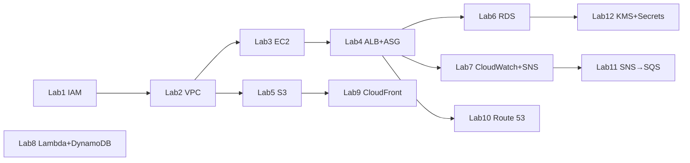

---

## 1. 環境準備與費用控管

### 1.1 需要的東西

1. 一個 AWS 帳號，以具有管理權限的 IAM 身分登入主控台（**不要用 root 帳號做練習**）
2. 主控台右上角 Region 切到 **美國（北維吉尼亞）us-east-1**
3. **AWS CloudShell**（主控台左下角或上方 `>_` 圖示）：已內建 AWS CLI、jq、Python，不需設定存取金鑰
4. 把本 repo 複製到 CloudShell：

```bash
git clone https://github.com/ChunPingWang/aws-saa-preparation.git
cd aws-saa-preparation
chmod +x scripts/*.sh
```

### 1.2 兩種做法

| 做法 | 適合 | 說明 |
|---|---|---|
| **主控台逐步操作**（本文主軸） | 第一次學、想看懂每個選項 | 照著每個 Step 的截圖點選 |
| **CLI 腳本** | 複習、想快速重建環境 | `scripts/01-iam.sh` … `scripts/12-kms-secrets.sh` 依序執行 |

> 兩種做法擇一即可，不要混用同名資源（例如主控台已建了 `saa-lab-vpc`，就不要再跑 `02-vpc.sh`）。
> 腳本會把資源 ID 存到 `~/.saa-lab-state`，後面的 Lab 與 `99-cleanup.sh` 會自動讀取。

### 1.3 費用提醒（us-east-1，依 AWS 定價頁為準）

| 資源 | 計費方式 | 注意 |
|---|---|---|
| NAT Gateway | 每小時 + 每 GB 處理量 | **最容易忘記刪的費用來源** |
| Application Load Balancer | 每小時 + LCU | — |
| RDS Multi-AZ db.t3.micro | 每小時（Multi-AZ 約單 AZ 的 2 倍） | 主控台估算約 29 USD/月 |
| EC2 t3.micro | 每小時 | 免費方案可能涵蓋 |
| 公有 IPv4 位址 | 每小時 | 2024 年起收費 |
| KMS 客戶受管金鑰 | 每月每把 | 排程刪除期間仍計費 |
| Route 53 託管區域 | 每月每個 | 建立後 12 小時內刪除不收費 |

**建議**：先到 **Billing → Budgets** 建一個 5 美元的預算警示；做完當天就執行 [Lab 99](#lab-99清除所有資源)。

---

## 2. 最終架構

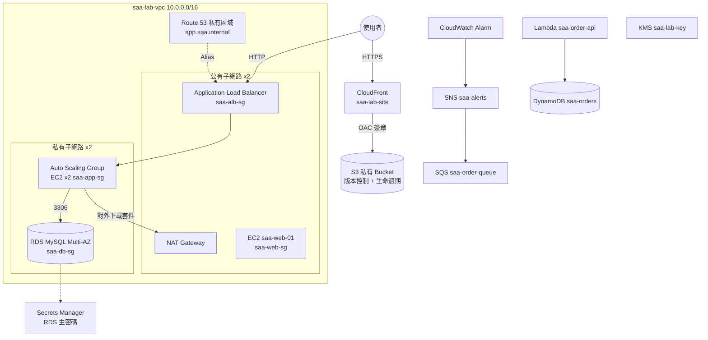

### 資源命名一覽

| 類別 | 名稱 |
|---|---|
| IAM | 群組 `saa-developers`、使用者 `saa-lab-user`、角色 `saa-ec2-ssm-role` |
| 網路 | `saa-lab-vpc`、`saa-lab-subnet-public1/2`、`saa-lab-subnet-private1/2`、`saa-lab-nat` |
| Security Group | `saa-web-sg`、`saa-alb-sg`、`saa-app-sg`、`saa-db-sg` |
| 運算 | `saa-web-01`、`saa-app-lt`、`saa-app-asg`、`saa-app-alb`、`saa-app-tg` |
| 資料 | `saa-lab-site-<日期>-<自訂>`（S3）、`saa-lab-mysql`（RDS）、`saa-orders`（DynamoDB） |
| 其他 | `saa-order-api`（Lambda）、`saa-alerts`（SNS）、`saa-order-queue`（SQS）、`saa.internal`（Route 53）、`alias/saa-lab-key`（KMS） |

---

## Lab 1：IAM 使用者、群組與 EC2 角色

**目標**：用「群組授權、角色給服務」的方式落實最小權限，並建立後續 EC2 會用到的 IAM 角色。
**考試領域**：設計安全的架構

### 觀念

| 身分 | 用途 | 憑證 |
|---|---|---|
| IAM User | 代表「人」或少數舊系統 | 長期：密碼、Access Key |
| IAM Group | 一群使用者共用權限，**不能被當作 Principal** | 無 |
| IAM Role | 給 AWS 服務、跨帳號或聯合身分「暫時扮演」 | 短期：STS 臨時憑證 |
| Instance Profile | 把 Role 裝進 EC2 的容器（主控台會自動建立同名的） | — |

### Step 1-1　建立使用者群組並命名

1. 主控台上方搜尋 **IAM** → 左側 **IAM 使用者群組** → **建立群組**
2. **人員群組名稱** 輸入 `saa-developers`
3. 「新增人員至群組」先略過（使用者還沒建立）

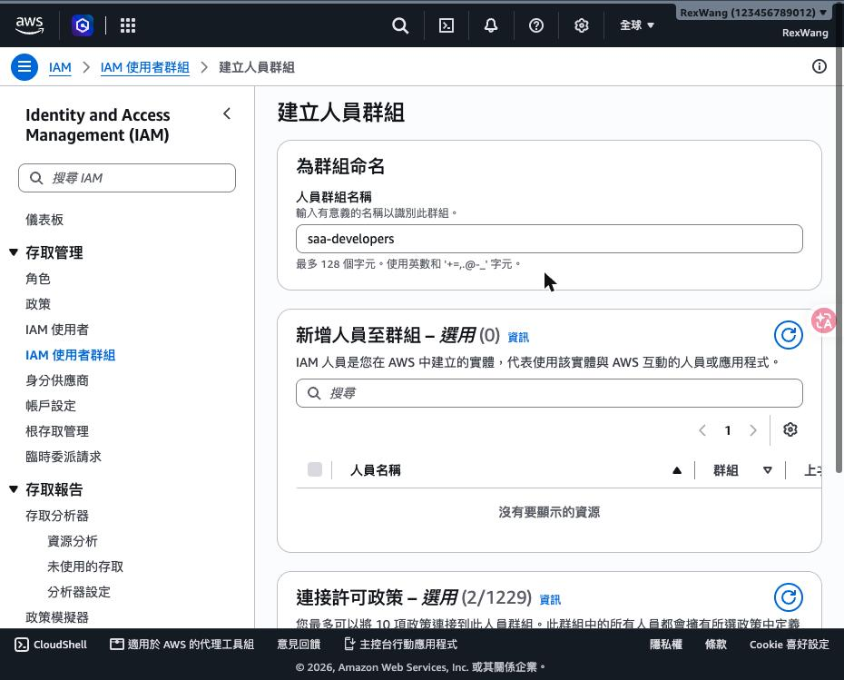

### Step 1-2　附加 AWS 受管政策

1. 在「連接許可政策」搜尋框輸入 `AmazonEC2ReadOnlyAccess` → Enter → 勾選
2. 再搜尋 `AmazonS3ReadOnlyAccess` → 勾選；標題會顯示 **(2/1229)**
3. 按 **建立人員群組**

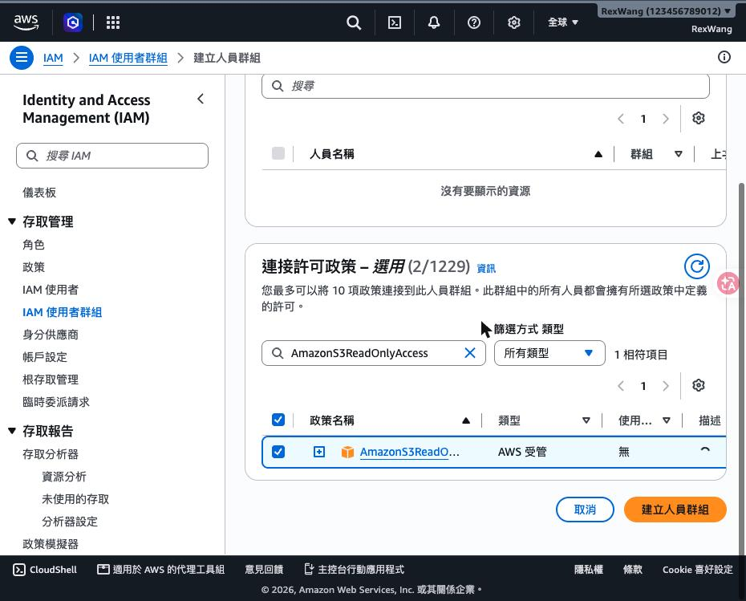

> 💡 權限掛在群組上，人員異動時只要加入/移出群組即可。這是考題「如何讓 50 位開發者有相同權限」的標準答案。

### Step 1-3　建立 EC2 用的 IAM 角色（選擇信任實體）

1. 左側 **角色** → **建立角色**
2. **信任的實體類型** 選 **AWS 服務**
3. **服務或使用案例** 選 **EC2**，下方使用案例選 **EC2 Role for AWS Systems Manager**
   - 主控台會自動帶入 `AmazonSSMManagedInstanceCore` 政策，讓 EC2 能被 Session Manager 管理
4. 下一步（權限頁確認政策已勾選）→ 下一步

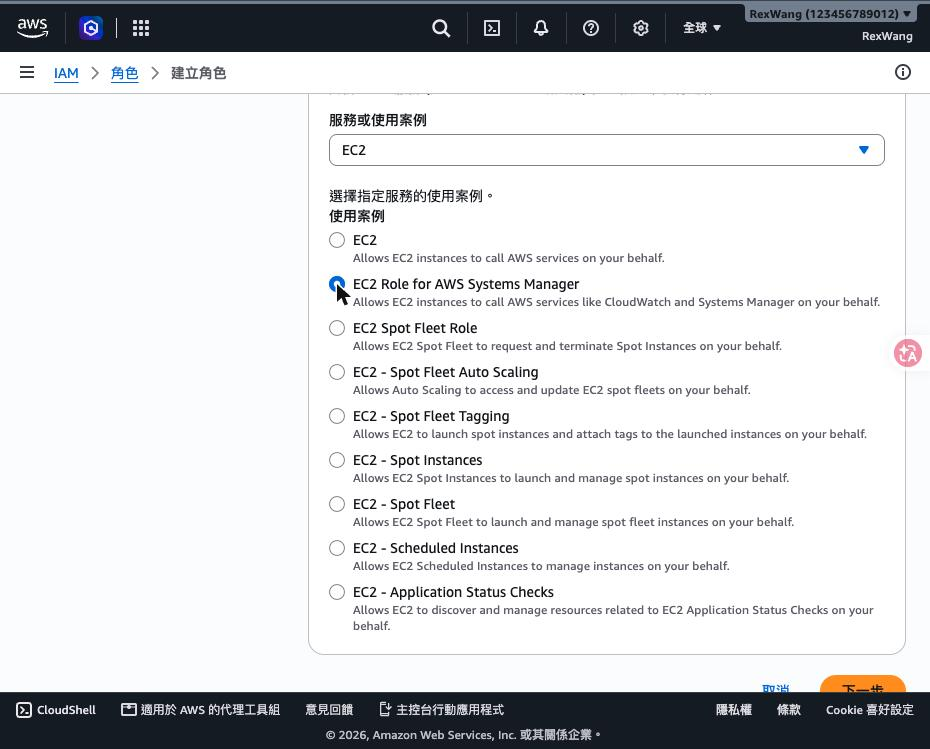

### Step 1-4　命名角色並檢視信任政策

1. **角色名稱** 輸入 `saa-ec2-ssm-role`
2. 往下看「步驟 1：選取信任的實體」中的 **信任政策**：`Principal` 是 `ec2.amazonaws.com`、`Action` 是 `sts:AssumeRole`
3. 按 **建立角色**

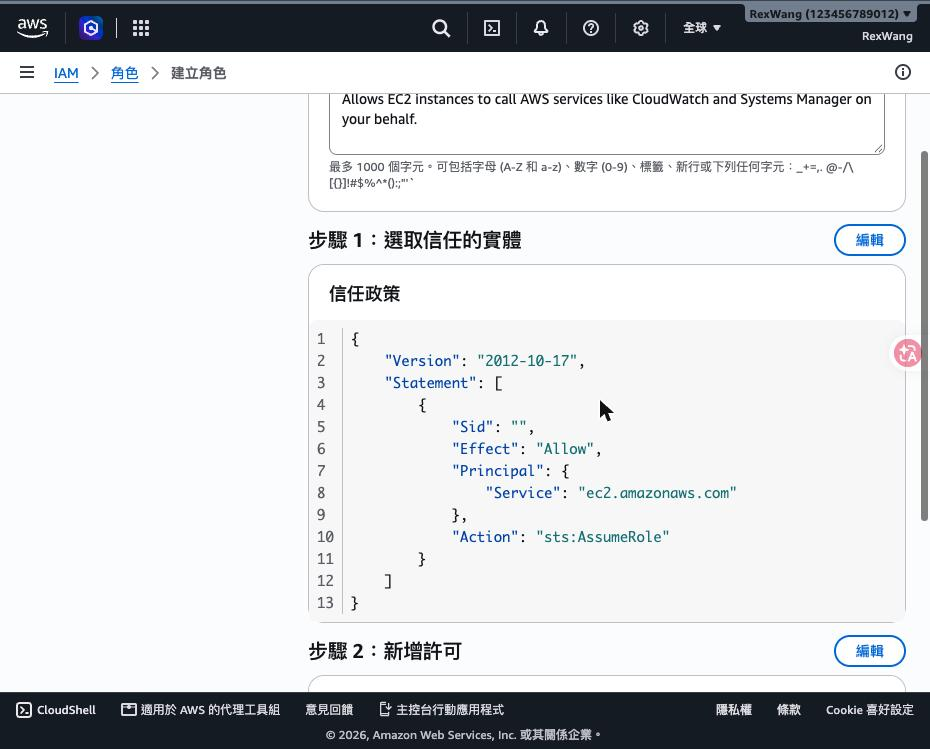

> 💡 **信任政策（Trust Policy）決定「誰可以扮演」，許可政策（Permission Policy）決定「扮演後能做什麼」**，兩者缺一不可。

### Step 1-5　建立使用者並加入群組

1. 左側 **IAM 使用者** → **建立人員** → 名稱 `saa-lab-user`
2. 本 Lab **不勾選**「提供人員對 AWS 管理主控台的存取權」（只示範權限結構，不產生任何密碼或金鑰）
3. 下一步，**許可選項** 選 **在群組中新增人員** → 勾選 `saa-developers`

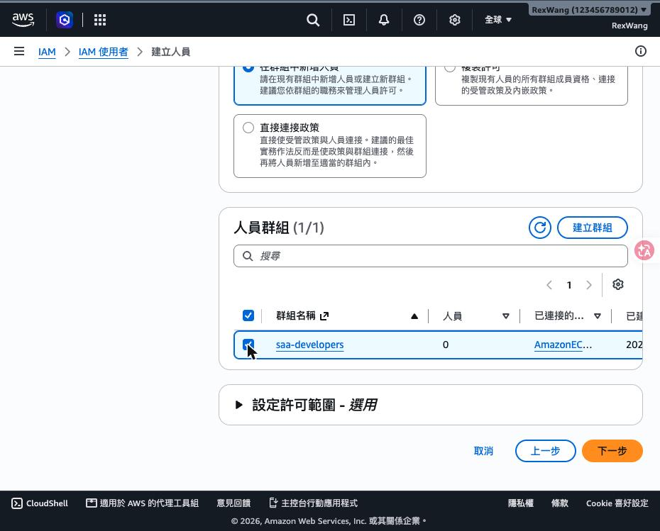

### Step 1-6　檢閱並建立

確認「主控台密碼類型：None」、「許可摘要：saa-developers（群組）」→ **建立人員**

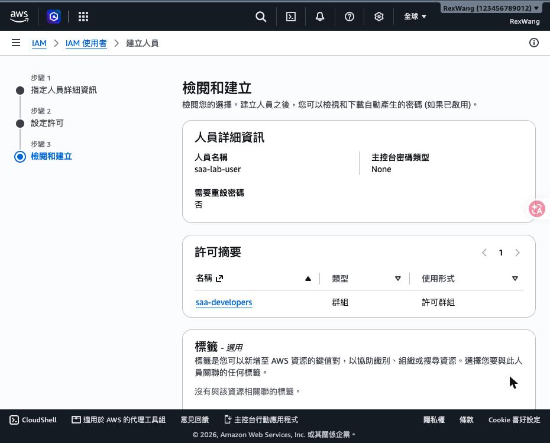

### CLI 等效

```bash
./scripts/01-iam.sh
```

### ✅ 考試重點

- 優先使用 **IAM Role + 臨時憑證**，不要把 Access Key 放在 EC2 或程式碼裡
- 政策評估：**明確 Deny > Allow > 預設 Deny**；多個政策取聯集
- **Permissions Boundary** 限制「最大可授權範圍」；**SCP**（Organizations）限制整個帳號
- Root 帳號：啟用 MFA、不建立 Access Key、只做必要的帳號層級操作

---

## Lab 2：自建 VPC（公有/私有子網路 + NAT）

**目標**：用「VPC 及更多」一次建立跨 2 個 AZ 的三層式網路基礎。
**考試領域**：設計具彈性的架構、成本最佳化

### Step 2-1　選擇「VPC 及更多」並設定名稱與 CIDR

1. 搜尋 **VPC** → **您的 VPC** → **建立 VPC**
2. **要建立的資源** 選 **VPC 和更多**
3. **自動產生名稱標籤** 輸入 `saa-lab`（所有子資源都會以 `saa-lab-` 開頭）
4. **IPv4 CIDR 區塊** 保持 `10.0.0.0/16`（65,536 個 IP）


### Step 2-2　可用區域與子網路數量

- **可用區域 (AZ) 數量**：`2`
- **公有子網路的數量**：`2`
- **私有子網路的數量**：`2`

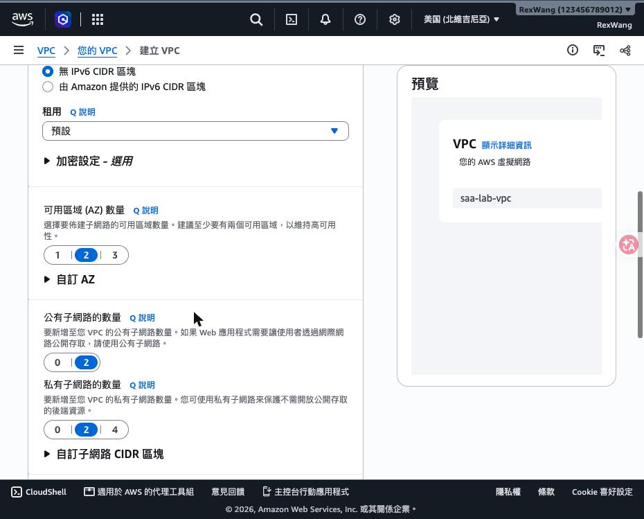

> 預設會切成 `/20`：public1 `10.0.0.0/20`、public2 `10.0.16.0/20`、private1 `10.0.128.0/20`、private2 `10.0.144.0/20`。每個子網路 AWS 會保留 5 個 IP。

### Step 2-3　NAT 閘道與 VPC 端點

1. **NAT 閘道**：選 **Zonal** → **在 1 個可用區域中**（練習省錢；正式環境選「每個可用區域 1 個」避免單點故障）
   - 主控台現在也提供新的「區域性（Regional）NAT 閘道」選項，可跨 AZ 自動擴展；考試仍以 Zonal NAT 的觀念為主
2. **VPC 端點**：保持 **S3 閘道**（Gateway Endpoint 免費，私有子網路存取 S3 不經 NAT）
3. **DNS 選項**：兩個都勾選（Route 53 私有託管區域需要）
4. 按 **建立 VPC**

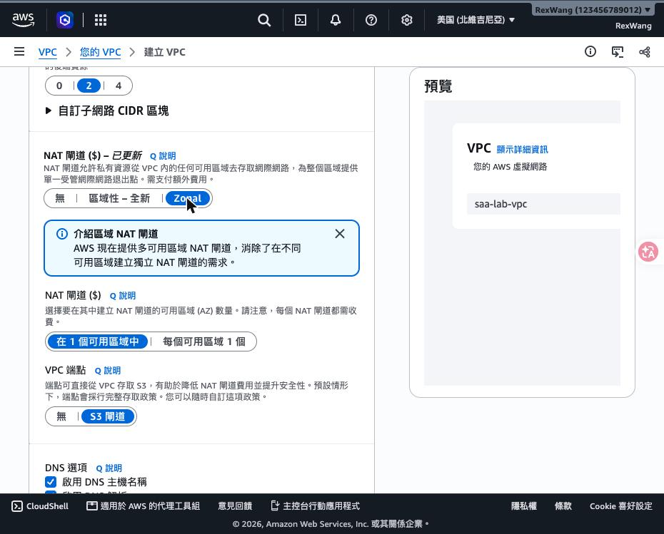

### Step 2-4　觀察建立流程

主控台會依序建立 VPC、S3 端點、4 個子網路、IGW、路由表、Elastic IP、NAT Gateway。**NAT 需要 1–2 分鐘** 才會變成 Available。

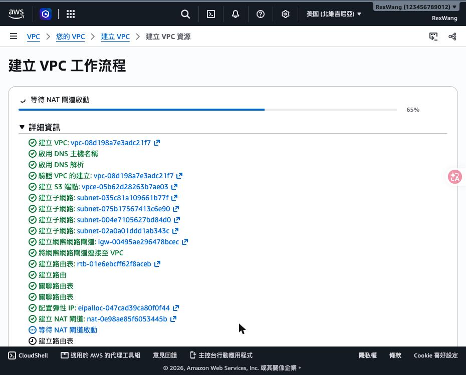

### Step 2-5　用「資源對應」檢查架構

進入 VPC 詳細資訊 → **資源對應** 分頁：

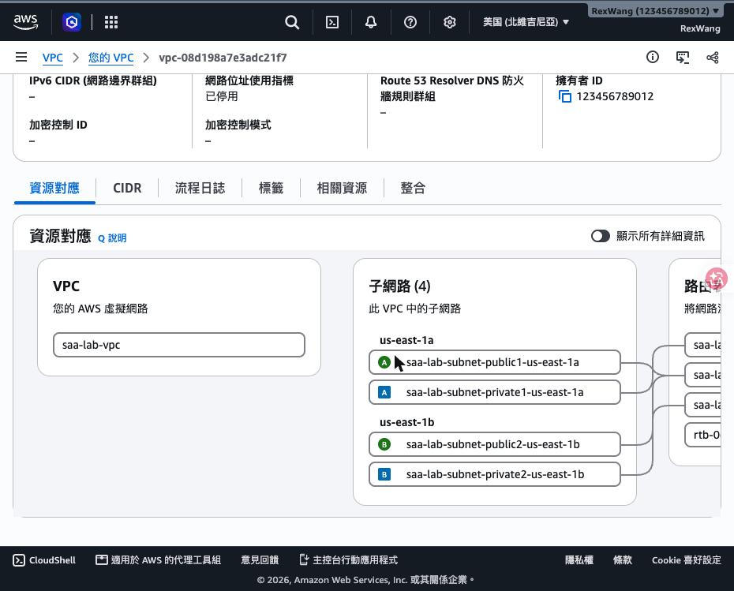

橫向捲動可看到路由表與網路連線：公有子網路共用 `saa-lab-rtb-public`（→ IGW），兩個私有子網路各自的路由表（→ NAT），以及 S3 端點。

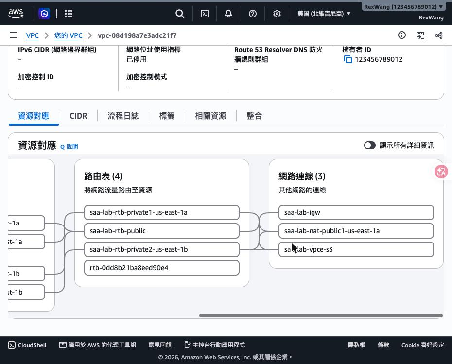

### CLI 等效

```bash
./scripts/02-vpc.sh     # 為了省錢，腳本讓兩個私有子網路共用一張路由表、一個 NAT
```

### ✅ 考試重點

| 情境 | 答案 |
|---|---|
| 私有子網路的 EC2 要下載套件 | NAT Gateway（放在**公有**子網路） |
| 私有子網路存取 S3/DynamoDB 且省錢 | **Gateway Endpoint**（免費） |
| 私有存取其他 AWS 服務（SQS、KMS…） | **Interface Endpoint**（PrivateLink，計費） |
| NAT 高可用 | 每個 AZ 各一個 NAT，各 AZ 私有路由表指向自己 AZ 的 NAT |
| 兩個 VPC 互通（少量） | VPC Peering（不可遞移） |
| 多個 VPC + 地端集中互通 | Transit Gateway |
| 子網路層級擋特定 IP | **NACL**（無狀態、可 Deny、規則有編號順序） |

---

## Lab 3：Security Group 與 EC2（SSM 免 SSH 登入）

**目標**：在公有子網路啟動一台 Web 伺服器，只開 80 port；用 IAM 角色 + Session Manager 管理，不開 22。
**考試領域**：設計安全的架構

### Step 3-1　建立 Security Group

1. **EC2** → **網路與安全 → 安全群組** → **建立安全群組**
2. 名稱 `saa-web-sg`、描述 `Allow HTTP from anywhere for SAA lab web server`（描述只能英數）
3. **VPC** 選 `saa-lab-vpc`（SG 綁定 VPC，不能跨 VPC 使用）
4. **傳入規則** → 新增規則：類型 **HTTP**、來源類型 **隨處 – IPv4**（`0.0.0.0/0`）
5. 傳出規則保持預設（全部允許）→ **建立安全群組**


### Step 3-2　啟動執行個體：名稱與 AMI

1. **執行個體** → **啟動執行個體**
2. 名稱 `saa-web-01`；AMI 選 **Amazon Linux 2023**（符合免費方案資格）
3. 執行個體類型 `t3.micro`
4. **金鑰對**：選「在沒有金鑰對的情況下繼續」（我們用 SSM 登入）

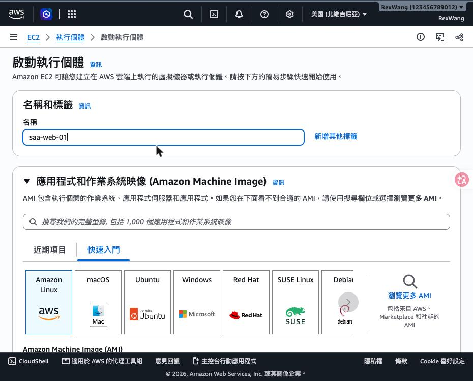

### Step 3-3　網路設定

按「網路設定」右上 **編輯**：

| 欄位 | 值 |
|---|---|
| VPC | `saa-lab-vpc` |
| 子網路 | `saa-lab-subnet-public1-us-east-1a` |
| 自動指派公有 IP | **啟用**（自建 VPC 的子網路預設是停用） |
| 防火牆 | **選取現有的安全群組** → `saa-web-sg` |

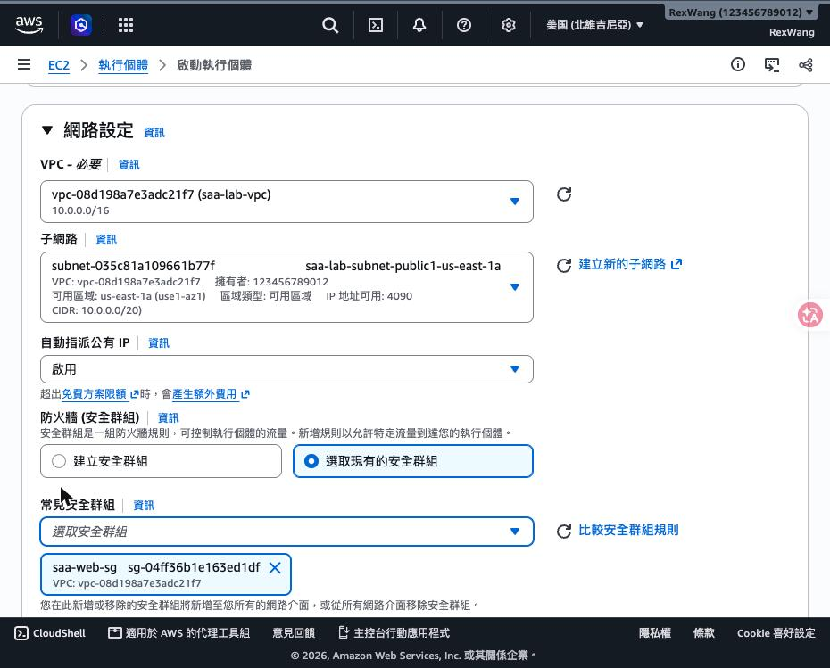

> ⚠️ 啟動精靈預設會「建立安全群組 launch-wizard-N」並**開放 SSH 給 0.0.0.0/0**，一定要改成選取現有的 SG。

### Step 3-4　IAM 執行個體設定檔

展開 **進階詳細資訊** → **IAM 執行個體設定檔** 選 `saa-ec2-ssm-role`

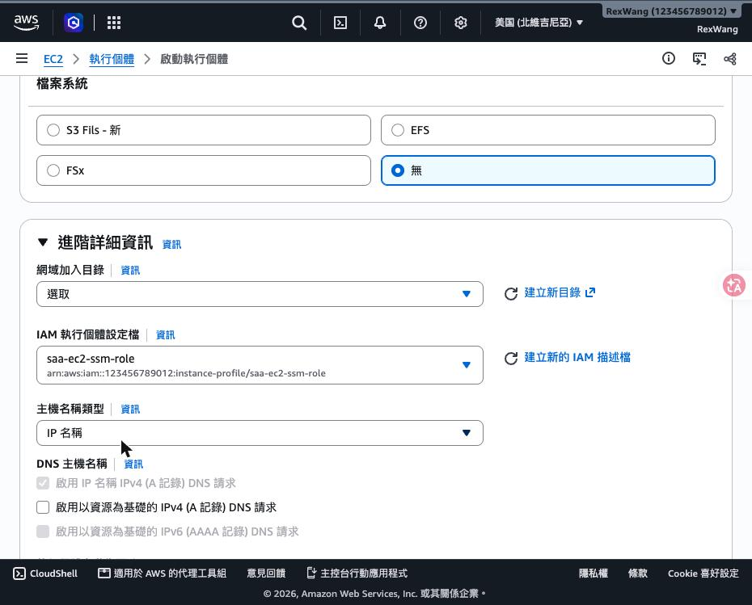

### Step 3-5　User Data

同一區塊拉到最下方 **使用者資料**，貼上 [`userdata/web-userdata.sh`](userdata/web-userdata.sh)：安裝 nginx，並以 **IMDSv2**（先取 token）讀出 Instance ID 與 AZ 寫進首頁。

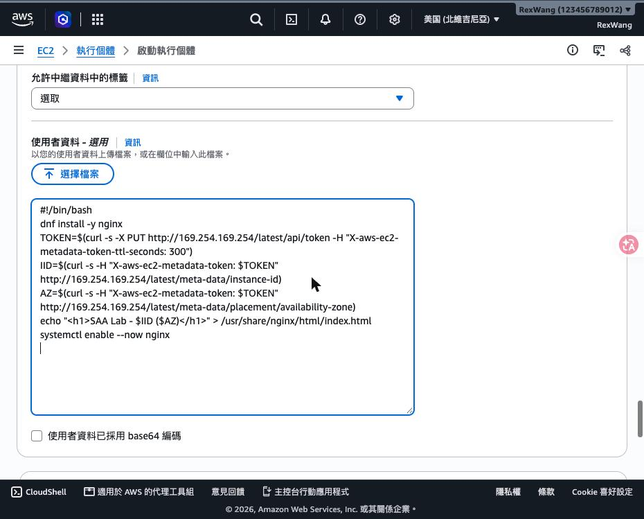

按 **啟動執行個體**。

### Step 3-6　確認執行個體狀態與公有 IP

等待「執行中」與「狀態檢查 2/2 通過」，記下 **公有 IPv4 地址**。

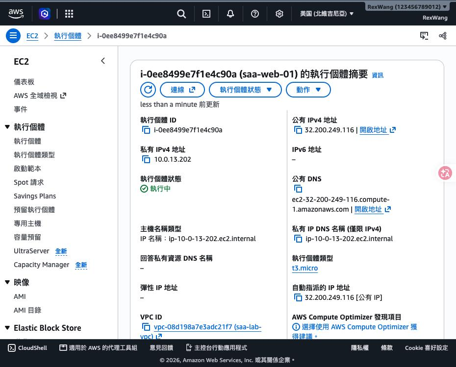

### Step 3-7　驗證：HTTP 與 Session Manager

在 **CloudShell** 執行：

```bash
curl -s http://<公有IP>/
aws ssm describe-instance-information --output table
aws ssm start-session --target <InstanceId>
# 進入後
whoami; systemctl is-active nginx; curl -s localhost; exit
```

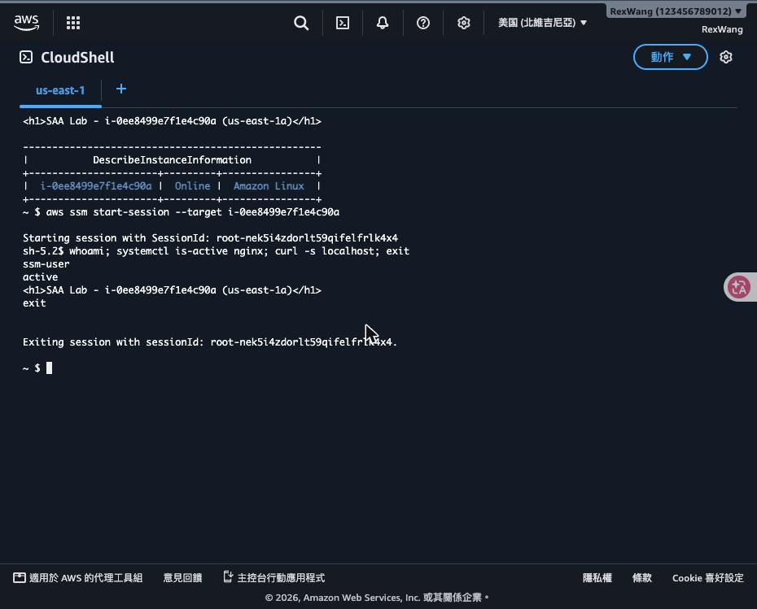

看到 `ssm-user`、nginx `active`，代表**完全沒開 22 port 也能登入並管理機器**，而且每次連線都可在 CloudTrail/Session Manager 稽核。

### CLI 等效

```bash
./scripts/03-ec2.sh
```

### ✅ 考試重點

- Security Group：**有狀態、只有 Allow、可以參照其他 SG**；NACL：無狀態、可 Deny
- 管理 EC2 的最佳答案通常是 **Systems Manager Session Manager**（免 Bastion、免開 22、可稽核）
- **IMDSv2** 以 session token 防止 SSRF 竊取中繼資料憑證
- EC2 購買選項：On-Demand、Savings Plans / Reserved（穩定長期）、**Spot**（可中斷、最便宜）、Dedicated Host（授權綁定實體核心）

---

## Lab 4：Launch Template、ALB 與 Auto Scaling

**目標**：把應用程式放在**私有子網路**，前面放 Internet-facing ALB，Auto Scaling 維持 2 台並依 CPU 擴展。
**考試領域**：設計具彈性與高效能的架構

### Step 4-1　用 CloudShell 建立「SG 串接」

ALB 對外開 80；App 只接受「來自 ALB SG」的流量（來源填 SG ID，不寫 IP）：

```bash
VPC=<你的 VPC ID>
ALB_SG=$(aws ec2 create-security-group --group-name saa-alb-sg --description 'ALB HTTP from anywhere' --vpc-id $VPC --query GroupId --output text)
aws ec2 authorize-security-group-ingress --group-id $ALB_SG --protocol tcp --port 80 --cidr 0.0.0.0/0
APP_SG=$(aws ec2 create-security-group --group-name saa-app-sg --description 'App HTTP only from ALB SG' --vpc-id $VPC --query GroupId --output text)
aws ec2 authorize-security-group-ingress --group-id $APP_SG --protocol tcp --port 80 --source-group $ALB_SG
```

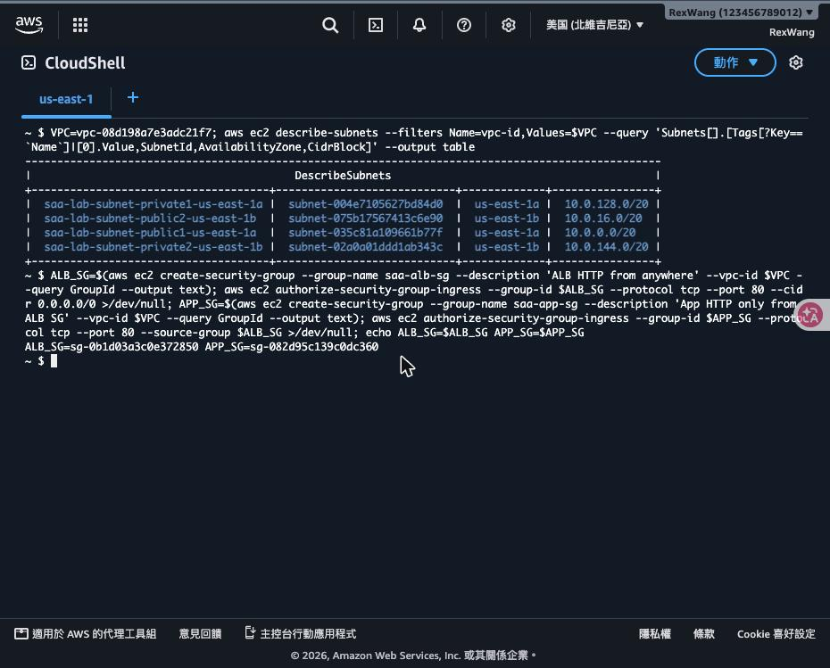

### Step 4-2　建立 Launch Template

1. **EC2 → 執行個體 → 啟動範本 → 建立啟動範本**
2. 名稱 `saa-app-lt`、版本描述 `v1 nginx web app`
3. 勾選 **提供指引以協助我設定可與 EC2 Auto Scaling 搭配使用的範本**

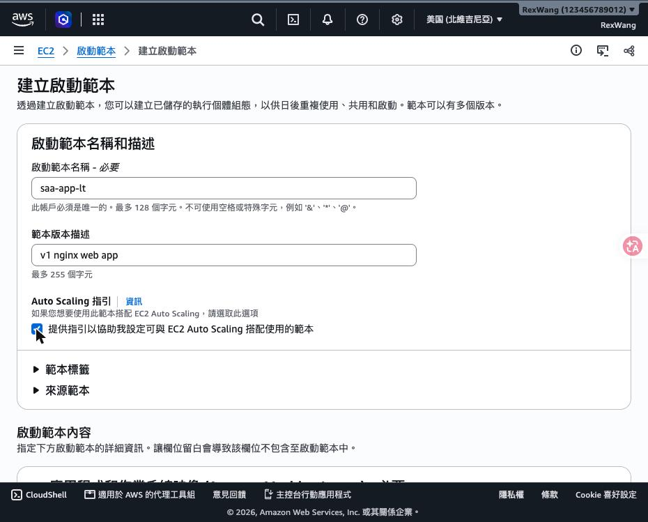

4. AMI：快速入門 → Amazon Linux 2023；類型 `t3.micro`；金鑰對「請勿包含」
5. **網路設定**：子網路「請勿包含」（交給 ASG 決定）；安全群組選 `saa-app-sg`

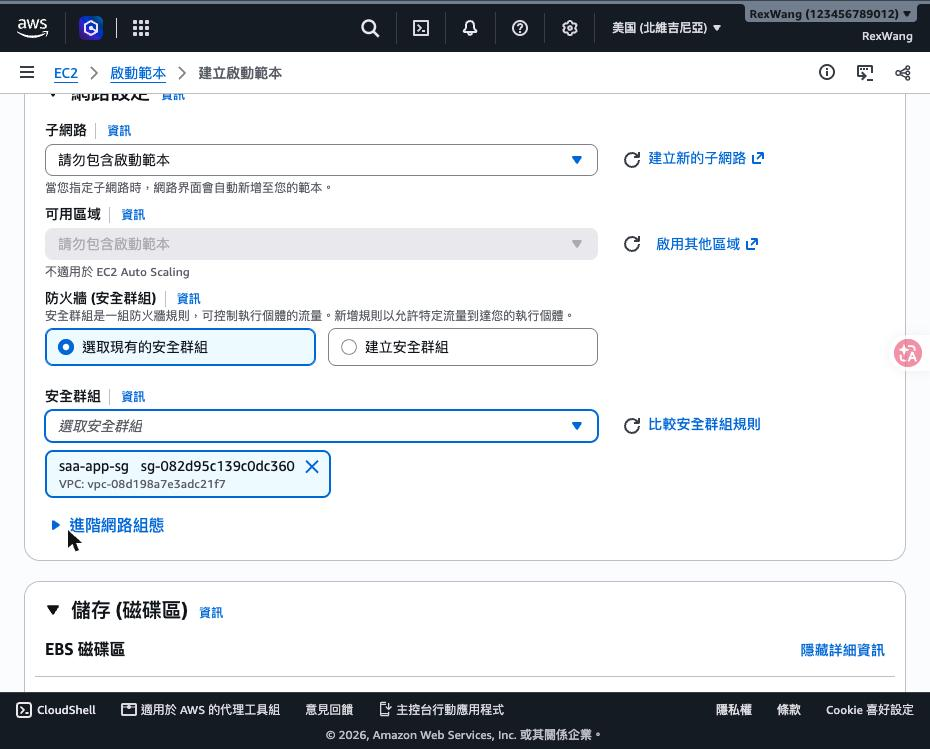

6. **進階詳細資訊**：IAM 執行個體設定檔 `saa-ec2-ssm-role`，使用者資料貼上同一份 `web-userdata.sh` → **建立啟動範本**

### Step 4-3　建立 Auto Scaling Group：選擇範本

**EC2 → Auto Scaling 群組 → 建立 Auto Scaling 群組**，名稱 `saa-app-asg`，啟動範本選 `saa-app-lt`（Default 版本）。

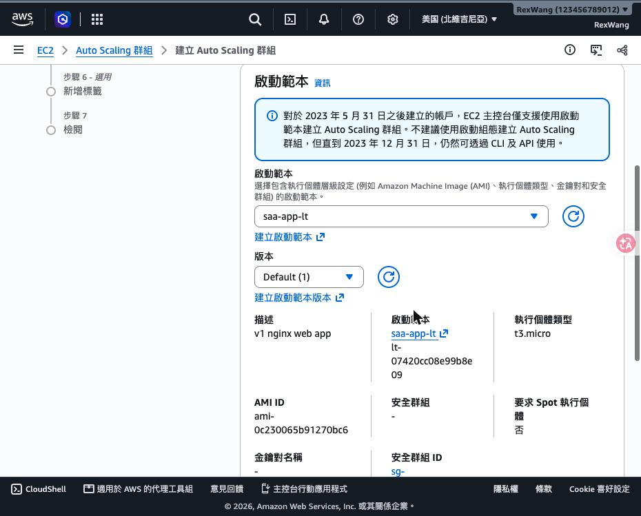

### Step 4-4　網路：選兩個私有子網路

VPC 選 `saa-lab-vpc`，可用區域和子網路選 **private1（1a）** 與 **private2（1b）**；可用區域分佈保持「平衡的最大努力」。

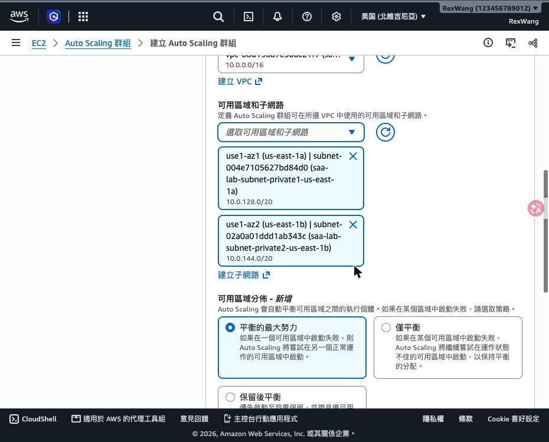

### Step 4-5　連接到新的 Application Load Balancer

步驟 3 選 **連接到新的負載平衡器**：

| 欄位 | 值 |
|---|---|
| 類型 | Application Load Balancer |
| 名稱 | `saa-app-alb` |
| 方案 | **Internet-facing** |
| 子網路 | 兩個 AZ 都改成 **public** 子網路（只有公有子網路能放 Internet-facing ALB） |
| 接聽程式 | HTTP:80 → 建立目標群組 `saa-app-tg` |

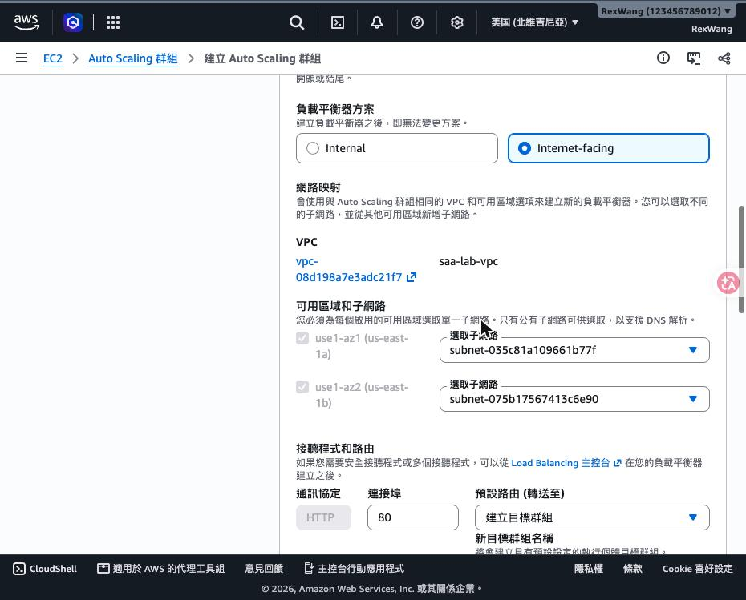

### Step 4-6　開啟 ELB 健康檢查

在同一頁下方 **運作狀態檢查** 勾選 **開啟 Elastic Load Balancing 運作狀態檢查**，寬限期 300 秒。

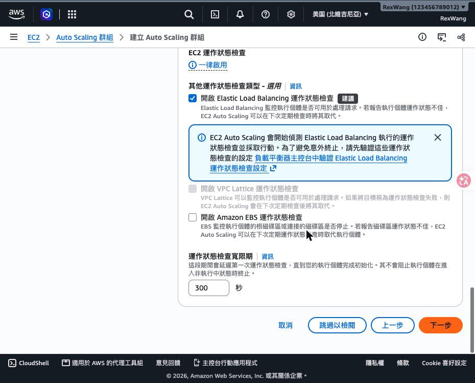

> 只用 EC2 狀態檢查時，nginx 掛掉但機器還活著，ASG 不會替換；加上 ELB 健康檢查才會。

### Step 4-7　群組大小與目標追蹤擴展

所需容量 `2`、下限 `2`、上限 `4`：

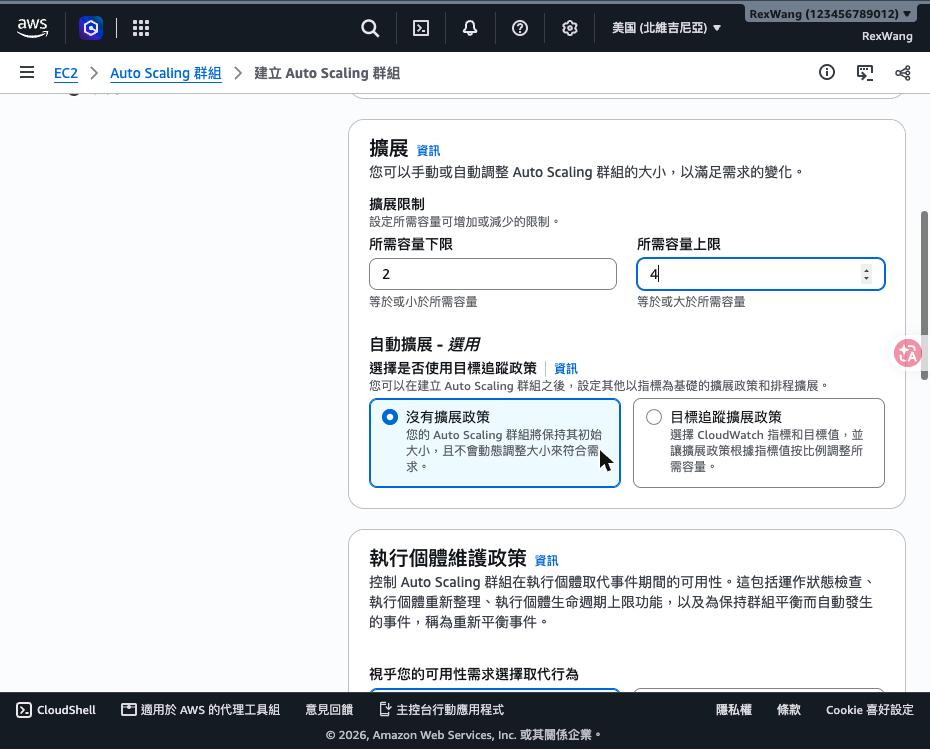

自動擴展選 **目標追蹤擴展政策**：指標「平均 CPU 使用率」，目標值 `50`。

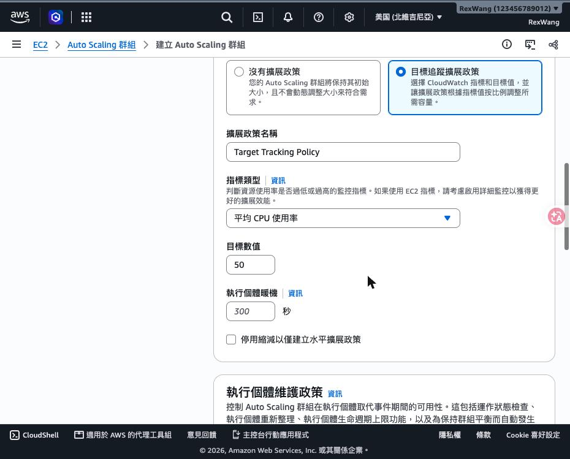

按 **跳過以檢閱** → **建立 Auto Scaling 群組**。

### Step 4-8　⚠️ 修正 ALB 的 Security Group

用 ASG 精靈「順便建立」的 ALB，**會沿用啟動範本的 SG（saa-app-sg）**，結果 ALB 自己也只接受「來自 ALB SG」的流量 → 外部連不進來、目標健康檢查也失敗。改成 `saa-alb-sg`：

```bash
ALB_ARN=$(aws elbv2 describe-load-balancers --names saa-app-alb --query 'LoadBalancers[0].LoadBalancerArn' --output text)
aws elbv2 set-security-groups --load-balancer-arn $ALB_ARN --security-groups $ALB_SG
```

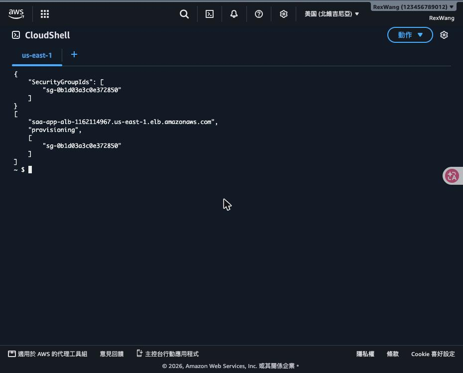

> 正式做法是先在 **EC2 → 負載平衡器** 獨立建好 ALB（指定 `saa-alb-sg`），再讓 ASG「連接到現有的負載平衡器」。`scripts/04-alb-asg.sh` 就是這樣做的。

### Step 4-9　驗證：目標健康 + 跨 AZ 負載平衡

```bash
TG=$(aws elbv2 describe-target-groups --names saa-app-tg --query 'TargetGroups[0].TargetGroupArn' --output text)
aws elbv2 describe-target-health --target-group-arn $TG --output table
for i in 1 2 3 4 5 6; do curl -s http://<ALB DNS>/; echo; done
```

兩台都 `healthy`，回應輪流來自 us-east-1a / 1b 的不同執行個體：

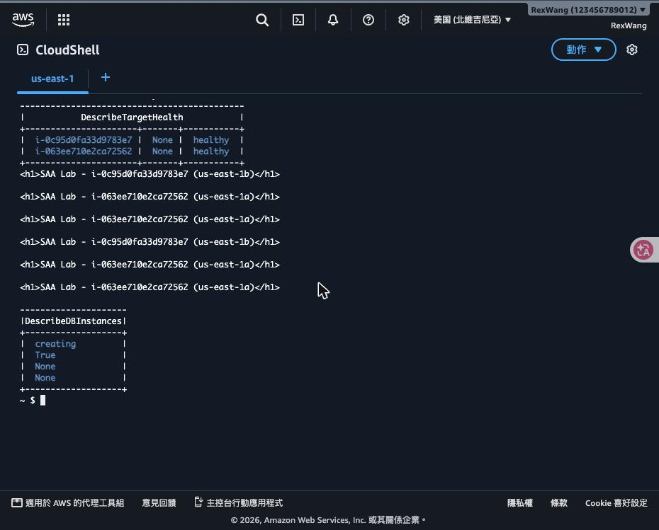

### CLI 等效

```bash
./scripts/04-alb-asg.sh
```

### ✅ 考試重點

| 情境 | 答案 |
|---|---|
| HTTP/HTTPS、路徑/主機名路由、WebSocket | **ALB**（第 7 層） |
| TCP/UDP、極低延遲、固定 IP | **NLB**（第 4 層，可配 Elastic IP） |
| 串接第三方防火牆設備 | **GWLB** |
| 依指標維持在目標值 | Target Tracking（最常見答案） |
| 已知時段尖峰（每天 9 點） | Scheduled Scaling |
| 依歷史模式預先擴展 | Predictive Scaling |
| 縮減時避免中斷連線 | ALB Deregistration Delay（Connection Draining） |
| 讓應用程式無狀態 | Session 放到 ElastiCache / DynamoDB，而非 Sticky Session |

---

## Lab 5：S3 版本控制、加密與生命週期

**目標**：建立私有 Bucket，開啟版本控制、預設加密，並用生命週期規則自動分層與清理舊版本。
**考試領域**：設計安全的架構、成本最佳化

### Step 5-1　建立 Bucket

1. 搜尋 **S3** → **建立儲存貯體**
2. 儲存貯體類型：**一般用途**；命名空間：**全域命名空間**
3. 名稱：全球唯一，例如 `saa-lab-site-20261031-<你的代號>`（只能小寫、數字、`-`、`.`）


> 主控台現在多了「帳戶區域命名空間」選項，名稱只在你的帳號 + 區域內唯一；考試仍以「Bucket 名稱全球唯一」為主。

### Step 5-2　封鎖公開存取 + 啟用版本控制

- **封鎖所有公開存取**：保持勾選（之後由 CloudFront OAC 提供內容，Bucket 不需要公開）
- **儲存貯體版本控制**：選 **啟用**

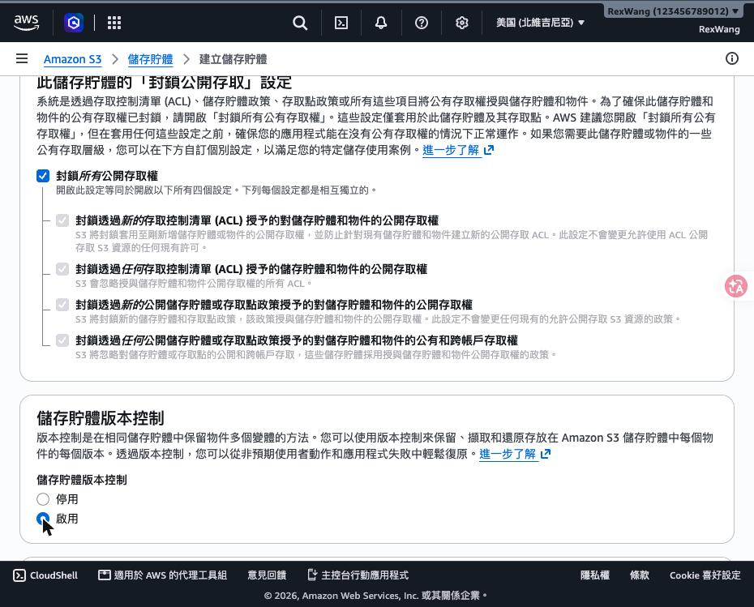

### Step 5-3　預設加密

保持 **SSE-S3** 與 **儲存貯體金鑰：啟用** → **建立儲存貯體**

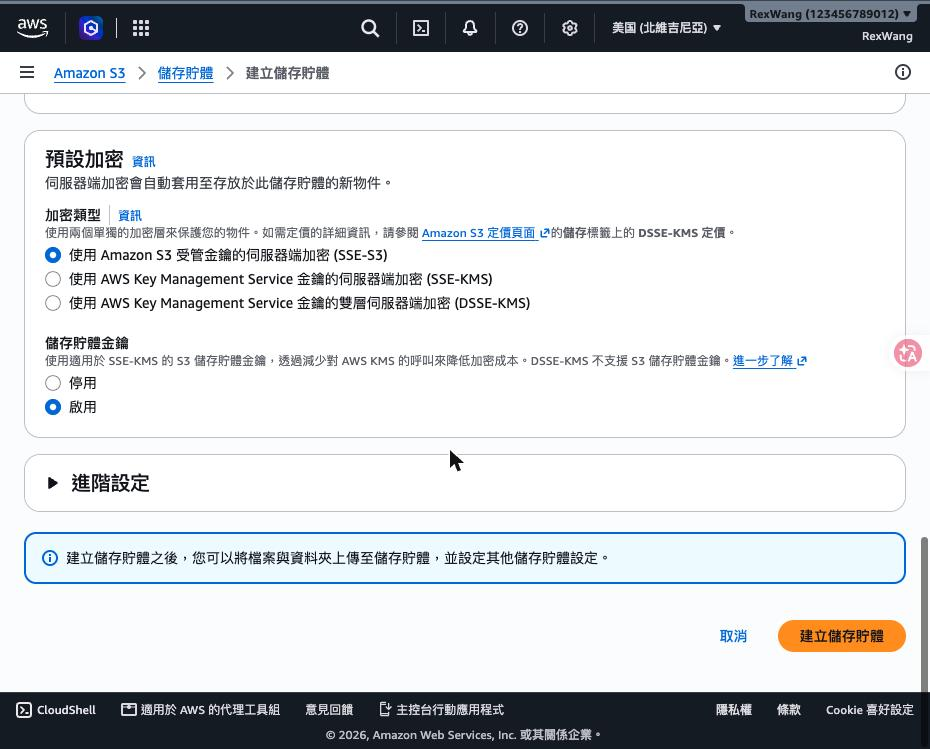

| 加密方式 | 金鑰管理 | 適用情境 |
|---|---|---|
| SSE-S3 | AWS 全權管理 | 預設、最省事 |
| SSE-KMS | KMS 金鑰，可稽核、可控權限 | 合規要求、需要 CloudTrail 記錄金鑰使用 |
| DSSE-KMS | 雙層 KMS 加密 | 特定合規（如 CNSSP 15） |
| SSE-C | 客戶自帶金鑰，每次請求附上 | 金鑰必須留在企業手中 |

### Step 5-4　上傳測試資料並產生兩個版本

在 CloudShell：

```bash
B=<你的 Bucket 名稱>
aws s3 cp test-data/site/ s3://$B/ --recursive --exclude 'index-v2.html'
aws s3 cp test-data/site/index-v2.html s3://$B/index.html     # 覆寫 → 產生新版本
aws s3api list-object-versions --bucket $B --prefix index.html --output table
```

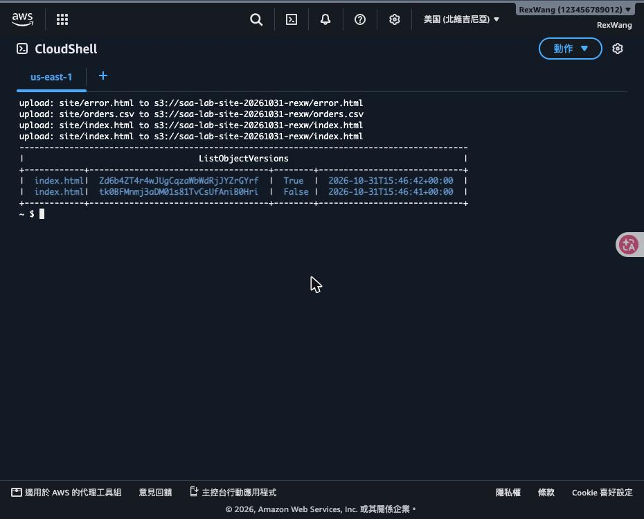

同一個 `index.html` 有兩個 VersionId，`IsLatest=True` 的是 v2。誤刪時只會產生「刪除標記」，舊版本仍可還原。

### Step 5-5　生命週期規則

**Bucket → 管理 → 建立生命週期規則**：

1. 名稱 `saa-tiering-and-cleanup`，範圍「套用至儲存貯體中的所有物件」並勾選確認
2. 動作勾選：
   - **在儲存體類別之間轉移目前版本的物件**：30 天 → **標準 – IA**、90 天 → **Glacier Flexible Retrieval**
   - **永久刪除非目前版本的物件**：成為非目前版本 30 天後
3. 勾選確認「轉移請求費用」→ **建立規則**

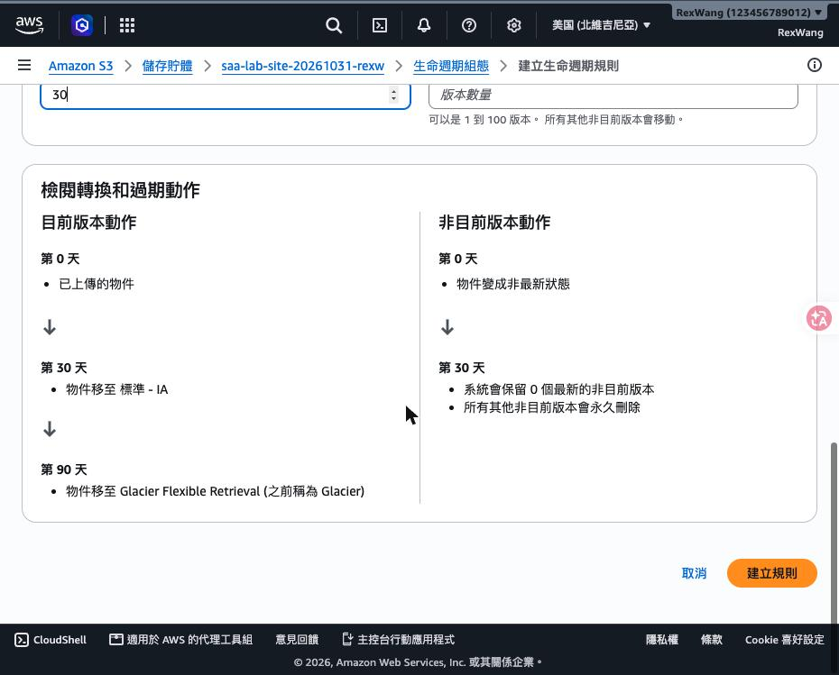

> 預設情況下，**小於 128 KB 的物件不會被轉移**（轉移成本可能高於省下的儲存費）。

### CLI 等效

```bash
./scripts/05-s3.sh
```

### ✅ 考試重點

| 儲存類別 | 特性 |
|---|---|
| Standard | 頻繁存取 |
| Intelligent-Tiering | 存取模式不確定，自動分層（有少量監控費） |
| Standard-IA / One Zone-IA | 不常存取但要即時取回；One Zone 只在單一 AZ |
| Glacier Instant Retrieval | 季度存取一次、毫秒取回 |
| Glacier Flexible Retrieval | 分鐘到小時取回 |
| Glacier Deep Archive | 最便宜，12–48 小時取回，合規長期保存 |

- 防誤刪：**版本控制 + MFA Delete**；合規不可改：**Object Lock（WORM）**
- 跨區災備：**Cross-Region Replication**（兩端都要開版本控制）
- 大檔上傳：**Multipart Upload**；遠距加速：**Transfer Acceleration**
- 授權他人暫時上傳/下載：**Presigned URL**

---

## Lab 6：RDS MySQL Multi-AZ 與容錯移轉

**目標**：在私有子網路建立 Multi-AZ 資料庫，密碼交給 Secrets Manager 管理，並實際觸發一次容錯移轉。
**考試領域**：設計具彈性的架構

### Step 6-0　先建立 DB 用的 Security Group

```bash
DB_SG=$(aws ec2 create-security-group --group-name saa-db-sg --description 'MySQL only from app SG' --vpc-id $VPC --query GroupId --output text)
aws ec2 authorize-security-group-ingress --group-id $DB_SG --protocol tcp --port 3306 --source-group $APP_SG
```

### Step 6-1　選擇引擎

**Aurora and RDS → 資料庫 → 建立資料庫**，選 **完整組態**、引擎 **MySQL**。

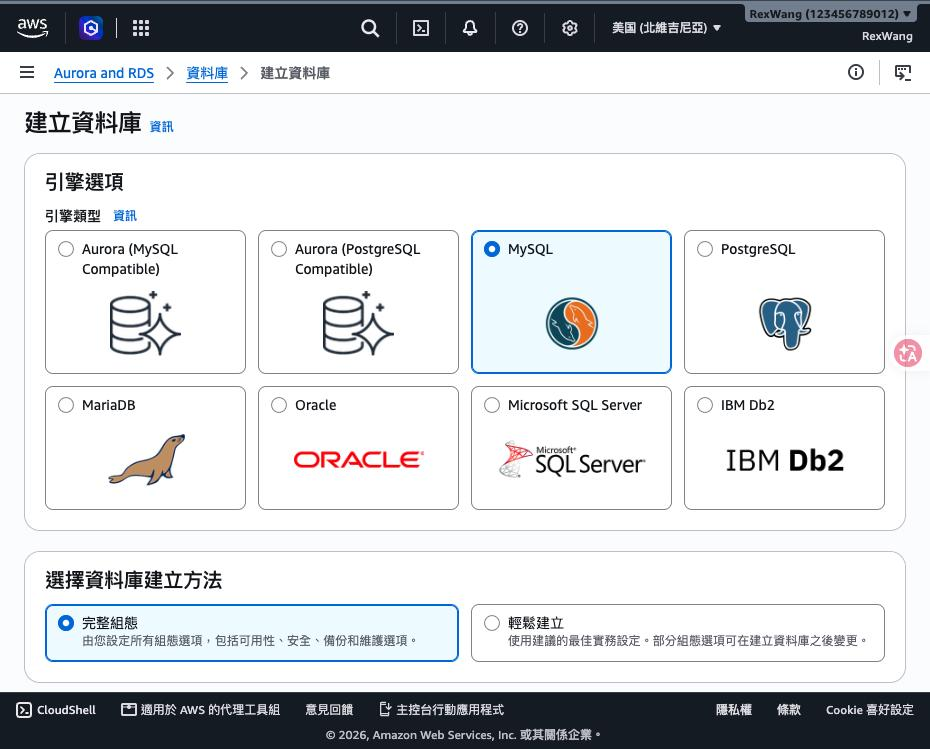

### Step 6-2　部署選項：多可用區域資料庫執行個體

主控台用圖示說明三種部署：

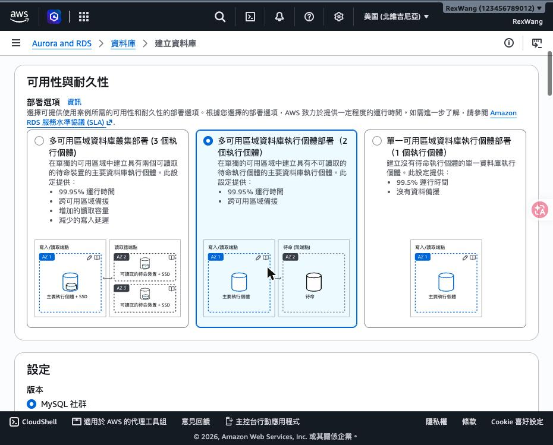

| 選項 | 說明 | 備援是否可讀 |
|---|---|---|
| 多可用區域**資料庫叢集**（3 個執行個體） | 1 寫入 + 2 個可讀待命，容錯移轉通常更快 | ✅ |
| **多可用區域資料庫執行個體**（2 個執行個體）← 本 Lab | 1 主要 + 1 同步待命（不可讀） | ❌ |
| 單一可用區域 | 只有 1 個 | — |

### Step 6-3　設定識別碼與憑證

- **資料庫執行個體識別符**：`saa-lab-mysql`
- **主要使用者名稱**：`admin`
- **憑證管理**：**以 AWS Secrets Manager 管理**（RDS 自動產生並可輪替密碼，不用人工輸入）

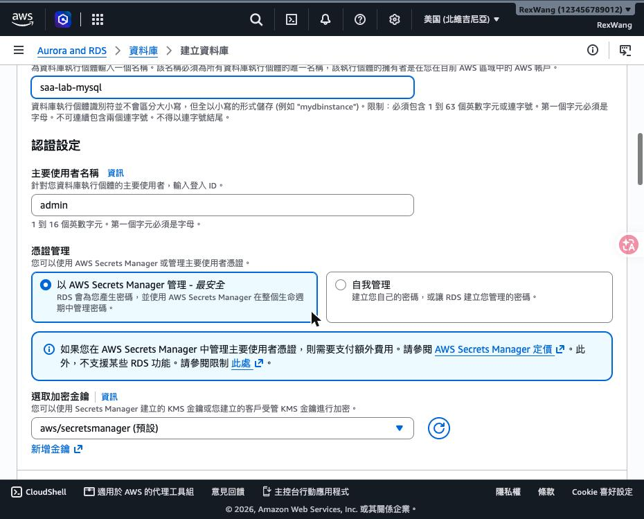

### Step 6-4　執行個體類別

勾選 **爆量類別（包括 t 類別）** → `db.t3.micro`

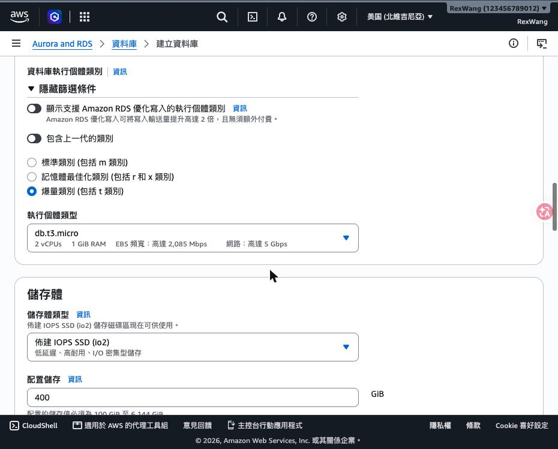

### Step 6-5　⚠️ 儲存體改成 gp3 20 GiB

主控台預設帶入 **佈建 IOPS SSD (io2) 400 GiB**，費用很高！改成：

- 儲存體類型：**一般用途 SSD (gp3)**
- 配置儲存：`20` GiB（gp3 在 400 GiB 以下含 3,000 IOPS / 125 MiBps 基準）

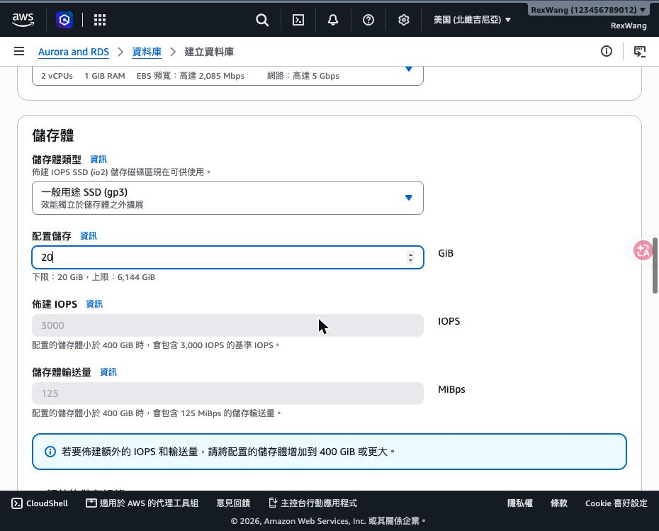

### Step 6-6　連線設定

| 欄位 | 值 |
|---|---|
| VPC | `saa-lab-vpc`（建立後不能改） |
| 資料庫子網路群組 | 建立新的 |
| 公開存取 | **否** |
| VPC 安全群組 | 選擇現有 → 移除 `default`，加入 `saa-db-sg` |

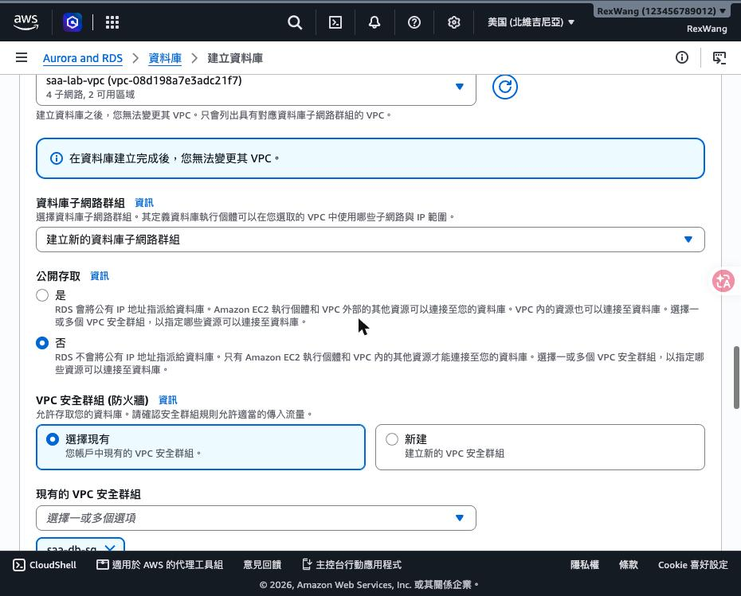

### Step 6-7　其他設定與成本

- **監控 → 其他監控設定**：取消「啟用 Enhanced Monitoring」（避免額外 IAM 角色與費用）
- **其他組態**：初始資料庫名稱 `saalab`；**取消勾選「啟用刪除保護」**（練習完才能直接刪）
- 頁尾會顯示預估每月成本（本例約 29.42 USD/月，Lab 只會用到幾小時）

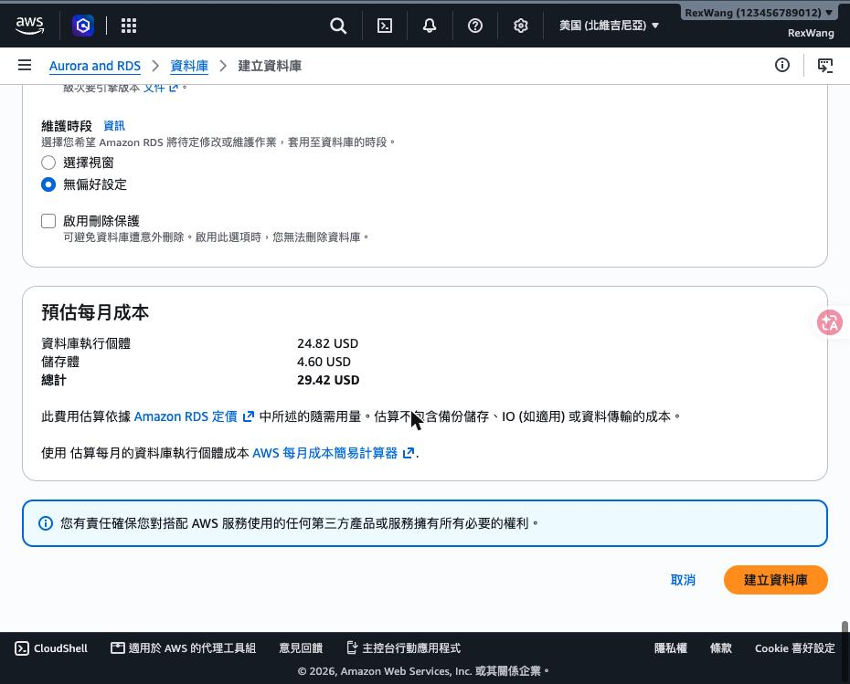

按 **建立資料庫**，約 10–15 分鐘後變成「可用」。

### Step 6-8　觸發容錯移轉並觀察事件

```bash
aws rds reboot-db-instance --db-instance-identifier saa-lab-mysql --force-failover
aws rds describe-events --source-identifier saa-lab-mysql --source-type db-instance --duration 30 --output table
```

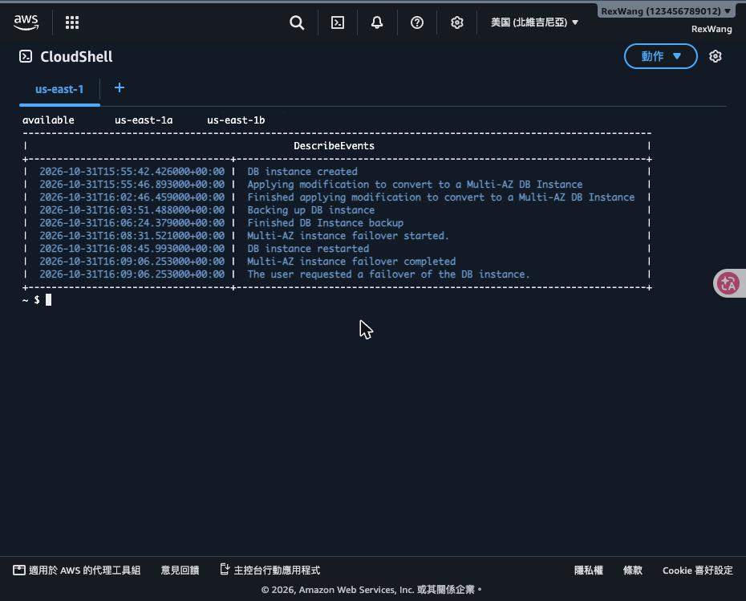

從事件可見：`Multi-AZ instance failover started` → `completed`，本次約 35 秒。**應用程式使用的端點（DNS 名稱）不變**，DNS 會自動指向新的主要執行個體。

### CLI 等效

```bash
./scripts/06-rds.sh
```

### ✅ 考試重點

| 需求 | 答案 |
|---|---|
| 高可用、自動容錯移轉 | **Multi-AZ**（同步複寫，備援預設不可讀） |
| 分擔讀取流量 | **Read Replica**（非同步，可跨區，可升級為獨立 DB） |
| 跨區災難復原、RPO 秒級 | Aurora Global Database |
| 大量短連線（Lambda） | **RDS Proxy** |
| 不可預測的負載、自動擴展 | Aurora Serverless v2 |
| 密碼不寫在程式碼、自動輪替 | **Secrets Manager**（Parameter Store 不支援原生輪替） |
| 時間點還原 | 自動備份（保留 1–35 天） |

---

## Lab 7：CloudWatch 警示 + SNS 通知

**目標**：ASG 平均 CPU > 70% 時發送 SNS 通知。
**考試領域**：設計具彈性的架構（監控）

### Step 7-1　建立 SNS 主題

**SNS → 主題 → 建立主題**：類型選 **標準**，名稱 `saa-alerts`。


| 類型 | 順序 | 交付 | 可訂閱的協定 |
|---|---|---|---|
| FIFO | 嚴格保序 | 恰好一次 | 只有 SQS（FIFO） |
| 標準 | 盡力 | 至少一次 | SQS、Lambda、HTTP/S、Email、SMS、Firehose… |

> 若要收 Email：主題建立後 → **建立訂閱** → 協定 Email，再到信箱點確認連結。

### Step 7-2　選擇指標

**CloudWatch → 警示 → 建立警示 → 選擇指標**，搜尋 `saa-app-asg CPUUtilization` → **EC2 > By Auto Scaling Group** → 勾選。

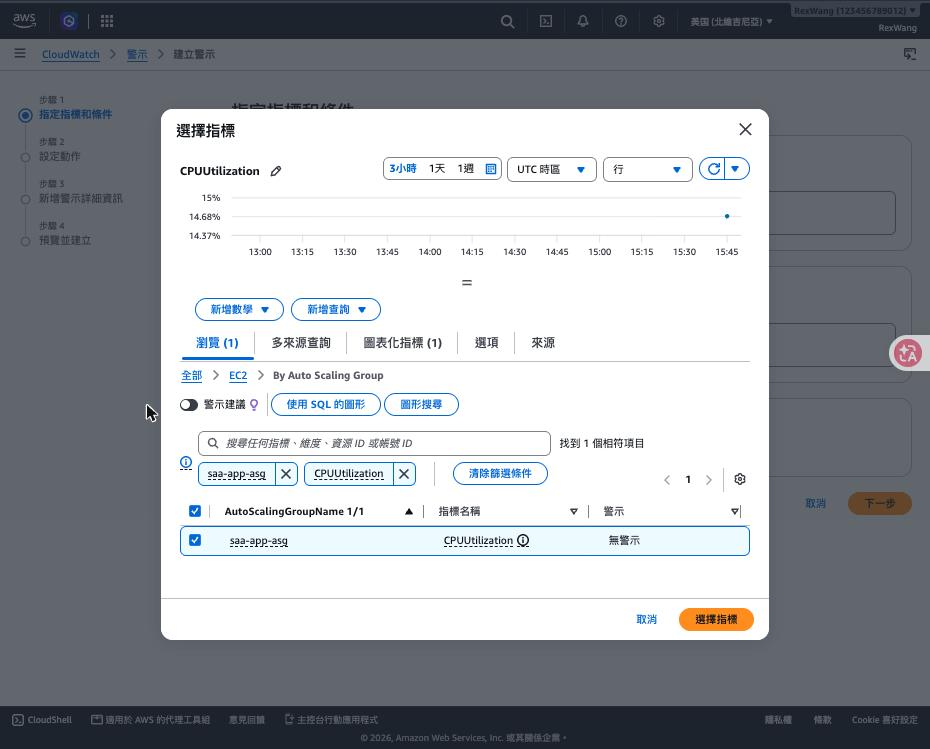

### Step 7-3　設定條件

靜態閾值、**大於** `70`，期間 5 分鐘、統計平均數。

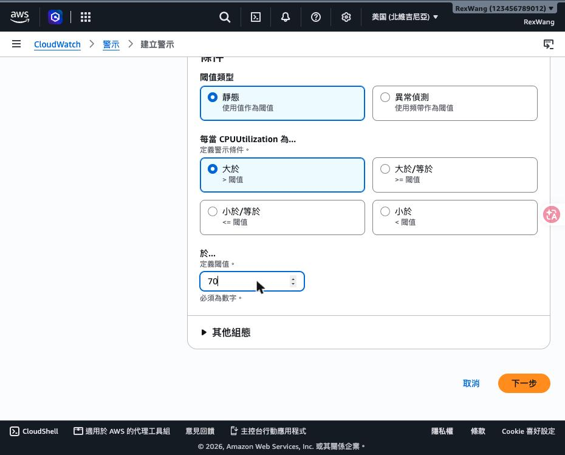

### Step 7-4　設定動作

警示狀態「警示中」時，傳送通知至現有主題 `saa-alerts`。

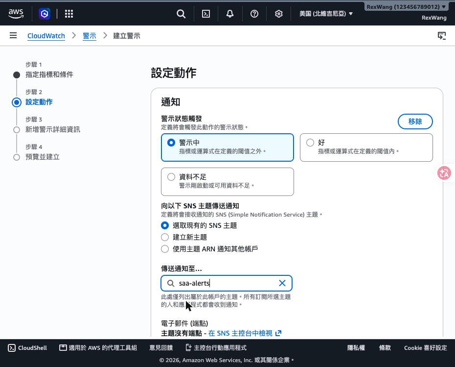

### Step 7-5　命名並建立

名稱 `saa-asg-high-cpu` → 預覽 → **建立警示**。

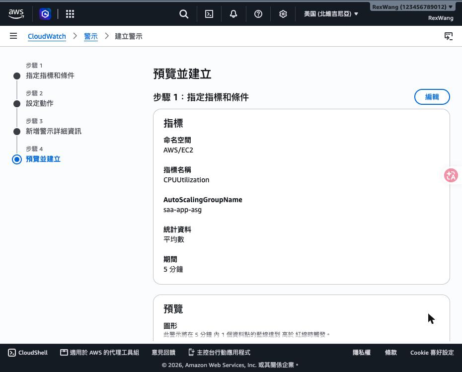

### 驗證（不需真的拉高 CPU）

```bash
aws cloudwatch set-alarm-state --alarm-name saa-asg-high-cpu --state-value ALARM --state-reason "manual test"
```

### CLI 等效

```bash
./scripts/07-cloudwatch-sns.sh
```

### ✅ 考試重點

- EC2 預設指標不含**記憶體與磁碟使用率** → 需安裝 **CloudWatch Agent**
- 誰呼叫了什麼 API → **CloudTrail**；資源設定是否合規、設定變更歷史 → **AWS Config**
- 事件驅動自動化（排程、狀態變更）→ **EventBridge**
- 警示動作可以是：SNS、Auto Scaling、EC2 動作（停止/重新開機/復原）、Systems Manager

---

## Lab 8：Lambda + DynamoDB 無伺服器 API

**目標**：Lambda 寫入/讀取 DynamoDB，執行角色只給必要的兩個動作。
**考試領域**：設計高效能、成本最佳化的架構

### Step 8-1　建立 DynamoDB 資料表

**DynamoDB → 資料表 → 建立資料表**：名稱 `saa-orders`，分區索引鍵 `order_id`（字串）。

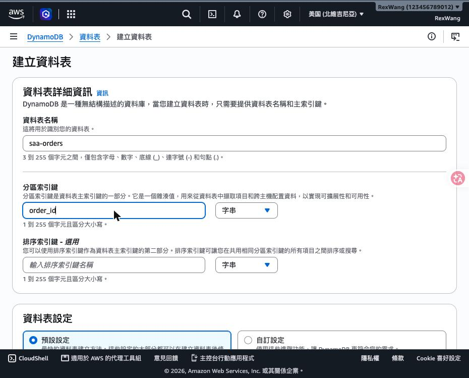

### Step 8-2　預設設定：隨需容量

保持 **預設設定**：容量模式 **隨需**、加密使用 AWS 擁有的金鑰 → **建立資料表**。

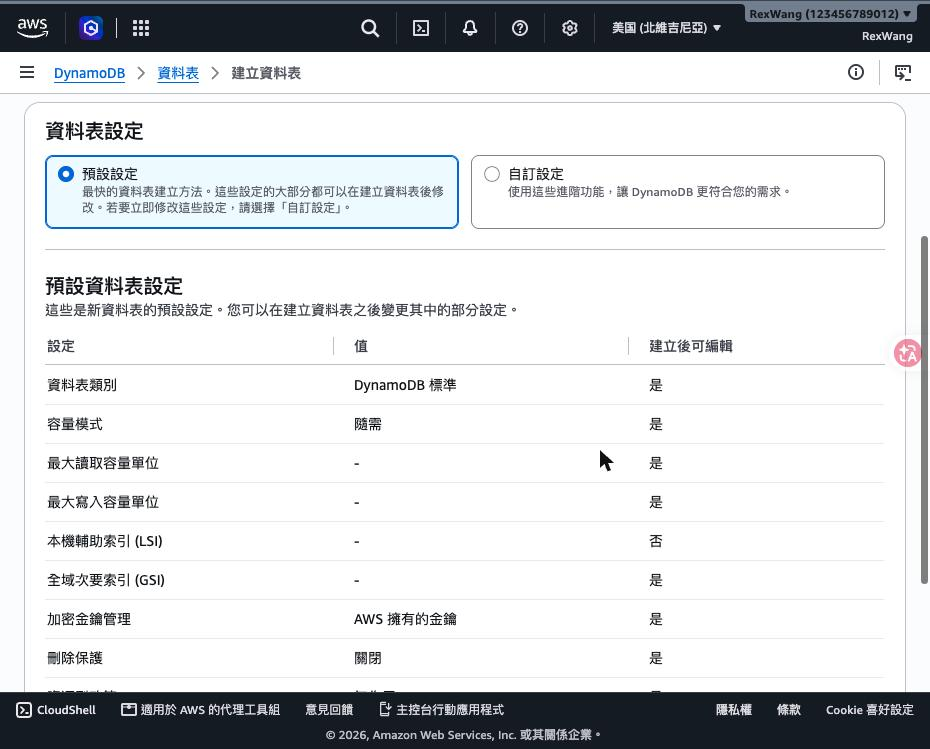

### Step 8-3　建立 Lambda 函式

**Lambda → 建立函式 → 從頭開始撰寫**：名稱 `saa-order-api`、執行時期 **Python**（截圖當下最新為 3.14；腳本使用 3.13，兩者皆可）。權限保持「建立具有基本 Lambda 許可的新角色」。

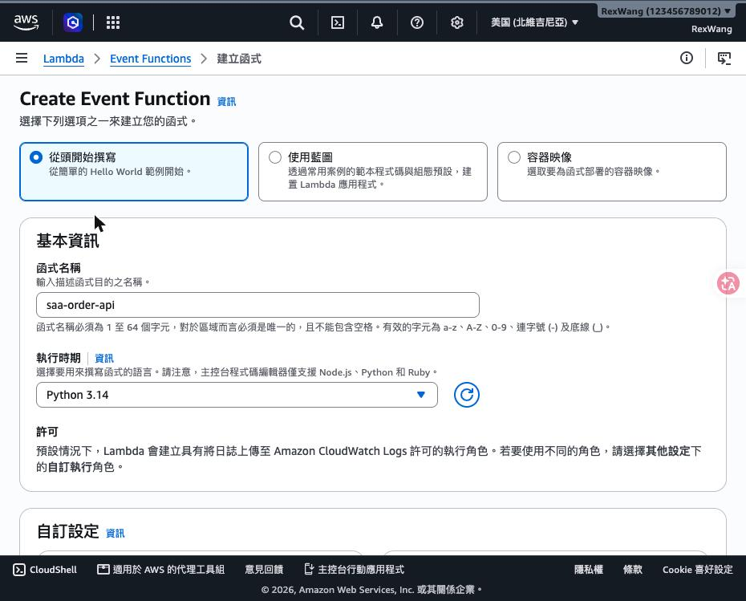

### Step 8-4　部署程式碼並授權 DynamoDB

程式碼在 [`lambda/lambda_function.py`](lambda/lambda_function.py)。在 CloudShell：

```bash
cd lambda && zip -q ../fn.zip lambda_function.py && cd ..
aws lambda update-function-code --function-name saa-order-api --zip-file fileb://fn.zip
aws lambda update-function-configuration --function-name saa-order-api \
  --environment 'Variables={TABLE_NAME=saa-orders}'

ROLE=$(aws lambda get-function-configuration --function-name saa-order-api --query Role --output text | awk -F/ '{print $NF}')
aws iam put-role-policy --role-name $ROLE --policy-name saa-orders-rw \
  --policy-document file://policies/lambda-dynamodb-policy.json
```

### Step 8-5　呼叫並查詢資料

```bash
aws lambda invoke --function-name saa-order-api --cli-binary-format raw-in-base64-out \
  --payload file://lambda/events/create-order.json out1.json && cat out1.json
aws lambda invoke --function-name saa-order-api --cli-binary-format raw-in-base64-out \
  --payload file://lambda/events/get-order.json out2.json && cat out2.json
aws dynamodb scan --table-name saa-orders --output table
```

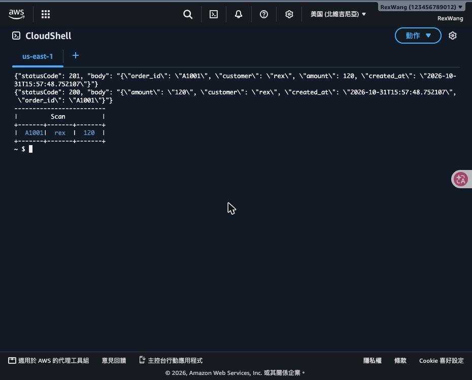

### CLI 等效

```bash
./scripts/08-lambda-dynamodb.sh
```

### ✅ 考試重點

| 需求 | 答案 |
|---|---|
| 毫秒級鍵值查詢、無伺服器 | DynamoDB |
| 讀取延遲降到微秒 | **DAX** |
| 多區域主動-主動 | DynamoDB **Global Tables** |
| 資料變更觸發處理 | **DynamoDB Streams** + Lambda |
| 流量無法預測 | **隨需容量**；穩定可預測 → 佈建容量 + Auto Scaling |
| 自動過期資料 | **TTL** |
| Lambda 限制 | 最長 15 分鐘、記憶體 128 MB–10 GB；長時間任務改用 ECS/Fargate 或 Step Functions |
| 冷啟動敏感 | Provisioned Concurrency |

---

## Lab 9：CloudFront + OAC 保護私有 S3

**目標**：S3 維持「封鎖所有公開存取」，只允許 CloudFront 透過 **Origin Access Control (OAC)** 讀取。
**考試領域**：設計安全與高效能的架構

### Step 9-1　選擇計費方案

**CloudFront → 分佈 → 建立分發**。新版精靈先選方案；練習選 **按使用量付費**。


> 「統一定價方案」是月費制（含 WAF、DDoS 防護等），適合想要固定帳單的情境。

### Step 9-2　指定原始伺服器（S3 + OAC）

1. 入門：分發名稱 `saa-lab-site`、類型 **單一網站組態**
2. 來源類型 **Amazon S3**，S3 origin 填 `<bucket>.s3.us-east-1.amazonaws.com`
3. 勾選 **允許私有 S3 儲存貯體存取 CloudFront（建議）** → 主控台會自動建立 OAC，並**自動更新 Bucket Policy**
4. 原始伺服器與快取設定使用建議值


自動寫入的 Bucket Policy 等同 [`policies/s3-oac-bucket-policy.template.json`](policies/s3-oac-bucket-policy.template.json)：Principal 是 `cloudfront.amazonaws.com`，並以 `AWS:SourceArn` 限定**只有這個 Distribution** 能讀。

### Step 9-3　安全性（WAF）

正式環境建議啟用；練習為避免費用選 **不要啟用安全保護**。


### Step 9-4　檢閱並建立


建立後會取得 `xxxxxx.cloudfront.net` 網域，狀態「正在部署」約數分鐘。


### Step 9-5　驗證

```bash
curl -s https://<分發網域>/index.html                         # 透過 CloudFront：200，看到 v2
curl -s -o /dev/null -w '%{http_code}\n' \
  https://<bucket>.s3.us-east-1.amazonaws.com/index.html       # 直接打 S3：403
```


> 同一張截圖下半部是 Lab 6 的 RDS 狀態：`MultiAZ=True`、主要在 us-east-1a、待命在 us-east-1b、`Public=False`。

### CLI 等效

```bash
./scripts/09-cloudfront.sh   # 會設定 DefaultRootObject=index.html 與強制 HTTPS
```

### ✅ 考試重點

- 私有 S3 給 CloudFront → **OAC**（新方案）；OAI 是舊方案
- 限制特定國家 → CloudFront **Geo Restriction**；付費內容 → **Signed URL / Signed Cookie**
- 動態內容 + 全球加速、非 HTTP（TCP/UDP）、固定 Anycast IP → **Global Accelerator**
- 自訂網域 HTTPS 憑證 → ACM 憑證必須在 **us-east-1**
- 更新內容立即生效 → **Invalidation** 或使用版本化檔名

---

## Lab 10：Route 53 私有託管區域與 Alias

**目標**：VPC 內用 `app.saa.internal` 存取 ALB。
**考試領域**：設計具彈性的架構

### Step 10-1　建立私有託管區域

**Route 53 → 託管區域 → 建立託管區域**：網域 `saa.internal`、類型 **私有託管區域**。


### Step 10-2　關聯 VPC

區域 **美國東部（維吉尼亞北部）**、VPC 選 `saa-lab-vpc`。VPC 必須開啟 `enableDnsHostnames` 與 `enableDnsSupport`（Lab 2 已勾選）。


### Step 10-3　建立 Alias 記錄

**建立紀錄**：

| 欄位 | 值 |
|---|---|
| 紀錄名稱 | `app` |
| 紀錄類型 | A |
| 別名 | 開啟 |
| 將流量路由至 | Application 和 Classic Load Balancer 的別名 → us-east-1 → 選 `saa-app-alb` |
| 評估目標運作狀態 | 是 |


### Step 10-4　在 VPC 內驗證

透過 Session Manager 登入 `saa-web-01`：

```bash
getent hosts app.saa.internal
curl -s http://app.saa.internal/
```


### CLI 等效

```bash
./scripts/10-route53.sh   # 透過 SSM Run Command 驗證，不需互動登入
```

### ✅ 考試重點

| 路由政策 | 用途 |
|---|---|
| Simple | 單一資源 |
| Weighted | 依比例分流（藍綠/金絲雀） |
| Latency | 導向延遲最低的區域 |
| Failover | 主備切換（搭配 Health Check） |
| Geolocation | 依使用者所在地（合規、在地化內容） |
| Geoproximity | 依地理距離並可加權偏移（Traffic Flow） |
| Multivalue Answer | 回傳多個健康的 IP |
| IP-based | 依來源 CIDR |

- **Alias vs CNAME**：Alias 可用於網域根（zone apex，如 `example.com`）、查詢 AWS 資源不收費；CNAME 不能用在根網域

---

## Lab 11：SNS → SQS 扇出解耦

**目標**：一則 SNS 訊息同時送到多個 SQS 佇列（本 Lab 示範一個），讓下游非同步處理。
**考試領域**：設計具彈性的架構（解耦）

### Step 11-1　建立 SQS 佇列

**SQS → 建立佇列**：類型 **標準**、名稱 `saa-order-queue`，其他保持預設。


### Step 11-2　訂閱 SNS 主題

佇列詳細頁 → **SNS 訂閱** 分頁 → **訂閱 Amazon SNS 主題** → 選 `saa-alerts` → 儲存。
主控台會自動在佇列存取政策中允許該主題 `sqs:SendMessage`。


### Step 11-3　發佈並接收

```bash
TOPIC=$(aws sns list-topics --query "Topics[?ends_with(TopicArn,':saa-alerts')].TopicArn" --output text)
Q=$(aws sqs get-queue-url --queue-name saa-order-queue --query QueueUrl --output text)
aws sns publish --topic-arn $TOPIC --subject OrderCreated --message '{"order_id":"A1003","amount":95}'
aws sqs receive-message --queue-url $Q --max-number-of-messages 10 --wait-time-seconds 5 --output json \
  | jq -r '.Messages[].Body | fromjson | "\(.Type) | \(.Subject) | \(.Message)"'
```


### CLI 等效

```bash
./scripts/11-sqs-sns-fanout.sh
```

### ✅ 考試重點

| 需求 | 答案 |
|---|---|
| 一對多廣播 | SNS（扇出到多個 SQS） |
| 削峰填谷、生產者與消費者解耦 | SQS |
| 嚴格順序、不重複 | SQS **FIFO**（MessageGroupId、去重） |
| 處理失敗的訊息 | **Dead-Letter Queue** |
| 減少空輪詢成本 | **Long Polling**（WaitTimeSeconds 最多 20 秒） |
| 處理時間比可見性逾時長 | 延長 **Visibility Timeout** |
| 依佇列長度擴展 Worker | ASG 依 `ApproximateNumberOfMessagesVisible`（或每台 backlog）擴展 |
| 即時串流、多消費者重播 | Kinesis Data Streams |
| 依事件內容路由到多個 SaaS/服務 | EventBridge |

---

## Lab 12：KMS 加解密與 Secrets Manager

**目標**：建立客戶受管金鑰（CMK）加解密資料，並檢視 RDS 自動託管在 Secrets Manager 的密碼。
**考試領域**：設計安全的架構

### Step 12-1　設定金鑰

**KMS → 客戶受管金鑰 → 建立金鑰**：金鑰類型 **對稱**、用途 **加密和解密**。


### Step 12-2　別名與描述

別名 `saa-lab-key`，描述 `SAA lab customer managed key`。接著可按 **跳至 檢閱**。


### Step 12-3　檢閱金鑰政策

預設金鑰政策把權限交給帳號 root，再由 IAM 政策控管誰能用：


> ⚠️ 不要在金鑰政策裡移除帳號自身的管理權限，否則可能造成「沒人能管理這把金鑰」，只能找 AWS Support。

按 **完成**。

### Step 12-4　加密與解密

```bash
echo 'card-token: tok_demo_4242' > plain.txt
aws kms encrypt --key-id alias/saa-lab-key --plaintext fileb://plain.txt \
  --query CiphertextBlob --output text > cipher.b64
base64 -d cipher.b64 > cipher.bin
aws kms decrypt --ciphertext-blob fileb://cipher.bin --query Plaintext --output text | base64 -d
aws kms describe-key --key-id alias/saa-lab-key --output table
```


> 示範資料是假的 token。KMS 單次加密上限 4 KB；大檔案用 **Envelope Encryption**（`GenerateDataKey` 產生資料金鑰，在本地加密資料）。

### Step 12-5　Secrets Manager：RDS 託管密碼

**Secrets Manager → 機密**，可看到 `rds!db-...`，描述指向 `saa-lab-mysql`。應用程式以 IAM 權限呼叫 `GetSecretValue` 取得密碼，不需寫在程式碼或設定檔。


### CLI 等效

```bash
./scripts/12-kms-secrets.sh
```

### ✅ 考試重點

| 需求 | 答案 |
|---|---|
| 自動輪替資料庫密碼 | **Secrets Manager** |
| 一般設定值、便宜、可放 SecureString | SSM **Parameter Store** |
| 金鑰需要自己控管、可稽核使用紀錄 | KMS **客戶受管金鑰** + CloudTrail |
| 硬體專屬、FIPS 140-3 Level 3、客戶獨佔 | **CloudHSM** |
| 跨區使用同一把金鑰加解密 | KMS **Multi-Region Keys** |
| 公開憑證、自動續約 | **ACM** |
| 刪除 KMS 金鑰 | 只能**排程刪除**，等待期 7–30 天，期間可取消 |

---

## Lab 99：清除所有資源

> ⚠️ 會永久刪除 S3 物件、RDS、DynamoDB 等資料。

### 腳本清除（建議）

```bash
./scripts/99-cleanup.sh     # 會要求輸入 yes 確認
```

### 手動清除的正確順序

| 順序 | 資源 | 原因 |
|---|---|---|
| 1 | CloudFront：**先停用**，部署完成後才能刪除；再刪 OAC | 啟用中的分發不能刪 |
| 2 | Auto Scaling Group（強制刪除）→ ALB → Target Group → Launch Template | ASG 會一直補機器 |
| 3 | EC2 執行個體 | — |
| 4 | RDS（略過最終快照、刪除自動備份）→ DB 子網路群組 | RDS 託管的 Secrets Manager 密碼會一併刪除 |
| 5 | Lambda、Log Group、DynamoDB、CloudWatch Alarm、SNS、SQS | — |
| 6 | Route 53：先刪 Alias 記錄，再刪託管區域 | 非 SOA/NS 記錄存在時不能刪區域 |
| 7 | KMS 金鑰：排程刪除（7 天） | 不能立即刪除 |
| 8 | S3：刪除**所有版本與刪除標記**後再刪 Bucket | 開了版本控制，`aws s3 rm` 只會產生刪除標記 |
| 9 | NAT Gateway → 釋放 Elastic IP → VPC Endpoint | NAT 與 EIP 會持續計費 |
| 10 | Security Group（先撤銷互相參照的規則）→ 子網路 → 路由表 → IGW → VPC | 依賴關係 |
| 11 | IAM：角色（先從 Instance Profile 移除）、使用者、群組 | — |

### 清除後檢查

```bash
aws ec2 describe-nat-gateways --filter Name=state,Values=available,pending --query 'length(NatGateways)'
aws ec2 describe-addresses --query 'length(Addresses)'
aws elbv2 describe-load-balancers --query 'length(LoadBalancers)'
aws rds describe-db-instances --query 'length(DBInstances)'
aws cloudfront list-distributions --query 'DistributionList.Quantity'
```

全部回傳 `0`（CloudFront 無分發時為 `null`）即完成。隔天再到 **Billing → Bills** 確認。

---

## 實作中踩到的坑（考試也愛考）

| # | 現象 | 原因 | 解法 |
|---|---|---|---|
| 1 | EC2 啟動精靈預設建立 `launch-wizard-N` SG，並開 **SSH 0.0.0.0/0** | 精靈的預設值 | 改選「選取現有的安全群組」 |
| 2 | 自建 VPC 的公有子網路啟動 EC2 沒有公有 IP | 子網路「自動指派公有 IP」預設停用 | 啟動時改為啟用，或修改子網路屬性 |
| 3 | 從 ASG 精靈順便建的 ALB 回應 502、外部連不進 | ALB 沿用了啟動範本的 `saa-app-sg` | 改成 `saa-alb-sg`，或先獨立建 ALB |
| 4 | RDS 估算費用異常高 | 預設儲存是 **io2 400 GiB** | 改 gp3 20 GiB |
| 5 | RDS 刪不掉 | 預設勾選**刪除保護** | 建立時取消，或先修改設定 |
| 6 | 有版本控制的 Bucket 刪不掉 | 還有舊版本與刪除標記 | 刪除所有 Version 與 DeleteMarker |
| 7 | CloudFront 刪不掉 | 分發仍在啟用狀態 | 先停用，等部署完成 |
| 8 | ASG 刪除後 EC2 還在跑一段時間 | 刪除是非同步 | 等待或手動終止 |
| 9 | 主控台改版（S3 命名空間、CloudFront 方案、Regional NAT、Lambda 新建立頁） | AWS 持續更新 | 以欄位名稱與概念為準 |

---

## 考試情境速查表

| 關鍵字 | 優先想到 |
|---|---|
| 「最少營運負擔」「全受管」 | Serverless：Lambda、Fargate、DynamoDB、Aurora Serverless、S3 |
| 「最具成本效益」+ 可中斷 | Spot Instances |
| 「穩定長期 1/3 年」 | Savings Plans / Reserved Instances |
| 「解耦」「緩衝尖峰」 | SQS |
| 「一對多通知」 | SNS（扇出） |
| 「全球使用者、靜態內容」 | CloudFront |
| 「非 HTTP、固定 IP、全球加速」 | Global Accelerator |
| 「私有子網路存取 S3 不經網際網路」 | Gateway Endpoint |
| 「跨帳號存取」 | IAM Role + Trust Policy（AssumeRole） |
| 「多帳號治理」 | Organizations + SCP、Control Tower |
| 「稽核 API 呼叫」 | CloudTrail |
| 「資料庫密碼自動輪替」 | Secrets Manager |
| 「防 SQL Injection / XSS」 | WAF |
| 「DDoS」 | Shield（Advanced 提供 DDoS 成本保護與 Shield Response Team 支援） |
| 「找出 S3 中的個資」 | Macie |
| 「威脅偵測」 | GuardDuty |
| 「共享檔案系統、Linux、多 AZ」 | EFS |
| 「Windows 共享檔案（SMB）」 | FSx for Windows File Server |
| 「HPC、與 S3 整合」 | FSx for Lustre |
| 「地端大量資料離線搬遷」 | Snowball |
| 「地端持續同步到 AWS」 | DataSync；檔案閘道 → Storage Gateway |
| 「資料庫遷移、異質引擎」 | DMS + SCT |
| 「RTO/RPO 最小、成本最高」 | Multi-Site Active/Active；成本低到高：Backup & Restore → Pilot Light → Warm Standby → Active/Active |

更多練習題請見 [`docs/practice-questions.md`](docs/practice-questions.md)。

---

## Repo 結構

```text
aws-saa-preparation/
├── README.md                      # 本教學（Step by Step + 截圖）
├── images/                        # 70 張主控台截圖（帳號 ID 已遮蔽）
├── scripts/
│   ├── 00-env.sh                  # 共用變數與狀態檔
│   ├── 01-iam.sh … 12-kms-secrets.sh
│   └── 99-cleanup.sh              # 依相依順序清除全部資源
├── userdata/web-userdata.sh       # EC2 User Data（nginx + IMDSv2）
├── lambda/
│   ├── lambda_function.py         # 訂單 API
│   └── events/*.json              # 測試事件
├── policies/                      # 信任政策、最小權限政策、OAC Bucket Policy、生命週期
├── test-data/site/                # 靜態網站與 orders.csv 測試資料
├── docs/practice-questions.md     # 模擬練習題與解析
└── slides/                        # 教學簡報（.pptx）
```

## 說明

截圖取自作者個人 AWS 帳號，帳號 ID 已替換為 `123456789012`。AWS 與相關服務名稱為 Amazon.com, Inc. 或其關係企業之商標。
